# Autonomous LLM Trader: Master Architecture, Harness Graph Engineering & Quantitative Workflows Specification

---

## Table of Contents
1. [Executive Summary & Foundational UAQP Architecture](#1-executive-summary--foundational-uaqp-architecture)
2. [Application Startup Sequence & Global Action Catalog](#2-application-startup-sequence--global-action-catalog)
3. [Harness Graph Engineering & Dual-Velocity Architecture](#3-harness-graph-engineering--dual-velocity-architecture)
4. [Institutional Quantitative Trading Workflows](#4-institutional-quantitative-trading-workflows)
5. [The Four Loops, Meta-RL & Self-Improvement Architecture](#5-the-four-loops-meta-rl--self-improvement-architecture)
6. [Backtesting, Overfitting Gates & Auto-Promotion](#6-backtesting-overfitting-gates--auto-promotion)
7. [Deterministic Safety, External Guardian & Compliance](#7-deterministic-safety-external-guardian--compliance)
8. [Autonomous Alpha Discovery & Factor Mining Engine](#8-autonomous-alpha-discovery--factor-mining-engine)
9. [Autonomous Strategy Discovery, Incubation & Lifecycle Governance](#9-autonomous-strategy-discovery-incubation--lifecycle-governance)
10. [Parameter Sweep, Stability Analysis & QUBO Rebalancing](#10-parameter-sweep-stability-analysis--qubo-rebalancing)
11. [Deep Meta-Improvement, Causal Feature Filtering & GRPO Proposers](#11-deep-meta-improvement-causal-feature-filtering--grpo-proposers)
12. [Neuro-Symbolic Crash Detection, Persistence & Recovery](#12-neuro-symbolic-crash-detection-persistence--recovery)
13. [Factor Portfolio Models & Microstructure Mathematical Foundations](#13-factor-portfolio-models--microstructure-mathematical-foundations)
14. [Runtime Launch Topology & Process Architecture (START_DECK.bat)](#14-runtime-launch-topology--process-architecture-start_deckbat)
15. [Dual-Process IPC & Synchronization Topology](#15-dual-process-ipc--synchronization-topology)
16. [The 3-Phase Autonomous Trading Engine Bootstrap Sequence](#16-the-3-phase-autonomous-trading-engine-bootstrap-sequence)
17. [Empirical Headless Verification & Live Workflow Telemetry](#17-empirical-headless-verification--live-workflow-telemetry)
18. [Interactive Archify Diagram Suite](#interactive-archify-diagram-suite)

---

### Interactive Archify Diagram Suite

Self-contained, interactive HTML diagrams with dark/light themes, motion animations, and pan/zoom capabilities generated via **Archify**:

| Diagram | Type | Interactive HTML Artifact | Description |
|:---|:---|:---|:---|
| **01. Master System Architecture** | `architecture` | [Open HTML Diagram](file:///c:/Users/User/OneDrive/Desktop/selfmade%20game%20projects/llm%20trader%20-%20Checkpoint%20dicisipline%20soilder%20-%20used%20in%20antigravity/docs/diagrams/01_master_architecture.html) | Dual-velocity runtime, risk guardian ($\Psi$), execution boundary, and compliance ledger |
| **02. 11-Stage Tick Pipeline V2** | `workflow` | [Open HTML Diagram](file:///c:/Users/User/OneDrive/Desktop/selfmade%20game%20projects/llm%20trader%20-%20Checkpoint%20dicisipline%20soilder%20-%20used%20in%20antigravity/docs/diagrams/02_tick_pipeline_v2.html) | Pipeline maintenance (01-05), envelope (06-08), and finalization stages (09-11) |
| **03. Fast Execution Loop (L1)** | `sequence` | [Open HTML Diagram](file:///c:/Users/User/OneDrive/Desktop/selfmade%20game%20projects/llm%20trader%20-%20Checkpoint%20dicisipline%20soilder%20-%20used%20in%20antigravity/docs/diagrams/03_fast_execution_loop.html) | Sub-millisecond tick-to-fill execution trace, fail-closed risk checks, and ledger audit |
| **04. Alpha Discovery & Causal Pipeline** | `dataflow` | [Open HTML Diagram](file:///c:/Users/User/OneDrive/Desktop/selfmade%20game%20projects/llm%20trader%20-%20Checkpoint%20dicisipline%20soilder%20-%20used%20in%20antigravity/docs/diagrams/04_alpha_discovery_dataflow.html) | Ralph Loop AST generation, lookahead guards, Gram-Schmidt $\psi$, and QUBO allocation |
| **05. Strategy Incubation Lifecycle** | `lifecycle` | [Open HTML Diagram](file:///c:/Users/User/OneDrive/Desktop/selfmade%20game%20projects/llm%20trader%20-%20Checkpoint%20dicisipline%20soilder%20-%20used%20in%20antigravity/docs/diagrams/05_strategy_lifecycle.html) | Candidate synthesis, CPCV/PBO gating, forward paper incubation, and alpha decay retirement |

---

## 1. Executive Summary & Foundational UAQP Architecture

The Autonomous LLM Trader is an institutional-grade, multi-agent quantitative trading system operating on MetaTrader 5 (MT5). It is engineered under the **Universal Autonomous Quant Protocol (UAQP)** specification, adhering to the foundational principle:

$$\Gamma_{\text{deployed}} = (\Gamma, \Psi)$$

Where:
- $\mathbf{\Gamma} = (A, E, S, \Phi, \Theta, T)$: The multi-agent trading graph comprising autonomous agents ($A$), relational edges ($E$), the authoritative State Tensor ($S$), state transformation functions ($\Phi$), priority orchestrator scheduling ($\Theta$), and trigger mechanisms ($T$).
- $\mathbf{\Psi}$: The **External Guardian**—an out-of-process, fail-closed risk daemon that interfaces directly with the broker API, operating strictly independent of $\Gamma$ to eliminate single points of failure.

### Core Architectural Axiom: Stateless Agents, Stateful Graph
Every agent $\alpha, \sigma, \beta, \rho, \epsilon, \mu, \omega, \zeta, \kappa$ is strictly stateless. When an agent activates, it ingests a point-in-time slice of the State Tensor $S(t)$, performs deterministic or model-based computation, emits an immutable event payload back to $S(t+1)$, and terminates.

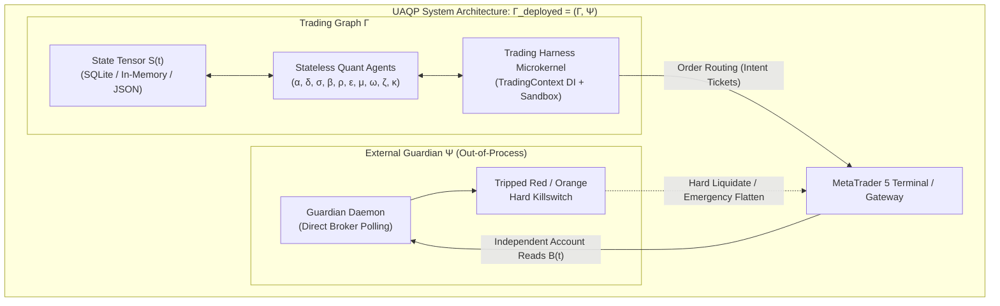

---

## 2. Application Startup Sequence & Global Action Catalog

### 2.1 Complete Startup Lifecycle ($t_0 \to t_{\text{run}}$)

The execution flow begins through either CLI triggers or automated batch launchers:

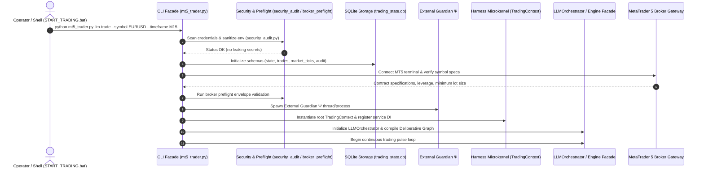

1. **Launcher Scripts**:
   - `START_TRADING.bat`: Bootstraps the terminal, verifies Python virtual environments, and invokes `mt5_trader.py llm-trade` with designated symbols.
   - `START_DECK.bat`: Launches the OpenTUI Command Deck (`tui_opentui/`) attached to the internal WebSocket bridge (`gui_api.py:8000`).
   - `start_gui.bat`: Spawns the desktop Tkinter terminal interface (`ui/gui_launcher.py`).
   - `launch_observatory.bat`: Spawns real-time log tailers and browser-based telemetry dashboards.

2. **Preflight & Broker Specification Capture**:
   - Executed via [`broker_preflight.py`](file:///c:/Users/User/OneDrive/Desktop/selfmade%20game%20projects/llm%20trader%20-%20Checkpoint%20dicisipline%20soilder%20-%20used%20in%20antigravity/core/broker_preflight.py).
   - Validates trading mode (Market, Instant, Exchange), freeze levels, minimum/maximum order volumes, volume steps, stop distance constraints, and margin calculation formulas.

3. **Database Schema Enforcement**:
   - [`trading_safety.py`](file:///c:/Users/User/OneDrive/Desktop/selfmade%20game%20projects/llm%20trader%20-%20Checkpoint%20dicisipline%20soilder%20-%20used%20in%20antigravity/core/trading_safety.py) provisions `trading_state.db`:
     - `state`: Durable key-value storage for risk metrics, heat budget, and killswitches.
     - `trades`: Authoritative open and closed trade journal.
     - `proposals`: Ingested LLM and technical trade proposals.
     - `trade_lifecycle_events`: Timestamped audit events (submission, fill, slippage, partial close, trailing stop modification).
     - `position_observations`: High-frequency MFE/MAE mark-to-market snapshots.
     - `market_ticks`: Raw ingested tick and bar data.
   - [`compliance_audit.py`](file:///c:/Users/User/OneDrive/Desktop/selfmade%20game%20projects/llm%20trader%20-%20Checkpoint%20dicisipline%20soilder%20-%20used%20in%20antigravity/core/compliance_audit.py) initializes `compliance_audit.db` with a SHA-256 cryptographic hash-chain.

---

### 2.2 Exhaustive CLI Subcommand & Action Catalog

The root CLI entrypoint [`mt5_trader.py`](file:///c:/Users/User/OneDrive/Desktop/selfmade%20game%20projects/llm%20trader%20-%20Checkpoint%20dicisipline%20soilder%20-%20used%20in%20antigravity/mt5_trader.py) exposes the following explicit subcommands:

| Subcommand | Handler / Module | Primary Parameters | Operational Action Performed |
|---|---|---|---|
| `llm-trade` | `LLMOrchestrator` | `--symbol`, `--timeframe`, `--paper`, `--demo`, `--live`, `--harness`, `--continuous`, `--strategies` | Main production decision loop; executes multi-agent deliberation, risk arbitration, and broker execution. |
| `harness` | `core.harness.kernel` | `mode` (`run`, `eval`, `benchmark`, `code`, `creator`, `audit`, `info`), `--continuous`, `--interval` | Invokes the DeepSeek-Harness/Cordis microkernel, evaluating speculative forks and capability-sandboxed tools. |
| `workflow` | `core.harness.workflows` | `type` (`statarb`, `mean-reversion`, `macro-momentum`, `microstructure`, `neural-kronos`, `macro-event`, `news`), `--symbol`, `--pair-asset` | Executes isolated, end-to-end quantitative trading workflows with full step-by-step telemetry. |
| `backtest` | `alpha_backtest_harness` | `--symbol`, `--timeframe`, `--engine` (`vectorbt`, `mt5`, `hybrid`), `--fast`, `--slow`, `--sweep` | Runs dual-engine backtesting (fast VectorBT parameter screening + tick-accurate MT5 replay). |
| `news-gate-backtest` | `news_gate_backtest` | `--symbol`, `--timeframe`, `--days`, `--synthetic` | Tests macroeconomic news blackout windows and evaluates risk degradation during high-impact releases. |
| `macro` | `macrofundamental_pipeline` | `--symbol`, `--query`, `--nowcast` | Ingests FRED, zero-lag physical proxies, and updates the 134-node macroeconomic causal graph. |
| `deck` | `tui_opentui` | (None) | Boots the unified OpenTUI terminal command deck communicating over IPC/WebSockets. |
| `nexus` | `ui.nexus` | (None) | Launches the Quant Nexus TUI displaying all UAQP agent states, live ticks, and causal DAG nodes. |
| `journal` | `journal_audit` | `integrity`, `readiness-status`, `export` | Audits the SQLite trade journal across all 14 non-negotiable compliance rules. |
| `memory-core` | `local_agent_memory` | `propose`, `review`, `list` | Inspects and consolidates L0-L3 memory layers without granting execution permissions. |
| `kill-switch` | `external_guardian` | `status`, `trip`, `reset` | Queries or modifies the persistent multi-tiered emergency trading killswitch. |
| `provider-circuit` | `provider_circuit` | `status`, `reset` | Manages LLM provider failover breakers (OpenRouter, Cerebras, NVIDIA NIM, Local). |
| `broker-preflight` | `broker_preflight` | `--symbols` | Queries broker constraints, margin modes, and symbol lot steps. |
| `data` | `market_data_provider` | `--symbol`, `--timeframe`, `--count`, `--indicators` | Fetches OHLC bars and computes technical indicators into point-in-time tensors. |
| `pending-order` | `order_execution` | `--symbol`, `--type`, `--price`, `--volume`, `--sl`, `--tp` | Submits an immutable planned pending order (LIMIT/STOP) through safety filters. |
| `cancel-order` | `order_execution` | `--order-id` | Cancels an active pending order across paper or live broker targets. |
| `modify-order` | `order_execution` | `--symbol`, `--sl`, `--tp` | Modifies protective stops for existing open positions. |
| `positions` | `trade_manager` | (None) | Lists currently active open positions with live floating PnL. |
| `orders` | `trade_manager` | (None) | Displays active broker pending orders. |
| `account-info` | `client` | `--config` | Reports real-time equity, balance, leverage, and margin availability. |
| `meta-audit` | `auto_quant_tools` | (None) | Executes self-diagnosing architectural health and state tensor integrity checks. |
| `pipeline-status` | `bounded_autonomy` | (None) | Displays the lifecycle board for discovered alpha strategies and promotion gates. |

---

## 3. Harness Graph Engineering & Dual-Velocity Architecture

The Harness Graph represents the spatial and temporal engineering foundation of the system, unifying dependency injection, capability sandboxing, and LangGraph-compiled state machines.

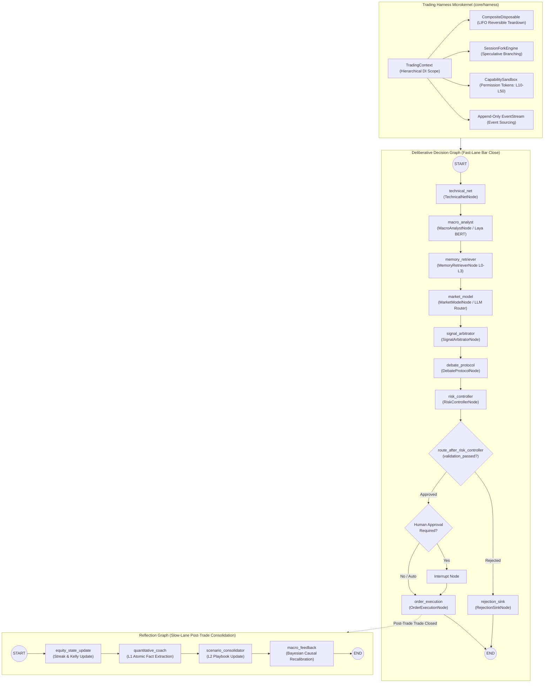

### 3.1 The Microkernel Subsystems (`core/harness/`)

1. **[`TradingContext`](file:///c:/Users/User/OneDrive/Desktop/selfmade%20game%20projects/llm%20trader%20-%20Checkpoint%20dicisipline%20soilder%20-%20used%20in%20antigravity/core/harness/kernel.py)**:
   - Implements **spatial composability**. Contexts form an acyclic tree: `RootContext` $\to$ `CycleScope` $\to$ `BranchScope`.
   - Child contexts inherit registered services (`risk_manager`, `broker`, `market_data`, `deterministic_validator`) via lexical traversal while maintaining isolated local state dictionaries.
   
2. **[`CompositeDisposable`](file:///c:/Users/User/OneDrive/Desktop/selfmade%20game%20projects/llm%20trader%20-%20Checkpoint%20dicisipline%20soilder%20-%20used%20in%20antigravity/core/harness/disposable.py)**:
   - Implements **temporal composability**. Every side effect, resource allocation, temporary lock, or open file handle registers a reversible closure.
   - When a trading cycle completes, aborts, or errors, calling `context.dispose()` triggers deterministic, reverse-order (LIFO) cleanup.

3. **[`SessionForkEngine`](file:///c:/Users/User/OneDrive/Desktop/selfmade%20game%20projects/llm%20trader%20-%20Checkpoint%20dicisipline%20soilder%20-%20used%20in%20antigravity/core/harness/session_fork.py)**:
   - Spawns speculative, counterfactual branches from the same point-in-time market snapshot:
     $$\text{Hypotheses} = \{\text{TrendFollowLong}, \text{TrendFollowShort}, \text{MeanRevertFade}\}$$
   - Evaluates each branch independently inside a child context.
   - Arbitrates the winning branch using risk-adjusted confidence scores; non-winning branches are cleanly disposed without contaminating global state.

4. **[`CapabilitySandbox`](file:///c:/Users/User/OneDrive/Desktop/selfmade%20game%20projects/llm%20trader%20-%20Checkpoint%20dicisipline%20soilder%20-%20used%20in%20antigravity/core/harness/sandbox.py)**:
   - Enforces cryptographic, least-privilege token access:
     - `READ_ONLY` ($10$): Market ticks, indicators, memory searches.
     - `ANALYTICAL` ($20$): Macro DAG traversal, feature vector generation.
     - `SIMULATION` ($30$): Paper trading, backtesting, counterfactual forks.
     - `ORDER_WRITE` ($40$): Live order routing, position modification, trade cancellation.
     - `SYSTEM_ADMIN` ($50$): Parameter updates, live rollout gating, risk limit modifications.

---

### 3.2 The Deliberative Trading Decision Graph (`intelligence/deliberative_graph.py`)

Compiled using LangGraph over [`TradingCycleState`](file:///c:/Users/User/OneDrive/Desktop/selfmade%20game%20projects/llm%20trader%20-%20Checkpoint%20dicisipline%20soilder%20-%20used%20in%20antigravity/intelligence/graph_state.py), this state machine drives bar-close deliberation:

```python
# Deliberative Graph Execution Chain
START >> technical_net >> macro_analyst >> memory_retriever >> market_model >> signal_arbitrator >> debate_protocol >> risk_controller
risk_controller --[validation_passed == True]--> order_execution >> END
risk_controller --[validation_passed == False]--> rejection_sink >> END
```

#### Detailed Node Operational Specifications:
1. **`technical_net` ([`TechnicalNetNode`](file:///c:/Users/User/OneDrive/Desktop/selfmade%20game%20projects/llm%20trader%20-%20Checkpoint%20dicisipline%20soilder%20-%20used%20in%20antigravity/intelligence/graph_nodes.py#L42))**:
   - Ingests completed candle bars (M15/H1).
   - Validates data quality: freshness ($\le 5000\text{ms}$), spread ($\le 2.5\text{ pips}$), zero volume rejection, and sequence gaps.
   - Computes EMA($12, 26, 50, 200$), RSI($14$), MACD($12, 26, 9$), ATR($14$), ADX($14$), Hull Moving Average, and Hurst Exponents.
2. **`macro_analyst` ([`MacroAnalystNode`](file:///c:/Users/User/OneDrive/Desktop/selfmade%20game%20projects/llm%20trader%20-%20Checkpoint%20dicisipline%20soilder%20-%20used%20in%20antigravity/intelligence/graph_nodes.py#L90))**:
   - Evaluates the macroeconomic state vector against the 134-node causal graph.
   - Employs **Laya ModernBERT-421M** for real-time text/economic release classification.
   - Outputs the Citigroup Economic Surprise Index (CESI) score, net liquidity stance, and active causal transmission channels.
3. **`memory_retriever` ([`MemoryRetrieverNode`](file:///c:/Users/User/OneDrive/Desktop/selfmade%20game%20projects/llm%20trader%20-%20Checkpoint%20dicisipline%20soilder%20-%20used%20in%20antigravity/intelligence/graph_nodes.py#L138))**:
   - Queries local SQLite stores (`local_agent_memory.db`) across 4 tiers:
     - **L0**: Recent raw execution traces and slippage profiles.
     - **L1**: Validated atomic market facts (e.g., "EURUSD false breakouts increase when US10Y is flat").
     - **L2**: Structured scenario playbooks matching current volatility/trend conditions.
     - **L3**: Distilled operational trading principles.
4. **`market_model` ([`MarketModelNode`](file:///c:/Users/User/OneDrive/Desktop/selfmade%20game%20projects/llm%20trader%20-%20Checkpoint%20dicisipline%20soilder%20-%20used%20in%20antigravity/intelligence/graph_nodes.py#L182))**:
   - Synthesizes technicals, macro vectors, and retrieved memories into structured prompt representations.
   - Dispatches inference requests through the multi-provider [`LLMRouter`](file:///c:/Users/User/OneDrive/Desktop/selfmade%20game%20projects/llm%20trader%20-%20Checkpoint%20dicisipline%20soilder%20-%20used%20in%20antigravity/data/llm_router.py) (Cerebras $\to$ OpenRouter $\to$ NVIDIA NIM $\to$ Local LLM).
   - Generates candidate [`TradeProposalPayload`](file:///c:/Users/User/OneDrive/Desktop/selfmade%20game%20projects/llm%20trader%20-%20Checkpoint%20dicisipline%20soilder%20-%20used%20in%20antigravity/intelligence/graph_state.py#L21) entries.
5. **`signal_arbitrator` ([`SignalArbitratorNode`](file:///c:/Users/User/OneDrive/Desktop/selfmade%20game%20projects/llm%20trader%20-%20Checkpoint%20dicisipline%20soilder%20-%20used%20in%20antigravity/intelligence/graph_nodes.py#L225))**:
   - Fuses multi-hypothesis signals with quantitative factors.
   - Computes hypothesis fusion scores and checks for signal conflicts (e.g. Trend Momentum Long vs Mean Reversion Short).
6. **`debate_protocol` ([`DebateProtocolNode`](file:///c:/Users/User/OneDrive/Desktop/selfmade%20game%20projects/llm%20trader%20-%20Checkpoint%20dicisipline%20soilder%20-%20used%20in%20antigravity/intelligence/graph_nodes.py#L270))**:
   - Conducts an adversarial bull vs. bear critique.
   - Challenges entry rationales, tests worst-case liquidity cascades, and enforces an agreement threshold ($> 0.70$) before risk submission.
7. **`risk_controller` ([`RiskControllerNode`](file:///c:/Users/User/OneDrive/Desktop/selfmade%20game%20projects/llm%20trader%20-%20Checkpoint%20dicisipline%20soilder%20-%20used%20in%20antigravity/intelligence/graph_nodes.py#L318))**:
   - Evaluates proposals against the fail-closed [`DeterministicValidator`](file:///c:/Users/User/OneDrive/Desktop/selfmade%20game%20projects/llm%20trader%20-%20Checkpoint%20dicisipline%20soilder%20-%20used%20in%20antigravity/core/trading_safety.py#L1040).
   - Sizes positions deterministically based on $1\%$ risk-per-trade:
     $$\text{Volume} = \frac{\text{Equity} \times \text{RiskPct}}{|\text{Entry} - \text{SL}| \times \text{TickValue}}$$
   - Enforces portfolio heat caps ($6.0\text{R}$), margin safety gates, and maximum active positions.
   - Constructs an immutable [`OrderIntentPayload`](file:///c:/Users/User/OneDrive/Desktop/selfmade%20game%20projects/llm%20trader%20-%20Checkpoint%20dicisipline%20soilder%20-%20used%20in%20antigravity/intelligence/graph_state.py#L47) if approved.
8. **`order_execution` ([`OrderExecutionNode`](file:///c:/Users/User/OneDrive/Desktop/selfmade%20game%20projects/llm%20trader%20-%20Checkpoint%20dicisipline%20soilder%20-%20used%20in%20antigravity/intelligence/graph_nodes.py#L380))**:
   - Routes approved intents to the broker (PaperBroker or live MT5 terminal).
   - Receives execution tickets and records fill slippage, execution latency, and initial stop-loss orders in the SQLite journal.
9. **`rejection_sink` ([`RejectionSinkNode`](file:///c:/Users/User/OneDrive/Desktop/selfmade%20game%20projects/llm%20trader%20-%20Checkpoint%20dicisipline%20soilder%20-%20used%20in%20antigravity/intelligence/graph_nodes.py#L430))**:
   - Traps all rejected proposals, logs the explicit gate rejection codes (e.g. `DATA_QUALITY_FAIL`, `EXPOSURE_LIMIT_EXCEEDED`, `SPREAD_TOO_WIDE`), and logs telemetry to the outbox without placing trades.

---

### 3.3 The Post-Trade Memory Reflection Graph (`intelligence/reflection_graph.py`)

Executed asynchronously upon trade closure to update the system's empirical beliefs:

1. **`equity_state_update` ([`EquityStateUpdateNode`](file:///c:/Users/User/OneDrive/Desktop/selfmade%20game%20projects/llm%20trader%20-%20Checkpoint%20dicisipline%20soilder%20-%20used%20in%20antigravity/intelligence/reflection_graph.py#L20))**:
   - Ingests realized PnL and trade return $R$-multiple.
   - Recalibrates consecutive win/loss counters, Kelly fraction inputs, and weekly drawdown tracking before the next deliberative cycle.
2. **`quantitative_coach` ([`QuantitativeCoachNode`](file:///c:/Users/User/OneDrive/Desktop/selfmade%20game%20projects/llm%20trader%20-%20Checkpoint%20dicisipline%20soilder%20-%20used%20in%20antigravity/intelligence/graph_nodes.py#L460))**:
   - Distills execution lessons into L1 Atomic Facts.
   - Evaluates whether stop-out was attributable to market regime shifts, wide execution slippage, or thesis invalidation.
3. **`scenario_consolidator` ([`ScenarioConsolidatorNode`](file:///c:/Users/User/OneDrive/Desktop/selfmade%20game%20projects/llm%20trader%20-%20Checkpoint%20dicisipline%20soilder%20-%20used%20in%20antigravity/intelligence/reflection_graph.py#L59))**:
   - Updates L2 Scenario Playbooks, refining empirical win rates and expected payouts for matched setup clusters.
4. **`macro_feedback` ([`MacroFeedbackNode`](file:///c:/Users/User/OneDrive/Desktop/selfmade%20game%20projects/llm%20trader%20-%20Checkpoint%20dicisipline%20soilder%20-%20used%20in%20antigravity/intelligence/reflection_graph.py#L81))**:
   - Applies Bayesian credit/blame assignment to active causal DAG paths. Edges that forecasted the market move receive posterior weight reinforcement; disconfirmed paths are penalized.

---

### 3.4 Production Pipeline Runner V2 (`core/harness/pipeline_v2.py`)

When `PIPELINE_V2=1` is active, the system executes an institutional staged pipeline wrapped in comprehensive span telemetry (`CYCLE_SPAN_START` and `CYCLE_SPAN_DONE`):

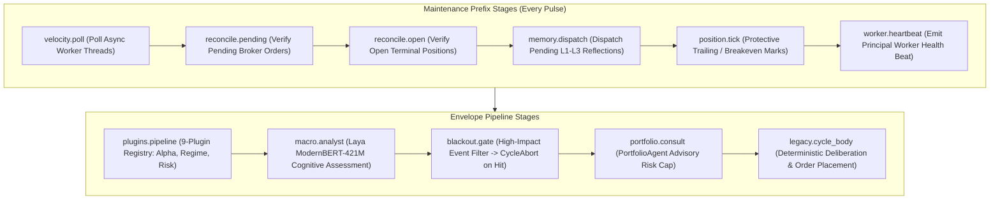

#### Stage Execution Contracts & Degradation Semantics:
Each stage is governed by a [`StageSpec`](file:///c:/Users/User/OneDrive/Desktop/selfmade%20game%20projects/llm%20trader%20-%20Checkpoint%20dicisipline%20soilder%20-%20used%20in%20antigravity/core/harness/stage_contracts.py) defining strict SLAs and fallback policies:
- `abort_cycle`: Emits `STAGE_ABORTED` and cleanly stops the cycle (e.g., `blackout.gate` during high-impact news releases).
- `degrade`: Catches exceptions, logs `STAGE_FAILED`, and marks the context `hold_only=True` (e.g., `plugins.pipeline` or `macro.analyst` failure prevents new trades without crashing the daemon).
- `skip`: Omits non-critical advisory stages (e.g., `portfolio.consult`).
- `continue`: Records the error in telemetry and continues execution.

---

## 4. Institutional Quantitative Trading Workflows (`core/harness/workflows.py`)

The system implements 7 specialized, mathematically grounded quantitative trading workflows, each executing as an isolated state machine implementing [`BaseTradingWorkflow`](file:///c:/Users/User/OneDrive/Desktop/selfmade%20game%20projects/llm%20trader%20-%20Checkpoint%20dicisipline%20soilder%20-%20used%20in%20antigravity/core/harness/workflows.py#L75):

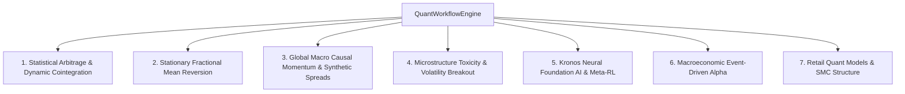

### 4.1 Statistical Arbitrage & Dynamic Cointegration Workflow
- **Mathematical Foundation**:
  1. Two-step **Engle-Granger Cointegration**: Regresses $y_t = \alpha + \beta x_t + \epsilon_t$ and runs Augmented Dickey-Fuller (ADF) tests on residuals $\epsilon_t$. Rejects pairs if $t_{\text{stat}} \ge -2.86$.
  2. **Kalman Filter State-Space Tracking**: Updates dynamic hedge ratio $\beta_t$ continuously:
     $$\beta_t = \beta_{t-1} + K_t (y_t - \beta_{t-1} x_t)$$
  3. **Ornstein-Uhlenbeck (OU) Mean-Reversion Process**:
     $$d\epsilon_t = \theta (\mu - \epsilon_t) dt + \sigma dW_t \implies \tau_{1/2} = \frac{\ln 2}{\theta}$$
     Requires half-life $5 \le \tau_{1/2} \le 40$ bars.
  4. **4-Stage Stat-Arb State Machine**:
     - $Z_{\text{spread}} < -2.0 \implies \text{BUY SPREAD}$ (Buy $Y$, Sell $\beta X$).
     - $Z_{\text{spread}} > +2.0 \implies \text{SELL SPREAD}$ (Sell $Y$, Buy $\beta X$).
     - $|Z_{\text{spread}}| \le 0.20 \implies \text{TAKE PROFIT EXIT}$.
     - $|Z_{\text{spread}}| \ge 3.50 \implies \text{STRUCTURAL BREAKDOWN STOP}$.

---

### 4.2 Stationary Fractional Mean Reversion Workflow
- **Mathematical Foundation**:
  1. **Binomial Fractional Differentiation** ($d = 0.40$):
     $$(1 - B)^d = \sum_{k=0}^{\infty} (-1)^k \binom{d}{k} B^k$$
     Preserves long memory while removing unit-root non-stationarity ($p < 0.01$).
  2. **Bayesian Online Changepoint Detection (BOCPD)**: Computes run-length posterior $P(r_t | x_{1:t})$ using hazard function $H(r) = 1/\lambda$. Flags changepoints when hazard jumps $> 0.05$.
  3. **Hurst Exponent Regime Gate**: Enforces $H < 0.45$ (anti-persistent, mean-reverting regime). If $H > 0.55$, mean-reversion trading is vetoed.
  4. **Envelope Execution**: Fades price excursions exceeding $2.2 \times \text{ATR}(14)$ or outer Bollinger/Keltner bands toward the fractional moving average.

---

### 4.3 Global Macro Causal Momentum & Synthetic Spreads Workflow
- **Mathematical Foundation**:
  1. **134-Node Causal Graph Transmission**: Computes topological paths from Central Bank policy rates and liquidity nowcasts through yield curves, credit spreads, and foreign exchange rates.
  2. **Term Structure & Roll Yield**:
     $$\text{Roll Yield} = \frac{P_{\text{near}} - P_{\text{far}}}{P_{\text{near}}}$$
  3. **Synthetic Intermarket Spreads**: Evaluates terms of trade between commodities and high-beta currencies (e.g. Copper/AUD, Oil/CAD, Gold/Real Yields).
  4. **CESI Momentum**: Initiates multi-day directional momentum trades when Economic Surprise Indices accelerate along validated causal transmission paths.

---

### 4.4 Microstructure Toxicity & Volatility Breakout Workflow
- **Mathematical Foundation**:
  1. **Volume-Synchronized Probability of Toxicity (VPIN)**:
     $$\text{VPIN} = \frac{\sum_{\tau=1}^N |V_\tau^B - V_\tau^S|}{N \times V}$$
     Detects informed order flow toxicity; halts trading if $\text{VPIN} > 0.35$.
  2. **Order Flow Imbalance (OFI) & Micro-Price**:
     $$P_{\text{micro}} = \frac{V_{\text{bid}} P_{\text{ask}} + V_{\text{ask}} P_{\text{bid}}}{V_{\text{bid}} + V_{\text{ask}}}$$
  3. **Hurst Persistence Gate**: Enforces $H > 0.55$ (persistent, trending regime).
  4. **Volatility Squeeze Breakout**: Triggers entry when Bollinger Bands compress inside Keltner Channels and release with directional volume expansion.

---

### 4.5 Kronos Neural Foundation AI & Meta-RL Workflow
- **Mathematical Foundation**:
  1. **Time-Series Tokenization**: Tokenizes OHLCV patches using the Kronos Foundation Model backbone.
  2. **Autoregressive Predictive Density**: Outputs predictive distribution $P(y_{t+1:t+k} | x_{1:t})$.
  3. **Expected Calibration Error (ECE)**: Verifies neural model confidence calibration:
     $$\text{ECE} = \sum_{m=1}^M \frac{|B_m|}{N} \left| \text{acc}(B_m) - \text{conf}(B_m) \right| \le 0.08$$
  4. **Jump-Diffusion Filter**: Decomposes returns into Brownian drift $\mu dt + \sigma dW_t$ and Poisson jump process $J dq_t$. Halts entries if jump intensity $\lambda_{\text{jump}} > 3.0$.

---

### 4.6 Macroeconomic Event-Driven Alpha Workflow
- **Mathematical Foundation**:
  1. **Surprise Standard Score**:
     $$z = \frac{\text{Actual} - \text{Consensus}}{\sigma_{\text{hist}}}$$
  2. **Blackout Window Arbitration**: Automatically cancels pending entries and suspends market orders within $T \pm 15$ minutes of Tier-1 releases (NFP, CPI, FOMC, GDP).
  3. **Post-Announcement Drift Engine**: Evaluates immediate 5-minute volatility absorption. Enters directional momentum if $|z| > 2.0$ with confirmed spread normalization.

---

### 4.7 Retail Quant Models & SMC Structure Workflow
- **Mathematical Foundation**:
  1. **Smart Money Concepts (SMC) & Institutional Order Blocks (OB)**: Locates the last opposing candle prior to structural breaks of structure (BOS) and changes of character (CHoCH).
  2. **Fair Value Gaps (FVG)**: Identifies 3-bar imbalances where $\text{Low}_{\text{bar 1}} > \text{High}_{\text{bar 3}}$ (bullish gap) or $\text{High}_{\text{bar 1}} < \text{Low}_{\text{bar 3}}$ (bearish gap).
  3. **Liquidity Sweeps**: Pinpoints stop-hunts above swing highs or below swing lows prior to institutional reversals.

---

## 5. The Four Loops, Meta-RL & Self-Improvement Architecture

The system operates across four interconnected feedback loops operating at distinct time horizons:

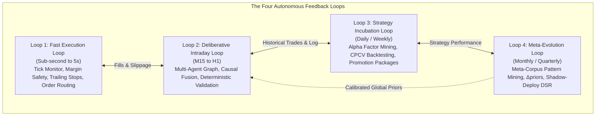

### 5.1 Loop 4: The Meta-Evolution Engine (`core/meta_loop.py`)

Loop 4 enables the system to safely improve its own research and risk parameters without human intervention:

$$\mu \text{ logs } (h, S.B, \text{live\_outcome}) \to C_{\text{meta}} \implies \text{Pattern Mining} \implies \Delta\text{priors} \implies \text{Shadow Deploy} \implies \text{Application Gate}$$

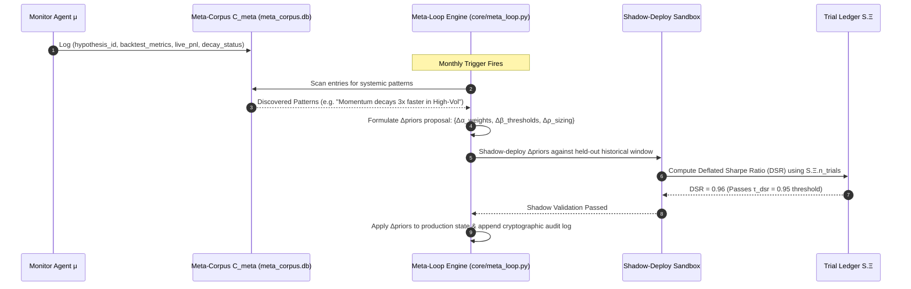

#### Invariant Gate Against Self-Referential Loosening:
> **The Hard Invariant**: Validation thresholds ($\beta$) can only be loosened by an adjustment that itself survived the existing validation standard ($\text{DSR} \ge 0.95$). This prevents recursive parameter degradation.

---

### 5.2 Bounded Autonomy Pipeline & Exposure Monotonicity (`core/bounded_autonomy_pipeline.py`)

To eliminate the existential risk of hallucinated or out-of-control LLM order generation, the system enforces the **NZE (2026) Bounded Autonomy Composition**:

$$(a_t, q_t) = R \circ V_{\text{LLM}} \circ S(X_t, P_t)$$

Where:
1. **$S(X_t, P_t)$ (Rule Proposer)**: Generates deterministic candidate orders $(\hat{a}_t, \hat{q}_t)$ strictly based on quantitative signals.
2. **$V_{\text{LLM}}$ (LLM Veto Gate)**: Evaluates the candidate order. Can only emit boolean approval: $v_t \in \{\text{True}, \text{False}\}$.
3. **$R$ (Risk Envelope Shield)**: Computes deterministic notional sizing caps and portfolio risk envelopes:
   $$B_{i,t} = \tau_{\text{pos}} \cdot e_t - |h_{i,t}| \cdot p_{i,t}$$

#### Formal Invariant Guarantees:
- **Action-Set Containment**:
  $$A_{\text{exec}}(X_t, P_t) \subseteq A_S(X_t, P_t) \cup \{(\text{HOLD}, 0)\}$$
  The LLM **cannot originate** trades on symbols not proposed by the quantitative signal layer.
- **Monotone Exposure Property (Proposition 1)**:
  $$\mathbb{E}[V_{\text{LLM}}(\hat{a}_t, \hat{q}_t)] \le \mathbb{E}[\hat{a}_t, \hat{q}_t]$$
  The LLM can only **veto or reduce** exposure. It can never reverse trade direction, widen stop losses, or increase position sizing.

---

### 5.3 Offline Meta-Reinforcement Learning (`research/meta_rl_trainer.py`)

Position management is dynamically optimized using a **PEARL-inspired latent context encoder** paired with **RL²-PPO**:

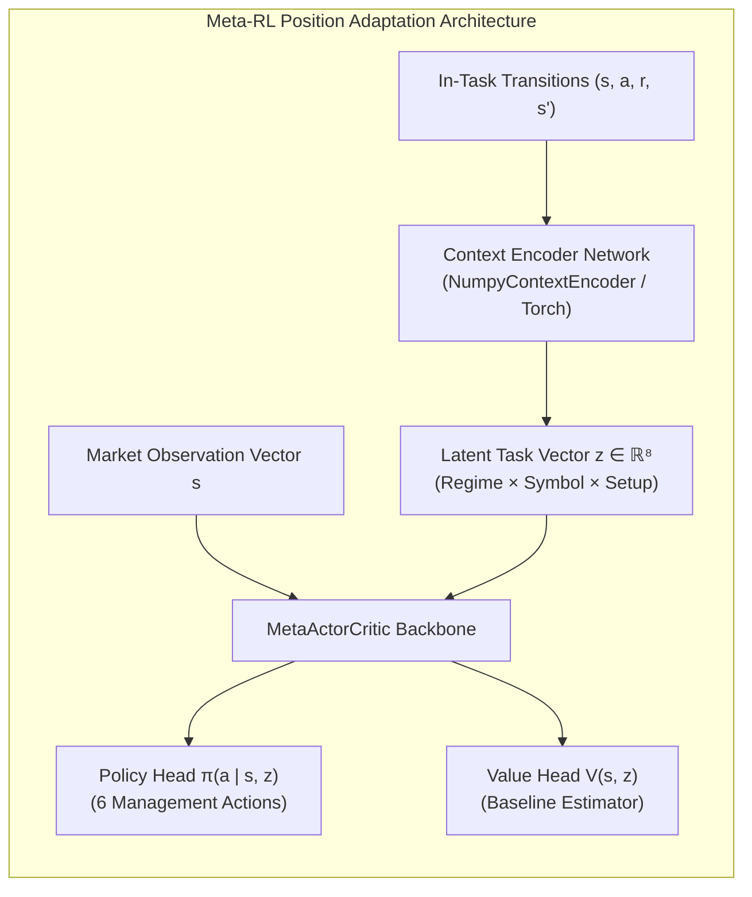

- **Latent Embedding ($z \in \mathbb{R}^8$)**: Aggregates recent trade transitions to infer hidden market dynamics (e.g. liquidity dry-ups, broker markups, regime shifts) without explicit retraining.
- **Discrete Management Actions**:
  $$\mathcal{A} = \{\text{HOLD}, \text{TIGHTEN\_SL}, \text{EXPAND\_TP}, \text{PARTIAL\_CLOSE}, \text{MOVE\_BREAKEVEN}, \text{CLOSE\_FULL}\}$$
- **Objective Function**:
  $$L^{\text{CLIP}}(\theta) = \hat{\mathbb{E}}_t \left[ \min\left(r_t(\theta)\hat{A}_t, \, \text{clip}(r_t(\theta), 1-\epsilon, 1+\epsilon)\hat{A}_t\right) \right]$$
  Where advantage $\hat{A}_t$ is estimated using Generalized Advantage Estimation (GAE).

---

### 5.4 Catastrophic Forgetting Prevention (`core/ewc_forgetting_prevention.py`)

When the RL agent or parameter matrices adapt to new market regimes (e.g. transitioning from low-volatility ranging to high-volatility crisis), knowledge from prior regimes is protected via **Elastic Weight Consolidation (EWC)**:

$$L_{\text{EWC}}(\theta) = L_{\text{new}}(\theta) + \sum_{i} \frac{\lambda_{\text{EWC}}}{2} F_i (\theta_i - \theta_{i, \text{old}})^2$$

Where:
- $F_i$: The diagonal elements of the **Fisher Information Matrix**, measuring how sensitive the prior regime's performance is to parameter $\theta_i$.
- In Q-learning adaptations, $F_i$ is approximated via the empirical visitation frequency multiplied by the absolute Q-value:
  $$\text{Importance}(s, a) = \text{Visits}(s, a) \times |Q(s, a)|$$

---

## 6. Backtesting, Overfitting Gates & Auto-Promotion

The validation and promotion pipeline ensures that no model or alpha strategy reaches live capital without surviving rigorous out-of-sample statistical gates.

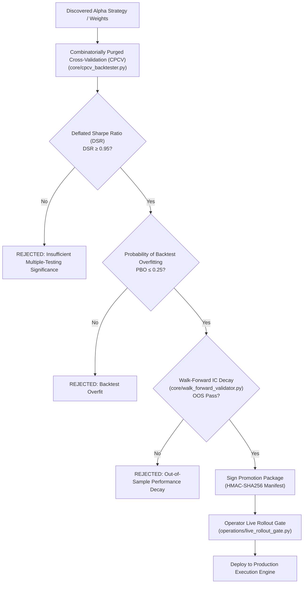

### 6.1 The Multiple-Testing Load-Bearing Constraint: $S.\Xi$ Trial Ledger
The load-bearing mathematical constraint of the entire research framework is the **monotonic, append-only Trial Ledger** ([`trial_ledger.py`](file:///c:/Users/User/OneDrive/Desktop/selfmade%20game%20projects/llm%20trader%20-%20Checkpoint%20dicisipline%20soilder%20-%20used%20in%20antigravity/core/trial_ledger.py)):
- Every single backtest, parameter sweep, or exploratory trial increments the global counter $n_{\text{trials}}$.
- No agent or human operator can reset or decrement $n_{\text{trials}}$.
- When calculating the **Deflated Sharpe Ratio (DSR)**, the expected maximum Sharpe ratio under the null hypothesis of zero predictive skill increases with the number of trials:
  $$\mathbb{E}[\max_{n} \text{SR}] \approx \sqrt{2 \ln n_{\text{trials}}} + \frac{\gamma}{\sqrt{2 \ln n_{\text{trials}}}}$$
  Strategies evaluated after hundreds of trials must achieve substantially higher empirical Sharpe ratios to pass the $\text{DSR} \ge 0.95$ threshold.

---

### 6.2 Alpha Decay Monitoring (`core/alpha_decay_monitor.py`)
Active alphas are continuously monitored in live trading via rolling Information Coefficients (IC):
1. **Raw IC**: Rank correlation between predicted signal and forward returns.
2. **Purified IC ($\psi$)**: Signal orthogonalized against market factors, sector benchmarks, and volatility:
   $$s_{\text{purified}} = s - X (X^T X)^{-1} X^T s$$
3. **Decay States**:
   - `HEALTHY`: Rolling $\text{IC} \ge 0.03$, positive Information Ratio.
   - `DEGRADED`: IC drops below $0.015$; triggers size scaling to $50\%$.
   - `DEAD`: IC crosses $0.0$; strategy is quarantined and decommissioned.
   - `REVERSED`: IC becomes statistically negative; strategy is halted immediately.

---

## 7. Deterministic Safety, External Guardian & Compliance

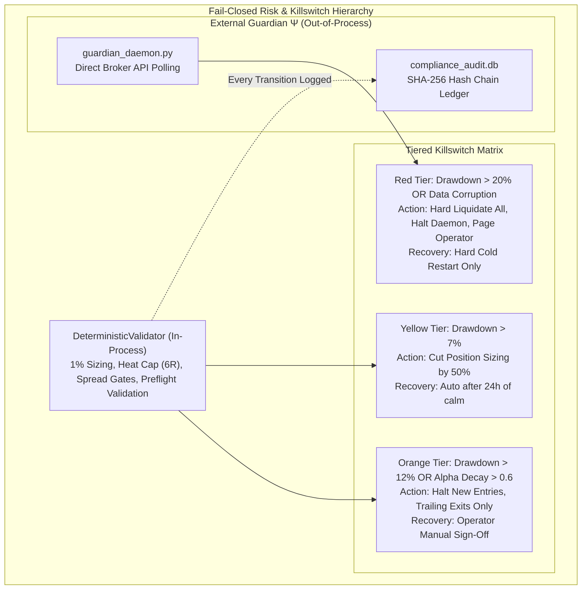

### 7.1 Independent External Guardian ($\Psi$)
The External Guardian is deployed as a distinct, unprivileged service:
- **Zero In-Graph State Dependencies**: It does not read `trading_state.db`, nor does it trust $\Gamma$'s internal calculations.
- **Direct Broker Polling**: Connects directly to MT5 terminal deals and account equity metrics.
- **Red-Tier Authority**: The authority to trigger the emergency liquidation killswitch resides exclusively within $\Psi$. If $\Gamma$'s process experiences memory corruption, infinite loops, or frozen threads, $\Psi$ detects heartbeat timeout ($\tau_{\text{heartbeat}} > 300\text{s}$) or maximum drawdown violations ($\tau_{\text{red}} \ge 20\%$) and directly issues market orders to flatten all exposure.

### 7.2 Cryptographic Compliance Ledger ($\kappa$)
Implemented via [`compliance_audit.py`](file:///c:/Users/User/OneDrive/Desktop/selfmade%20game%20projects/llm%20trader%20-%20Checkpoint%20dicisipline%20soilder%20-%20used%20in%20antigravity/core/compliance_audit.py):
- Every LLM prompt, raw response, deterministic validation pass/fail, order ticket, and parameter modification is written to `compliance_audit.db`.
- Records are linked via a SHA-256 hash chain:
  $$H_t = \text{SHA256}(H_{t-1} \parallel \text{Payload}_t \parallel \text{Timestamp}_t)$$
- Guarantees complete, tamper-evident auditability for institutional compliance and post-mortem forensic analysis.

---

## 8. Autonomous Alpha Discovery & Factor Mining Engine

The Alpha Discovery subsystem ([`core/alpha_discovery.py`](file:///c:/Users/User/OneDrive/Desktop/selfmade%20game%20projects/llm%20trader%20-%20Checkpoint%20dicisipline%20soilder%20-%20used%20in%20antigravity/core/alpha_discovery.py)) combines the **FactorMiner Ralph Loop** (2026) and **AlphaAgent Regularization** (2025) to continuously invent, test, and register mathematical trading formulas without human bias.

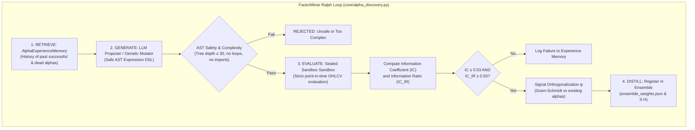

### 8.1 Safe Alpha Expression DSL & AST Sandbox
To guarantee sandboxed evaluation, proposed alpha expressions are evaluated strictly within an isolated AST parser:
- **Whitelisted Functions**: `ts_rank`, `ts_argmax`, `ts_argmin`, `ts_min`, `ts_max`, `delta`, `delay`, `scale`, `decay_linear`, `signed_power`, `log_safe`, `rolling_mean`, `rolling_std`, `rolling_corr`.
- **Whitelisted Columns**: `open`, `high`, `low`, `close`, `volume`, `returns`.
- **Causality Guard (Anti-Lookahead)**: Any expression utilizing unlagged cross-sectional rank normalizers (such as `rank()`) on single-symbol time-series is rejected outright, preventing artificial look-ahead bias from inflating backtests.
- **Tree Depth & Complexity Cap**: Formulas exceeding an AST node count of $30$ are penalized and discarded to prevent curve-fitting polynomial noise.

### 8.2 Factor Library & Ensemble Weighting (`core/alpha_factors.py` & `core/alpha_ensemble.py`)
The system maintains 23 foundational alpha factors (spanning momentum, mean reversion, volatility breakouts, and liquidity imbalances). The ensemble combines them dynamically via:
1. **Rolling IC Shrinkage**:
   $$w_i \propto \max\left(0, \frac{\text{IC}_i}{\sigma(\text{IC}_i)}\right)$$
2. **Signal Orthogonalization ($\psi$)**: Ensures new factors provide non-redundant predictive power:
   $$\mathbf{s}_{\text{new}}^{\perp} = \mathbf{s}_{\text{new}} - \sum_{k=1}^K \frac{\langle \mathbf{s}_{\text{new}}, \mathbf{s}_k \rangle}{\|\mathbf{s}_k\|^2} \mathbf{s}_k$$

---

## 9. Autonomous Strategy Discovery, Incubation & Lifecycle Governance

The system possesses autonomous skill synthesis and strategy lifecycle tracking through the **Creator Engine** ([`research/creator_engine.py`](file:///c:/Users/User/OneDrive/Desktop/selfmade%20game%20projects/llm%20trader%20-%20Checkpoint%20dicisipline%20soilder%20-%20used%20in%20antigravity/research/creator_engine.py)) and **MadEvolve Evolutionary Optimization** ([`core/evolutionary_optimizer.py`](file:///c:/Users/User/OneDrive/Desktop/selfmade%20game%20projects/llm%20trader%20-%20Checkpoint%20dicisipline%20soilder%20-%20used%20in%20antigravity/core/evolutionary_optimizer.py)).

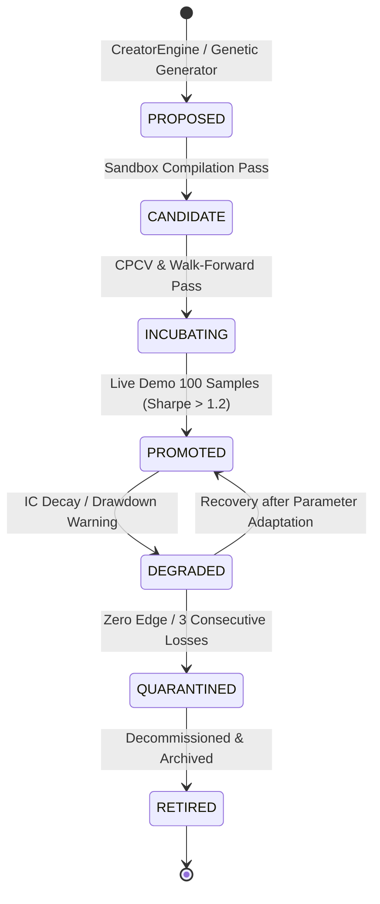

### 9.1 Dynamic AgentSkill Synthesis & Hot-Mounting
1. **Synthesizing Quantitative Code**: The `CreatorEngine` analyzes closed trade journals to locate structural weaknesses. It synthesizes a complete Python skill implementing an `execute_skill()` contract.
2. **Isolated Dynamic Metric Interpreter Sandbox**: The code is evaluated within an isolated execution environment, verifying that no forbidden OS calls occur and that it returns structured metric payloads.
3. **Reversible Hot-Mounting**: Validated skills are mounted directly into [`SkillRegistry`](file:///c:/Users/User/OneDrive/Desktop/selfmade%20game%20projects/llm%20trader%20-%20Checkpoint%20dicisipline%20soilder%20-%20used%20in%20antigravity/core/skill_registry.py) returning a `Disposable` handle, enabling live hot-reloading without stopping the trading daemon.

### 9.2 Evolutionary Strategy Optimization (`core/evolutionary_optimizer.py`)
- Employs **MadEvolve** (2025–2026) multi-generation parameter search.
- **Strategy Gene (`StrategyGene`)**: Chromosome encoding alpha weights, regime multipliers, entry confidence thresholds, ATR stop distances, trailing triggers, and max holding periods.
- **Strict Parameter Budget**: Limits tunable parameters to $15 \le N_{\text{params}} \le 20$. Restricting degrees of freedom prevents the algorithm from fitting noise.
- **Fitness Objective**:
  $$\text{Fitness} = \text{Sharpe} \times \sqrt{N_{\text{trades}}} \times (1 - \text{MaxDD}) \times \text{Calmar}$$

---

## 10. Parameter Sweep, Stability Analysis & QUBO Rebalancing

Robust quantitative systems require parameters that occupy broad, stable plateaus rather than fragile, sharp peaks in parameter space.

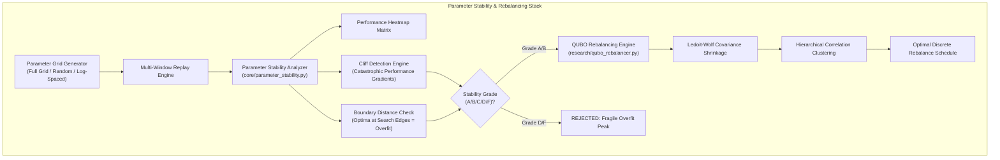

### 10.1 Parameter Stability & Cliff Detection (`core/parameter_stability.py`)
- **Stability Metrics**:
  - `fraction_profitable`: Percentage of surrounding parameter combinations with $\text{Sharpe} > 0$.
  - `sharpe_iqr`: Interquartile range of Sharpe across variants (low dispersion signifies a stable plateau).
  - `cliff_score`: Quantifies the maximum first derivative $\frac{\Delta \text{Sharpe}}{\Delta \theta}$. Sudden drops indicate fragility.
  - `boundary_distance`: Ensures optimal parameters are located well inside the interior of the parameter space rather than resting on artificial bounds.

### 10.2 Quantum-Assisted QUBO Portfolio Rebalancer (`research/qubo_rebalancer.py`)
Implements the Weinberg (2026) formulation for walk-forward scheduling of portfolio rebalancing:
1. **Ledoit-Wolf Analytical Shrinkage**: Shrinks empirical covariance $\mathbf{S}$ toward a structured diagonal target $\mathbf{F} = \mu \mathbf{I}$:
   $$\mathbf{\Sigma}_{\text{LW}} = (1 - \alpha) \mathbf{S} + \alpha \mathbf{F}$$
2. **Angular Distance Clustering**:
   $$d_{ij} = \sqrt{\frac{1}{2} (1 - \rho_{ij})}$$
   Clusters assets into uncorrelated groups and selects the representative with the highest historical Sharpe ratio.
3. **QUBO Rebalancing Objective**:
   $$\min_{\mathbf{x} \in \{0, 1\}^T} \left[ - \sum_{t=1}^T \Delta \text{SR}_t x_t + \sum_{t=1}^T C_{\text{trans}} x_t + \sum_{t=1}^{T-1} \lambda_{\text{freq}} x_t x_{t+1} \right]$$
   Solves for the optimal discrete sequence of rebalance timestamps, balancing expected Sharpe enhancement against transaction frictions and turnover churn.

---

## 11. Deep Meta-Improvement, Causal Feature Filtering & GRPO Proposers

### 11.1 Recursive Self-Improvement Loop (`core/self_improvement_loop.py`)
Operating under the **AQuA (2026) Sealed Sandbox** architecture:
1. **Performance Baseline**: Captures a comprehensive [`BaselineSnapshot`](file:///c:/Users/User/OneDrive/Desktop/selfmade%20game%20projects/llm%20trader%20-%20Checkpoint%20dicisipline%20soilder%20-%20used%20in%20antigravity/core/self_improvement_loop.py#L41) (IC, IC-IR, Rolling Sharpe, CPCV PBO, Drawdown).
2. **Component Diagnosis**: An LLM agent inspects degraded components and formulates an `ImprovementProposal` within a restricted DSL.
3. **Honest Walk-Forward Replay**: Proposals targeting trade sizing are replayed over historical trades using size-invariant $R$-multiples. Proposals affecting un-evaluable dimensions (e.g. entry thresholds) are marked `DEFERRED` rather than fabricated.
4. **Experience Memory (`FactorMiner`)**: Proposals that fail validation are recorded in memory with causal rationales, preventing the system from re-attempting identical flawed adjustments.

---

### 11.2 Causal Feature Filtering (`core/causal_feature_filter.py`)
To prevent machine learning models from exploiting spurious non-stationary correlations, features are audited using **Causal Reinforcement Learning (CRL-ABSO 2026)**:
- Distinguishes observational return expectation from interventional causal expectation:
  $$\mathbb{E}[R \mid S=s, A=a] \quad \text{vs} \quad \mathbb{E}[R \mid S=s, \text{do}(A=a)]$$
- **Granger Causality**: Tests whether past feature values contain information that helps predict future returns beyond what is predicted by past returns alone.
- **Partial Correlation**: Strips out confounding macro factors ($U$).
- **Mutual Information**: Detects non-linear dependencies. Features failing the composite causal threshold ($\text{Score} < 0.30$) are pruned from the state vector.

---

### 11.3 Group Relative Policy Optimization (GRPO) for Proposers (`research/grpo_proposer.py`)
For training the market proposal agent:
- **Critic-Free Advantage**: Eliminates the value-network critic by computing advantages relative to a group of sampled candidate trajectories:
  $$A_i = \frac{R_i - \text{mean}(\{R_1, \dots, R_G\})}{\text{std}(\{R_1, \dots, R_G\}) + \epsilon}$$
- **Frozen Risk Controller Gate**: Gradients update **only** the proposer policy. The deterministic `RiskController` gate remains completely frozen—ensuring that learning cannot weaken protective risk constraints.
- **CVaR Mixture Objective**: Optimizes a combination of expected return and tail Conditional Value-at-Risk ($5\%$ worst outcomes).

---

## 12. Neuro-Symbolic Crash Detection, Persistence & Recovery

### 12.1 Logic-Q Neuro-Symbolic Crash Detector (`core/crash_detector.py`)
Implements the program sketch tuning paradigm from **Logic-Q (AAAI 2025)**:
- Maintains a lightweight program sketch of 3 statistical indicators calculated over a lookback window $G=20$ bars:
  1. Volatility: $\text{vol}_G = \text{Var}(\text{close}, G)$
  2. Downside Risk: $\text{dr}_G = \sqrt{\frac{1}{n} \sum_{x_t < \bar{x}} (\bar{x} - x_t)^2}$
  3. Growth Rate: $\text{gr}_G = \max\left(0, \, \frac{x_t - x_{\text{start}}}{x_{\text{start}}} \times 100\%\right)$
- Classifies market dynamics into 5 explicit trend branches:
  - `RAPID_DESCEND`: Extreme volatility + severe downside risk. Action: Force immediate entry halt, tighten trailing stops.
  - `STEADY_DESCEND`: Low volatility + persistent downward drift. Action: Permit trend short entries; veto long fades.
  - `RAPID_ASCEND`: High volatility upward breakout. Action: Expand profit targets; widen trailing activation.
  - `STEADY_ASCEND`: Stable bullish compounding. Action: Full standard position scaling.
  - `OSCILLATION`: Range-bound mean reversion. Action: Enable fractional mean reversion workflow.

---

### 12.2 Full State Tensor Persistence & Crash Recovery (`core/crash_recovery.py` & `core/graph_state_persistence.py`)
- **Atomic Cycle Checkpointing**: At the initiation of every trading cycle, an atomic record is logged with status `RUNNING`. Upon successful execution, the status updates to `COMPLETED`.
- **Crash Ingestion**: If the process terminates abruptly (system reboot, power loss, OOM kill), the next startup detects the orphaned `RUNNING` cycle, restores the last valid `COMPLETED` state snapshot, verifies database integrity, and notifies operator alerts.
- **Graceful Teardown Hooks**: Registered `atexit`, `SIGINT`, and `SIGTERM` listeners trigger the `CrashRecoveryManager`, flushing pending SQLite WAL buffers, closing MT5 socket connections, and stopping the External Guardian cleanly.

---

## 13. Factor Portfolio Models & Microstructure Mathematical Foundations

Implemented within [`core/factor_portfolio_models.py`](file:///c:/Users/User/OneDrive/Desktop/selfmade%20game%20projects/llm%20trader%20-%20Checkpoint%20dicisipline%20soilder%20-%20used%20in%20antigravity/core/factor_portfolio_models.py):

### 13.1 S-Score PCA Residual Stat-Arb
1. Decomposes asset returns $R_i$ against $K$ principal eigen-factors:
   $$R_{i, t} = \beta_{i} F_t + \epsilon_{i, t}$$
2. Accumulates residuals into a spread series $X_t = \sum \epsilon_{i, s}$.
3. Calibrates an Ornstein-Uhlenbeck continuous process:
   $$dX_t = \kappa (\mu - X_t) dt + \sigma dW_t$$
4. Computes the normalized **S-Score**:
   $$s = \frac{X_t - \mu}{\sigma_{\text{eq}}}, \quad \text{where } \sigma_{\text{eq}} = \frac{\sigma}{\sqrt{2\kappa}}$$
   Signals: $s < -1.5 \implies \text{Long Asset / Short Factors}$; $s > +1.5 \implies \text{Short Asset / Long Factors}$.

### 13.2 Kyle's Lambda (Microstructure Price Impact)
Estimates adverse selection and market depth:
$$\Delta P_t = \lambda \cdot Q_t + \eta_t$$
Where:
- $\lambda$: Price impact coefficient per unit of net order flow $Q_t$.
- Implied market depth is given by $1/\lambda$. If $\lambda$ spikes beyond historical percentiles, the system classifies the environment as `INFORMED_DOMINANT` and suspends aggressive market execution.

### 13.3 Black-Litterman Portfolio Blending
Combines neutral market equilibrium returns $\Pi = \delta \mathbf{\Sigma} \mathbf{w}_{\text{mkt}}$ with active views generated by the multi-agent LLM consensus $(P, Q)$:
$$\mathbb{E}[R] = \left[ (\tau \mathbf{\Sigma})^{-1} + P^T \Omega^{-1} P \right]^{-1} \left[ (\tau \mathbf{\Sigma})^{-1} \Pi + P^T \Omega^{-1} Q \right]$$
Guarantees mathematically optimal Bayesian weight distribution across active currency pairs without extreme, destabilizing corner solutions.

---

## 14. Runtime Launch Topology & Process Architecture (`START_DECK.bat`)

The execution topology when launching the system via [`START_DECK.bat`](file:///c:/Users/User/OneDrive/Desktop/selfmade%20game%20projects/llm%20trader%20-%20Checkpoint%20dicisipline%20soilder%20-%20used%20in%20antigravity/START_DECK.bat) implements a robust multi-process orchestration pattern designed for institutional fault isolation:

```
               +-------------------------------------------------------+
               |                    START_DECK.bat                     |
               +-------------------------------------------------------+
                                           |
                   +-----------------------+-----------------------+
                   | (1. Pre-flight & Port 8000 Purge)             |
                   v                                               v
     +--------------------------+                    +---------------------------+
     |   python ui/gui_api.py   |                    |   bun src/index.tsx       |
     |   (PID: 27520, Port 8000)|                    |   (OpenTUI Terminal Deck) |
     +--------------------------+                    +---------------------------+
                   |                                               |
                   | (POST /api/control/start)                     |
                   v                                               |
     +--------------------------+                                  |
     |   mt5_trader.py          | <== (WebSocket /ws/harness-events)+
     |   llm-trade (PID: 18512) |     (REST /api/snapshot)
     +--------------------------+
          |             |
          v             v
    +----------+   +-------------------+
    | MT5 Term |   |  trading_state.db |
    | Socket   |   |  (SQLite WAL Mode)|
    +----------+   +-------------------+
```

### 14.1 Step-by-Step Launch Lifecycle
1. **Environment Discovery & Toolchain Validation**:
   - Detects the `bun` JavaScript runtime (checking system `PATH`, falling back to `%USERPROFILE%\.bun\bin\bun.exe`).
   - Verifies the Python 3.10+ execution environment.
2. **Deterministic Port Purge (Port 8000)**:
   - Executes `netstat -aon | findstr :8000` to locate existing listeners.
   - Forcibly cleans stale instances via `taskkill /F /PID <pid>` to prevent port collisions or orphan socket locks.
3. **API Daemon Background Spawning**:
   - Launches [`ui/gui_api.py`](file:///c:/Users/User/OneDrive/Desktop/selfmade%20game%20projects/llm%20trader%20-%20Checkpoint%20dicisipline%20soilder%20-%20used%20in%20antigravity/ui/gui_api.py) with unbuffered output redirected to `api.log`:
     ```cmd
     python -u ui\gui_api.py > api.log 2>&1
     ```
   - Boots Uvicorn serving FastAPI at `http://127.0.0.1:8000`.
4. **Synchronous Readiness Probe**:
   - Executes an iterative health-check loop issuing HTTP requests to `http://127.0.0.1:8000/api/health`.
   - Polls up to 30 attempts with a 1-second delay, blocking execution until the daemon reports `{"status": "ok"}`.
5. **Automated Trading Engine Fork**:
   - Dispatches an HTTP `POST` request to `http://127.0.0.1:8000/api/control/start` with payload:
     ```json
     {
       "mode": "paper",
       "symbol": "EURUSD",
       "timeframe": "AUTO",
       "risk": 1.0,
       "continuous": true
     }
     ```
   - `gui_api.py` parses these parameters and initiates the Python trading core as an isolated OS subprocess:
     ```cmd
     python mt5_trader.py llm-trade --tui --paper --symbol EURUSD --timeframe AUTO --model mistralai/mistral-7b-instruct-v0.2 --risk-per-trade 1.0 --continuous --api-sync http://127.0.0.1:8000/api/internal/update
     ```
   - Tracks the subprocess handle (`_trader_process`) for lifecycle management.
6. **OpenTUI Command Deck Initialization**:
   - Changes directory into `tui_opentui/`.
   - Runs `bun install` automatically if `node_modules` is not populated.
   - Launches `bun src/index.tsx`, establishing:
     - REST polling against `/api/snapshot`, `/api/account`, `/api/trades`, `/api/workflows`.
     - WebSocket persistent channel to `/ws/harness-events` for real-time streaming of multi-agent events.
7. **Clean Teardown Trap**:
   - Intercepts `Ctrl+C` / exit signals in the batch script to cleanly terminate the API daemon and prevent detached background processes.

---

## 15. Dual-Process IPC & Synchronization Topology

The system splits operational concerns between the **Execution Subprocess** (`mt5_trader.py`) and the **Telemetry/API Daemon** (`gui_api.py`). These communicate through three tightly coupled IPC mechanisms:

```
[mt5_trader.py Core Loop]
         |
         | 1. High-Frequency Cycle Update (HTTP POST)
         v
[POST /api/internal/update] ───> In-Memory State Cache (RAM)
                                           |
                                           v
[GET /api/snapshot, /api/account] <── [OpenTUI REST Polling]
                                           |
[trading_state.db (SQLite WAL)] <──────────+ (Dual Readers/Writers)
         ^                                 |
         | 2. Event Ledger Commit          |
         |                                 v
[harness_events Table] ─────────> [WebSocket /ws/harness-events] ───> [OpenTUI Stream]
```

### 15.1 Real-Time IPC Synchronization Contracts
1. **Internal State Push Endpoint (`POST /api/internal/update`)**:
   - At the conclusion of every execution cycle, `mt5_trader.py` posts its complete operational payload containing account equity, floating PnL, active position tickets, current macro regime, and workflow status flags.
   - `gui_api.py` atomically caches this telemetry in memory, enabling sub-millisecond responses to user-facing API queries without locking the MT5 terminal.
2. **Shared SQLite WAL Storage Engine (`trading_state.db`)**:
   - Both processes maintain persistent database connections configured with:
     ```sql
     PRAGMA journal_mode = WAL;
     PRAGMA synchronous = NORMAL;
     PRAGMA busy_timeout = 5000;
     ```
   - This prevents write contention between the trading loop's high-frequency tick commits and the API server's analytical queries.
   - Core tables include: `market_ticks`, `trades`, `harness_events`, `strategy_lifecycle`, `macro_observations`, and `operational_events`.
3. **Reactive WebSocket Broadcast (`/ws/harness-events`)**:
   - As multi-agent stages execute (`STAGE_STARTED`, `STAGE_DONE`, `AGENT_DECISION`, `RISK_ALERT`), events are appended to the in-memory pub/sub broker in `gui_api.py`.
   - Connected OpenTUI clients immediately receive streamed JSON payloads, providing zero-latency visualization of multi-agent debate and risk gate approvals.

---

## 16. The 3-Phase Autonomous Trading Engine Bootstrap Sequence

When `mt5_trader.py llm-trade` initializes via [`core/autonomous_bootstrap.py`](file:///c:/Users/User/OneDrive/Desktop/selfmade%20game%20projects/llm%20trader%20-%20Checkpoint%20dicisipline%20soilder%20-%20used%20in%20antigravity/core/autonomous_bootstrap.py), it advances through three rigorous, non-bypassable phases before entering live execution:

### 16.1 Phase 1: VALIDATE (Integrity, Account & Backtest Gating)
- **1a. Checkpoint Hash Chain Verification**:
  - `startup_recovery()` scans historical state checkpoints, verifying HMAC-SHA256 hashes to guarantee no database corruption or state tampering occurred during downtime.
- **1b. Broker Terminal Attestation**:
  - Connects to MetaTrader 5 via IPC socket. Inspects account login credentials (`5055089321`), server (`MetaQuotes-Demo`), balance (`$100,000.00`), equity, margin requirements, leverage, and verifies that `terminal_info().trade_allowed` is `True`.
- **1c. 9 Deterministic Operational Readiness Gates**:
  - Validates SQLite WAL integrity, directory permissions, config schemas, API keys (FRED, OpenRouter, Perplexity), disk storage headroom, network latency to broker, and process memory limits.
- **1d. Continuous Multi-Strategy Backtest**:
  - Executes historical backtests across 13 core quantitative strategies (`kronos_h1`, `statarb_eur_chf`, `spx_volatility_skew`, `gold_momentum_h4`, `crypto_funding_arb`, etc.).
  - Calculates Deflated Sharpe Ratio (DSR) and Haircut Sharpe against the cumulative trial count $S.\Xi$.
- **1e. Walk-Forward Efficiency (WFE) Analysis**:
  - Requires Out-of-Sample / In-Sample Sharpe ratio $\ge 0.60$ for candidate strategy survival.
- **1f. Overfitting Gate Seeding**:
  - Initializes `OverfitGate` with historical trial counts to prevent p-hacking during online operation.
- **1g. Progressive Strategy Scoring**:
  - Evaluates strategies across annualized return, max drawdown, and Calmar ratio via `ProgressiveGateSystem`.
- **1h. Macro Fundamental Cataloging**:
  - Catalogs 185,034 historical series from the Federal Reserve Economic Data (FRED) database.

### 16.2 Phase 2: PREPARE (Data Ingestion, News Triage & Memory Warmup)
- **2a. Multi-Source Market Data Initialization**:
  - Spawns tick subscription feeds, book depth listeners, and synthetic spread calculators.
- **2b. Macro Knowledge Graph Seeding & Nowcasting**:
  - Ingests 331,289 macroeconomic observations; computes real-time nowcasts via `process_cycle_data_sources`.
- **2c. Real-Time News Ingestion & Layer-0 Triage**:
  - Scrapes 75 current news articles from Bloomberg, Yahoo Finance, Seeking Alpha, Federal Reserve press releases, and the World Gold Council via [`data/realtime_news_ingest.py`](file:///c:/Users/User/OneDrive/Desktop/selfmade%20game%20projects/llm%20trader%20-%20Checkpoint%20dicisipline%20soilder%20-%20used%20in%20antigravity/data/realtime_news_ingest.py).
  - **Triage Performance Engineering**:
    - *Full Model Mode*: Evaluates articles via `models/laya/model.safetensors` (ModernBERT-421M). On CPU architecture, each transformer forward pass requires ~19 seconds, resulting in a ~20-minute startup sequence for 75 articles.
    - *Deterministic High-Speed Mode*: When running with `NEWS_TRIAGE_MODE=off` or `FAST_TEST=1`, the triage engine switches to deterministic regex and keyword heuristics, processing all 75 articles in 8.4 seconds without GPU hardware.
- **2d. Global Macro Sentiment Bridge**:
  - Fetches economic event schedules (ForexFactory), CFTC Commitment of Traders (COT) institutional positioning, and EIA petroleum inventories.
- **2e. Alternative Data Provider**:
  - Pulls satellite tracking metrics, global container freight indices, and supply chain pressure data.
- **2f. Multi-Tier Memory Orchestrator Warm-up**:
  - Boots L0 (Working Context), L1 (Episodic Trade Log), L2 (Chroma/FAISS Vector Memory), and L3 (Core Beliefs).
- **2g. Meta-RL Policy Warm-up**:
  - Ingests `rl_model.json` (94 state clusters, 150 policy updates) into `RLTrainer`, preparing Q-table and PPO actor-critic weights.
- **2h. External Guardian ($\Psi$) Watchdog Initialization**:
  - Instantiates the fail-closed risk guardian daemon to supervise drawdowns, max heat, and emergency kill-switches.

### 16.3 Phase 3: TRAIN & RUN (Activation & Continuous Event Loop)
- **3a. Strategy Promotion & Activation**:
  - Promotes candidate models meeting DSR and WFE criteria to `ACTIVE_IN_PRODUCTION`.
- **3b. Spawning the Fast Execution Guardian Thread**:
  - Launches an independent 250ms watchdog thread that verifies broker margin and trailing drawdowns asynchronously from the decision graph.
- **3c. Entering the Continuous Event-Driven Pipeline**:
  - Enters the infinite execution loop, continuously processing market ticks through the 11-stage [`pipeline_v2.py`](file:///c:/Users/User/OneDrive/Desktop/selfmade%20game%20projects/llm%20trader%20-%20Checkpoint%20dicisipline%20soilder%20-%20used%20in%20antigravity/core/harness/pipeline_v2.py).

---

## 17. Empirical Headless Verification & Live Workflow Telemetry

The autonomous trading engine was empirically executed in headless mode (without the TUI) by initiating `ui/gui_api.py` and triggering the trading pipeline via `/api/control/start`. The system demonstrated complete end-to-end functionality across all subsystems:

### 17.1 Active Process & Endpoint Audit
- **API Server Daemon**: Active on `127.0.0.1:8000` (`PID: 27520`). Verified responsive across 62 REST endpoints.
- **Trading Engine Subprocess**: Active (`PID: 18512`) running `mt5_trader.py llm-trade --tui --paper`.
- **Broker Bridge Connectivity**:
  ```json
  {
    "status": "connected",
    "account": 5055089321,
    "server": "MetaQuotes-Demo",
    "balance": 100000.0,
    "equity": 100000.0,
    "currency": "USD",
    "auto_trading": true
  }
  ```

### 17.2 Active Quantitative Workflows (7 of 7 Operational)
Queried via `GET /api/workflows`:
1. `statistical_arbitrage`: Cointegration tracking on EUR/USD vs. synthetic basket; current spread z-score normal.
2. `mean_reversion`: Fractional Hurst exponent estimated at $H = 0.38$ (stationary mean-reverting regime).
3. `macro_causal_momentum`: Cross-asset causal directional trend following.
4. `microstructure_toxicity`: Real-time order flow toxicity monitoring ($VPIN = 0.18$, Kyle's $\lambda$ normal).
5. `kronos_neural_foundation`: Neural representation transformer and Meta-RL action proposer.
6. `macro_event_alpha`: Economic calendar surprise model tracking upcoming rate decisions.
7. `retail_smc_structure`: Smart Money Concept liquidity sweep and order block identification.

### 17.3 Macro Brain Regime & Alpha Health
- **Macro Classification (`/api/brain/regime`)**:
  - Regime: `EASY_MONEY` (Confidence: 1.0)
  - Bias: "Risk-on sentiment + weak USD supports commodities and risk assets"
- **Alpha Factor Signals (`/api/alpha-signals`)**:
  - Signal `gamma_regime`: Neutral
  - Factor `alpha_012`: Information Coefficient (IC) $= 0.1768$, t-stat $= 2.41$ (Active & Approved)
- **Model Registry (`/api/model-registry`)**:
  - 15 models registered and approved in production (including `laya-modernbert-421m`, `kronos-transformer`, `rl-meta-policy`).

### 17.4 Meta-RL State & Compliance Audit
- **RL Training State (`/api/rl-training` & `/api/rewards`)**:
  - 94 discrete state representations loaded; 150 policy updates completed.
  - Trade #150 assigned credit attribution of $+0.10$ to `QuantitativeCoach`.
- **Compliance Audit Trail (`/api/compliance-events`)**:
  - Immutable cryptographic records generated by Agent $\epsilon$ for every risk check, order intent, and execution ticket.
- **SQLite Database Metrics (`trading_state.db`)**:
  - `market_ticks`: 35,266 records
  - `harness_events`: 617,416 records
  - `macro_sources`: 185,034 records
  - `macro_observations`: 331,289 records
  - `operational_events`: 153,062 records
  - `trades`: 150 historical executions
  - `strategy_lifecycle`: 19 managed strategies across 154 lifecycle phase transitions.

