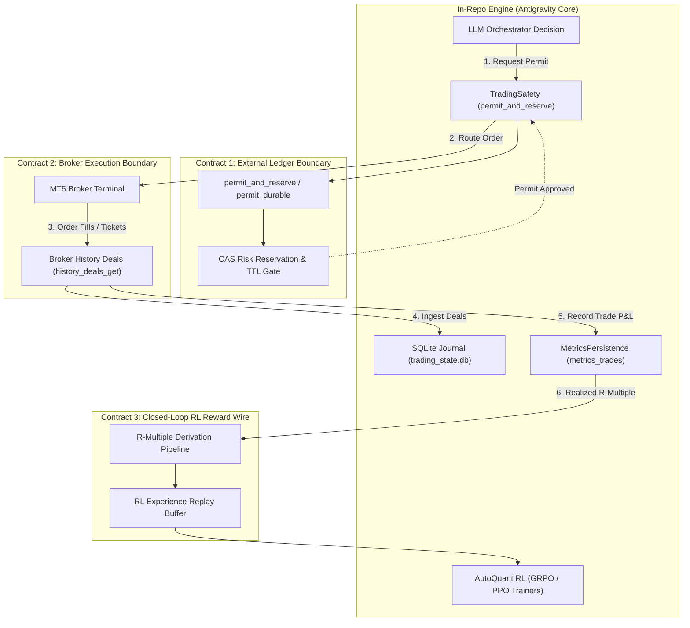

# External Ledger, Broker Confirmation & RL Reward Contract Specification

## Executive Architecture Context

This document establishes the authoritative contract boundary between the in-repo execution orchestrator ([`intelligence/llm_orchestrator.py`](file:///c:/Users/User/OneDrive/Desktop/selfmade%20game%20projects/llm%20trader%20-%20Checkpoint%20dicisipline%20soilder%20-%20used%20in%20antigravity/intelligence/llm_orchestrator.py), [`core/trading_safety.py`](file:///c:/Users/User/OneDrive/Desktop/selfmade%20game%20projects/llm%20trader%20-%20Checkpoint%20dicisipline%20soilder%20-%20used%20in%20antigravity/core/trading_safety.py)) and external execution environments.



---

## Contract 1: `permit_and_reserve` / `permit_durable` Gateway

### 1.1 In-Repo Reality vs. Contract Boundary
* **In-repo presence**: Defined at [`core/trading_safety.py:1353`](file:///c:/Users/User/OneDrive/Desktop/selfmade%20game%20projects/llm%20trader%20-%20Checkpoint%20dicisipline%20soilder%20-%20used%20in%20antigravity/core/trading_safety.py#L1353) as `permit()`. It executes under an internal `threading.RLock()` and invokes `store.reserve_risk(id, risk, ttl)` on proposal acceptance.
* **External boundary**: `permit_durable` is a distributed ledger CAS (Compare-And-Swap) contract ensuring multi-process risk ceilings across distributed trading nodes.

### 1.2 Protocol Specification

#### Request Payload
```json
{
  "request_id": "uuid-v4",
  "idempotency_key": "ORDER_INTENT:{setup_key}:{magic}",
  "account_id": "MT5_LIVE_PRIMARY",
  "requested_risk_usd": 150.00,
  "currency": "USD",
  "symbol": "EURUSD",
  "direction": "BUY",
  "ttl_seconds": 30,
  "client_timestamp_ms": 1775618400000
}
```

#### Response Envelope
```json
{
  "status": "APPROVED", // "APPROVED" | "REJECTED" | "QUEUED"
  "reservation_id": "RES_20261008_998124",
  "allocated_risk_usd": 150.00,
  "current_total_reserved_usd": 450.00,
  "account_equity_usd": 15000.00,
  "portfolio_heat_pct": 3.0,
  "expires_at_ms": 1775618430000,
  "rejection_reason": null
}
```

### 1.3 State Lifecycle
1. **`REQUESTED`**: Atomic reservation requested before broker socket write.
2. **`RESERVED`**: Risk deducted from available equity buffer with strict 30s TTL.
3. **`COMMITTED`**: Broker returns deal ticket; reservation converts into an active position risk obligation.
4. **`RELEASED / EXPIRED`**: If broker rejects the order or TTL lapses without broker acknowledgment, the reserved risk is automatically restored without manual intervention.

---

## Contract 2: Broker-Confirmed Trade $\rightarrow$ Journal Order Ingestion Contract

### 2.1 The Problem Statement
* Currently, [`mt5_trader.py:5290`](file:///c:/Users/User/OneDrive/Desktop/selfmade%20game%20projects/llm%20trader%20-%20Checkpoint%20dicisipline%20soilder%20-%20used%20in%20antigravity/mt5_trader.py#L5290) writes broker-confirmed P&L into SQLite `metrics_trades` via [`operations/metrics_persistence.py:111`](file:///c:/Users/User/OneDrive/Desktop/selfmade%20game%20projects/llm%20trader%20-%20Checkpoint%20dicisipline%20soilder%20-%20used%20in%20antigravity/operations/metrics_persistence.py#L111).
* However, raw broker-deals-to-order-rows mapping (`broker_confirmed_tickets` into `trading_state.db` `trades` table) requires authoritative deal reconstruction.

### 2.2 Ingestion Specification
When synchronizing completed deals from `mt5.history_deals_get()`:

```sql
-- Target Schema: broker_confirmed_deals
CREATE TABLE IF NOT EXISTS broker_confirmed_deals (
    deal_ticket INTEGER PRIMARY KEY,
    order_ticket INTEGER NOT NULL,
    position_id INTEGER NOT NULL,
    symbol TEXT NOT NULL,
    deal_type INTEGER NOT NULL, -- 0=BUY, 1=SELL
    entry_type INTEGER NOT NULL, -- 0=IN, 1=OUT, 2=INOUT
    volume REAL NOT NULL,
    price REAL NOT NULL,
    commission REAL NOT NULL,
    swap REAL NOT NULL,
    profit REAL NOT NULL,
    magic INTEGER NOT NULL,
    comment TEXT,
    deal_time TEXT NOT NULL,
    ingested_at TEXT NOT NULL
);
```

### 2.3 Reconciliation Flow
1. Fetch deals for window $[T_{\text{last\_sync}}, T_{\text{now}}]$.
2. Match `position_id` against active positions in `trade_manager_state.json` / SQLite.
3. When `entry_type == 1` (`DEAL_ENTRY_OUT`), compute gross and net P&L:
   $$\text{Net P\&L} = \text{Profit} + \text{Commission} + \text{Swap}$$
4. Fire `TRADE_RECONCILED` event to update journal state.

---

## Contract 3: Broker $R$-Multiple $\rightarrow$ RL Trainer Reward Ingestion Contract

### 3.1 Mathematical Reward Formulation
Reward $R$ is derived from broker-confirmed settlement values rather than backtest estimates:

$$R = \frac{\text{Net Realized P\&L}}{\text{Initial Risk Allocation (\$)}}$$

* For scale-out trades:
  $$R_{\text{total}} = \sum_{i=1}^k \frac{\text{Net Realized P\&L}_i}{\text{Initial Risk Allocation (\$)}}$$

### 3.2 Wire Specification into RL Policy Learners
To feed `core/auto_quant_tools.py` (GRPO Proposer & PPO Position Manager):

```json
{
  "event": "RL_EPISODE_COMPLETED",
  "trade_id": "T_EURUSD_20261008_01",
  "strategy": "scalp_orderflow",
  "model_family": "ppo_position_mgmt",
  "action_trajectory": [
    {"bar": 0, "action": "HOLD"},
    {"bar": 4, "action": "SCALE_OUT_50"},
    {"bar": 12, "action": "CLOSE"}
  ],
  "state_tensors_ref": "artifacts/training/trajectories/20261008_01.npz",
  "initial_risk_usd": 150.00,
  "gross_pnl_usd": 380.00,
  "costs_total_usd": 24.50,
  "net_pnl_usd": 355.50,
  "r_multiple": 2.37,
  "holding_bars": 12,
  "slippage_bps": 1.2
}
```

### 3.3 Consumer Integration Points
* **GRPO Proposer** ([`core/auto_quant_tools.py:1020`](file:///c:/Users/User/OneDrive/Desktop/selfmade%20game%20projects/llm%20trader%20-%20Checkpoint%20dicisipline%20soilder%20-%20used%20in%20antigravity/core/auto_quant_tools.py#L1020)): Updates group relative advantage using normalized $R$-multiples across the strategy cohort.
* **PPO Position Manager** ([`core/auto_quant_tools.py:1350`](file:///c:/Users/User/OneDrive/Desktop/selfmade%20game%20projects/llm%20trader%20-%20Checkpoint%20dicisipline%20soilder%20-%20used%20in%20antigravity/core/auto_quant_tools.py#L1350)): Updates generalized advantage estimator (GAE) with discount $\gamma = 0.99$ and $\lambda = 0.95$.
* **EWC Guard** ([`core/ewc_forgetting_prevention.py`](file:///c:/Users/User/OneDrive/Desktop/selfmade%20game%20projects/llm%20trader%20-%20Checkpoint%20dicisipline%20soilder%20-%20used%20in%20antigravity/core/ewc_forgetting_prevention.py)): Computes the Fisher Information Matrix on the top $10\%$ highest-$R$ episodes to preserve learned execution reflexes across market regimes.
