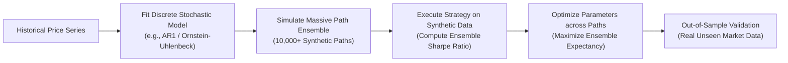
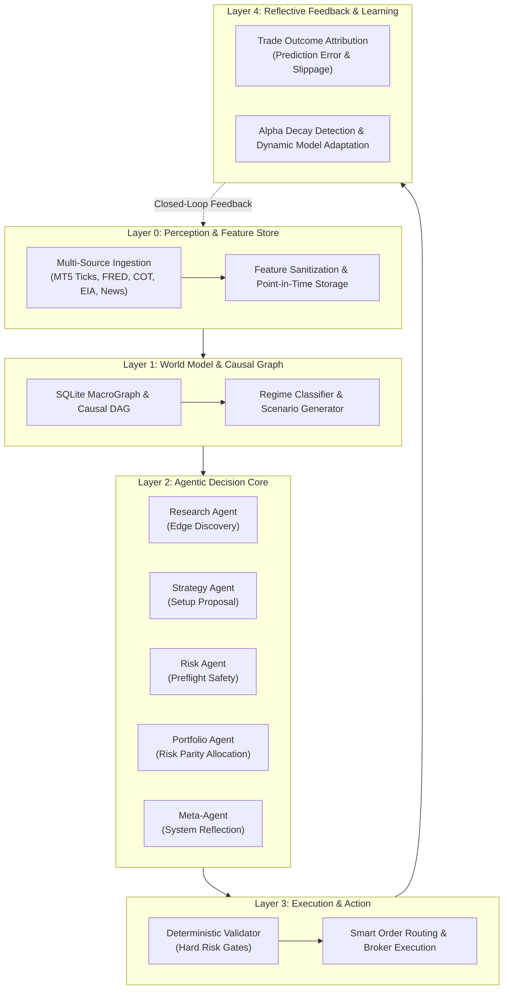

# Quantitative Research, Edge Discovery & Autonomous Trading System Foundations

## 📖 Executive Summary & Table of Contents

This document consolidates the mathematical foundations, statistical validation methodologies, risk management frameworks, causal reaction models, and meta-reflective autonomous architecture powering the quantitative trading system.

### Table of Contents
1. [The Problem of Overfitting & The Simulation Solution (Author-C's Approach)](#1-the-problem-of-overfitting--the-simulation-solution)
2. [Compounding as Geometric Convexity & Real-Market Realities (Gold & Forex)](#2-compounding-as-geometric-convexity--real-market-realities)
3. [Institutional-Grade Realistic Risk Management Framework](#3-institutional-grade-realistic-risk-management-framework)
4. [Correlation Matrix Analysis & Risk-Parity Portfolio Optimization](#4-correlation-matrix-analysis--risk-parity-portfolio-optimization)
5. [Master Macro Causal Chains & Real-Time Situation-Reaction System](#5-master-macro-causal-chains--real-time-situation-reaction-system)
6. [Retail-to-Institutional Edge Discovery, Validation & Lifecycle Management](#6-edge-discovery-validation--lifecycle-management)
7. [Monte Carlo Simulation & Regime-Switching Techniques](#7-monte-carlo-simulation--regime-switching-techniques)
8. [Hidden Markov Model (HMM) Regime Detection](#8-hidden-markov-model-hmm-regime-detection)
9. [Full Map of Autonomous Multi-Agent Trading System](#9-full-map-of-autonomous-multi-agent-trading-system)
10. [Self-Diagnosing Architecture, Bayesian Model Averaging & Causal Discovery](#10-self-diagnosing-architecture-bayesian-model-averaging--causal-discovery)

---

## 1. The Problem of Overfitting & The Simulation Solution

### The Flaw in Traditional Optimization
Traditional optimization tests a trading strategy directly against historical price data, tuning parameters (e.g., moving average lengths, RSI thresholds) to maximize a historical performance metric such as Total P&L or Sharpe Ratio.

* **Root Cause of Overfitting**: Trading strategies typically generate far fewer discrete trading signals than there are underlying data points. It is statistically trivial to "cherry-pick" a parameter set that aligns with historical noise patterns without possessing any genuine out-of-sample predictive power.
* **The Naive Fallacy**: Simply adding older historical data fails because market microstructure (bid-ask spreads, liquidity providers, participant algorithms, regulatory regimes) shifts over time, rendering distant historical data obsolete.

### Dr. Robustness Playbook's Synthetic Simulation Methodology
To eliminate data scarcity and parameter overfitting, we model the continuous historical price series mathematically and generate synthetic ensembles of price paths:



#### Step 1: Model the Price Series
Select a discrete time-series model. For mean-reverting or trend processes, fit an Autoregressive model ($\text{AR}(1)$) or Ornstein-Uhlenbeck process on log prices:
\[
\ln(P_t) = \mu + \phi \ln(P_{t-1}) + \epsilon_t, \quad \epsilon_t \sim \mathcal{N}(0, \sigma^2)
\]
*Why this avoids overfitting*: Fitting a continuous price model estimates 2–3 parameters across *every single data point*, unlike a trading strategy that isolates few signal events.

#### Step 2: Simulate Price Paths
Generate an ensemble of simulated paths (e.g., 10,000 paths). Ensure path lengths exceed $10\times$ the calculated half-life of mean reversion:
\[
\tau_{1/2} = \frac{\ln(2)}{1 - \phi}
\]

#### Step 3: Run Strategy & Optimize across Ensembles
- **Method A (Maximize Average Performance)**: Calculate the Sharpe ratio for candidate parameters across all $N$ simulated paths and select parameters that maximize the mean:
  \[
  \theta^* = \arg\max_\theta \frac{1}{N} \sum_{i=1}^N \text{Sharpe}(\theta, \text{Path}_i)
  \]
- **Method B (Maximize Frequency of Best Performance)**: Select the parameter set that most frequently ranks #1 across paths (mode of the distribution).

#### The Ensemble Real-World Reality
An optimized parameter represents the *expected average* across thousands of paths, yet the actual future unfolds along a single realized path. To harness this statistical law of large numbers, the system must trade an **ensemble of uncorrelated assets** (e.g., 50+ currency pairs, commodities, indices).

---

## 2. Compounding as Geometric Convexity & Real-Market Realities

### Geometric Convexity ("Growth on Growth")
Compounding is inherently non-linear. Small differences in Compound Annual Growth Rate (CAGR) produce exponential divergence in terminal equity over multi-decade horizons:
- **Baseline Path (7.5% CAGR)**: \$1,000,000 over 30 years $\approx$ **\$8,755,000**
- **Convex Path (18.0% CAGR)**: \$1,000,000 over 30 years $\approx$ **\$143,370,000**

### The Price of Convexity
High compound growth demands enduring volatility and deep drawdowns (e.g., 30%–40% equity drawdowns). Capital preservation is the non-negotiable prerequisite: an investor who suffers a 50% drawdown requires a 100% gain simply to recover to breakeven.

### Forex & Gold vs. A Fair Coin
Gold and Forex are non-stationary, costly, high-dimensional probability games:

| Dimension | Fair Coin | Forex / Gold Markets |
| :--- | :--- | :--- |
| **True Probability** | Known constant ($p = 0.5$) | Unknown, time-varying, regime-dependent |
| **Serial Independence** | Perfect ($P(A \cap B) = P(A)P(B)$) | Autocorrelation in volatility, regime clustering |
| **Friction Costs** | Zero | Spreads, commissions, financing swaps, slippage |
| **Leverage & Ruin** | None | High broker leverage $\rightarrow$ Ruin probability $> 0$ |
| **Participant Topology** | Zero | Millions of competing algorithmic agents & central banks |
| **Non-Stationarity** | None | Structural breaks, policy regime shifts |
| **Market Reflexivity** | None | Order flow impacts liquidity and moves market price |

---

## 3. Institutional-Grade Realistic Risk Management Framework

```
                       CORE PRINCIPLE:
       ┌──────────────────────────────────────────────┐
       │     1. Preserve Capital First                │
       │     2. Harvest Statistical Edge Second       │
       │     3. Allow Geometric Compounding Third     │
       └──────────────────────────────────────────────┘
```

### Position Sizing Protocol
Never size positions based on fixed notional capital. Size positions strictly on **Account Loss at Invalidation**:
\[
\text{Position Size} = \frac{\text{Account Equity} \times \text{Risk Per Trade (\%)}}{\text{Distance to Invalidation (ATR or Structural Stop)}}
\]

* **Conservative / Institutional**: $0.25\% - 0.50\%$ of equity per trade.
* **Aggressive / Pro Trader**: $0.50\% - 1.00\%$ of equity per trade.
* **Reckless Boundary**: $> 1.50\%$ per trade in leveraged markets.

### Portfolio Heat & Multi-Tier Circuit Breakers

| Threshold Level | Metric / Drawdown | Mandatory Protocol Action |
| :--- | :--- | :--- |
| **Max Portfolio Heat** | Open risk across all assets | $\le 2.0\% - 4.0\%$ total equity at risk |
| **Tier 1 Circuit Breaker** | $5\% - 8\%$ drawdown from peak | Immediately reduce all new position sizes by $50\%$ |
| **Tier 2 Circuit Breaker** | $10\% - 12\%$ drawdown from peak | Throttle to minimum lot sizes; halt correlated setups |
| **Tier 3 Emergency Stop**| $15\% - 20\%$ drawdown from peak | Complete trading halt; trigger deep model/regime audit |

---

## 4. Correlation Matrix Analysis & Risk-Parity Portfolio Optimization

Correlations in Gold and Forex are dynamic and break down during crises (correlations often surge toward $+1.0$).

### Dependence Metrics Comparison

| Metric | Captured Relationship | Robustness | Best Use Case |
| :--- | :--- | :--- | :--- |
| **Pearson ($r$)** | Linear co-movement | Sensitive to outliers | Portfolio covariance & optimization |
| **Spearman ($\rho$)**| Monotonic rank relationship | Highly robust | Outlier-resistant validation check |
| **Distance Correlation**| Linear & non-linear dependence | Identifies hidden links | Research & feature selection |
| **Tail Copulas** | Extreme co-movement | Critical for crash risk | Stress testing & tail-risk hedging |

### True Risk Parity with Turnover Constraints

Equal Risk Contribution (ERC) ensures each asset contributes an identical proportion to total portfolio volatility $\sigma_p$:
\[
\text{RC}_i = w_i \frac{(\Sigma w)_i}{\sqrt{w^T \Sigma w}} = \frac{1}{N} \sigma_p
\]

```python
import cvxpy as cp
import numpy as np

def solve_risk_parity_with_turnover(cov, w_current, max_turnover=0.20, max_weight=0.35, min_weight=0.01):
    n = len(w_current)
    w = cp.Variable(n)
    
    port_var = cp.quad_form(w, cov)
    risk_contrib = cp.multiply(w, cov @ w)
    target = port_var / n
    
    turnover = cp.norm(w - w_current, 1)
    objective = cp.Minimize(cp.sum_squares(risk_contrib - target) + 0.002 * turnover)
    
    constraints = [
        cp.sum(w) == 1.0,
        w >= min_weight,
        w <= max_weight,
        turnover <= max_turnover
    ]
    
    problem = cp.Problem(objective, constraints)
    problem.solve(solver=cp.SCS)
    return w.value
```

---

## 5. Master Macro Causal Chains & Real-Time Situation-Reaction System

### The 5 Master Causal Transmission Mechanisms

```
1. Central Bank Rate Decision ──► Yield Curve & Real Rates ──► DXY Currency Valuation ──► Asset Multiples
2. Real Yields (10Y TIPS) ──────► Opportunity Cost of Gold ──► Physical & Paper Gold Inflows/Outflows
3. Geopolitical Supply Shocks ──► Energy (WTI Crude) Spikes ──► Headline Inflation Expectations ──► Central Bank Hawkish Shift
4. Speculative Euphoria ────────► Gamma Squeezes & Stop Runs ──► Market Capitulation & Forced Liquidations
5. Cantillon Liquidity Surge ───► Financial Asset Inflation ──► Real Wage Compression ──► Credit Default Strain
```

### Automated Regime Classification Matrix

| Detected Macro Regime | Primary Observable Signals | Dominant Transmission Channel | System Tactical Bias |
| :--- | :--- | :--- | :--- |
| **Normal Risk-Off** | DXY $\uparrow$, Equities $\downarrow$, Gold $\downarrow$, VIX 18–25 | Classical Rate/DXY transmission | Long USD, Short Cyclicals |
| **Crisis Panic / Liquidity Stress** | DXY $\uparrow$, Gold $\uparrow$, VIX $> 30$, Spreads Blowout | Dual Safe-Haven Contagion | Long Gold, Long USD, Long Vol |
| **Stagflation Shock** | Oil $\uparrow$, Gold $\uparrow$, Real Rates $\downarrow$, DXY Flat/$\downarrow$ | Commodity & Real Yield Channel | Long Commodities, Short Duration |
| **Growth / Risk-On Expansion** | Equities $\uparrow$, DXY $\downarrow$, Credit Spreads Tight, VIX $< 15$ | Financial Balance Sheet Channel | Long Equities, Long Carry FX |

---

## 6. Edge Discovery, Validation & Lifecycle Management

```
┌───────────────────────────┐
│ 1. Hypothesis Formulation │ ──► Rooted in economic theory & causal mechanics
└─────────────┬─────────────┘
              ▼
┌───────────────────────────┐
│ 2. Walk-Forward Testing   │ ──► Purged & Embargoed Cross-Validation
└─────────────┬─────────────┘
              ▼
┌───────────────────────────┐
│ 3. Robustness Perturbation│ ──► Parameter variation (±20%), Transaction Cost Stress
└─────────────┬─────────────┘
              ▼
┌───────────────────────────┐
│ 4. Monte Carlo Simulation │ ──► Resample trade returns across 10,000 simulated paths
└─────────────┬─────────────┘
              ▼
┌───────────────────────────┐
│ 5. Alpha Decay Monitoring │ ──► Continuous tracking of rolling 30-trade expectancy
└───────────────────────────┘
```

---

## 7. Monte Carlo Simulation & Regime-Switching Techniques

Simple Monte Carlo resamples trade returns unconditionally. **Regime-Switching Monte Carlo** samples conditionally based on the active market regime ($S_t \in \{\text{Low Vol}, \text{High Vol}\}$), utilizing a discrete Markov transition matrix:
\[
P = \begin{bmatrix} P(\text{Low} \to \text{Low}) & P(\text{Low} \to \text{High}) \\ P(\text{High} \to \text{Low}) & P(\text{High} \to \text{High}) \end{bmatrix} = \begin{bmatrix} 0.85 & 0.15 \\ 0.40 & 0.60 \end{bmatrix}
\]

This generates realistic clustering of adverse trades and exposes fat-tail drawdown risks that naive simulations overlook.

---

## 8. Hidden Markov Model (HMM) Regime Detection

Instead of using arbitrary static indicators (e.g. VIX $> 20$), Gaussian Hidden Markov Models infer unobserved latent market states directly from multivariate feature streams (Returns, Realized Volatility, Credit Spreads, DXY changes):

```python
from hmmlearn.hmm import GaussianHMM
from sklearn.preprocessing import StandardScaler

# Fit 2-state Gaussian HMM
scaler = StandardScaler()
X_scaled = scaler.fit_transform(features[['Gold_Return', 'Gold_Vol']])

hmm = GaussianHMM(n_components=2, covariance_type='full', n_iter=1000, random_state=42)
hmm.fit(X_scaled)
regime_states = hmm.predict(X_scaled)
```

---

## 9. Full Map of Autonomous Multi-Agent Trading System



---

## 10. Self-Diagnosing Architecture, Bayesian Model Averaging & Causal Discovery

### Self-Diagnosis Meta-Reflective Layer
The system monitors its own internal models as untrusted hypotheses. If an HMM shows signs of overfitting (e.g., high regime flip frequency or train-test generalization gap $> 15\%$), the Meta-Agent initiates automated self-remediation:
1. Lowers state count ($n=3 \to n=2$) or switches to diagonal covariance.
2. Increases minimum state persistence thresholds.
3. Blends outputs via Bayesian Model Averaging (BMA).

### Bayesian Model Averaging (BMA) for Architecture Selection
Rather than relying on a single architecture, BMA computes posterior weights across candidate architectures:
\[
P(\mathcal{M}_k \mid \mathcal{D}) = \frac{P(\mathcal{D} \mid \mathcal{M}_k) P(\mathcal{M}_k)}{\sum_{j} P(\mathcal{D} \mid \mathcal{M}_j) P(\mathcal{M}_j)}
\]

### Causal Discovery for Feature Integrity
The system employs algorithm families to isolate genuine structural drivers from spurious statistical correlations:
- **PCMCI / PCMCI+**: Time-series causal discovery resolving lagged dependencies while conditioning on parent sets.
- **NOTEARS / DirectLiNGAM**: Continuous optimization recovering directed acyclic graphs (DAGs) from non-Gaussian financial return series.
- **Granger Causality**: Validating predictive lead-lag relationships across macro indicators and tradeable assets.
