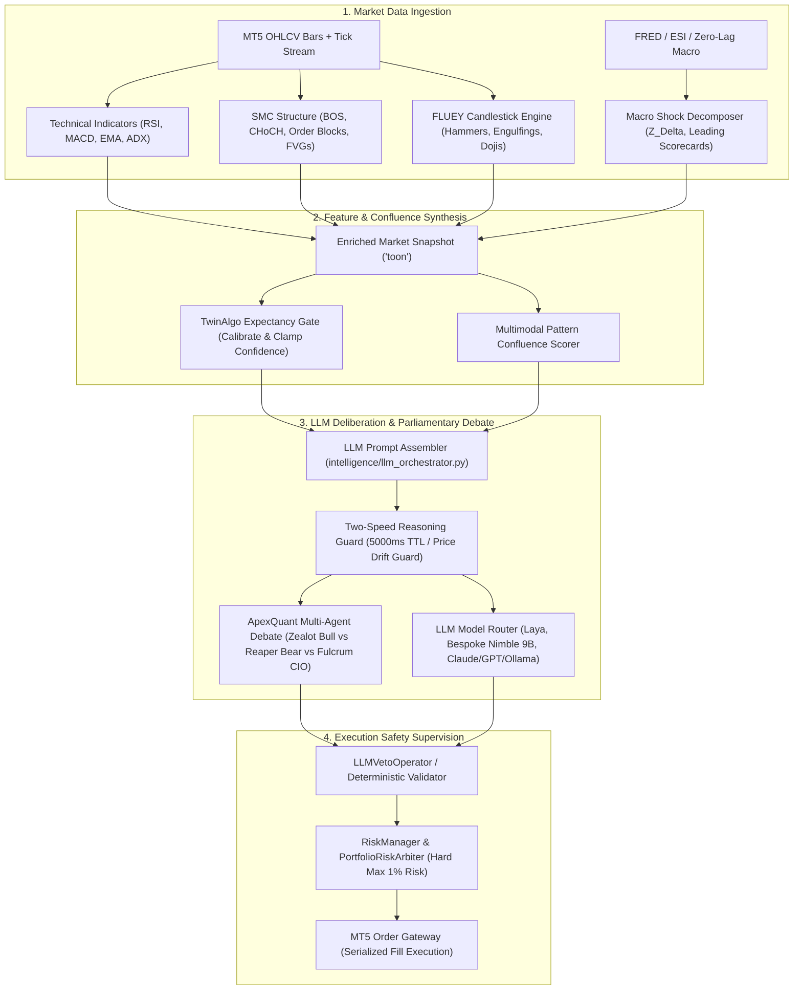

# Master Signal Inventory, LLM Analysis, FLUE, SMC & Multi-Strategy Architecture

> **Exhaustive System Audit & Deep Codebase Mapping**  
> **Repository**: `llm trader - Checkpoint dicisipline soilder - used in antigravity`  
> **Verification Timestamp**: 2026-10-17  
> **Status**: Verified via deterministic runtime execution & AST static inspection

---

## 1. Executive Summary & Core Architectural Locations

This document maps the complete quantitative architecture of the platform, specifically targeting:
1. **The LLM Analysis Engine**: Where LLM analysis is orchestrated, prompted, debated, and gated.
2. **FLUE / FLUEY**: The Formal Logical Unified Engine for Candlestick Analysis (P02, Jha 2026) and its multimodal confluence pipeline.
3. **SMC (Smart Money Concepts)**: The TwinAlgo Layer-1 structural market engine (P06, Thophet 2026) with BOS, CHoCH, Order Blocks, Liquidity Pools, and FVGs.
4. **Technical Analysis (RSI, MACD, etc.)**: How indicators are computed incrementally and utilized as secondary/veto filters in the LLM prompts.
5. **Complete Multi-Layer Strategy Catalog**: Every single strategy, workflow archetype, setup spec, quant model, macro execution model, and policy engine in the project.
6. **Backtest & Training Verification**: Why research/backtesting is strictly isolated from production memory, how broker reconciliations gate RL training, and how post-trade reflection graphs operate.

---

## 2. Where the LLM Analysis Lives

The LLM analysis is not a single script; it is a multi-tier deliberative reasoning plane composed of:

### 2.1 The Master LLM Orchestration Engine
- **Implementation**: [`intelligence/llm_orchestrator.py`](file:///c:/Users/User/OneDrive/Desktop/selfmade%20game%20projects/llm%20trader%20-%20Checkpoint%20dicisipline%20soilder%20-%20used%20in%20antigravity/intelligence/llm_orchestrator.py)
- **Prompt Construction ([Lines 380–520](file:///c:/Users/User/OneDrive/Desktop/selfmade%20game%20projects/llm%20trader%20-%20Checkpoint%20dicisipline%20soilder%20-%20used%20in%20antigravity/intelligence/llm_orchestrator.py#L380-L520))**:
  The system prompt enforces strict quantitative reasoning:
  - **Technical Momentum Rules**: If HMA is declining AND Kalman drift is negative AND alpha ensemble $< -0.5$, buying is strictly forbidden until a reversal pattern prints.
  - **RSI and MACD Directive ([Line 386](file:///c:/Users/User/OneDrive/Desktop/selfmade%20game%20projects/llm%20trader%20-%20Checkpoint%20dicisipline%20soilder%20-%20used%20in%20antigravity/intelligence/llm_orchestrator.py#L386))**: `"RSI/MACD are ADVISORY ONLY (lagging, 3-5h delay on M15). Use as secondary filter: RSI<30/70 or MACD divergence can veto, never trigger."`
  - **Bad Habit Check**: Forces the LLM to self-critique: *"Am I chasing this candle? Am I knife-catching a red candle? Is this a revenge trade?"* If yes, automatically aborts to `HOLD`.
  - **Strict JSON Schema**: Requires `self_reflection`, `reasoning`, `key_levels`, `invalidation_price`, `confluence_explanation`, `action` (`BUY`/`SELL`/`HOLD`), `confidence`, `entry`, `stop_loss`, and `take_profit`.

### 2.2 ApexQuant Multi-Agent Parliamentary Debate Protocol (Paper P13)
- **Implementation**: [`intelligence/debate_protocol.py`](file:///c:/Users/User/OneDrive/Desktop/selfmade%20game%20projects/llm%20trader%20-%20Checkpoint%20dicisipline%20soilder%20-%20used%20in%20antigravity/intelligence/debate_protocol.py)
- **Personas**:
  1. **Zealot (Bull)**: Identifies upside momentum, structural catalysts, and risk/reward geometry.
  2. **Reaper (Bear & Risk Auditor)**: Audits hidden risks, distribution patterns, liquidity traps, and thesis invalidation.
  3. **Fulcrum (Moderating CIO)**: Adjudicates the debate, penalizes rhetorical overconfidence lacking metric evidence, filters behavioral biases, and outputs the consensus verdict.

### 2.3 Two-Speed Reasoning & Deliberation Tax Guard (Paper P20)
- **Implementation**: [`core/two_speed_reasoning.py`](file:///c:/Users/User/OneDrive/Desktop/selfmade%20game%20projects/llm%20trader%20-%20Checkpoint%20dicisipline%20soilder%20-%20used%20in%20antigravity/core/two_speed_reasoning.py)
- **Concept**: Resolves the "deliberation tax" (latency drift during LLM thinking).
- **Guards**: Fast-path deterministic compilation for execution and stop-losses; slow-path deliberation with strict $5,000\text{ ms}$ TTL and maximum $0.20\%$ price drift ($0.5\text{ ATR}$) guard.

### 2.4 Decision Models
- **Text Decision Model**: [`research/decision_models/laya_model.py`](file:///c:/Users/User/OneDrive/Desktop/selfmade%20game%20projects/llm%20trader%20-%20Checkpoint%20dicisipline%20soilder%20-%20used%20in%20antigravity/research/decision_models/laya_model.py) (Laya model fine-tuned on trading taxonomy).
- **Local Nimble Model**: [`models/bespoke_nimble_9b/inference.py`](file:///c:/Users/User/OneDrive/Desktop/selfmade%20game%20projects/llm%20trader%20-%20Checkpoint%20dicisipline%20soilder%20-%20used%20in%20antigravity/models/bespoke_nimble_9b/inference.py) (9B parameter local LLM inference).
- **Kronos Quant Heads**: [`research/decision_models/kronos_heads.py`](file:///c:/Users/User/OneDrive/Desktop/selfmade%20game%20projects/llm%20trader%20-%20Checkpoint%20dicisipline%20soilder%20-%20used%20in%20antigravity/research/decision_models/kronos_heads.py) (overrides technical heads `D11_trend_state`, `D11b_vol_regime`, `D6_yield_curve_divergence` using foundation forecasts).

---

## 3. Where FLUE / FLUEY Lives & How It Works

**FLUEY** stands for **Formal Logical Unified Engine for Candlestick Analysis** (Jha, 2026, Paper P02).

### 3.1 Thresholds & Formal Logic Predicates
- **Implementation**: [`core/flue_thresholds.py`](file:///c:/Users/User/OneDrive/Desktop/selfmade%20game%20projects/llm%20trader%20-%20Checkpoint%20dicisipline%20soilder%20-%20used%20in%20antigravity/core/flue_thresholds.py)
- **Scale-Invariant Thresholds ([Lines 30–40](file:///c:/Users/User/OneDrive/Desktop/selfmade%20game%20projects/llm%20trader%20-%20Checkpoint%20dicisipline%20soilder%20-%20used%20in%20antigravity/core/flue_thresholds.py#L30-L40))**:
  - `doji_body = 0.05`
  - `large_body = 0.60`
  - `small_body = 0.30`
  - `long_shadow_mult = 2.0`
  - `gap_tol = 0.001`
  - `eps = 1e-9`
- **Single-Candle Predicates**: `hammer`, `hanging_man`, `inverted_hammer`, `shooting_star`, `dragonfly_doji`, `gravestone_doji`, `long_legged_doji`, `marubozu_bull`, `marubozu_bear`, `high_wave`.
- **Multi-Candle Predicates**:
  - `bullish_engulfing`: Exact body containment ($C_2 > O_2 \land O_2 < C_1 \land C_2 > O_1$).
  - `bearish_engulfing`: Exact body containment ($C_2 < O_2 \land O_2 > C_1 \land C_2 < O_1$).
  - `bullish_harami` & `bearish_harami`.
  - `morning_star` ($C_1 < O_1 \land \rho_2 \le 0.3 \land C_3 > O_3 \land O_3 > (O_1 + C_1)/2$).
  - `evening_star` ($C_1 > O_1 \land \rho_2 \le 0.3 \land C_3 < O_3 \land O_3 < (O_1 + C_1)/2$).

### 3.2 Integration into Multimodal Confluence
- **Implementation**: [`core/multimodal_analysis.py`](file:///c:/Users/User/OneDrive/Desktop/selfmade%20game%20projects/llm%20trader%20-%20Checkpoint%20dicisipline%20soilder%20-%20used%20in%20antigravity/core/multimodal_analysis.py)
- **Mechanics**:
  Imports `from core import flue_thresholds as flue` ([Line 38](file:///c:/Users/User/OneDrive/Desktop/selfmade%20game%20projects/llm%20trader%20-%20Checkpoint%20dicisipline%20soilder%20-%20used%20in%20antigravity/core/multimodal_analysis.py#L38)).
  Runs `ConfluenceScorer` ([Line 591](file:///c:/Users/User/OneDrive/Desktop/selfmade%20game%20projects/llm%20trader%20-%20Checkpoint%20dicisipline%20soilder%20-%20used%20in%20antigravity/core/multimodal_analysis.py#L591)) across all detected FLUE patterns, generating `PatternConfluence` with a normalized `confluence_score` ($0.0 \dots 1.0$).
  This score is fed into the LLM context (`multimodal_patterns: confluence_score > 0.7 = strong pattern alignment`).

---

## 4. Where SMC (Smart Money Concepts) Lives & How It Works

SMC is implemented according to **Paper P06 (TwinAlgo, Thophet 2026)**: *"Expectancy-Optimised Algorithmic Trading via Dynamic Regime-Conditioned LLM Prompting and SMC Integration on Gold."*

### 4.1 Structural Engine
- **Implementation**: [`core/smc_structure.py`](file:///c:/Users/User/OneDrive/Desktop/selfmade%20game%20projects/llm%20trader%20-%20Checkpoint%20dicisipline%20soilder%20-%20used%20in%20antigravity/core/smc_structure.py)
- **Core Components**:
  1. **Pivot Swing Points** (`swing_points`): Identifies local peaks and troughs over lookback windows.
  2. **Break of Structure (BOS)**: Validated by **two consecutive closes** beyond swing levels (single-close breaks rejected as ranging noise).
  3. **Change of Character (CHoCH)**: Two-close validation against prevailing trend; acts as primary market reversal indicator.
  4. **Order Blocks** (`find_order_blocks`): Last opposing candle prior to an impulsive displacement move, tracked for boundary mitigation (`mitigated: bool`).
  5. **Liquidity Pools** (`liquidity_pools`): Equal Highs (EQH) and Equal Lows (EQL) within tolerance representing stop-loss cluster liquidity pools.
  6. **Dealing Range & Premium/Discount** (`is_premium`, `range_position`): Evaluates current price within Fibonacci dealing zones ($0.382 / 0.50 / 0.618$). Buying in premium is discouraged in bullish regimes.
  7. **Fair Value Gaps (FVG)**: Handled by [`research/alpha_miner/fvg_detector.py`](file:///c:/Users/User/OneDrive/Desktop/selfmade%20game%20projects/llm%20trader%20-%20Checkpoint%20dicisipline%20soilder%20-%20used%20in%20antigravity/research/alpha_miner/fvg_detector.py) with Kondapally degree scores.

### 4.2 SMC Runtime Wiring in the LLM Orchestrator
- **Snapshot Enrichment ([Lines 8430–8501](file:///c:/Users/User/OneDrive/Desktop/selfmade%20game%20projects/llm%20trader%20-%20Checkpoint%20dicisipline%20soilder%20-%20used%20in%20antigravity/intelligence/llm_orchestrator.py#L8430-L8501))**:
  Every trading cycle automatically computes `toon["smc_structure"]` containing:
  - `events`: List of recent BOS/CHoCH events.
  - `has_choch`: Boolean flag if Change of Character occurred in the last 3 events.
  - `order_blocks`: Top 3 unmitigated order blocks.
  - `liquidity_pools`: Active stop-loss liquidity pools.
  - `in_premium`: Boolean flag indicating if price is in premium zone.
  - `fvg_analysis`: Detected FVGs.
- **TwinAlgo Gate Calibration ([Lines 2969–3010](file:///c:/Users/User/OneDrive/Desktop/selfmade%20game%20projects/llm%20trader%20-%20Checkpoint%20dicisipline%20soilder%20-%20used%20in%20antigravity/intelligence/llm_orchestrator.py#L2969-L3010))**:
  Calls [`core/twinalgo_gates.py`](file:///c:/Users/User/OneDrive/Desktop/selfmade%20game%20projects/llm%20trader%20-%20Checkpoint%20dicisipline%20soilder%20-%20used%20in%20antigravity/core/twinalgo_gates.py) (`calibrate_confidence` and `clamped_confidence`) to adjust the proposal confidence based on `choch`, `in_premium`, MTF alignment, and consecutive loss history.
- **Microstructure A+ Confluence Matrix ([`core/microstructure_impact_engine.py`](file:///c:/Users/User/OneDrive/Desktop/selfmade%20game%20projects/llm%20trader%20-%20Checkpoint%20dicisipline%20soilder%20-%20used%20in%20antigravity/core/microstructure_impact_engine.py#L242))**:
  Evaluates 100-point A+ matrix requiring $\ge 85/100$ score combining SMC liquidity sweep, FVG retest, VPIN toxicity $<0.30$, and order book micro-price delta before placing limit orders.

---

## 5. Technical Indicators Engine (RSI, MACD, etc.)

- **Implementation**: [`core/technical_indicators.py`](file:///c:/Users/User/OneDrive/Desktop/selfmade%20game%20projects/llm%20trader%20-%20Checkpoint%20dicisipline%20soilder%20-%20used%20in%20antigravity/core/technical_indicators.py)
- **Indicators Supported**:
  - `ema(series, period)` & `ema_step` ($O(1)$ streaming tick update).
  - `rsi(series, period=14)` & `rsi_step` ($O(1)$ streaming update).
  - `macd(series, fast=12, slow=26, signal=9)` & `macd_step` ($O(1)$ streaming update).
  - `atr(high, low, close, period=14)` & `atr_step` ($O(1)$ streaming update).
  - `wma(series, period)` & `hma(series, period)` (Hull Moving Average).
  - `adx(high, low, close, period=14)` (Wilder's Directional Movement Index).
  - `compute_indicators(df, requests)`: Batch parser handling parameterized indicator requests (e.g. `"EMA(20)"`, `"RSI(14)"`, `"MACD(12,26,9)"`, `"ATR(14)"`, `"ADX(14)"`, `"ALPHA*"`).
- **Scanner Integration**: [`ui/scanner.py`](file:///c:/Users/User/OneDrive/Desktop/selfmade%20game%20projects/llm%20trader%20-%20Checkpoint%20dicisipline%20soilder%20-%20used%20in%20antigravity/ui/scanner.py) runs multi-timeframe scans computing RSI, MACD, and ADX across all active currency pairs.

---

## 6. Comprehensive Inventory: ALL Strategies Across the Entire Codebase

The system implements 8 distinct strategy and setup layers across the repository:

### Layer 1: Drop-In Strategy Plugins ([`strategies/`](file:///c:/Users/User/OneDrive/Desktop/selfmade%20game%20projects/llm%20trader%20-%20Checkpoint%20dicisipline%20soilder%20-%20used%20in%20antigravity/strategies))
Inherit from [`BaseStrategy`](file:///c:/Users/User/OneDrive/Desktop/selfmade%20game%20projects/llm%20trader%20-%20Checkpoint%20dicisipline%20soilder%20-%20used%20in%20antigravity/strategies/base.py) with dynamic discovery by [`StrategyLoader`](file:///c:/Users/User/OneDrive/Desktop/selfmade%20game%20projects/llm%20trader%20-%20Checkpoint%20dicisipline%20soilder%20-%20used%20in%20antigravity/strategies/loader.py):
1. **`kronos_neural`** ([`KronosNeuralStrategy`](file:///c:/Users/User/OneDrive/Desktop/selfmade%20game%20projects/llm%20trader%20-%20Checkpoint%20dicisipline%20soilder%20-%20used%20in%20antigravity/strategies/kronos_neural_strategy.py)): Dual BSQ K-line Transformer forecasting + L2 DOM imbalance.
2. **`avellaneda_stoikov_scalp`** ([`AvellanedaStoikovScalpStrategy`](file:///c:/Users/User/OneDrive/Desktop/selfmade%20game%20projects/llm%20trader%20-%20Checkpoint%20dicisipline%20soilder%20-%20used%20in%20antigravity/strategies/avellaneda_stoikov_scalp_strategy.py)): High-frequency inventory-risk market making and optimal spread positioning.
3. **`kalman_statarb`** ([`KalmanStatArbStrategy`](file:///c:/Users/User/OneDrive/Desktop/selfmade%20game%20projects/llm%20trader%20-%20Checkpoint%20dicisipline%20soilder%20-%20used%20in%20antigravity/strategies/kalman_statarb_strategy.py)): Kalman filter state-space spread estimation with OU half-life thresholding.
4. **`cointegration_pair`** ([`CointegrationPairStrategy`](file:///c:/Users/User/OneDrive/Desktop/selfmade%20game%20projects/llm%20trader%20-%20Checkpoint%20dicisipline%20soilder%20-%20used%20in%20antigravity/strategies/cointegration_pair_strategy.py)): Engle-Granger two-step cointegration pairs arbitrage.
5. **`macro_event_alpha`** ([`MacroEventAlphaStrategy`](file:///c:/Users/User/OneDrive/Desktop/selfmade%20game%20projects/llm%20trader%20-%20Checkpoint%20dicisipline%20soilder%20-%20used%20in%20antigravity/strategies/macro_event_alpha_strategy.py)): 3-phase economic release state machine.

### Layer 2: Institutional Quant Workflows ([`core/harness/workflows.py`](file:///c:/Users/User/OneDrive/Desktop/selfmade%20game%20projects/llm%20trader%20-%20Checkpoint%20dicisipline%20soilder%20-%20used%20in%20antigravity/core/harness/workflows.py))
1. **`StatisticalArbitrageWorkflow`**: Dynamic cointegration & OU mean-reversion.
2. **`MeanReversionWorkflow`**: Fractional differentiation ($d=0.40$) + BOCPD changepoints + Hurst $H < 0.45$.
3. **`MacroCausalMomentumWorkflow`**: 134-node causal macro DAG + 23 barometers + roll yield.
4. **`MicrostructureBreakoutWorkflow`**: VPIN order-flow toxicity + micro-price imbalance + Hurst $H > 0.55$.
5. **`NeuralFoundationWorkflow`**: Kronos forecast + Brier calibration / ECE + CPCV DSR.
6. **`MacroEventAlphaWorkflow`**: Leading economic indicator scorecards + $Z_\Delta$ surprise transmission.
7. **`RetailQuantModelsWorkflow`**: 11-model retail quant safety suite.

### Layer 3: Certified Research Plane Strategies ([`research/strategy_signal_registry.py`](file:///c:/Users/User/OneDrive/Desktop/selfmade%20game%20projects/llm%20trader%20-%20Checkpoint%20dicisipline%20soilder%20-%20used%20in%20antigravity/research/strategy_signal_registry.py))
13 base causal models + 5 `@sprt_confirm` variants:
`kronos_h1`, `statarb_eur_chf`, `macro_nfp_pullback`, `meanrev_bollinger`, `alpha_055_orderflow`, `alpha_098_copula`, `agent_execution_rl`, `agent_regime_supervisor`, `model_bocpd_changepoint`, `model_kalman_filter`, `gold_momentum_h4`, `spx_volatility_skew`, `sprt_hypothesis_gate`.

### Layer 4: Structural Setup Registry ([`research/setup_registry.py`](file:///c:/Users/User/OneDrive/Desktop/selfmade%20game%20projects/llm%20trader%20-%20Checkpoint%20dicisipline%20soilder%20-%20used%20in%20antigravity/research/setup_registry.py))
Deterministic setup specifications gating journal segmentation and trade execution:
1. `trend_pullback_v1`: Multi-timeframe trend continuation near key levels ($\ge 2.0R$).
2. `range_reversal_v1`: Range-bound edge rejection at key support/resistance ($\ge 2.0R$).
3. `liquidity_sweep_reversal_v1`: Sweep and wick rejection with volume confirmation ($\ge 2.0R$).
4. `asian_range_breakout_v1`: London/NY breakout of defined Asian session range ($\ge 2.0R$).
5. `macro_continuation_v1`: Post-news continuation following blackout window ($\ge 2.5R$).
6. `scalp_bracket_v1`: Fixed 2R bracket continuation for engine-mode signals.
7. `momentum_cascade_v1`: Hawkes self-exciting cascade with VPIN confirmation ($\ge 2.0R$).

### Layer 5: Retail Quantitative Models ([`core/retail_quant_models.py`](file:///c:/Users/User/OneDrive/Desktop/selfmade%20game%20projects/llm%20trader%20-%20Checkpoint%20dicisipline%20soilder%20-%20used%20in%20antigravity/core/retail_quant_models.py))
11 models: SPRT Strategy Kill, CUSUM Monitor, Alpha Capacity Decay, Retail Friction Drag, Bayesian Win Rate, Correlation Breakdown, Sentiment Veto, 1R Account Sizing, Session Spread Multiplier, OU Time Stop, 4-Sleeve De-Correlation.

### Layer 6: Macro Event Execution Models ([`core/macro_event_alpha_engine.py`](file:///c:/Users/User/OneDrive/Desktop/selfmade%20game%20projects/llm%20trader%20-%20Checkpoint%20dicisipline%20soilder%20-%20used%20in%20antigravity/core/macro_event_alpha_engine.py))
4 specialized models:
- **Model A**: Post-Announcement Pullback (Fibonacci retracement).
- **Model B**: Dual OCO Straddle (pre-event volatility bracket).
- **Model C**: Spike Fade (exhaustion reversal).
- **Model D**: Pre-Event Positioning (leading indicator high-conviction bias).

### Layer 7: Zero-Shot Regime Adaptation Policy Library ([`core/policy_library.py`](file:///c:/Users/User/OneDrive/Desktop/selfmade%20game%20projects/llm%20trader%20-%20Checkpoint%20dicisipline%20soilder%20-%20used%20in%20antigravity/core/policy_library.py))
Stores pre-computed policy parameter vectors (`risk_multiplier`, `position_scale`, `stop_loss_atr`, `take_profit_atr`) per regime (`LOW_VOL_TREND`, `LOW_VOL_RANGE`, `HIGH_VOL_TREND`, `HIGH_VOL_CRISIS`) and dynamically blends them via softmax temperature regime gating without multi-day adaptation lag.

### Layer 8: Evolutionary Genetic Alpha Strategies ([`research/alpha_miner/`](file:///c:/Users/User/OneDrive/Desktop/selfmade%20game%20projects/llm%20trader%20-%20Checkpoint%20dicisipline%20soilder%20-%20used%20in%20antigravity/research/alpha_miner))
Hierarchical genetic algorithm discovering formulaic alpha combinations evaluated by [`OptimalStrategyEvaluator`](file:///c:/Users/User/OneDrive/Desktop/selfmade%20game%20projects/llm%20trader%20-%20Checkpoint%20dicisipline%20soilder%20-%20used%20in%20antigravity/research/alpha_miner/optimal_strategy.py) and bridged via [`AlphaStrategyBridge`](file:///c:/Users/User/OneDrive/Desktop/selfmade%20game%20projects/llm%20trader%20-%20Checkpoint%20dicisipline%20soilder%20-%20used%20in%20antigravity/research/alpha_miner/strategy_bridge.py).

---

## 7. Learning Loop, Memory & Reconciliations Audit

1. **Backtesting Memory Isolation**:
   - Backtest engine strictly locked out of `trading_state.db` via `validate_backtest_journal_path`.
   - Simulated trades stored in `research_backtest_trades`.
   - Does not touch `trades`, `playbooks`, or `verified_memories`.
   - Strategy promotions are blocked during backtesting.
2. **Reconciliation Gates Training**:
   - RL/PPO/Meta-RL training requires `broker_reconciled_tickets(_db_path)`. Unreconciled journal rows cannot be used as policy rewards.
3. **Cognitive Post-Trade Reflection**:
   - Live/paper trades trigger [`intelligence/reflection_graph.py`](file:///c:/Users/User/OneDrive/Desktop/selfmade%20game%20projects/llm%20trader%20-%20Checkpoint%20dicisipline%20soilder%20-%20used%20in%20antigravity/intelligence/reflection_graph.py) updating Kelly sizing, distilling atomic facts, updating L2 playbooks, and recalibrating the causal macro DAG.
