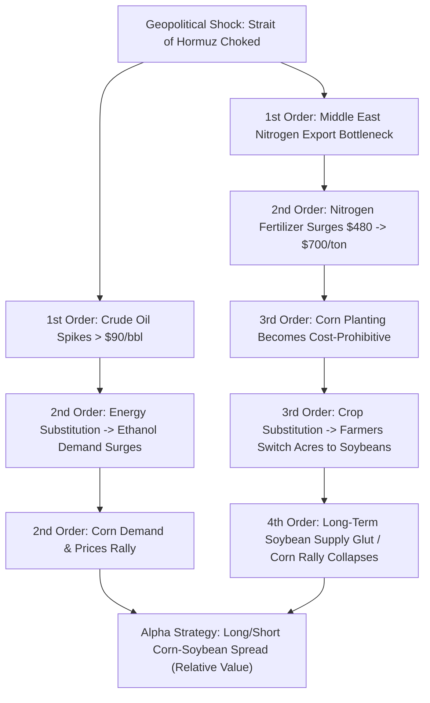
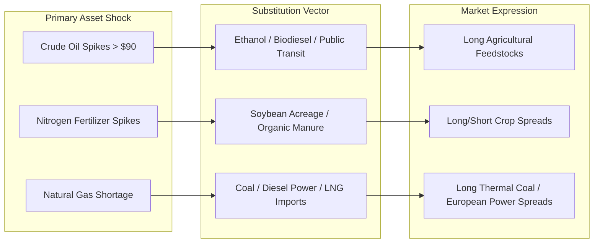

# Geopolitical & Macro-Commodity Cross-Market Analysis

## Executive Summary & Core Paradigm

Traditional market analysis suffers from **first-order reductionism**—the naive assumption that an event produces a single, immediate, direct linear reaction (e.g., *"War in the Middle East = Oil prices go up"*). 

Master macro-commodity analysis operates on **second-, third-, and N-th order causal thinking** (cascade or ripple-effect analysis). Instead of trading the crowded, obvious first-order trade where alpha is rapidly commoditized, the macro analyst traces the cross-market transmission mechanism across seemingly unrelated asset classes, supply chains, input costs, and geopolitical theaters.

---

## 1. Second- and Third-Order Effects Analysis (The Cascade Framework)

### The First-Order Fallacy
First-order thinking is simple, fast, and intuitive. It asks: *"What is the direct consequence of this event?"*
- *Example*: An escalation in the Persian Gulf threatens tanker traffic $\implies$ Buy Crude Oil futures.
- *The Limitation*: Millions of retail participants and high-frequency algorithms execute this simultaneously, bidding up prices instantly, creating poor risk/reward entries with high slippage.

### Higher-Order Transmission Mechanics
Second- and third-order thinking asks: *"And then what happens? What are the secondary constraints, input dependencies, and behavioral adaptations that will trigger 3 to 12 months down the line?"*

| Order Level | Transmission Node | Physical / Market Mechanism | Market Impact |
| :--- | :--- | :--- | :--- |
| **1st Order** | Crude Oil Transport | Strait of Hormuz closure disrupts ~20% of global petroleum transit. | Brent & WTI spike $+25\%$. |
| **1st Order** | Petrochemical Feedstocks | Middle Eastern ammonia and urea production plants cut export logistics. | Nitrogen fertilizer price spikes from $\$480$ to $\$700/\text{ton}$. |
| **2nd Order** | Fuel Substitution | Refineries and blenders substitute expensive crude with corn-based ethanol. | Corn demand surges; agricultural futures rally. |
| **2nd Order** | Input-Cost Inflation | Corn requires intense nitrogen fertilizer application (~140–200 lbs/acre). | Production breakeven cost for corn farmers surges by $40\%$. |
| **3rd Order** | Crop Acreage Substitution | Soybeans are legumes that naturally fix their own atmospheric nitrogen via *Rhizobium* root bacteria (requiring zero nitrogen fertilizer). Farmers shift millions of acres from corn to soybeans. | Soybean forward supply expands; corn supply contracts. |
| **4th Order** | Market Equilibrium | Massive soybean acreage causes a supply glut; exorbitant corn prices crash downstream livestock margins. | The initial corn speculative rally terminates; corn-soy relative value mean-reverts. |

---

## 2. Relative Value (Spread) Analysis

A relative value trader does not speculate on absolute price direction ($P_t$). Instead, they trade the **relationship, ratio, or price differential** between two economically linked assets:
\[
\text{Spread}_t = P_{\text{Asset A}, t} - \beta \cdot P_{\text{Asset B}, t} \quad \text{or} \quad \text{Ratio}_t = \frac{P_{\text{Asset A}, t}}{P_{\text{Asset B}, t}}
\]

### Key Spread Categories in Macro-Commodities:
1. **The Corn-Soybean Ratio**:
   - Historical equilibrium ratio trades between $2.2:1$ and $2.6:1$ (bushel of soybeans to bushel of corn).
   - If ratio drops below $2.0$, soybeans are historically cheap relative to corn; farmers allocate more acreage to corn.
   - If ratio exceeds $2.8$, soybeans are historically expensive; farmers switch acreage to soybeans.
   - *Spread Trade Execution*: Long Soybeans / Short Corn when ratio is depressed during fertilizer shocks.

2. **Crackle & Crush Spreads**:
   - **Crack Spread**: The refining margin between crude oil and refined products ($\text{3:2:1 Crack} = 3 \text{ Crude} \to 2 \text{ Gasoline} + 1 \text{ Distillate/Diesel}$).
   - **Soybean Crush Spread**: The processing margin between raw soybeans and downstream products ($\text{Soybean} \to \text{Soybean Meal} + \text{Soybean Oil}$).
   - **Spark / Dark Spread**: The gross margin of gas-fired (Spark) or coal-fired (Dark) power generation against wholesale electricity prices.

---

## 3. Input-Cost & Supply Chain Bottleneck Analysis

All physical goods require a chain of upstream feedstocks, energy, logistics, and capital. Bottleneck analysis models the **chokepoints** where capacity elasticity is near zero.

### Critical Macro Chokepoint Archetypes:
1. **Geographic Chokepoints**:
   - *Straits of Hormuz*: ~21M bbl/day petroleum, LNG, ammonia exports.
   - *Malacca Strait*: ~16M bbl/day oil and critical mineral flows to East Asia.
   - *Bab el-Mandeb & Suez Canal*: European-Asian container freight, refined products.
   - *Panama Canal*: Western Hemisphere grain and LNG transit dependent on freshwater lock levels.
2. **Chemical & Mineral Precursor Chokepoints**:
   - Natural gas $\to$ Haber-Bosch process $\to$ Ammonia $\to$ Nitrogen fertilizer $\to$ Global staple crops (Wheat, Corn, Rice).
   - Silicon / Neon gas / Lithography optics $\to$ Semiconductor fabrication $\to$ Automotive / Industrial equipment.
   - Rare Earth Elements (Neodymium, Dysprosium) $\to$ Permanent magnets $\to$ Electric vehicle powertrains and wind turbines.

---

## 4. Substitution Effect Analysis

When an asset encounters supply destruction or price inflation, human economic systems do not simply stop consuming; they seek physical, synthetic, or behavioral substitutes.

### Substitution Vectors:
1. **Energy Substitution**: Thermal coal $\leftrightarrow$ Liquefied Natural Gas (LNG) $\leftrightarrow$ Crude Distillates (Diesel) $\leftrightarrow$ Biofuels (Ethanol).
2. **Agricultural Substitution**: Corn (high nitrogen demand) $\leftrightarrow$ Soybeans (nitrogen fixing) $\leftrightarrow$ Wheat (cool climate alternative).
3. **Currency & Reserve Substitution**: US Dollar reserves $\leftrightarrow$ Physical Gold bullion $\leftrightarrow$ Bilateral local currency swaps (petroyuan, gold-backed settlements).

---

## 5. Geopolitical Spillover & Theater Escalation Modeling

Geopolitical spillover analysis evaluates how regional kinetic, diplomatic, or economic conflict radiates outward across sovereign balance sheets, currency pegs, and supply routes.

### Analytical Checklist for Geopolitical Events:
1. **Theater Boundary**: Where is the physical kinetic activity vs. where are the economic transit arteries?
2. **Sanction Asymmetry**: Does the sanction harm the target more than the sanctioning coalition (e.g. European natural gas dependence vs Russian pipeline leverage)?
3. **Escalation Ladder (Herman Kahn Framework)**:
   - Level 1: Diplomatic rhetoric and military exercises.
   - Level 2: Target-specific export controls / tariffs.
   - Level 3: Asset freezes and secondary financial sanctions (SWIFT restrictions).
   - Level 4: Maritime blockades and shipping insurance cancellations.
   - Level 5: Direct kinetic strikes against critical energy/industrial infrastructure.
4. **Third-Party Arbitrageurs**: Which neutral sovereign entities will act as intermediary trading hubs (e.g., UAE, Turkey, India refining and re-exporting discounted Russian crude)?
