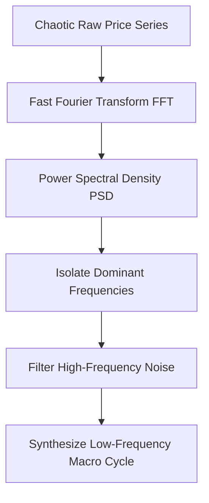
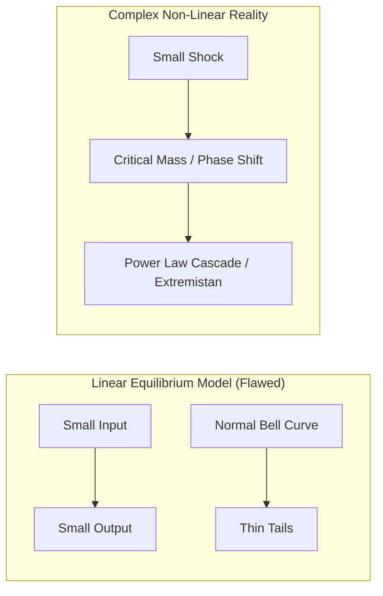

# Quantitative, Statistical, Machine Learning & Chaos Models

## Executive Overview

Quantitative analysis transforms raw price feeds, cross-sectional fundamentals, and macroeconomic data into mathematically rigorous, testable hypotheses. This document details the complete spectrum of quantitative methodologies—from traditional statistical clustering and Bayesian updating to frequency-domain signal processing, neural network probing, and non-linear chaos dynamics.

---

## 1. Statistical & Pattern-Finding Frameworks

### A. Cluster Analysis
- **Definition**: Unsupervised partitioning of $N$-dimensional data points such that intra-cluster similarity is maximized and inter-cluster similarity is minimized.
- **Algorithms**: K-Means, Hierarchical Agglomerative Clustering (Ward's minimum variance), DBSCAN (density-based spatial clustering for noisy data).
- **Macro/Quant Application**: Grouping global currency pairs or equity sectors based on rolling correlation regimes, beta to global liquidity, and sovereign yield differentials to build uncorrelated statistical baskets.

### B. Factor Analysis & Dimensionality Reduction
- **Definition**: Explaining variance across dozens of observed correlated variables via a small set of unobserved latent factors:
  \[
  X = \Lambda F + \epsilon
  \]
- **Techniques**:
  - **Principal Component Analysis (PCA)**: Orthogonal linear transformation projecting data onto directions of maximum variance (e.g. Yield curve dynamics: Level, Slope, Curvature).
  - **t-Distributed Stochastic Neighbor Embedding (t-SNE) & UMAP**: Non-linear manifold learning preserving local neighborhood topologies for high-dimensional feature spaces.
- **Macro Application**: Distilling 500 macroeconomic time series (FRED, labor, housing, PMIs, trade) into 3 master orthogonal macro factors: *Growth Shock*, *Inflation Shock*, and *Liquidity Tightening*.

### C. Bayesian Probability Updating
- **Mathematical Formulation**:
  \[
  P(\theta \mid \mathcal{D}) = \frac{P(\mathcal{D} \mid \theta) \cdot P(\theta)}{P(\mathcal{D})} = \frac{P(\mathcal{D} \mid \theta) \cdot P(\theta)}{\int P(\mathcal{D} \mid \theta') P(\theta') d\theta'}
  \]
- **Quant/Macro Application**: Continuously updating the posterior probability of a Central Bank rate cut or a systemic regime transition as new data prints arrive (e.g., Non-Farm Payrolls, CPI releases), avoiding binary overreactions to single noise data points.

### D. Anomaly & Outlier Detection
- **Techniques**: Isolation Forests, Local Outlier Factor (LOF), Mahalanobis Distance, Autoencoder Reconstruction Errors.
- **Application**: Detecting synthetic market manipulation, flash crashes, sudden liquidity evaporation in interbank order books, and data feed corruption.

---

## 2. Signal Processing & Frequency Domain Analysis

Markets exhibit multiple overlapping periodicities (daily session cycles, weekly option expiries, quarterly rebalancing, 4-year election cycles, 10-year capex cycles).

### A. Fast Fourier Transform (FFT) & Spectral Analysis
- **Formulation**: Decomposes a discrete time series $x_n$ into its constituent sinusoidal frequency components:
  \[
  X_k = \sum_{n=0}^{N-1} x_n e^{-i 2\pi k n / N}
  \]
- **Application**: Identifying dominant cycle lengths in commodity supply gluts, agricultural planting seasons, and inventory restocking cycles.

### B. Wavelet Transform (Continuous & Discrete)
- **Advantage over Fourier**: Fourier analysis assumes stationarity across the entire time window; Wavelet transforms provide localized time-frequency resolution (identifying *when* a specific frequency burst occurred).

---

## 3. Artificial Intelligence, Machine Learning & Ensemble Architectures

### A. Saliency Maps & Neural Network "Black Box" Probing
- Deep neural networks learn complex non-linear representations. Analysts use gradient-weighted class activation mapping (Grad-CAM), Integrated Gradients, and SHAP (SHapley Additive exPlanations) values to identify exactly which features or historical bars drove a trade proposal.

### B. Ensemble Learning & Voting Consensus
- **Ensemble Hypothesis**: Combining diverse, weakly-correlated models produces a meta-predictor with lower variance and superior generalization:
  \[
  \hat{y}_{\text{ensemble}} = \sum_{m=1}^M w_m f_m(x), \quad \text{where } \sum w_m = 1
  \]
- **Methods**: Bootstrap Aggregating (Bagging / Random Forests), Gradient Boosting (XGBoost / LightGBM), Bayesian Model Averaging (BMA).

---

## 4. Complexity, Chaos Theory & Non-Linear Dynamics

Traditional finance relies on Gaussian assumptions of linear equilibrium. Real economic systems are **complex adaptive systems** characterized by feedback loops, non-linearity, and emergent phase transitions.

### A. Agent-Based Modeling (ABM)
- Instead of solving top-down aggregate macro equations, ABM simulates thousands of autonomous digital agents (e.g. Trend followers, Value funds, Retail traders, Central Banks) interacting under local behavioral rules.
- **Emergence**: Market panics, flash crashes, and liquidity dry-ups spontaneously emerge from bottom-up agent interactions.

### B. Fractal Analysis & Hurst Exponent
- **Mandelbrot Fractal Geometry**: Market prices exhibit self-similarity across time scales (a 5-minute chart exhibits similar statistical geometry to a daily or monthly chart).
- **Hurst Exponent ($H$)**:
  - $H = 0.5$: Geometric Brownian Motion (Pure random walk).
  - $0 \le H < 0.5$: Mean-reverting / anti-persistent time series.
  - $0.5 < H \le 1.0$: Persistent / trending time series.

### C. Punctuated Equilibrium & Phase Transitions
- Systems build invisible internal pressure during extended periods of apparent stability (low volatility), followed by violent, non-linear phase transitions (e.g., currency peg breaks, sovereign debt restructuring, liquidity crisis).

---

## 5. Fat-Tail Statistics & Power Law Dynamics

| Property | Mediocristan (Gaussian / Bell Curve) | Extremistan (Power Law / Fat-Tailed) |
| :--- | :--- | :--- |
| **Governing Distribution** | Normal / Gaussian Distribution | Pareto / Lévy Stable / Student's t |
| **Outlier Impact** | $3\sigma$ events are rare; $6\sigma$ events impossible | Extreme outliers dominate total variance and cumulative returns |
| **Averages** | Sample mean rapidly converges to population mean | Sample mean is unstable and dominated by single rare events |
| **Risk Measure** | Standard Deviation / Volatility / Classic VaR | Expected Shortfall (CVaR), Max Drawdown, Tail Risk Hedging |
| **Mathematical Decay** | Exponential decay: $P(X > x) \sim e^{-x^2}$ | Polynomial / Power decay: $P(X > x) \sim x^{-\alpha}$ |

### Quantitative Mandate:
- Never optimize trading parameters purely on Gaussian mean Sharpe ratios.
- Run continuous 10,000+ path stochastic simulations (Dr. Robustness Playbook AR(1) ensembles) and Markov regime-switching Monte Carlo simulations to calculate true tail-risk ruin probabilities.
