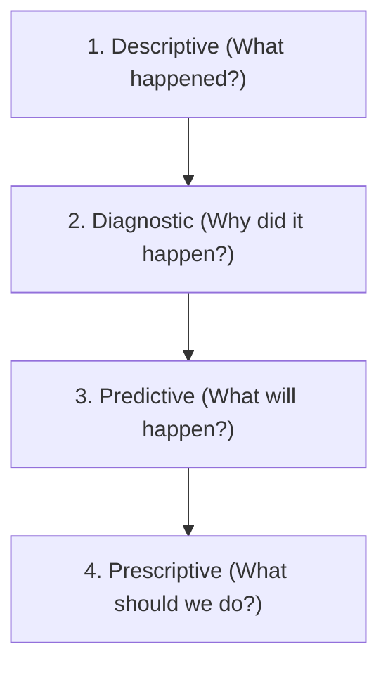
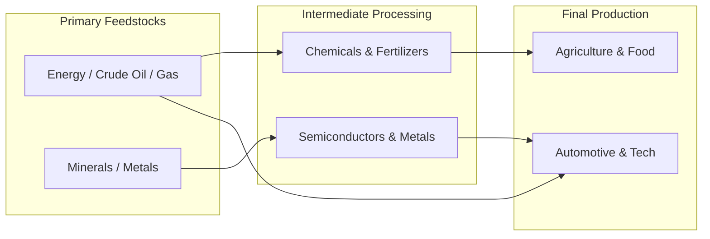

# Economic Systems, Input-Output Matrices & Feedback Dynamics

## Executive Summary

Economic systems are vast, interconnected networks of resource production, capital allocation, labor specialization, and consumption. Understanding how an economic shock propagates requires quantitative frameworks capable of modeling inter-industry dependencies, temporal lead-lag relationships, and non-linear feedback loops.

---

## 1. The Data Science & Analytics Hierarchy

1. **Descriptive Analysis**: Summarizes raw historical records into structured statistical summaries (*"US Core CPI accelerated to 3.8% YoY"*).
2. **Diagnostic Analysis**: Isolates root causal drivers and component contributions (*"CPI acceleration was driven by shelter lag and crude refining margins, while durable goods deflated"*).
3. **Predictive Analysis**: Employs econometric models and stochastic path simulations to forecast distributions of future outcomes (*"Forward inflation expectations will compress over 6 months as rental vacancy rates normalize"*).
4. **Prescriptive Analysis**: Recommends optimal, risk-controlled actions given constraints and objective functions (*"Allocate 25% long 2Y sovereign debt, short commodity index, hedge tail-risk via OTM put spreads"*).

---

## 2. Input-Output Analysis (The Wassily Leontief Model)

Nobel laureate Wassily Leontief developed the **Input-Output (I-O) Model**, which maps the structural interdependencies between all productive sectors of an economy.

### Mathematical Formulation:
Let $\mathbf{x}$ be the total output vector of $n$ industries, $\mathbf{d}$ be the final consumer demand vector, and $\mathbf{A}$ be the matrix of technical coefficients (where $a_{ij}$ is the amount of output from industry $i$ required to produce one unit of output in industry $j$):
\[
\mathbf{x} = \mathbf{A}\mathbf{x} + \mathbf{d}
\]
Solving for total industry output required to satisfy final demand:
\[
(\mathbf{I} - \mathbf{A})\mathbf{x} = \mathbf{d} \implies \mathbf{x} = (\mathbf{I} - \mathbf{A})^{-1}\mathbf{d}
\]
Where $(\mathbf{I} - \mathbf{A})^{-1}$ is the **Leontief Inverse Matrix** (or multiplier matrix).

### Macroeconomic Application:
- If a sanctions package or geopolitical blockade restricts chemical/energy imports by 20%, the Leontief matrix computes the exact cascade contraction across automotive, agriculture, plastics, and construction industries.

---

## 3. Temporal & Evolution Analysis

### A. Cross-Sectional vs. Longitudinal Analysis
- **Cross-Sectional Analysis**: A single point-in-time snapshot comparing multiple entities (e.g. comparing sovereign Debt-to-GDP ratios across all G20 nations on Q3 2026).
- **Longitudinal / Time-Series Analysis**: Tracking the evolution of specific variables over extended horizons across multiple market cycles.

### B. Leading vs. Lagging Macro Indicators

| Classification | Indicator Category | Typical Economic Metrics | Market Signal Horizon |
| :--- | :--- | :--- | :--- |
| **Leading Indicators** | Financial & Order Flow | Yield curve slope (10Y-2Y, 10Y-3M), Building permits, ISM Manufacturing New Orders, S&P 500 momentum, Credit spreads | Signals turns 6–12 months prior to economic inflection |
| **Coincident Indicators** | Real-Time Output | Industrial Production, Real Personal Income, Non-Farm Payrolls, Retail Sales | Measures current velocity and capacity utilization |
| **Lagging Indicators** | Structural Adjustments | Unemployment Rate, Consumer Price Index (CPI), Unit Labor Costs, Corporate Debt Defaults | Confirms prior regime shifts 3–18 months after inception |

---

## 4. Systems Dynamics & Feedback Loops

Economic dynamics are governed by two fundamental types of feedback loops:

1. **Reinforcing (Positive) Feedback Loops**: Amplify initial perturbations, driving runaway inflation, speculative asset bubbles, bank runs, or liquidity spirals.
2. **Balancing (Negative) Feedback Loops**: Attenuate perturbations, driving mean reversion toward fundamental marginal production costs.

---

## 5. Economic Scarcity & Strategic Foundations

### A. Opportunity Cost & Shadow Pricing
- The true cost of allocating capital, labor, or compute to Strategy A is the foregone risk-adjusted return of the next best alternative (Strategy B).

### B. Tragedy of the Commons
- Depletion of shared, unregulated resources (e.g., interbank repo liquidity, algorithmic latency arbitrage bandwidth, ocean fisheries) when individual actors maximize short-term utility without bearing full systemic costs.

### C. Payoff Asymmetry (Convexity)
- Systems with positive convexity benefit from volatility, shocks, and uncertainty ($\text{Gain if Right} \gg \text{Loss if Wrong}$), whereas systems with negative convexity (e.g. shorting unhedged volatility) suffer catastrophic ruin during fat-tail events.
