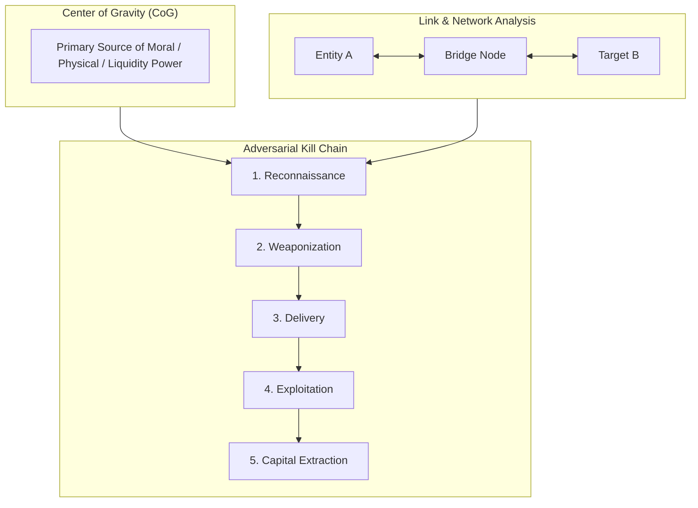
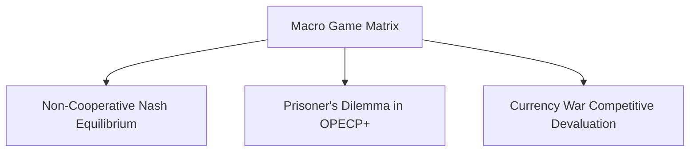
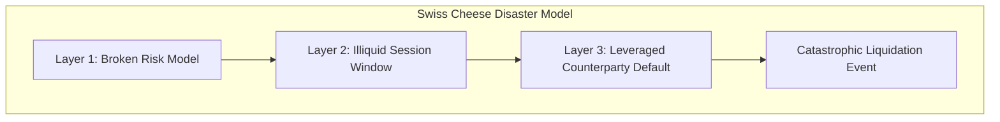

# Strategic Intelligence, Adversarial Modeling & Failure Forensics

## Executive Summary

Trading and macroeconomic positioning occur in an **adversarial environment**. Market participants, institutional liquidity providers, state-sponsored actors, and corporate insiders do not act randomly—they act strategically to deceive, exploit vulnerabilities, hunt stop-losses, and maximize their payoffs. 

This document integrates military intelligence frameworks, game theory, failure forensics, and media propaganda modeling into systematic analytical practices.

---

## 1. Military & Strategic Intelligence Methodologies

### A. Center of Gravity (CoG) Analysis (Clausewitzian Framework)
- **Definition**: The single hub of all power, movement, or liquidity upon which everything depends.
- **Application in Finance**:
  - In the global financial architecture, the primary CoG is the **US Dollar clearing system and US Treasury repo market**.
  - In crypto/digital assets, the CoG is fiat on/off-ramp banking rails and USD-pegged stablecoin backing reserves.
  - Striking or disrupting the CoG causes the entire surrounding structure to collapse.

### B. Adversarial Kill Chain Analysis
- Models an adversary's execution sequence to identify mandatory interception points:
  1. *Reconnaissance*: Mapping institutional stop-loss clusters and illiquid order book depths.
  2. *Positioning*: Accumulating inventory quietly during low-volatility Asian sessions.
  3. *Catalyst Delivery*: Releasing aggressive press leaks or narrative headlines during thin liquidity windows.
  4. *Liquidity Sweep*: Pushing price into stop-loss pools to trigger cascading liquidations.
  5. *Distribution & Extraction*: Unloading inventory into the forced liquidation buying/selling flow.

### C. Link Analysis & Social Network Mapping
- Maps hidden entity graphs, corporate shell structures, and cross-holding networks to uncover hidden systemic concentration risk and beneficial ownership.

---

## 2. Game-Theoretic & Competitive Dynamics

### Key Strategic Game Archetypes:
1. **The OPEC+ Production Game (Prisoner's Dilemma)**:
   - *Cooperate (Cut Production)*: High oil prices, but loss of market share.
   - *Defect (Cheat on Quotas)*: Maximize revenue volume while others cut.
   - *Nash Equilibrium*: Periodic price wars where Saudi Arabia floods the market to punish defectors and discipline producers.
2. **Competitive Currency Devaluation (Beggar-Thy-Neighbor)**:
   - Central banks lower policy rates and expand balance sheets to weaken their currency and boost export competitiveness, triggering retaliatory tariff and easing cycles from trading partners.

---

## 3. Structural Strategy & Corporate Evaluation Frameworks

| Framework | Core Dimensions | Macro / Trading Application |
| :--- | :--- | :--- |
| **PESTLE** | **P**olitical, **E**conomic, **S**ocial, **T**echnological, **L**egal, **E**nvironmental | Evaluating long-term capital expenditure allocations for multi-year commodity/energy projects. |
| **SWOT** | Internal **S**trengths & **W**eaknesses, External **O**pportunities & **T**hreats | Assessing exchange stability, broker capitalization, and quantitative model edge durability. |
| **Gap Analysis** | Difference between current capability state and desired target benchmark | Measuring execution latency gaps and alpha decay relative to institutional benchmarks. |

---

## 4. Failure Forensics & Safety Engineering

Disasters and systemic blowups rarely stem from a single isolated failure; they result from compounding structural brittleness.

### A. The Swiss Cheese Model (James Reason)
- Systems have multiple defensive layers (risk limits, stop losses, correlation caps, margin checks). Each layer has weaknesses ("holes"). A catastrophe occurs when the holes across all layers temporarily align.

### B. Fault Tree Analysis (FTA) & Failure Mode and Effects Analysis (FMEA)
- **Fault Tree Analysis**: Deductive top-down Boolean logic (AND/OR gates) tracing the exact sequence of subsystem failures leading to a top-level catastrophe.
- **FMEA**: Proactively cataloging every failure mode, ranking by Severity ($S$), Occurrence ($O$), and Detection ($D$) to compute a Risk Priority Number ($\text{RPN} = S \times O \times D$).

### C. The "5 Whys" Root Cause Iteration
- Iterative drilling down past superficial symptoms to uncover the root organizational, psychological, or code failure.

---

## 5. Narrative, Media Propaganda & Forensic Accounting

### A. Manufacturing Consent (The Propaganda Model - Herman & Chomsky)
- Mainstream media narratives are shaped by commercial and political filter mechanisms. 
- *Analytical Mandate*: When analyzing headlines, focus on **what is being systematically omitted** or downplayed rather than the loud headline narrative.

### B. The Gell-Mann Amnesia Effect
- Recognizing that media reports on familiar technical topics frequently contain material inaccuracies. Never accept secondary news summaries as ground truth without primary-source triangulation (FRED, SEC filings, official central bank text).

### C. Forensic Accounting & Money Trail Auditing
- Tracking fund velocity through balance sheet footnotes, off-balance-sheet Special Purpose Vehicles (SPVs), and non-standard audit disclosures.
