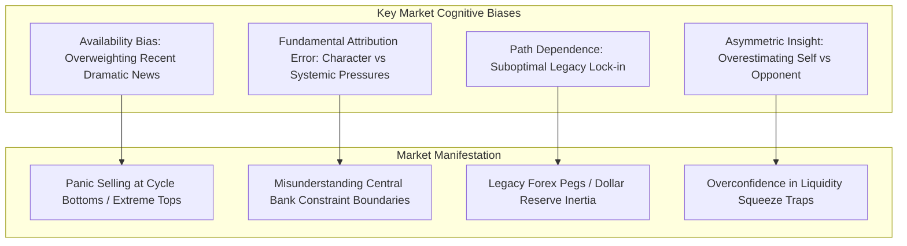
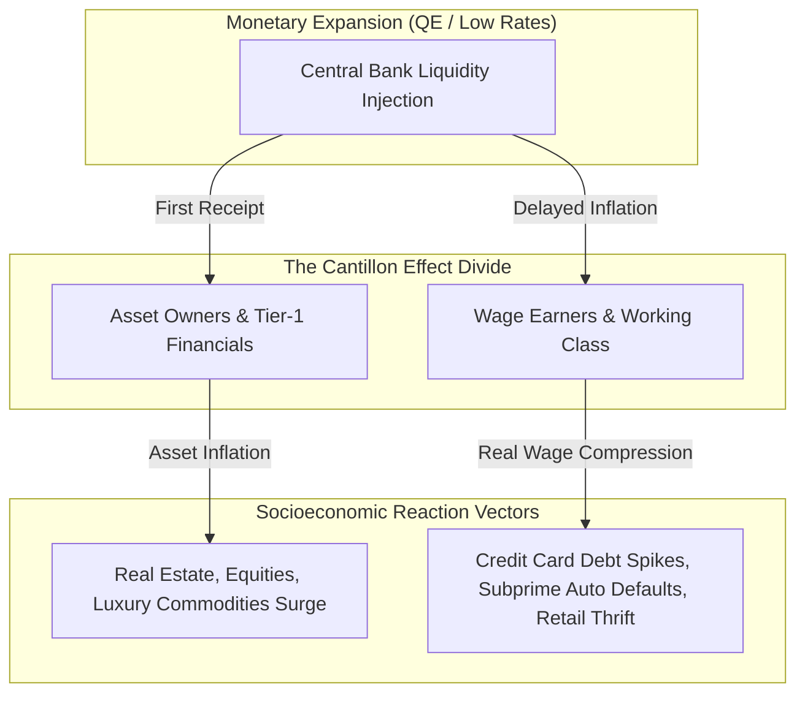

# Behavioral, Cognitive & Socioeconomic Analysis

## Executive Overview

Market prices are not generated by abstract mathematical formulas; they are the emergent result of human cognitive limits, emotional overreactions, structural socioeconomic class dynamics, and institutional incentive structures.

This document details the behavioral and psychological methodologies required to analyze market participant actions, deceptive signaling, and systemic socioeconomic pressures.

---

## 1. Cognitive Biases & Heuristic Failure Modes

### A. Availability Bias
- Human actors judge the probability of an event by the ease with which recent examples come to mind. 
- *Market Impact*: After a major banking failure or commodity spike, participants assign an irrational 80% probability to immediate recurrence, pricing in extreme insurance premia.

### B. Fundamental Attribution Error
- Attributing an adversary's or competitor's decisions to personal character flaws ("they are greedy / corrupt") rather than structural systemic pressures (debt maturity walls, regulatory liquidity mandates, capital flight constraints).

### C. Path Dependence & Lock-in
- Prior historical accidents and early legacy decisions lock systems into suboptimal equilibria because the switching cost is prohibitive (e.g. US Dollar SWIFT hegemony, legacy settlement rails).

### D. Asymmetric Insight Illusion
- The cognitive belief that one's own strategy understands the "dumb crowd," while underestimating that other sophisticated algorithmic participants are running identical models.

---

## 2. Human Deception, Kinesics & Micro-Expression Analysis

### A. Facial Action Coding System (FACS) & Micro-Expressions
- Developed by Dr. Paul Ekman, FACS taxonomizes every human facial movement into **Action Units (AUs)**:
  - *Duchenne Genuine Smile*: AU 6 (Cheek Raiser / Orbicularis Oculi) combined with AU 12 (Lip Corner Puller / Zygomaticus Major).
  - *Social Mask / Forced Reassurance*: AU 12 active in isolation without AU 6 muscle contraction around the eyes.
- **Central Bank & Corporate Press Conference Application**:
  - Analyzing video press conferences of Central Bank governors or corporate executives during guidance announcements. Micro-expressions of stress or contempt (AU 4 Brow Lowerer, AU 14 Dimpler, unilateral lip curl) signal private divergence from official hawkish/dovish statements.

### B. Computational Stylometry & Discourse Forensics
- Measuring statistical distribution of sentence lengths, word frequencies, passive voice density, and non-committal qualifying phrasing in corporate disclosures and FOMC statements to detect evasion and risk concealment.

---

## 3. Socioeconomic Class Dynamics & Wealth Distribution

Macroeconomic policy does not impact society uniformly. Analyzing the distributional divide between asset owners (the wealthy) and wage-dependent consumers (the working class) reveals major macro trends.

### A. The Cantillon Effect
- Money injection is non-neutral: those closest to the primary money creation spigot (banks, sovereign primary dealers, institutional asset owners) deploy new capital before prices rise, while wage earners receive diluted purchasing power after prices have inflated.

### B. Real Wage Compression & Retail Capitulation
- Tracking the spread between nominal wage growth and essential goods inflation (food, shelter, energy) forecasts retail consumer default waves and consumer discretionary earnings contractions.

---

## 4. Organizational Sociology & Bureaucracy Laws

Institutions, sovereign ministries, and central bank committees behave according to structural sociological laws:

1. **The Peter Principle**: Employees in a hierarchy rise to their level of ultimate incompetence. Bureaucracies become paralyzed by incompetent upper management layers.
2. **Parkinson's Law**: *"Work expands so as to fill the time available for its completion."* Regulatory committees and compliance teams naturally create internal friction regardless of efficiency gains.
3. **The Law of Triviality (Bikeshedding)**: Committees spend 90% of their time debating simple, trivial issues everyone understands (e.g. minor disclosure formatting) while rubber-stamping multi-billion-dollar systemic risks they cannot comprehend.

---

## 5. Memetics & Viral Transmission Dynamics

Ideas, market narratives, and speculative panics propagate identically to biological viruses through epidemiological networks.

### Mathematical Formulation:
\[
R_0 = \beta \cdot c \cdot d
\]
Where $R_0$ is the basic reproduction number, $\beta$ is the transmission probability per exposure, $c$ is the social network contact rate, and $d$ is the duration of narrative salience.

- **Application**: Tracking viral financial narratives (e.g., "AI Capex Supercycle", "De-Dollarization", "Meme Stock Squeezes"). When $R_0 > 1$, retail FOMO drives exponential price extension independent of underlying cash flows until narrative exhaustion ($R_0 < 1$) triggers violent capitulation.
