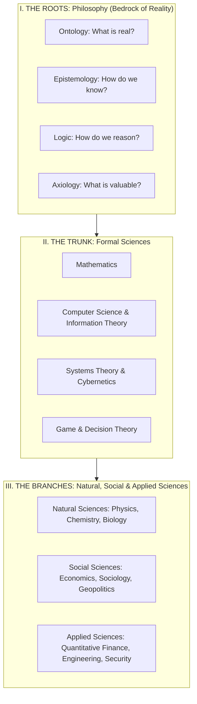
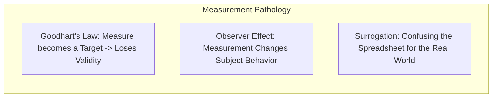
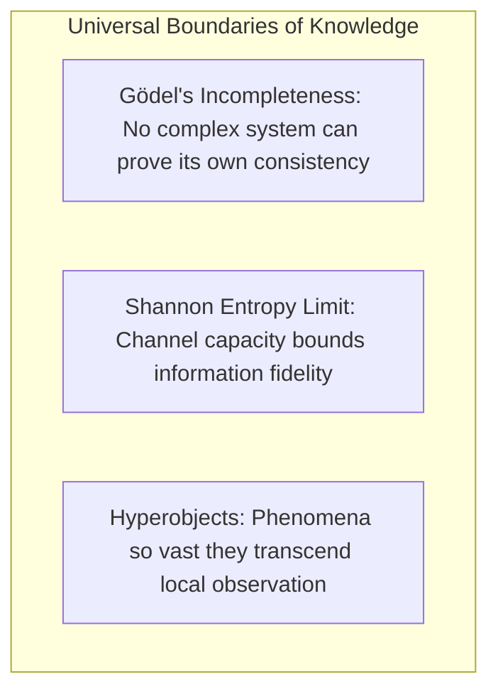
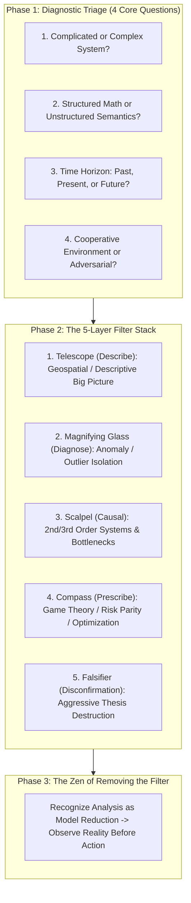

# Epistemology, Ontology & The Philosophical Foundations of Analysis

## Executive Summary: The Root of Knowledge

Every analytical model, quantitative formula, and macroeconomic thesis is fundamentally an applied philosophical stance. Before an analyst calculates a single Sharpe ratio or parses a central bank speech, they have already made implicit assumptions about **what exists (Ontology)**, **how truth is verified (Epistemology)**, and **the rules of inference (Logic)**.

---

## 1. The Taxonomy of Human Knowledge (The Knowledge Tree)

### I. The Roots: Philosophy
1. **Ontology / Metaphysics** (*"What is real?"*): The study of being and reality. Do financial markets have an objective intrinsic truth, or are they intersubjective social constructs governed by reflexivity?
2. **Epistemology** (*"How do we know?"*): The study of justified belief versus opinion. What constitutes proof? Can historical backtests prove future performance (Empiricism), or are they subject to non-ergodicity?
3. **Logic** (*"How do we reason?"*): The formal rules of valid inference (Deduction, Induction, Abduction, Modal Logic).
4. **Axiology** (*"What is valuable?"*): Ethics (acceptable risk, fiduciary duty) and Aesthetics (simplicity, mathematical elegance, Occam's Razor).

---

## 2. Measurement Distortions & The Illusion of Data

Data is not reality; data is a compressed, noisy projection of reality. Several universal laws govern how measurement distorts human systems:

### A. Goodhart's Law & Campbell's Law
- *"When a measure becomes a target, it ceases to be a good measure."*
- *Trading Application*: If a quantitative fund mandates that portfolio managers maximize historical Sharpe ratio, managers will optimize for strategies with hidden tail-risk (e.g. shorting deep OTM volatility puts), artificially manufacturing high Sharpe ratios until catastrophic liquidation.

### B. The Observer Effect (Heisenberg in Social Systems)
- The act of observing or measuring a market changes the market itself. When large institutional funds measure a specific anomaly (e.g. the January effect or post-earnings announcement drift), market participants front-run the signal, destroying the anomaly's alpha.

### C. Surrogation & The "Menu vs. Meal" Fallacy
- Confusing the mathematical model with the underlying territory. When an executive or quantitative analyst falls in love with the spreadsheet formula, they forget that physical supply chains, human exhaustion, and counterparty defaults do not obey spreadsheet cells.

---

## 3. The Physical Laws of Flow, Entropy & Decay

### A. The Constructal Law (Adrian Bejan)
- *"For any finite-size system to persist in time (to live), it must evolve with freedom such that it provides easier access to the imposed currents that flow through it."*
- **Application**: Capital, goods, and information naturally organize into hierarchical branching networks (like river basins or vascular systems). Financial regulations that impose extreme artificial friction against capital flows will inevitably be bypassed by shadow banking rails or decentralized protocols.

### B. The Second Law of Thermodynamics (Entropy in Systems)
- Closed systems naturally decay from order to disorder ($\Delta S \ge 0$). 
- *Quantitative Rule*: Trading strategies experience natural **alpha decay**. A system must continuously invest energy, data, and research into edge discovery just to maintain baseline profitability.

---

## 4. Limits of Formal Logic & Information Theory

### A. Gödel's Incompleteness Theorems
- Any sufficiently rich axiomatic system contains true statements that cannot be proven from within the system.
- *Mandate*: Never trust a financial risk model that claims to be 100% self-consistent and fully closed. There are always unmodeled external axioms that can fail.

### B. Shannon Information Entropy
- $H(X) = -\sum P(x_i) \log_2 P(x_i)$.
- As data passes through multiple secondary intermediaries (media, social commentary, aggregated summaries), transmission noise degrades the true economic signal exponentially. Always seek primary cryptographic / raw data sources.

### C. Hyperobjects (Timothy Morton)
- Objects so massively distributed in time and space that they cannot be observed in a single point-in-time cross-section (e.g. Global climate, the Eurodollar debt system, the global internet routing mesh). Hyperobjects require multi-decade longitudinal and fractal analysis.

---

## 5. The Master Analytical Triage & Filter Stacking Protocol

Master analysts do not pick tools at random. They follow a rigorous **3-Phase Triage and Filter Stacking Protocol**:

### Phase 1: Diagnostic Triage
1. **Complicated vs. Complex**: Complicated systems (jet engine) use Root Cause / Statistical filters; Complex systems (markets, geopolitics) use Systems Dynamics / Agent-Based / Second-Order filters.
2. **Structured vs. Unstructured**: Use quantitative regressions for time-series data; use Stylometry / Discourse / Thematic coding for corporate texts.
3. **Time Horizon**: Diagnostic (past root cause) vs. Stochastic Simulation (future probabilistic distribution).
4. **Adversarial Dimension**: If an adversary is involved, apply Red Teaming, Forensic Accounting, and Kill Chain modeling.

### Phase 2: The 5-Layer Filter Stack
1. **The Telescope (Describe)**: Map the global theater (Geospatial / Macro snapshot).
2. **The Magnifying Glass (Diagnose)**: Isolate the statistical anomaly (where does the data diverge?).
3. **The Scalpel (Causal)**: Cut into the transmission mechanism (Leontief input-costs, supply bottlenecks).
4. **The Compass (Prescribe)**: Formulate the optimal portfolio allocation (Risk Parity, convex payoff).
5. **The Falsifier (Disconfirmation / Karl Popper)**: Try aggressively to destroy your own thesis. If it survives ruthless falsification, execute.

### Phase 3: The Final Wisdom — Removing the Filter
**Analysis is an act of selective violence against reality.** Applying a filter ignores $99.9\%$ of reality to illuminate a useful $0.1\%$. The highest level of mastery is knowing when to pause, remove all filters, and respect the true emergent complexity of the world.
