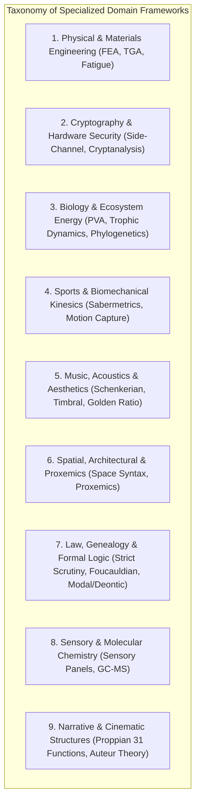
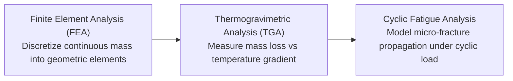
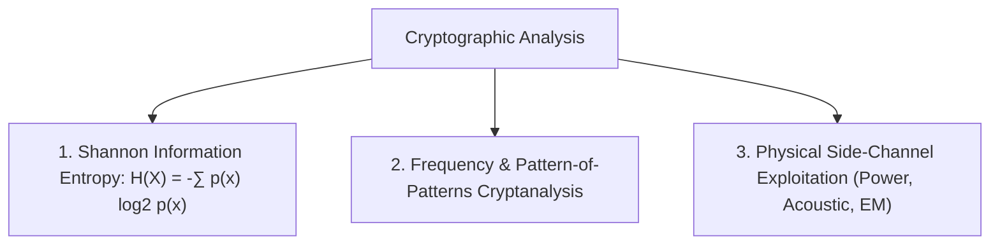
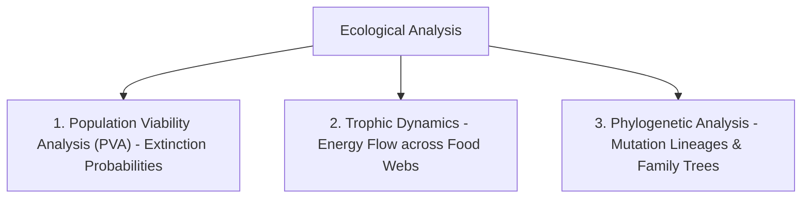
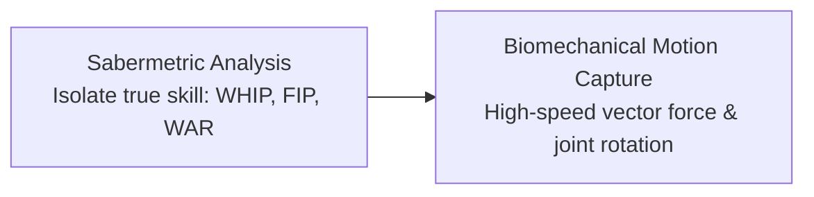
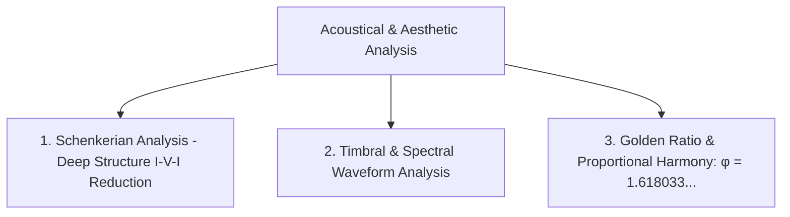
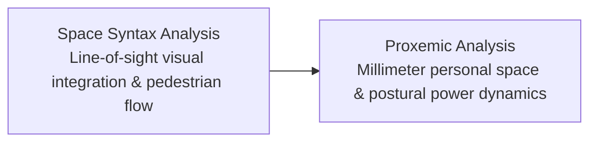
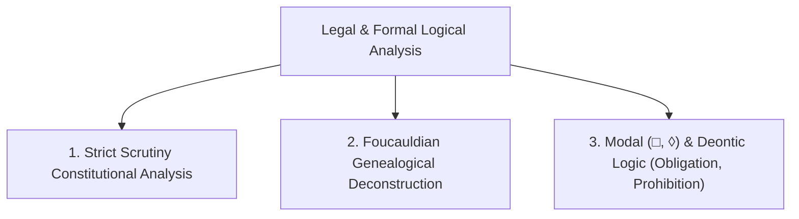
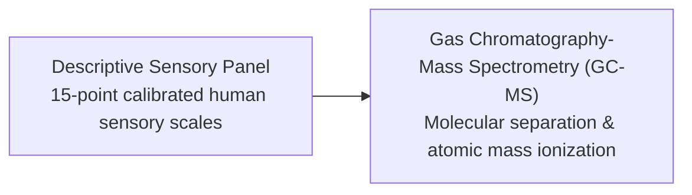
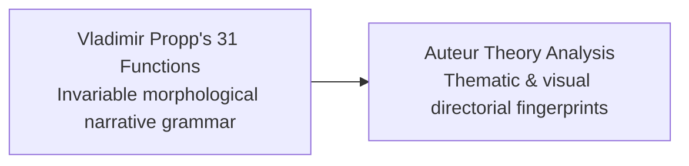

# Specialized Domain & Hyper-Niche Analytical Frameworks

## Executive Overview

Beyond standard economic and statistical methodologies lies a spectrum of **hyper-specialized analytical frameworks** developed across materials science, cryptography, ecology, musicology, forensic kinesics, structural linguistics, and jurisprudence. 

These frameworks demonstrate the universal meta-principle of analysis: **every analytical model is a specialized filter designed to ignore 99.9% of incoming noise to illuminate a hidden 0.1% structural signal.**

---

## 1. Physical & Materials Engineering

### A. Finite Element Analysis (FEA)
- **Mathematical Formulation**: Discretizes continuous partial differential equations (PDEs) of elasticity over complex geometry $\Omega$:
\[
\mathbf{K} \mathbf{u} = \mathbf{F}
\]
Where $\mathbf{K}$ is the global stiffness matrix, $\mathbf{u}$ is the nodal displacement vector, and $\mathbf{F}$ is the applied force vector.
- **Application**: Simulating structural stress concentrations across bridges, airplane wings, or turbine blades prior to physical fabrication.
- **Financial Analogue**: Stress-testing complex interconnected financial networks by discretizing bank counterparty balance sheets into network nodes to simulate cascade liquidity default.

### B. Thermogravimetric Analysis (TGA)
- **Mechanism**: Continuously measures the exact mass of a substance as temperature increases at a constant heating rate ($\frac{dT}{dt}$):
\[
\frac{dm}{dT} = f(T, m)
\]
- **Application**: Determining exact polymer decomposition thresholds, oxidative stability, and inorganic filler content.

### C. Cyclic Fatigue & S-N Curves (Wöhler's Law)
- **Mechanism**: Evaluates structural degradation under repeated sub-yield stresses:
\[
S^m \cdot N = C
\]
Where $S$ is stress amplitude, $N$ is number of cycles to failure, and $m, C$ are material constants.
- **Systemic Analogue**: Systems do not break from single massive shocks; they fail from thousands of unnoticed micro-stress cycles (e.g. repeated daily liquidity drains on regional banks).

---

## 2. Cryptography & Physical Hardware Security

### A. Information Entropy Analysis
- Measures the pure unpredictability or surprise of a data stream:
\[
H(X) = -\sum_{i=1}^n P(x_i) \log_2 P(x_i)
\]
- Low entropy indicates structured, redundant natural language; maximal entropy ($H(X) \approx \log_2 n$) indicates encrypted data or white noise.

### B. Frequency & Pattern-of-Patterns Cryptanalysis
- Breaking substitution and polyalphabetic ciphers by analyzing n-gram frequencies, index of coincidence, and recurring symbol clusters without possession of the private decryption key.

### C. Side-Channel Analysis (DPA, Acoustic, Timing)
- **Mechanism**: Interrogates a cryptographic engine not through its mathematical inputs/outputs, but by measuring the physical emissions produced during computation:
  - *Differential Power Analysis (DPA)*: Measuring microvolt fluctuations in CPU power draw.
  - *Acoustic Cryptanalysis*: Recording high-frequency capacitor hum during RSA key exponentiation.
  - *Timing Attacks*: Measuring nanosecond variations in execution execution branches.
- **Trading Application**: Observing institutional order placement through side-channel effects (e.g., changes in repo market borrow rates, dark pool fill ratios) rather than looking at public exchange order books.

---

## 3. Biology & Ecological Systems

### A. Population Viability Analysis (PVA)
- **Mechanism**: Monte Carlo simulation of stochastic population dynamics integrating demographic, environmental, and genetic stochasticity:
\[
N_{t+1} = N_t + B_t - D_t + I_t - E_t + \epsilon_t
\]
- Calculates the cumulative probability of quasi-extinction ($P(N_t < N_{\text{crit}})$) over horizon $T$.

### B. Trophic Dynamics & Ecological Energy Budgets (Lindeman's Efficiency)
- Maps the thermodynamic conversion efficiency of solar energy into biomass across trophic levels:
\[
\text{Trophic Efficiency} = \frac{\text{Production at Level } n}{\text{Production at Level } n-1} \approx 10\%
\]
- **Macro Supply Chain Parallel**: Tracking the energy and feedstock conversion ratios from crude oil/gas $\to$ ammonia $\to$ urea $\to$ corn $\to$ livestock $\to$ retail protein.

### C. Phylogenetic Mutation Mapping
- Reconstructs evolutionary trees by minimizing genetic edit distance (Maximum Parsimony) or maximizing likelihood across nucleotide sequence mutations.

---

## 4. Sports Sabermetrics & Biomechanical Kinesics

### A. Sabermetric Analysis (Empirical Skill Decoupling)
- **Core Principle**: Decouples individual performance from team-dependent noise:
  - *WHIP*: $\frac{\text{Walks} + \text{Hits}}{\text{Innings Pitched}}$ (isolates pitcher baseline control).
  - *FIP (Fielding Independent Pitching)*: Focuses strictly on strikeouts, walks, and home runs—events where fielders have zero impact.
- **Quantitative Parallel**: Evaluating a portfolio manager by isolating pure **Idiosyncratic Alpha ($\alpha$)** from passive market beta exposure ($\beta \cdot R_m$) and factor tilts (Fama-French).

### B. High-Speed Kinematic Analysis
- Uses 1,000+ fps multi-camera computer vision to measure angular joint velocities, torque vectors, and kinetic chain energy transfer in milliseconds.

---

## 5. Musicology, Acoustics & Aesthetics

### A. Schenkerian Analysis
- **Theoretical Stance**: Classical musical compositions are hierarchical elaborations of a simple underlying fundamental structure: the **Ursatz** (a two-part linear progression combining a descending melodic line with a $I - V - I$ harmonic bass arpeggiation).
- **Macro Parallel**: Stripping away high-frequency market noise to expose the underlying macro-fundamental business cycle arpeggiation (Expansion $\to$ Contraction $\to$ Trough $\to$ Recovery).

### B. Timbral Waveform Analysis
- Decomposes audio waves into attack, decay, sustain, release (ADSR) envelopes and transient harmonic spectra using Fourier and Wavelet transforms to explain why instruments playing the identical fundamental frequency sound distinct.

### C. Golden Ratio ($\phi$) & Geometric Harmonics
- Analyzes structural proportions adhering to $\phi = \frac{1 + \sqrt{5}}{2} \approx 1.6180339887\dots$ across the Parthenon, Renaissance compositions, and logarithmic spiral growth in natural organisms.

---

## 6. Spatial Syntax, Architecture & Proxemics

### A. Space Syntax (Bill Hillier)
- **Graph Formulation**: Represents architectural floorplans or urban street networks as **axial lines of sight** and convex spaces:
\[
\text{Integration Value} = \frac{2(MD - 1)}{k - 2}
\]
Where $MD$ is mean topological depth and $k$ is total system nodes. High integration values mathematically predict where pedestrians naturally congregate and where commercial activity or crime clusters.

### B. Proxemic Analysis (Edward T. Hall)
- Analyzes physical distance zones in human interaction:
  - *Intimate Space*: $0 - 1.5 \text{ ft}$
  - *Personal Space*: $1.5 - 4 \text{ ft}$
  - *Social Space*: $4 - 12 \text{ ft}$
  - *Public Space*: $> 12 \text{ ft}$
- **Geopolitical Application**: Analyzing summit seating arrangements, knee angles, and physical intrusions into personal space during bilateral diplomatic negotiations to assess dominant power postures.

---

## 7. Jurisprudence, Formal Logic & Genealogical Deconstruction

### A. Strict Scrutiny Legal Analysis
- The highest standard of judicial review applied to constitutional rights infringements:
  1. *Compelling Governmental Interest*: Must be essential, not just preferred.
  2. *Narrow Tailoring*: The law must address the compelling interest specifically without collateral breadth.
  3. *Least Restrictive Means*: No less restrictive alternative exists to accomplish the goal.

### B. Foucauldian Genealogical Analysis
- Traces the historical emergence of concepts (e.g. "insanity," "penology," "market efficiency") to demonstrate that they are not objective, universal physical truths, but historical constructs engineered to enforce specific institutional power arrangements.

### C. Modal & Deontic Logic
- **Modal Logic**:
  - $\Box P$: It is *necessarily* true that $P$.
  - $\Diamond P \equiv \neg \Box \neg P$: It is *possibly* true that $P$.
- **Deontic Logic**:
  - $\mathcal{O}(A)$: Action $A$ is *obligatory*.
  - $\mathcal{P}(A) \equiv \neg \mathcal{O}(\neg A)$: Action $A$ is *permitted*.
  - $\mathcal{F}(A) \equiv \mathcal{O}(\neg A)$: Action $A$ is *forbidden*.
- **Trading System Application**: Enforcing formal deontic logic in risk gates to guarantee that no conflicting permissions exist (e.g. an order cannot be simultaneously permitted and forbidden).

---

## 8. Sensory Sciences & Molecular Aromatics

### A. Descriptive Sensory Analysis
- Uses human panellists trained under ISO/ASTM standards to convert subjective human taste, aroma, and texture into rigorous quantitative rating vectors across standardized sensory lexicons.

### B. Gas Chromatography-Mass Spectrometry (GC-MS)
- **Mechanism**: Vaporizes a chemical mixture into a gas carrier phase passing through a capillary column (separating compounds by boiling point and polarity), then ionizes molecules and measures their mass-to-charge ratios ($m/z$).
- **Application**: Identifying trace aroma markers (e.g. geosmin, 2,4,6-trichloroanisole) at parts-per-trillion concentrations.

---

## 9. Narrative & Cinematic Structural Analysis

### A. Vladimir Propp's Narrative Morphology
- Demonstrated that all folktales and mythic structures are composed of permutations of exactly **31 invariable narrative functions** (e.g., *Absentation*, *Interdiction*, *Violation*, *Villainy*, *Receipt of Magical Agent*, *Transfiguration*, *Punishment*, *Wedding*).
- **Market Narrative Application**: Speculative bubbles and meme rallies invariably follow Proppian archetypes (e.g., The Visionary Founder $\to$ The Malicious Short-Seller Villain $\to$ The Retail Hero Army $\to$ The Transformational Moon Catalyst).

### B. Auteur Theory (Cahiers du Cinéma)
- Evaluates creative works by identifying the consistent philosophical, thematic, and stylistic signatures of the single overarching creator across their complete body of work regardless of superficial script variations.
