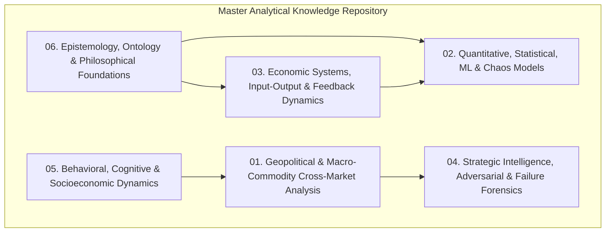
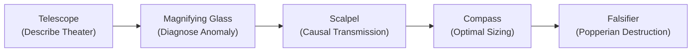

# Universal Knowledge Repository: Analytical Frameworks, Geopolitics, Quantitative Models & Epistemology

## Overview & Architecture of the Knowledge Base

This repository represents the exhaustive extraction and distillation of all analytical disciplines—spanning **macroeconomic cross-market mechanics, quantitative mathematics, signal processing, strategic intelligence, behavioral psychology, and foundational philosophy**.

Located in: [`docs/analytical_frameworks_and_epistemology/`](file:///c:/Users/User/OneDrive/Desktop/selfmade%20game%20projects/llm%20trader%20-%20Checkpoint%20dicisipline%20soilder%20-%20used%20in%20antigravity/docs/analytical_frameworks_and_epistemology)

---

## Compendium of Volumes

### 1. [Volume 01: Geopolitical & Macro-Commodity Cross-Market Analysis](file:///c:/Users/User/OneDrive/Desktop/selfmade%20game%20projects/llm%20trader%20-%20Checkpoint%20dicisipline%20soilder%20-%20used%20in%20antigravity/docs/analytical_frameworks_and_epistemology/01_GEOPOLITICAL_AND_MACRO_COMMODITY_ANALYSIS.md)
- **Core Topics**: Second- and Third-Order Thinking (Cascade Analysis), Relative Value (Spread) Analysis, Corn/Soybean Spreads, Input-Cost Bottlenecks (Haber-Bosch Nitrogen Fertilizer Spikes), Substitution Vectors (Crude $\to$ Ethanol, Corn $\to$ Soybeans), Geopolitical Spillover (Strait of Hormuz, Malacca, Suez), and Theater Escalation Ladders.

### 2. [Volume 02: Quantitative, Statistical, ML & Chaos Models](file:///c:/Users/User/OneDrive/Desktop/selfmade%20game%20projects/llm%20trader%20-%20Checkpoint%20dicisipline%20soilder%20-%20used%20in%20antigravity/docs/analytical_frameworks_and_epistemology/02_QUANTITATIVE_STATISTICAL_AND_CHAOS_MODELS.md)
- **Core Topics**: Statistical Clustering & Factor Analysis (PCA, t-SNE), Bayesian Probability Updating, Fast Fourier Transform (FFT) & Wavelet Transforms, Saliency Mapping & Neural Net Black-Box Probing, Ensemble Learning, Agent-Based Modeling (ABM), Mandelbrot Fractal Geometry & Hurst Exponent, Punctuated Equilibrium, and Fat-Tail / Extremistan Power Laws.

### 3. [Volume 03: Economic Systems, Input-Output & Feedback Dynamics](file:///c:/Users/User/OneDrive/Desktop/selfmade%20game%20projects/llm%20trader%20-%20Checkpoint%20dicisipline%20soilder%20-%20used%20in%20antigravity/docs/analytical_frameworks_and_epistemology/03_ECONOMIC_SYSTEMS_AND_INPUT_OUTPUT_MODELS.md)
- **Core Topics**: The 4-Tier Data Science Pyramid (Descriptive $\to$ Diagnostic $\to$ Predictive $\to$ Prescriptive), Wassily Leontief Input-Output Matrices $(\mathbf{I} - \mathbf{A})^{-1}$, Cross-Sectional vs Longitudinal Time-Series, Leading vs Lagging Macro Indicators, Reinforcing vs Balancing Feedback Loops, and Positive Convexity Payoffs.

### 4. [Volume 04: Strategic Intelligence, Adversarial & Failure Forensics](file:///c:/Users/User/OneDrive/Desktop/selfmade%20game%20projects/llm%20trader%20-%20Checkpoint%20dicisipline%20soilder%20-%20used%20in%20antigravity/docs/analytical_frameworks_and_epistemology/04_STRATEGIC_INTELLIGENCE_AND_ADVERSARIAL_FRAMEWORKS.md)
- **Core Topics**: Clausewitzian Center of Gravity (CoG) Analysis, Adversarial Kill Chain Modeling, Link Analysis & Social Network Graphs, Game Theory & Nash Equilibria (OPEC+ Prisoner's Dilemma, Currency Wars), PESTLE & SWOT Models, James Reason Swiss Cheese Disaster Model, Fault Tree Analysis (FTA), FMEA, Manufacturing Consent (Propaganda Models), and Forensic Accounting.

### 5. [Volume 05: Behavioral, Cognitive & Socioeconomic Dynamics](file:///c:/Users/User/OneDrive/Desktop/selfmade%20game%20projects/llm%20trader%20-%20Checkpoint%20dicisipline%20soilder%20-%20used%20in%20antigravity/docs/analytical_frameworks_and_epistemology/05_BEHAVIORAL_COGNITIVE_AND_PSYCHOLOGICAL_ANALYSIS.md)
- **Core Topics**: Availability Bias, Fundamental Attribution Error, Path Dependence, Asymmetric Insight, Paul Ekman Facial Action Coding System (FACS Action Units, Duchenne Smile Detection), The Cantillon Effect & Wealth Inequality Dynamics, Real Wage Compression & Retail Capitulation, The Peter Principle, Parkinson's Law, Law of Triviality (Bikeshedding), and Memetic $R_0$ Viral Transmission.

### 6. [Volume 06: Epistemology, Ontology & Philosophical Foundations](file:///c:/Users/User/OneDrive/Desktop/selfmade%20game%20projects/llm%20trader%20-%20Checkpoint%20dicisipline%20soilder%20-%20used%20in%20antigravity/docs/analytical_frameworks_and_epistemology/06_EPISTEMOLOGY_ONTOLOGY_AND_PHILOSOPHICAL_FOUNDATIONS.md)
- **Core Topics**: The Universal Knowledge Tree (Roots: Philosophy $\to$ Trunk: Formal Sciences $\to$ Branches: Natural/Social/Applied), Goodhart's Law & Campbell's Law, The Observer Effect, Surrogation, Adrian Bejan Constructal Law, Second Law of Thermodynamics (Entropy & Alpha Decay), Gödel's Incompleteness Theorems, Shannon Information Entropy, Hyperobjects, The 3-Phase Diagnostic Triage & 5-Layer Filter Stack (Telescope $\to$ Magnifying Glass $\to$ Scalpel $\to$ Compass $\to$ Falsifier), and The Zen of Removing the Filter.

### 7. [Volume 07: Specialized Domain & Hyper-Niche Analytical Frameworks](file:///c:/Users/User/OneDrive/Desktop/selfmade%20game%20projects/llm%20trader%20-%20Checkpoint%20dicisipline%20soilder%20-%20used%20in%20antigravity/docs/analytical_frameworks_and_epistemology/07_SPECIALIZED_DOMAIN_AND_NICHE_ANALYTICAL_FRAMEWORKS.md)
- **Core Topics**: Finite Element Analysis (FEA), Thermogravimetric Analysis (TGA), Fatigue Analysis (S-N curves), Side-Channel Cryptanalysis (DPA, acoustic, timing), Population Viability Analysis (PVA), Trophic Dynamics (Lindeman efficiency), Phylogenetic lineage mapping, Sabermetrics (WHIP/FIP/WAR), High-speed kinematic joint vector tracking, Schenkerian deep-structure (I-V-I) reduction, Timbral spectra, Space Syntax (axial line-of-sight integration), Proxemics, Strict Scrutiny, Foucauldian Genealogy, Modal ($\Box, \Diamond$) & Deontic ($\mathcal{O}, \mathcal{P}, \mathcal{F}$) Logic, Descriptive Sensory Panels, GC-MS Food Chemistry, Vladimir Propp's 31 Narrative Functions, and Auteur Theory.

---

## Specialized Architecture Deep-Dive

### 🚀 [BMA + Causal Discovery Autonomous System Compendium](file:///c:/Users/User/OneDrive/Desktop/selfmade%20game%20projects/llm%20trader%20-%20Checkpoint%20dicisipline%20soilder%20-%20used%20in%20antigravity/docs/analytical_frameworks_and_epistemology/bma_causal_autonomous_system/INDEX.md)
A dedicated 7-module implementation compendium detailing:
- **Module 01**: Architecture-Level BMA ($A_1-A_6$) & Causal Discovery Algorithms (PC, NOTEARS, PCMCI+, LiNGAM).
- **Module 02**: The 7-Tier Analysis Pyramid & The 4 Macro Regimes.
- **Module 03**: Advanced Econometrics (VAR, VECM, GARCH, Kalman), Derivatives Calculus & VPIN Microstructure.
- **Module 04**: Machine Learning, FinBERT NLP Transcripts & Alternative Data Pipelines.
- **Module 05**: Purged K-Fold Cross-Validation, Triple Barrier Labeling, Kelly/Volatility Sizing & Drawdown Circuit Breakers.
- **Module 06**: Meta-Agent Self-Diagnosis, Causal Stability Indices & Autonomous Decision Fusion.
- **Module 07**: Omni-Global Activity Cascades, Physical Stoichiometry & Continuous Autonomous Learning.

### 🌐 [Geopolitical Predictive Analysis & Sanctions Intelligence](file:///c:/Users/User/OneDrive/Desktop/selfmade%20game%20projects/llm%20trader%20-%20Checkpoint%20dicisipline%20soilder%20-%20used%20in%20antigravity/docs/analytical_frameworks_and_epistemology/bma_causal_autonomous_system/geopolitical_predictive_and_sanctions_intelligence/INDEX.md)
A dedicated 4-module sub-system detailing:
- **Module 01**: Predictive Analysis, Extrapolation Mathematics, State Trajectories & Lyapunov Predictability Horizons.
- **Module 02**: Geopolitical Macro Foresight, 2×2 Scenario Matrices, SIPRI 8-Domain Early Warning & BMA Regimes.
- **Module 03**: The 12 Multi-Disciplinary Domain Knowledge Pillars & Causal Historical/Geographic Case Studies.
- **Module 04**: Economic Sanctions, OFAC 50% Rule, SWIFT/Correspondent Plumbing, Export Controls (EAR/ITAR), G7 Price Cap Attestation Chain & Evasion Forensics.

---

## Quick Reference: The Filter Stacking Protocol

