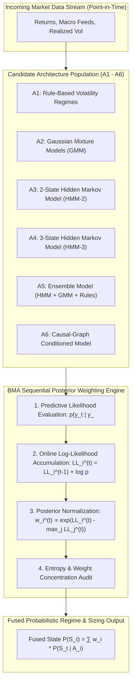
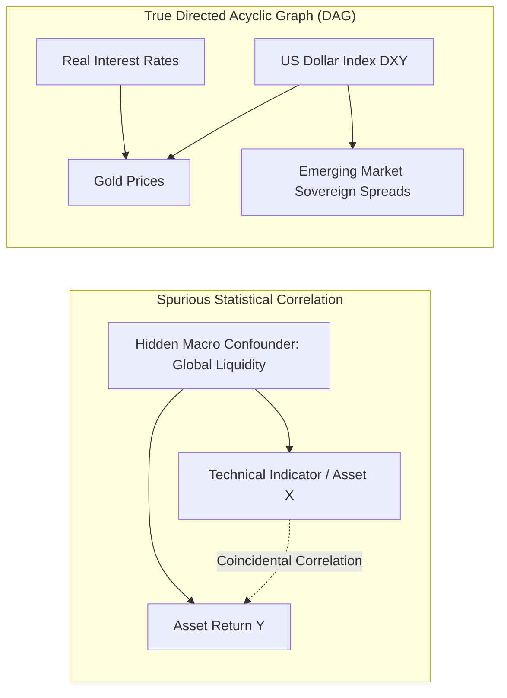
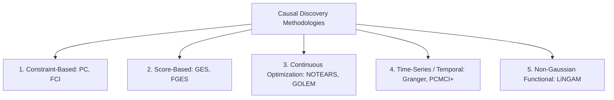
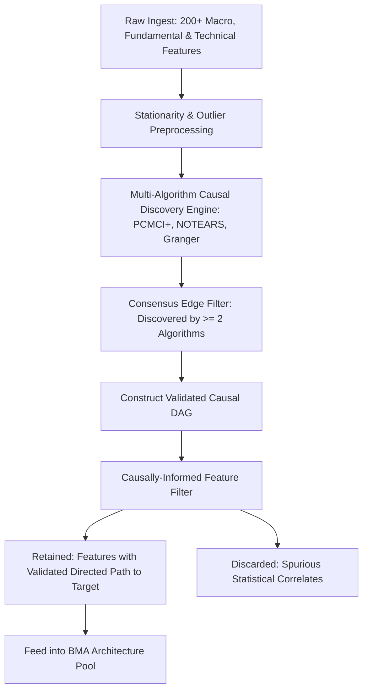

# Bayesian Model Averaging (BMA) & Causal Discovery Architecture

## Executive Overview

This document specifies the core theoretical and algorithmic foundations of the **BMA + Causal Discovery Autonomous Trading System**. 

The architecture resolves two fundamental vulnerabilities that cause traditional quantitative strategies to fail in live trading:
1. **Structural Risk**: The fatal danger of selecting a single "optimal" model from historical backtests that breaks when market dynamics undergo regime shifts.
2. **Spurious Correlation & Alpha Decay**: The trap of conditioning strategy rules on non-causal statistical coincidences that vanish out-of-sample.

---

## 1. Bayesian Model Averaging (BMA) at the Architecture Level

### A. The Core Paradigm Shift
Traditional quantitative development selects a single model that maximized a past metric (e.g. Sharpe ratio). This leads directly to **in-sample overfitting**.

BMA maintains a **population of diverse structural architectures** simultaneously, updating their weights sequentially based on incoming out-of-sample predictive evidence.

### B. Mathematical Formulation of Sequential BMA
Let $\mathcal{A} = \{A_1, A_2, \dots, A_K\}$ be the pool of $K$ distinct trading architectures.

#### 1. Posterior Probability Update via Bayes' Rule:
\[
P(A_i \mid D_{1:t}) = \frac{P(D_t \mid D_{1:t-1}, A_i) \cdot P(A_i \mid D_{1:t-1})}{\sum_{j=1}^K P(D_t \mid D_{1:t-1}, A_j) \cdot P(A_j \mid D_{1:t-1})}
\]
Where:
- $w_i^{(t)} = P(A_i \mid D_{1:t})$ is the posterior weight of architecture $A_i$ at time $t$.
- $p(y_t \mid y_{<t}, A_i)$ is the predictive likelihood assigned by architecture $A_i$ to the observed market realization $y_t$.

#### 2. Numerically Stable Log-Score Tracking with Memory Decay:
To prevent floating-point underflow and accommodate non-stationary market regimes, log-likelihood scores are accumulated with a memory decay parameter $\lambda \in [0.95, 0.99]$:
\[
LL_i^{(t)} = \lambda \cdot LL_i^{(t-1)} + \ln p(y_t \mid y_{<t}, A_i)
\]
\[
w_i^{(t)} = \frac{\exp\left(LL_i^{(t)} - \max_{j} LL_j^{(t)}\right)}{\sum_{k=1}^K \exp\left(LL_k^{(t)} - \max_{j} LL_j^{(t)}\right)}
\]

#### 3. BMA Fused Prediction and Model Uncertainty:
The BMA prediction combines the architecture predictions and explicitly calculates the **between-model variance** (model uncertainty):
\[
\hat{y}_t = \sum_{i=1}^K w_i^{(t)} \hat{y}_t^{(i)}
\]
\[
\text{Var}(\hat{y}_t) = \sum_{i=1}^K w_i^{(t)} \left[ \sigma_i^2(t) + \left(\hat{y}_t^{(i)} - \hat{y}_t\right)^2 \right]
\]

### C. The Candidate Architecture Pool

| Identifier | Architecture Name | Structural Philosophy | Key Strengths | Failure Vulnerability |
| :--- | :--- | :--- | :--- | :--- |
| **A1** | **Rule-Based Thresholds** | Deterministic volatility regimes (e.g. VIX, ATR percentiles) | Computationally instant, zero parameter estimation error | Inelastic; misses subtle multi-factor regime transitions |
| **A2** | **Gaussian Mixture Model (GMM)** | Unsupervised clustering of joint return/macro distributions | Flexible multimodal density representation | Stateless; ignores temporal sequence and autocorrelation |
| **A3** | **2-State Gaussian HMM** | Latent Markovian state transition (Expansion vs Contraction) | Models temporal persistence and regime stickiness | Too coarse for complex markets with stagflationary states |
| **A4** | **3-State Gaussian HMM** | Latent 3-state transition (Bull / Sideways Range / Bear) | Nuanced distinction between trending and chop regimes | Higher degrees of freedom; prone to state-flipping noise |
| **A5** | **Ensemble Meta-Architecture** | Multi-signal consensus blending (HMM + GMM + Rules) | Diversified baseline across multiple model families | Harder to debug and isolate root performance attribution |
| **A6** | **Causal-Graph Conditioned** | Predictions strictly conditioned on validated DAG parents | Immunized against spurious correlates and alpha decay | Dependent on the structural accuracy of causal discovery |

### D. Architecture-Level vs Prediction-Level Averaging

| Level | Traditional Ensembling | Architecture-Level BMA |
| :--- | :--- | :--- |
| **Diversity Domain** | Blends outputs of similar models with different seeds/parameters | Blends fundamentally different mathematical and structural assumptions |
| **Weighting Mechanism** | Static weights or simple rolling performance heuristics | Exact Bayesian posterior updating based on predictive density likelihood |
| **Failure Protection** | If the base model assumption is wrong, the entire ensemble fails | If an entire structural assumption collapses (e.g. 2-state world), BMA shifts weight to others |

---

## 2. Causal Discovery: Eliminating Spurious Correlations

### A. The Core Principle
Correlation indicates statistical association; **Causality indicates invariant physical/economic transmission mechanisms**. Trading on correlations without causal support leads to rapid alpha decay when background macro variables shift.

### B. Causal Discovery Algorithm Families

#### 1. Constraint-Based Methods (PC, FCI)
- **Mechanism**: Evaluates conditional independence relations: $X \perp Y \mid S$.
- **PC Algorithm Execution**:
  1. *Skeleton Phase*: Starts with a complete undirected graph. Iteratively tests conditional independence for increasing conditioning set sizes $|S| = 0, 1, 2, \dots$. Removes edges where conditional independence holds.
  2. *V-Structure Orientation*: For unshielded triples $X - Z - Y$ (where $X$ and $Y$ are not connected), if $Z \notin S_{XY}$, orient as collider $X \to Z \leftarrow Y$.
  3. *Meek Rules*: Propagates orientations avoiding cycles and new colliders.
- **FCI (Fast Causal Inference)**: Extends PC to handle unobserved confounders and selection bias.

#### 2. Score-Based Methods (GES, FGES)
- **Mechanism**: Searches graph space to maximize a penalized likelihood score (e.g., Bayesian Information Criterion - BIC):
\[
\text{BIC}(G; D) = \ln P(D \mid \hat{\theta}_G, G) - \frac{k_G}{2} \ln n
\]

#### 3. Continuous Optimization (NOTEARS & GOLEM)
- **Mechanism**: Reformulates discrete combinatorial graph search into a smooth, continuous optimization problem with an exact algebraic acyclicity constraint:
\[
\min_{W} \frac{1}{2n} \|X - XW\|_F^2 + \lambda \|W\|_1 \quad \text{subject to } h(W) = \text{tr}\left(e^{W \odot W}\right) - d = 0
\]
Where:
- $W \in \mathbb{R}^{d \times d}$ is the weighted causal adjacency matrix.
- $h(W) = 0$ is mathematically equivalent to the statement that the directed graph defined by $W$ contains **zero cycles (is a strict DAG)**.
- Solved via the Augmented Lagrangian numerical method.

#### 4. Time-Series Specific Causal Discovery (PCMCI / PCMCI+)
- Developed to handle autocorrelation, high-dimensionality, and contemporaneous vs lagged relationships in time series.
- **Algorithm**:
  - *MCI (Momentary Conditional Independence)* tests:
\[
X_{t-\tau} \perp Y_t \mid \widehat{\mathcal{P}}(Y_t) \setminus \{X_{t-\tau}\}, \widehat{\mathcal{P}}(X_{t-\tau})
\]
Controls for the parent histories of both variables, drastically reducing false positive edge discovery.

#### 5. Functional Causal Models (LiNGAM)
- Assumes Linear, Non-Gaussian, Acyclic Models:
\[
x_i = \sum_{j \in \text{Parents}(i)} c_{ij} x_j + e_i
\]
Where $e_i$ are independent non-Gaussian error terms. Employs Independent Component Analysis (ICA) to uniquely identify the causal ordering and coefficients.

---

## 3. The Causally-Informed Feature Selection Pipeline

### Operational Rules:
1. **No Spurious Inclusion**: A technical or macro indicator is only admitted into the trading model if a directed causal path to the target variable exists in the consensus DAG.
2. **Consensus Requirement**: An edge must be confirmed by at least two distinct algorithmic families (e.g. PCMCI+ and NOTEARS).
3. **Temporal Precedence**: Lagged effects must respect physical causality ($\Delta t > 0$).
