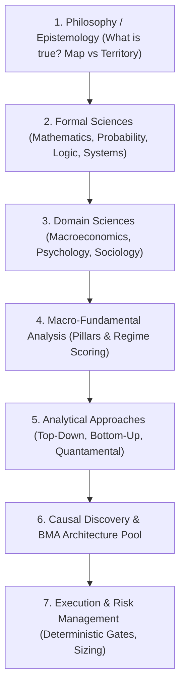
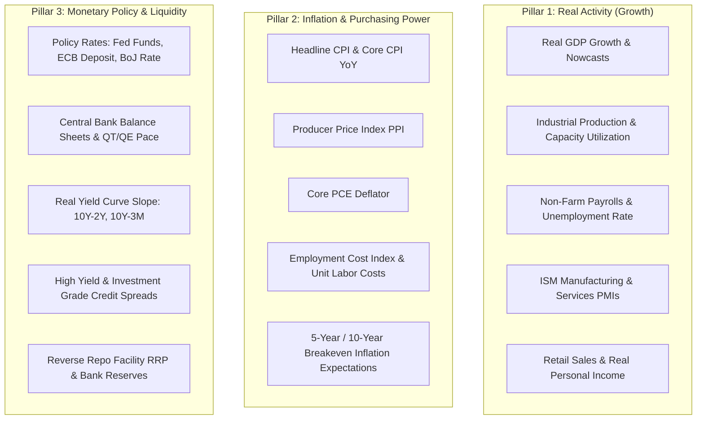
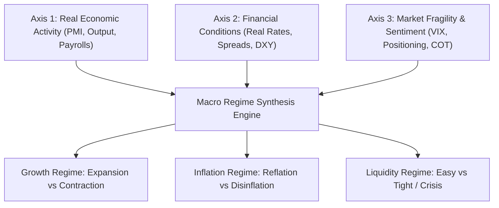

# The Analysis Pyramid & Macroeconomic Regime Framework

## Executive Summary

Trading signals cannot be evaluated in a vacuum. A technical setup that delivers positive expectancy during a **Goldilocks expansion** regime will produce devastating drawdowns during a **Stagflationary liquidity contraction**. 

This document details the **7-Tier Analysis Pyramid** and the **Multi-Factor Macro Regime Classification Engine** that anchors all quantitative decisions to underlying macroeconomic reality.

---

## 1. The Analysis Pyramid (From Epistemology to Execution)



---

## 2. The Three Pillars of Macro-Fundamental Analysis

Economic reality is continuously characterized across three fundamental pillars:



---

## 3. The Three-Tools Framework & Synthesis

The macro environment is synthesized across three orthogonal axes:



---

## 4. The Four Global Macro Regimes & Asset Class Biases

```mermaid
quadrantChart
    title Global Macro Regime Matrix
    x-axis Low Growth --> High Growth
    y-axis Low Inflation --> High Inflation
    quadrant-1 Reflation (High Growth, High Inflation)
    quadrant-2 Stagflation (Low Growth, High Inflation)
    quadrant-3 Deflation (Low Growth, Low Inflation)
    quadrant-4 Goldilocks (High Growth, Low Inflation)
```

### Regime Characteristics & Portfolio Dynamics

| Macro Regime | Economic Dynamics | Outperforming Assets | Underperforming Assets | Quantitative Trading Bias |
| :--- | :--- | :--- | :--- | :--- |
| **Goldilocks** | Strong growth, low/falling inflation, stable liquidity | Equities (Tech/Growth), High Yield Credit, Carry Trades | Sovereign Bonds, Gold, Cash | **Risk-ON**: Trend-following long equities, short volatility |
| **Reflation** | Accelerating growth, rising inflation, commodity demand | Broad Commodities (Energy, Metals), Value/Cyclical Equities, Short-duration debt | Long-duration Sovereign Bonds, Non-profitable Tech | **Cyclical Momentum**: Long commodities, curve steepeners |
| **Stagflation** | Stagnant/contracting growth, stubborn high inflation | Gold, Energy, TIPS (Inflation-Protected), Cash | Nominal Bonds, High-Multiple Equities, Real Estate | **Defensive / Asymmetric**: Long Gold/TIPS, short high-duration growth |
| **Deflation** | Severe growth contraction, falling prices, liquidity crunch | Long-Duration Sovereign Debt (US 10Y/30Y), Quality Cash, USD | Equities, High-Yield Credit, Industrial Commodities | **Risk-OFF**: Long Treasuries/USD, long volatility, short cyclicals |

---

## 5. Analytical Methodologies: Top-Down vs Bottom-Up vs Quantamental


### The Quantamental Principle:
Every fundamental and macroeconomic data point must be strictly timestamped **Point-in-Time (PIT)**. Models are never allowed to train on revised data or forward-looking disclosures, eliminating **lookahead bias**.
