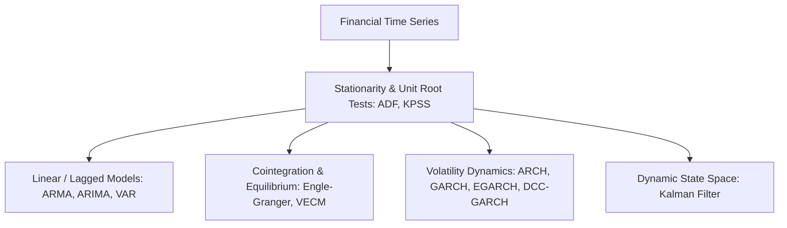
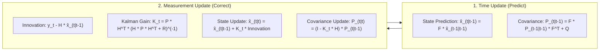
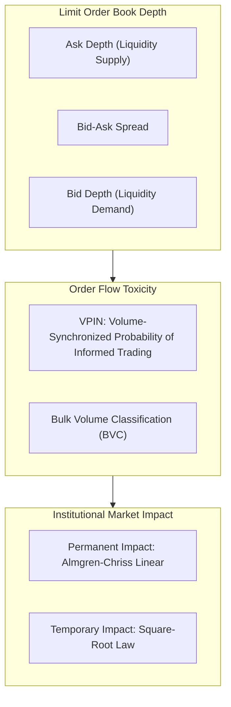

# Advanced Quantitative Econometrics, Stochastic Calculus & Market Microstructure

## Executive Summary

This document formalizes the mathematical and statistical foundations required for modeling financial time series, volatility dynamics, derivatives pricing, and market microstructure execution.

---

## 1. Classical & Modern Econometric Modeling

### A. Vector Autoregression (VAR) & Granger Causality
In an $n$-variable time-series vector $\mathbf{Y}_t = [y_{1,t}, y_{2,t}, \dots, y_{n,t}]^T$:
\[
\mathbf{Y}_t = \mathbf{c} + \sum_{i=1}^p \mathbf{A}_i \mathbf{Y}_{t-i} + \mathbf{\epsilon}_t
\]
#### Granger Causality F-Test:
To test whether variable $X$ Granger-causes variable $Y$:
\[
F = \frac{(\text{RSS}_R - \text{RSS}_U) / q}{\text{RSS}_U / (T - p - q - 1)}
\]
Where $\text{RSS}_R$ is the residual sum of squares of the restricted model (predicting $Y$ using only past $Y$), and $\text{RSS}_U$ includes past lags of $X$. If $F > F_{\text{critical}}$, we reject the null hypothesis of no Granger causality.

### B. Cointegration & Vector Error Correction Models (VECM)
When two non-stationary series $y_{1,t} \sim I(1)$ and $y_{2,t} \sim I(1)$ share a stationary linear combination $\mathbf{\beta}'\mathbf{Y}_t \sim I(0)$:
\[
\Delta \mathbf{Y}_t = \mathbf{\alpha} \mathbf{\beta}' \mathbf{Y}_{t-1} + \sum_{i=1}^{p-1} \mathbf{\Gamma}_i \Delta \mathbf{Y}_{t-i} + \mathbf{\epsilon}_t
\]
Where $\mathbf{\alpha}$ represents the speed of mean reversion back to the cointegrating equilibrium vector $\mathbf{\beta}$.

### C. Volatility Modeling (GARCH Family)
Financial returns exhibit **volatility clustering** and **excess kurtosis**.

#### 1. Standard GARCH(1,1):
\[
r_t = \mu + \epsilon_t, \quad \epsilon_t = \sigma_t z_t, \quad z_t \sim \mathcal{N}(0, 1)
\]
\[
\sigma_t^2 = \omega + \alpha \epsilon_{t-1}^2 + \beta \sigma_{t-1}^2
\]
Stationarity condition: $\alpha + \beta < 1$.

#### 2. Exponential GARCH (EGARCH) - Asymmetric Leverage Effect:
Captures the empirical fact that negative return shocks generate higher volatility spikes than positive shocks:
\[
\ln(\sigma_t^2) = \omega + \beta \ln(\sigma_{t-1}^2) + \alpha \left[ \frac{|\epsilon_{t-1}|}{\sigma_{t-1}} - \sqrt{\frac{2}{\pi}} \right] + \gamma \frac{\epsilon_{t-1}}{\sigma_{t-1}}
\]
Where $\gamma < 0$ captures the asymmetric equity leverage effect.

### D. The Kalman Filter (Adaptive State Space Estimation)
Used for tracking dynamic hedge ratios and latent market regimes in real time:

---

## 2. Stochastic Calculus & Derivatives Pricing

### A. Itô's Lemma
For a twice-differentiable function $f(t, S_t)$ of an Itô drift-diffusion process $dS_t = \mu S_t dt + \sigma S_t dW_t$:
\[
df = \left( \frac{\partial f}{\partial t} + \mu S_t \frac{\partial f}{\partial S} + \frac{1}{2} \sigma^2 S_t^2 \frac{\partial^2 f}{\partial S^2} \right) dt + \sigma S_t \frac{\partial f}{\partial S} dW_t
\]
The second-order term $\frac{1}{2}\sigma^2 S^2 \frac{\partial^2 f}{\partial S^2}$ explains the structural drag of volatility on geometric returns.

### B. The Black-Scholes-Merton PDE & The Greeks
\[
\frac{\partial V}{\partial t} + \frac{1}{2} \sigma^2 S^2 \frac{\partial^2 V}{\partial S^2} + r S \frac{\partial V}{\partial S} - r V = 0
\]

| Greek | Mathematical Derivative | Economic Interpretation | Hedging / Trading Mandate |
| :--- | :--- | :--- | :--- |
| **Delta ($\Delta$)** | $\frac{\partial V}{\partial S} = N(d_1)$ | Directional exposure to underlying price | Delta-neutral hedging |
| **Gamma ($\Gamma$)** | $\frac{\partial^2 V}{\partial S^2} = \frac{N'(d_1)}{S \sigma \sqrt{T}}$ | Rate of change of Delta (Curvature) | Gamma scalping & convexity capture |
| **Theta ($\Theta$)** | $\frac{\partial V}{\partial t}$ | Time decay per day | Option premium harvesting |
| **Vega ($\mathcal{V}$)** | $\frac{\partial V}{\partial \sigma} = S \sqrt{T} N'(d_1)$ | Sensitivity to implied volatility changes | Volatility arbitrage & regime defense |

---

## 3. Market Microstructure & High-Frequency Mechanics

### A. Volume-Synchronized Probability of Informed Trading (VPIN)
VPIN measures the imbalance between informed institutional flow and uninformed retail liquidity across equal-volume clock buckets:
\[
\text{VPIN} = \frac{\sum_{\tau=1}^N |V_\tau^B - V_\tau^S|}{N \cdot V}
\]
Where:
- $V$ is the constant volume bucket size.
- $V_\tau^B, V_\tau^S$ are buy and sell volumes estimated via **Bulk Volume Classification (BVC)**:
\[
V_\tau^B = V \cdot \Phi\left( \frac{\Delta P_\tau}{\sigma_{\Delta P}} \right), \quad V_\tau^S = V - V_\tau^B
\]
- When $\text{VPIN} > 0.50$, adverse selection risk is severe; market makers withdraw quotes, causing flash crashes and severe execution slippage.

### B. Institutional Market Impact Models (Almgren-Chriss & Square-Root Law)
Total transaction cost of executing an order of size $Q$ over trading horizon $T$ with daily volume $ADV$:
\[
\text{Total Impact} = \underbrace{\gamma \sigma \left(\frac{Q}{ADV}\right)^{1/2}}_{\text{Temporary (Square-Root Law)}} + \underbrace{\eta \sigma \frac{Q}{ADV}}_{\text{Permanent Shift}}
\]
