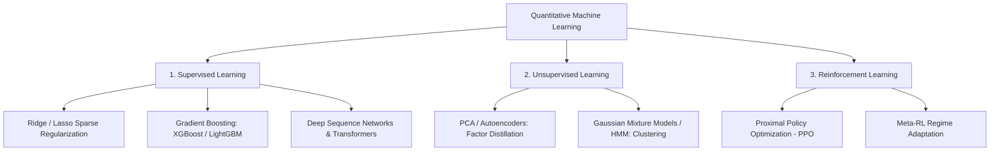
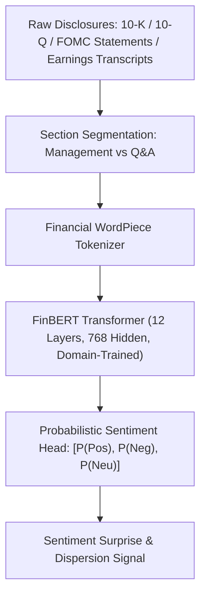
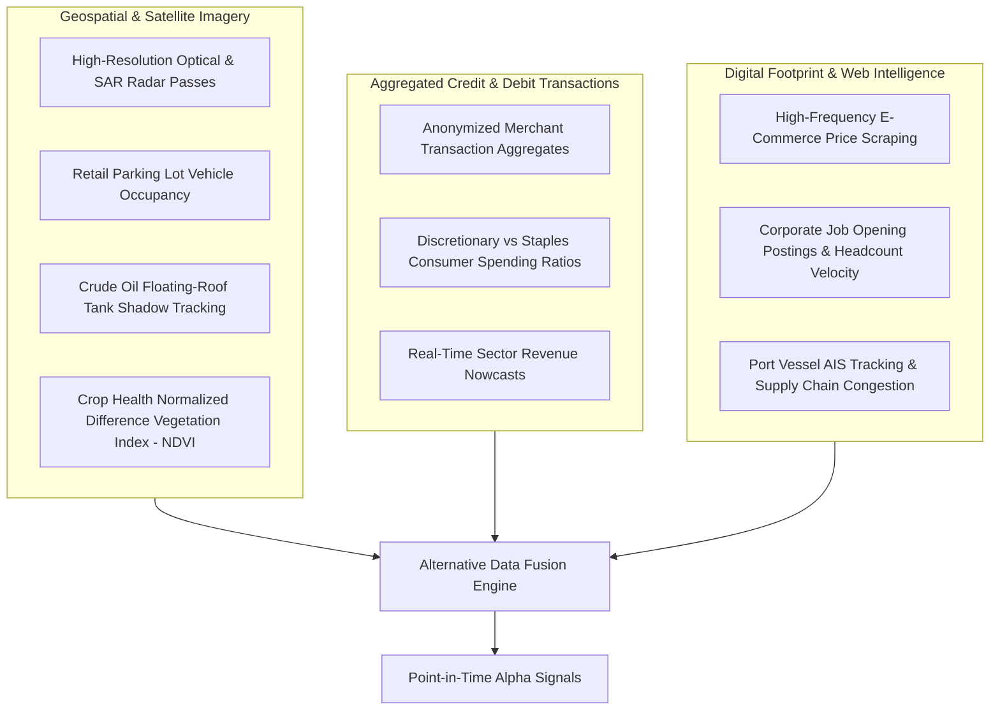

# Machine Learning, Financial NLP & Alternative Data Pipelines

## Executive Overview

This document specifies the integration of advanced machine learning architectures, domain-specific Natural Language Processing (FinBERT), and alternative geospatial/unstructured data pipelines into the autonomous macrofundamental pipeline.

---

## 1. Machine Learning in Quantitative Finance

### Critical Financial ML Mandates:
1. **Lookahead Bias Elimination**: Absolute prevention of future information leakage. Labels, indicators, and cross-sectional rankings must strictly exist in the information set $\mathcal{F}_{t-1}$.
2. **Data Mining & Multiple Testing Corrections**: When running multi-feature screens, raw $p$-values are invalid. Apply **False Discovery Rate (FDR - Benjamini-Hochberg)** or **Family-Wise Error Rate (FWER - Bonferroni)**:
\[
P_{(i)} \le \frac{i}{m} \cdot \alpha
\]
3. **Non-Stationarity & Distribution Shift**: Financial return distributions are non-ergodic. Supervised models must use rolling walk-forward calibration with Bayesian Model Averaging fallback.

---

## 2. Financial Natural Language Processing (FinBERT)

Standard language models (e.g. general BERT or GPT) misclassify financial statements because words like *"liability"*, *"depreciation"*, or *"hedge"* have non-negative structural meanings in accounting.

### A. The FinBERT Mathematical Scoring Model
Let $T$ be an earnings transcript segmented into individual statements $s_1, s_2, \dots, s_N$:
\[
\text{Sentiment Score}(s_k) = P(\text{Positive} \mid s_k) - P(\text{Negative} \mid s_k)
\]
The aggregate sentiment surprise relative to consensus analyst tone $\mathbb{E}[S]$:
\[
\Delta S = \frac{1}{N}\sum_{k=1}^N \text{Sentiment Score}(s_k) - \mathbb{E}[S]
\]
When $\Delta S > +2\sigma_{\text{hist}}$, management guidance is systematically more positive than priced by option markets, generating a directional long signal for post-earnings announcement drift (PEAD).

---

## 3. Alternative Data Ingestion Pipelines

### Alternative Data Verification Rules:
1. **Survivorship Bias Defense**: Ensure the historical universe includes delisted, bankrupt, and acquired corporate entities.
2. **Point-in-Time Integrity**: Record the exact timestamp when raw alternative data was released to the market, never the revised historical date.
3. **Decay Half-Life Modeling**: Measure the decay rate of alternative data alpha as data vendor exclusivity expires and market crowding increases.
