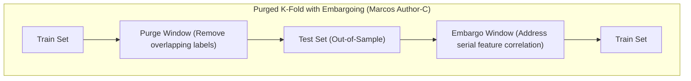
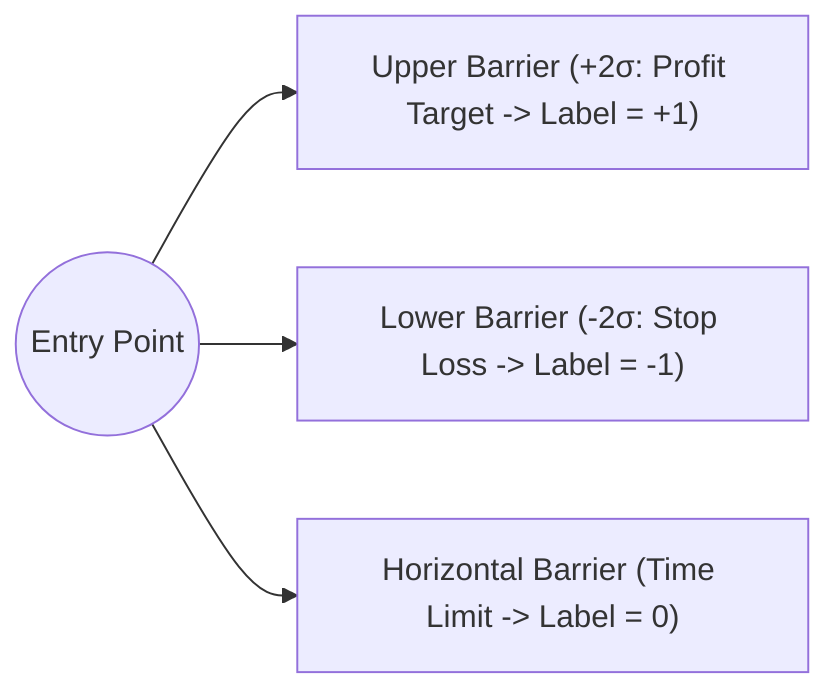
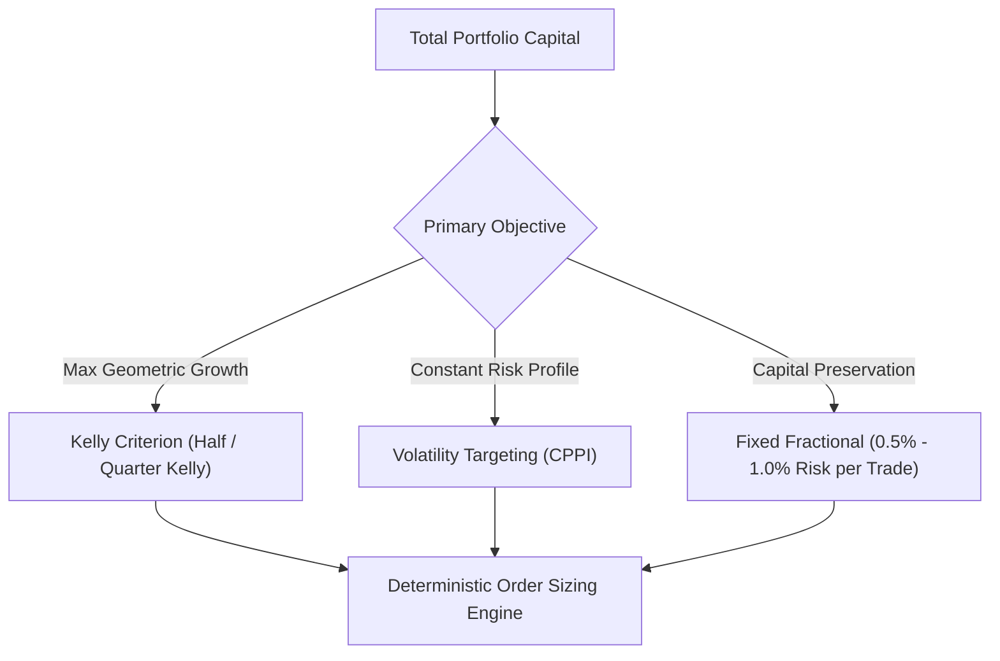
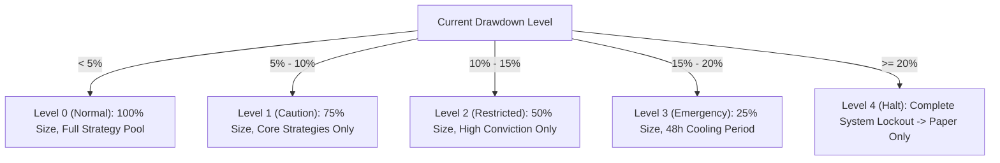

# Rigorous Backtesting, Position Sizing & Survival Mathematics

## Executive Summary

More than 90% of quantitative trading strategies that show high Sharpe ratios in standard backtests fail completely in live trading. This failure is driven by **information leakage, overlapping labels, serial correlation, and naive position sizing**.

This document outlines the rigorous institutional protocols required to prevent backtest overfitting, correctly label financial series (Marcos Author-C), calculate optimal risk allocations, and enforce deterministic drawdown circuit breakers.

---

## 1. The Four Fatal Sins of Backtesting

| Fatal Sin | Mechanism of Failure | Institutional Defense Protocol |
| :--- | :--- | :--- |
| **Overfitting (Noise Fitting)** | Tuning model parameters to maximize historical P&L on noise | Walk-Forward Analysis (WFA) & Bayesian Model Averaging |
| **Lookahead Bias** | Incorporating future information into past decision timestamps | Strict Point-in-Time (PIT) data warehousing & DAG causal precedence |
| **Survivorship Bias** | Filtering out delisted or bankrupt assets from historical backtests | Including all historical delistings, bankruptcies, and ticker changes |
| **Transaction Cost Neglect** | Ignoring spread widening, slippage, and non-linear market impact | Almgren-Chriss square-root execution impact models |

---

## 2. Advanced Validation: Purged K-Fold Cross-Validation & Embargoing

Standard K-Fold Cross-Validation assumes observations are independent and identically distributed (IID). In finance, **labels overlap across time**, leaking information from the test set into the training folds.

### Mathematical Definitions:
1. **Purging**: Removes any training observation whose forward-looking label horizon spans into the test evaluation period.
2. **Embargoing**: Inserts an intentional time buffer (typically 1–5% of the sample) *after* the test set before resuming training to ensure autoregressive feature memory decays to zero.

---

## 3. Labeling: The Triple Barrier Method & Meta-Labeling

### A. The Triple Barrier Method
Instead of arbitrary fixed-horizon returns ($R_{t, t+h}$), price paths are evaluated against dynamic volatility-adjusted barriers:

- **Label Assignment**: Whichever barrier is touched first defines the outcome:
\[
y_t = \begin{cases} +1 & \text{if price touches upper profit barrier first} \\ -1 & \text{if price touches lower stop-loss barrier first} \\ 0 & \text{if price expires at horizontal time limit} \end{cases}
\]

### B. Meta-Labeling (Two-Tier Model Architecture)
1. **Primary Model (Recall-Optimized)**: Identifies trade direction (Long / Short) with loose filtering to capture opportunities.
2. **Secondary Model (Precision-Optimized)**: Predicts the binary probability that the primary model's signal will actually hit the upper barrier.
3. **Outcome**: The secondary model scales position size directly based on predicted success probability: $P(y = 1 \mid X_t)$.

---

## 4. Position Sizing: The Mathematical Framework

### A. Fixed Fractional Position Sizing
\[
\text{Shares / Contracts} = \frac{\text{Capital} \times \text{Risk Limit \%}}{|\text{Entry Price} - \text{Stop Loss Price}|}
\]
Ensures that if the stop loss is triggered, the loss is deterministically capped at $\le 1.0\%$ of account equity.

### B. The Kelly Criterion
The theoretical fraction of capital to allocate to maximize long-term geometric capital growth:
\[
f^* = \frac{p(b + 1) - 1}{b}
\]
Where:
- $p$ = historical win rate.
- $b = \frac{\text{Average Win}}{\text{Average Loss}}$ (payoff ratio).

#### Fractional Kelly (Institutional Safety Rule):
Because parameter estimation errors in $p$ and $b$ cause Full Kelly to experience $50\%+$ drawdowns, institutional standards mandate **Half-Kelly** ($0.5 \cdot f^*$) or **Quarter-Kelly** ($0.25 \cdot f^*$).

### C. Volatility Targeting (Constant Volatility Exposure)
\[
\text{Scaled Position} = \text{Base Position} \times \frac{\sigma_{\text{target}}}{\sigma_{\text{realized}}(t)}
\]
Automatically scales down position sizes during extreme volatility spikes (e.g. VIX $> 35$) and scales up during quiet regimes.

### D. Ralph Vince Optimal $f$
Maximizes the geometric holding period return ($G$):
\[
G(f) = \prod_{i=1}^N \left( 1 + f \cdot \frac{-r_i}{\text{Worst Loss}} \right)^{1/N}
\]

---

## 5. Drawdown Control & Step-Down Circuit Breakers

The mathematics of drawdowns are severely asymmetric: recovering from a $50\%$ drawdown requires a $+100\%$ return; recovering from a $80\%$ drawdown requires a $+400\%$ return.

### Deterministic Risk Limits:
1. **Daily Loss Limit**: If cumulative daily loss exceeds $2.0\%$, all new order entry is halted immediately for 24 hours.
2. **Consecutive Loss Breaker**: 3 consecutive losing trades triggers automatic $50\%$ position size throttling.
3. **Hard Account Drawdown Cap**: At $20\%$ peak-to-trough drawdown, the system fail-closes all active positions and enters maintenance quarantine.
