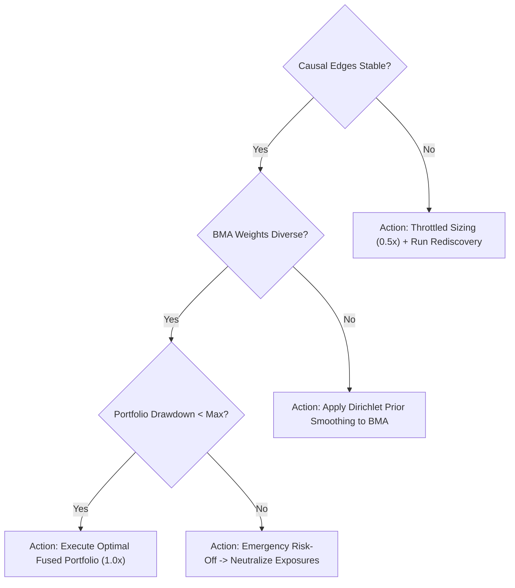

# Meta-Agent Orchestration, Self-Diagnosis & Decision Fusion

## Executive Overview

The **Meta-Agent Orchestration Layer** is the supervisory intelligence that monitors the health, stability, and calibration of the entire trading system. 

Rather than executing trades directly, the Meta-Agent operates as an impartial auditor: it evaluates causal edge stability, measures BMA weight entropy, detects dangerous model dominance, and triggers automated defensive risk throttling or rediscovery routines when system degradation is detected.

---

## 1. Meta-Agent Continuous Health Monitoring Architecture

```mermaid
flowchart TD
    subgraph Monitors ["Continuous Health & Diagnostics Monitors"]
        M1["1. Causal Graph Stability Monitor<br>• Edge survival rate over rolling 60 days<br>• Edge sign reversal detection"]
        M2["2. BMA Architecture Health Monitor<br>• Posterior weight entropy: H(w) = -∑ w_i log w_i<br>• Dominance alert: max(w_i) > 0.90<br>• Stagnation alert: uniform w_i across all models"]
        M3["3. Prediction Calibration Auditor<br>• Realized vs Predicted probability reliability curves<br>• Continuous Brier score & log-loss tracking"]
        M4["4. Portfolio Fragility & Risk Breaker<br>• Peak-to-trough drawdown check<br>• Daily VaR(95%) & CVaR exposure<br>• Inter-asset correlation spike detection"]
    end

    subgraph FusionEngine ["Meta-Agent Decision Fusion State Machine"]
        FSM{"System Health State"}
        FSM -->|All Healthy| S_NORM["NORMAL: Full allocation, active trading"]
        FSM -->|Causal Edges Unstable| S_CAUT1["CAUTION: Trigger Causal Rediscovery (PCMCI+/NOTEARS)"]
        FSM -->|One Model Dominant (>90%)| S_CAUT2["CAUTION: Diversify Architecture Candidates"]
        FSM -->|Predictions Miscalibrated| S_CAUT3["CAUTION: Recalibrate Likelihood Parameters"]
        FSM -->|Portfolio Health Breached| S_EMERG["EMERGENCY: Immediate Risk-Off Throttling (0.1x Sizing)"]
    end

    M1 --> FusionEngine
    M2 --> FusionEngine
    M3 --> FusionEngine
    M4 --> FusionEngine
```

---

## 2. Mathematical Diagnostic Formulas

### A. Causal Edge Stability Index (CESI)
Evaluates whether discovered causal relationships are persistent physical mechanisms or temporary statistical artifacts:
\[
\text{CESI} = \frac{1}{|\mathcal{E}_{\text{target}}|} \sum_{e \in \mathcal{E}_{\text{target}}} \left( \frac{1}{W} \sum_{\tau=1}^W \mathbb{I}\left(e \in \mathcal{G}_\tau\right) \right)
\]
Where:
- $\mathcal{E}_{\text{target}}$ is the set of validated causal edges leading into the target return variable.
- $W$ is the rolling window of observation periods (e.g. 60 trading days).
- $\mathbb{I}(e \in \mathcal{G}_\tau)$ indicates whether edge $e$ was discovered in the rolling graph $\mathcal{G}_\tau$.
- **Rule**: If $\text{CESI} < 0.70$, causal stability has degraded; position sizes are reduced by $50\%$ and automated DAG rediscovery is scheduled.

### B. BMA Posterior Weight Entropy (Weight Diversity)
Measures the effective number of functioning architectures in the BMA pool:
\[
H(\mathbf{w}) = -\sum_{i=1}^K w_i \ln(w_i), \quad N_{\text{eff}} = \frac{1}{\sum_{i=1}^K w_i^2}
\]
- **Overfitting Warning**: If $\max_i(w_i) > 0.90$, a single architecture has monopolized the system, reintroducing structural risk. The Meta-Agent injects new candidate architectures or applies weight shrinkage priors.
- **Ambiguity Warning**: If $H(\mathbf{w})$ approaches theoretical maximum ($\ln K$) and log-likelihood differences are negligible, no architecture possesses discernible alpha. System scales down gross leverage.

### C. Continuous Probability Calibration (Brier Score)
Evaluates whether predicted regime probabilities match realized empirical frequencies:
\[
\text{BS} = \frac{1}{N}\sum_{t=1}^N \sum_{k=1}^C \left( p_{t,k} - y_{t,k} \right)^2
\]
Where $p_{t,k}$ is the predicted probability of regime $k$ and $y_{t,k} \in \{0, 1\}$ is the actual realized regime indicator.

---

## 3. Autonomous Decision Fusion Matrix



### Operational Action Summary:

| Monitored Trigger | State Classification | Autonomous System Action | Execution Policy |
| :--- | :--- | :--- | :--- |
| **All Checks Passed** | `NORMAL` | Standard BMA weighted execution across architectures | Full $1.0\times$ Kelly-adjusted risk sizing |
| **Causal Edge Inversion** | `CAUTION` | Freeze new directional positions on affected pair; trigger PCMCI+/NOTEARS re-estimation | Throttle active exposure to $0.5\times$ |
| **Architecture Dominance ($w_i > 0.9$)** | `CAUTION` | Inject candidate variations (e.g. 4-state HMM, adaptive GMM); apply entropy regularization | Continue trading with model audit flag |
| **Brier Score Degradation ($BS > 0.35$)** | `CAUTION` | Trigger likelihood parameter recalculation across all regime models | Widen uncertainty bounds on position sizing |
| **Account Drawdown $\ge 15\%$** | `EMERGENCY` | Liquidate non-core holdings; enter delta-neutral hedging mode | Hard risk ceiling: max $0.1\times$ exposure |
