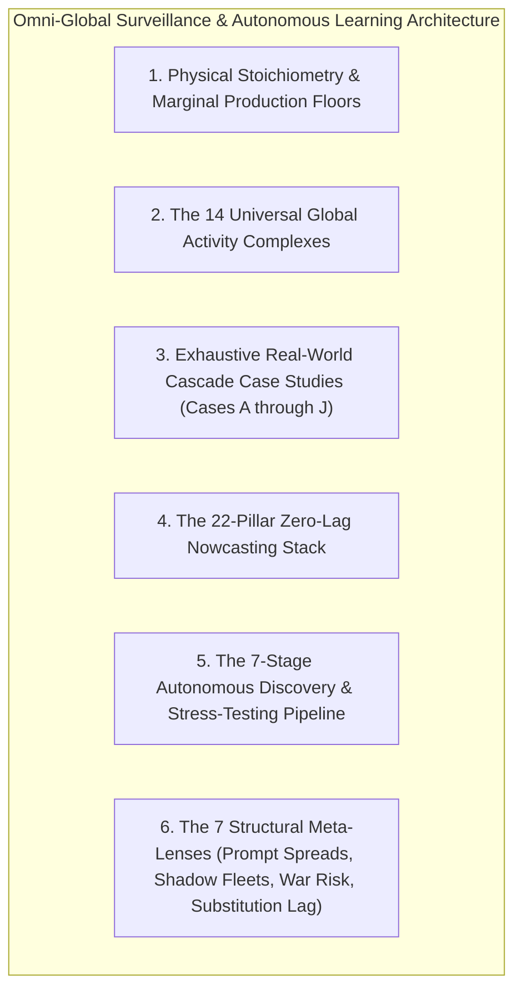
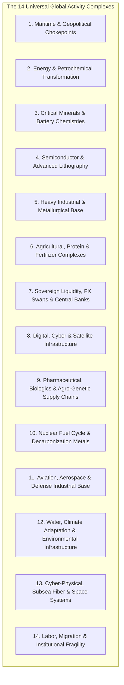
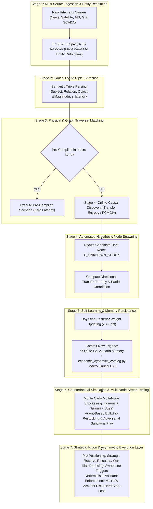
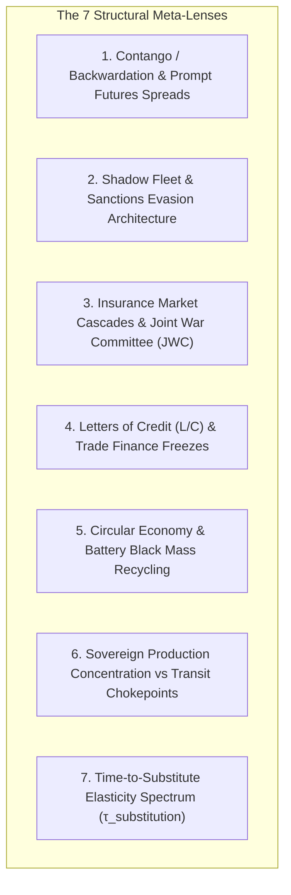

# Module 07: Omni-Global Activity Cascades, Physical Stoichiometry & Continuous Autonomous Learning

## Executive Overview

This module establishes the **Omni-Directional Global Activity Surveillance System**, the **Physical Stoichiometric Production Floor Engine**, and the **Continuous Autonomous Cascade Learning Pipeline**.

Rather than treating financial markets as isolated stochastic time-series, this architecture grounds market forecasting in the **immutable laws of chemistry, thermodynamics, industrial engineering, physical geography, and institutional power**.



---

## 1. Physical Stoichiometric Production Floors & Spread Formulations

In physical supply chains, market prices cannot violate chemical stoichiometry and thermodynamics without forcing plant closures and supply destruction. The system computes **real-time marginal cost floors**:

$$\text{Stoichiometric Conversion} \xrightarrow{\quad\text{Cost Function}\quad} \text{Marginal Cash Cost} \xrightarrow{\quad\text{Supply Shutdown Floor}\quad} \text{Asset Repricing}$$


### Key Mathematical Formulations

#### A. Haber-Bosch Synthetic Ammonia Cash-Cost
The Haber-Bosch reaction ($\text{N}_2 + 3\text{H}_2 \to 2\text{NH}_3$) consumes natural gas as hydrogen feedstock and process fuel:
\[
\text{Ammonia Cost}_{\text{ton}} = 33.5 \cdot P_{\text{HenryHub\_NatGas}} + \$65.00/\text{ton}
\]
When natural gas spikes, ammonia synthesis cash-costs rise linearly, establishing a hard floor under nitrogen fertilizer prices ($P_{\text{Urea}}$, $P_{\text{UAN}}$).

#### B. Corn / Soybean Relative Value Price Ratio
Tracks economic planting incentives across US Midwest and South American swing acres:
\[
\text{Ratio}_t = \frac{P_{\text{Soybean}}(t)}{P_{\text{Corn}}(t)}
\]
- **$\text{Ratio} > 2.50$ (SOY\_FAVORED)**: Soybeans expensive $\to$ Farmers expand soybean acreage $\to$ Forward soybean supply expands $\to$ Ratio compresses.
- **$2.20 \le \text{Ratio} \le 2.50$ (EQUILIBRIUM)**: Long-term historical baseline acreage parity.
- **$\text{Ratio} < 2.20$ (CORN\_FAVORED)**: Corn expensive $\to$ Farmers allocate capital to corn (conditioned on fertilizer input costs).

#### C. 3:2:1 Refinery Crack Spread
Models the net refining margin of converting 3 barrels of crude oil into 2 barrels of gasoline and 1 barrel of distillate:
\[
\text{Crack}_{3:2:1} = \frac{2 \cdot (42 \cdot P_{\text{RBOB\_gal}}) + 1 \cdot (42 \cdot P_{\text{HeatingOil\_gal}}) - 3 \cdot P_{\text{Crude\_bbl}}}{3}
\]

#### D. Soybean Processing Crush Spread
Models the gross processing margin of crushing 1 bushel ($60\text{ lbs}$) of raw soybeans into $44\text{ lbs}$ of soybean meal and $11\text{ lbs}$ of crude soybean oil:
\[
\text{Crush Margin}_{\text{bu}} = \left( \frac{P_{\text{Meal\_ton}}}{2000} \cdot 44 \right) + (P_{\text{Oil\_lb}} \cdot 11) - P_{\text{Soybean\_bu}}
\]

#### E. Spark & Clean Dark Spreads (Thermal Power Generation)
- **Spark Spread (Natural Gas Power)**:
\[
\text{Spark Spread} = P_{\text{Electricity\_MWh}} - (\text{HeatRate} \cdot P_{\text{NatGas\_MMBtu}})
\]
- **Clean Dark Spread (Coal Power + Carbon Credits)**:
\[
\text{Clean Dark Spread} = P_{\text{Electricity}} - (\text{HeatRate}_{\text{Coal}} \cdot P_{\text{Coal}}) - (\text{Emissions Factor} \cdot P_{\text{Carbon}})
\]

---

## 2. The 14 Universal Global Activity Complexes

To achieve complete global coverage, the surveillance engine continuously monitors **14 Interconnected Global Activity Complexes**:



| Complex | Strategic Epicenters & Chokepoints | Core High-Frequency Telemetry | Primary Downstream Cascade Target |
| :--- | :--- | :--- | :--- |
| **1. Maritime Chokepoints** | Hormuz, Malacca, Bab el-Mandeb (Red Sea), Suez, Panama, Bosphorus | AIS vessel transit counts, canal draft levels, VLCC tanker day-rates | Freightos FBX container index, crude tanker day-rates, delivery lead times. |
| **2. Energy & Petrochemicals** | Gulf Coast refineries, Rotterdam, Ras Laffan LNG, Cushing, Singapore | Floating-roof tank shadows via SAR radar, 3:2:1 crack spreads, pipeline flows | Jet fuel, diesel/heating oil, ethylene/propylene plastics, consumer goods packaging. |
| **3. Battery & Critical Minerals** | Atacama (Li), Kolwezi (Co), Morowali (Ni), Pilbara (Spodumene) | Mine export permits, refining conversion margins, smelter power draw | Lithium hydroxide, precursor cathode active materials (pCAM), EV automakers. |
| **4. Semiconductor Hardware** | Taiwan (TSMC), Netherlands (ASML), Ukraine (Neon purification), Japan | High-purity neon/xenon exports, optical mask shipments, fab electricity/water loads | GPU/CPU lead times, automotive ECU inventory shortages, tech capex. |
| **5. Heavy Metallurgy** | Pilbara iron ore, Australian coking coal, Chinese EAF mills, European smelters | Industrial electricity grid load (MW), blast furnace slag output, Baltic Dry Index (BDI) | Hot-rolled coil (HRC) steel, rebar, construction capex, automotive stamping. |
| **6. Agricultural Complexes** | US Midwest, Brazilian Cerrado, Ukrainian Chernozem, Black Sea ports | Sentinel-2 3m NDVI canopy density, NASA SMAP soil moisture, barge freight basis | Grain export basis, livestock feed margins, meat packing, grocery CPI. |
| **7. Sovereign Liquidity & FX** | Federal Reserve NY Desk, US Treasury, BoJ YCC, PBOC open-market ops | Daily Treasury General Account (TGA), Fed Overnight RRP, SOFR spreads | Global USD liquidity, emerging market FX debt stress, risk-on asset multiples. |
| **8. Digital & Cloud Grid** | Northern Virginia / Texas data center corridors, trans-oceanic subsea cables | Power purchase agreements (PPA), hyperscaler MW grid queues, fiber transit latency | AI compute cluster deployment, utility peak electricity rates, tech capex. |
| **9. Pharmaceuticals & Biologics** | India/China API hubs (>70% global volume), mRNA LNP labs, Cold-chain hubs | Acetic anhydride, 4-AA precursors, -80°C cold-chain logistics, CRISPR germplasm | Drug substance shortages, hospital operational costs, livestock herd immunity. |
| **10. Nuclear Fuel Cycle** | Kazakhstan (U3O8), Niger/Orano, Russia Tenex (SWU Enrichment), France | Yellowcake spot price, UF6 conversion fees, Separative Work Units (SWU) rates | Nuclear baseload power reliability, European natural gas substitution demand. |
| **11. Aerospace & Defense** | Russia VSMPO-AVISMA (30-40% global Ti), Toray Carbon Fiber, Pratt/GE | Titanium sponge export permits, single-crystal rhenium superalloys, NdFeB magnets | Commercial aircraft delivery backlogs (Boeing/Airbus), defense procurement lead times. |
| **12. Water & Environment** | Colorado Basin, Yangtze River, Mekong Dams, Ogallala Aquifer | Reservoir acre-feet storage, snowpack water equivalent (SWE), desalination kWh/m³ | Hydropower grid dispatch, industrial wafer fab water allocations, crop yields. |
| **13. Cyber-Physical & Space** | Alexandria Egypt subsea cable landings, GNSS/GPS constellations, SCADA | Subsea cable acoustic fiber telemetry, GPS spoofing/jamming alerts, PLC patch logs | AIS vessel routing efficiency, pipeline operational uptime, cloud region latency. |
| **14. Labor & Migration** | Global merchant fleet (200k seafarers), USWC/Rotterdam dockworkers, US trucking | Port container dwell days, driver load-to-truck ratios, demographic labor force deltas | Supply chain bullwhip congestion, working capital carrying costs, nearshoring capex. |

---

## 3. Exhaustive Real-World Cascade Case Studies

```mermaid
sequenceDiagram
    autonumber
    participant Event as Geopolitical / Physical Shock
    participant O1 as 1st-Order: Primary Physical Node
    participant O2 as 2nd-Order: Intermediate Conversion Node
    participant O3 as 3rd-Order: Substitution & Biological Node
    participant O4 as 4th-Order: Market Equilibrium / Spread Collapse

    Note over Event, O4: Case A: Strait of Hormuz Blockade (Energy & Fertilizer Shock)
    Event->>O1: Strait of Hormuz closed (~21M bbl/d petroleum + 20% global ammonia/LNG blocked)
    O1->>O2: Crude Oil spikes +25%; Nitrogen fertilizer surges from $480 to $700/ton
    O2->>O3: Refiners boost ethanol blending (corn demand rises); Corn fertilizer input costs surge +40%
    O3->>O4: Farmers rotate acreage to Soybeans (fixes own N2); Soybean supply expands -> Corn/Soy ratio collapses

    Note over Event, O4: Case B: Red Sea / Bab el-Mandeb Maritime Conflict (2023–2024)
    Event->>O1: Drone/missile attacks force container ships to bypass Suez Canal
    O1->>O2: Vessels rerouted around Cape of Good Hope (+14 days transit, +3,500 nautical miles)
    O2->>O3: Effective global container capacity contracts ~12%; bunker fuel consumption spikes +25%
    O3->>O4: Freightos FBX container index surges from $1,200 to $4,500/FEU; European import inflation reignites

    Note over Event, O4: Case C: Ukrainian Neon Gas Bottleneck (Semiconductor Shock)
    Event->>O1: Conflict halts major neon purification plants in Mariupol/Odessa (50% global supply)
    O1->>O2: Excimer laser-grade neon gas spikes 600%; DUV lithography operational costs surge
    O2->>O3: Semiconductor fabs face wafer allocation limits; automotive microcontroller lead times reach 52 weeks
    O3->>O4: Global automotive production cuts millions of units; used car prices surge +30% (Manheim index spike)

    Note over Event, O4: Case D: Fukushima-Daiichi & Thailand Floods (2011 JIT Electronics Collapse)
    Event->>O1: Nuclear incident shuts Japan auto OEMs + Bangkok monsoon floods submerge industrial parks
    O1->>O2: 50% of global Hard Disk Drive (HDD) assembly offline; automotive sensor inventories depleted
    O2->>O3: Enterprise PC and server fabrication halted; server delivery lead times surge to 9 months
    O3->>O4: Enterprise IT shifts capital from on-premise hardware to hyperscale cloud providers (AWS acceleration)

    Note over Event, O4: Case E: Texas Winter Storm Uri (Feb 2021 ERCOT Petrochemical Freeze)
    Event->>O1: Polar vortex collapses Texas electrical grid; un-winterized chemical plants freeze off
    O1->>O2: 60% of US PVC, ethylene, and propylene manufacturing offline; spot polymer prices spike 150%
    O2->>O3: Residential construction pipe, siding, and resin inventories vanish; home completion delays surge
    O3->>O4: Builders substitute alternative materials; lumber demand surges; lumber futures curve spikes

    Note over Event, O4: Case F: Ever Given Suez Canal Blockage (March 2021 Trade Bullwhip)
    Event->>O1: 400m container ship Ever Given runs aground, blocking $9.6B/day of global trade for 6 days
    O1->>O2: 350+ vessels anchored; European container terminals face zero arrivals followed by concentrated tsunami
    O2->>O3: Rotterdam/Antwerp container dwell times double; truck chassis shortage paralyzes inland logistics
    O3->>O4: European retail inventory carrying costs surge; supply chain bullwhip forces massive over-ordering

    Note over Event, O4: Case G: Colonial Pipeline Ransomware Attack (May 2021 East Coast Energy Panic)
    Event->>O1: DarkSide ransomware shuts IT billing network; Colonial Pipeline shuts 5,500 miles of fuel pipe
    O1->>O2: 45% of US East Coast gasoline, diesel, and jet fuel transport halted for 6 days
    O2->>O3: Retail gas stations suffer 70% dry-out rates; FAA temporarily waives truck driver Hours of Service (HOS)
    O3->>O4: Driver fatigue compensation premiums surge; spot trucking freight rates spike sharply

    Note over Event, O4: Case H: Kakhovka Dam Destruction (June 2023 Agricultural Wipeout)
    Event->>O1: Hydroelectric dam breach drains Kakhovka reservoir, destroying irrigation across 500,000 hectares
    O1->>O2: Ukrainian southern grain and oilseed crop wipeout; Black Sea export grain loading terminals flooded
    O2->>O3: FOB Black Sea grain basis collapses; European inland transit corridors congested by diverted volume
    O3->>O4: EU farmer protests force temporary import bans; global wheat futures curve contango steepens

    Note over Event, O4: Case I: Indonesian Nickel Export Ban & Tsingshan Smelter Cascade (2020–2024)
    Event->>O1: Indonesia bans raw nickel ore exports to force domestic value-add smelting investments
    O1->>O2: Chinese capital builds HPAL (High-Pressure Acid Leach) and RKEF smelters in Sulawesi
    O2->>O3: Low-grade Nickel Pig Iron (NPI) flood converts to nickel matte; Class 1/Class 2 market bifurcates
    O3->>O4: LME Nickel contract experiences historic March 2022 short squeeze ($100k/t); LME halts trading for days

    Note over Event, O4: Case J: Yangtze River Drought & Sichuan Power Rationing (Summer 2022)
    Event->>O1: Record heatwave and drought dry Yangtze basin; Sichuan hydropower generation collapses 50%
    O1->>O2: Industrial power rationed; Sichuan aluminum smelters and polysilicon plants shut down
    O2->>O3: Solar PV wafer prices spike; European solar deployment timelines slip
    O3->>O4: European utilities increase coal and natural gas burn; European carbon allowance (EUA) prices surge
```

---

## 4. The 22-Pillar Zero-Lag Nowcasting Stack

To eliminate the **15 to 90 day detection lag** inherent in lagging government surveys, the system ingests **22 High-Frequency Physical Proxies**:

```mermaid
quadrantChart
    title Data Source Latency vs Signal Alpha
    x-axis High Latency (Weeks/Months) --> Low Latency (Real-Time/Hours)
    y-axis Low Structural Alpha --> High Structural Alpha
    quadrant-1 "Zero-Lag Physical Proxies (Satellite SAR, Grid SCADA, Scraped SKUs, AIS, TROPOMI)"
    quadrant-2 "High-Frequency Market Feeds (Ticks, Order Book DOM, Options Implied Vol)"
    quadrant-3 "Lagging Public Headlines & Mainstream Financial News"
    quadrant-4 "Traditional Government Reports (WASDE, CPI, GDP, Census Surveys)"
```

| Pillar | Real-Time Physical Proxy | Replaced Delayed Report | Lead Time Advantage |
| :--- | :--- | :--- | :--- |
| **1. Prices** | 500k+ Scraped Retail Prices (PriceStats) + AAA Fuel | BLS Monthly CPI (15–45 days lag) | **15 to 45 Days** |
| **2. Activity** | PJM/ERCOT/CAISO 5-min Grid Loads + AAR Rail | BEA Quarterly Real GDP (30–90 days lag) | **30 to 90 Days** |
| **3. Labor** | Google Trends (*"unemployment benefits"*) + SEC 8-Ks | BLS JOLTS / NFP (7–65 days lag) | **30 to 65 Days** |
| **4. Spending** | FRED GASREGW + OpenTable Seated Diners + Cards | Census Retail Sales (15–45 days lag) | **15 to 30 Days** |
| **5. Housing** | Redfin Data Center + Zillow ZORI (9m shelter lead) | Census Housing Starts (20–50 days lag) | **20 to 50 Days** |
| **6. Agriculture** | Sentinel-2 NDVI 3m Canopy + NASA SMAP Moisture | USDA WASDE (30–60 days lag) | **30 to 45 Days** |
| **7. Energy** | NOAA GFS Degree Days (HDD/CDD) + Pipe Flows | EIA Weekly Storage (5–12 days lag) | **5 to 10 Days** |
| **8. Maritime** | NOAA MarineCadastre AIS + AISHub Chokepoints | Census Trade Balance (35 days lag) | **14 to 35 Days** |
| **9. Credit** | FRED ICE BofA US High Yield OAS (`BAMLH0A0HYM2`) | Corporate Default Reports | **Real-Time Daily** |
| **10. Liquidity** | Real-Time US Net Liquidity: $\text{WALCL} - \text{TGA} - \text{RRP}$ | FOMC Minutes (21 days lag) | **Daily at 16:15 EST** |
| **11. Satellite SAR** | Synthetic Aperture Radar Floating Tank Roof Heights | EIA Petroleum Inventories | **0-Day Daily Revisit** |
| **12. Night Lights** | NASA VIIRS Day/Night Band Industrial Radiance | Regional GDP & Factory Output | **0-Day Daily** |
| **13. Atmospheric** | TROPOMI / Sentinel-5P $\text{SO}_2$ & $\text{NO}_2$ Industrial Plumes | Industrial Production & Flare Volumes | **0-Day Daily** |
| **14. Gravity** | NASA GRACE-FO Groundwater & Aquifer Depletion | Drought & Irrigation Disaster Declarations | **Monthly (3m lead)** |
| **15. E-Commerce** | Daily 500k+ SKU Elasticity & Stock-Out Flags | Retail Inventory-to-Sales Ratios | **0-Day Daily** |
| **16. Rail Carloads** | AAR Weekly Carloads (Chemicals, Grain, Coal, Intermodal)| Surface Transportation Board Reports | **Weekly (3w lead)** |
| **17. Card Velocity** | Facteus / Second Measure Anonymized Credit Cards | Bureau of Economic Analysis PCE | **T+1 Daily** |
| **18. Job NLP** | Lightcast / LinkUp Hiring Velocity by Skill Cluster | BLS Occupational Employment Statistics | **Weekly (60d lead)** |
| **19. Dark Fleet AIS** | Satellite AIS Gap & STS Lightering Zone Detection | Sanctions Enforcement Disclosures | **0-Day Real-Time** |
| **20. Grid SCADA** | High-Voltage Substation Frequency & Inertia (FCR) | Energy Reliability Council Alerts | **Sub-Second Real-Time** |
| **21. On-Chain FX** | USDT/USDC Cross-Border Liquidity & Mining Hash-Rate | Sovereign Capital Flight Disclosures | **Real-Time 24/7** |
| **22. Open ISR** | Commercial Satellite & High-Resolution Optical Scans | Port Congestion & Military Deployments | **0-Day Daily** |

---

## 5. The 7-Stage Autonomous Discovery & Stress-Testing Pipeline



### Stage 6 & Stage 7 Formalization

#### Stage 6: Counterfactual Multi-Node Stress-Testing
The system executes Monte Carlo simulations across $10,000$ synthetic paths subjecting the causal DAG to **simultaneous multi-chokepoint disruptions** (e.g., *Hormuz Transit Shutdown + Taiwan Semiconductor Blockade + Suez Canal Closure*). The simulation models non-linear inventory hoarding behaviors (the **Bullwhip Effect**):

$$\text{Order}_t = \text{Demand}_t + k \cdot (\text{Target Inventory} - \text{Actual Inventory}_t) \cdot \exp(\text{Uncertainty}_t)$$

#### Stage 7: Strategic Action & Convex Positioning
Translates cascade forecasts into positive-convexity trade structures:
- **Trade Finance & Swap Line Arbitrage**: Captures widening cross-currency basis spreads before central bank swap lines activate.
- **Fail-Closed Risk Enforcement**: Every position is strictly validated by [`DeterministicValidator`](file:///c:/Users/User/OneDrive/Desktop/selfmade%20game%20projects/llm%20trader%20-%20Checkpoint%20dicisipline%20soilder%20-%20used%20in%20antigravity/core/trading_safety.py) with mandatory hard stop-loss, maximum $1\%$ account equity risk, and zero execution authority granted to non-deterministic agents (`execution_authority = False`).

---

## 6. The 7 Structural Meta-Lenses

To prevent structural blindspots, the system filters all analysis through **7 Critical Structural Lenses**:



### 1. Contango / Backwardation & Prompt Futures Spreads
Physical shortages always manifest in **prompt calendar spreads** weeks before moving headline spot prices. 
- *Backwardation* ($\text{Prompt} > \text{Deferred}$): Immediate physical inventory shortage.
- *Contango* ($\text{Prompt} < \text{Deferred}$): Inventory glut, storage capacity exhaustion.
- The system monitors the **Brent-Dubai spread**, **WTI prompt roll ($M1 - M2$)**, and **LME cash-to-3-month spreads** as leading signals.

### 2. Shadow Fleet & Sanctions Evasion Architecture
Over $300+$ vintage VLCC tankers operate without Western P&I club insurance, conducting **Ship-to-Ship (STS) lightering transfers** in international waters (Laconian Gulf, Malacca Strait). The system tracks satellite SAR radar anomalies and AIS dark gaps to model the **true parallel physical crude supply** bypassing official sanctions.

### 3. Insurance Market Cascades (Joint War Committee)
When Lloyd's Joint War Committee (JWC) designates a maritime area as a high-risk zone, **war risk insurance premiums surge by $400\% - 1,000\%$**, rendering voyages economically unviable for standard commercial charterers. The physical route becomes **effectively closed to commercial transit even if no military blockade is physically active**.

### 4. Letters of Credit (L/C) & Trade Finance Freezes
During systemic banking stress, commercial banks restrict issuance of commodity Letters of Credit (L/Cs). Solvent physical trading houses cannot finance maritime cargo transit, stranding physical commodities at sea and triggering **sudden liquidity-driven contango collapses**.

### 5. Circular Economy & Battery Black Mass Recycling
Urban mining (recovering lithium, cobalt, and nickel from recycled battery "black mass" and EAF steel scrap) represents an expanding share of primary supply. As battery chemistries shift from NMC to LFP, cobalt vulnerability declines while **manganese and synthetic graphite processing dependencies surge**.

### 6. Sovereign Production Concentration vs. Transit Chokepoints
A chokepoint (e.g. Suez Canal) can be bypassed by spending extra transit time. A **sovereign production concentration** (e.g. China controlling $> 70\%$ of global Cathode Active Material capacity, or DRC controlling $> 70\%$ of cobalt extraction) cannot be bypassed by altering shipping routes. It represents a **geopolitical sovereign policy risk** requiring long-dated capital expenditure substitution.

### 7. The Time-to-Substitute Elasticity Spectrum ($\tau_{\text{substitution}}$)
Every node in the causal graph is parameterized by its **inherent physical substitution horizon ($\tau_{\text{substitution}}$)**:

$$\tau_{\text{substitution}} \in \begin{cases} 
\text{Hours to Days} & \text{Crude Oil } \to \text{ Ethanol Blending} \\
\text{1 Growing Season (6–12 months)} & \text{Corn Acreage } \to \text{ Soybean Acreage} \\
\text{2 to 4 Years} & \text{Active Pharmaceutical Ingredient (API) Chemical Synthesis Facility} \\
\text{5 to 7 Years} & \text{Semiconductor Sub-2nm Wafer Fabrication Facility (TSMC/Intel Fab)} \\
\text{7 to 12 Years} & \text{Copper / Lithium Greenfield Mining & Smelting Complex}
\end{cases}$$

The system weights downstream ripple effects by $\tau_{\text{substitution}}$, capturing immense pricing power in supply chains where substitution requires multi-year capital cycles.
