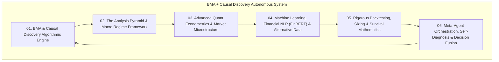

# BMA + Causal Discovery Autonomous Trading System: Architecture & Master Compendium

## Overview of the Autonomous Architecture

This repository encapsulates the complete engineering and theoretical design of the **Self-Improving, Epistemologically-Aware Autonomous Quantitative Architecture**.

Located in: [`docs/analytical_frameworks_and_epistemology/bma_causal_autonomous_system/`](file:///c:/Users/User/OneDrive/Desktop/selfmade%20game%20projects/llm%20trader%20-%20Checkpoint%20dicisipline%20soilder%20-%20used%20in%20antigravity/docs/analytical_frameworks_and_epistemology/bma_causal_autonomous_system)

---

## Compendium of Modules

### 1. [Module 01: BMA & Causal Discovery Algorithmic Engine](file:///c:/Users/User/OneDrive/Desktop/selfmade%20game%20projects/llm%20trader%20-%20Checkpoint%20dicisipline%20soilder%20-%20used%20in%20antigravity/docs/analytical_frameworks_and_epistemology/bma_causal_autonomous_system/01_BMA_AND_CAUSAL_DISCOVERY_ARCHITECTURE.md)
- **Core Principles**: Architecture-Level vs Prediction-Level Bayesian Model Averaging, Population pool ($A_1$ Rule-Based, $A_2$ GMM, $A_3$ HMM-2, $A_4$ HMM-3, $A_5$ Ensemble, $A_6$ Causal Conditioned), Online log-score updates with memory decay $\lambda$, and Causal Discovery algorithms (PC, FCI, FGES, NOTEARS continuous DAG optimization, PCMCI+ time-series, LiNGAM non-Gaussian ICA).

### 2. [Module 02: The Analysis Pyramid & Macro Regime Framework](file:///c:/Users/User/OneDrive/Desktop/selfmade%20game%20projects/llm%20trader%20-%20Checkpoint%20dicisipline%20soilder%20-%20used%20in%20antigravity/docs/analytical_frameworks_and_epistemology/bma_causal_autonomous_system/02_THE_ANALYSIS_PYRAMID_AND_MACRO_REGIMES.md)
- **Core Principles**: The 7-Tier Analysis Pyramid (Philosophy $\to$ Formal $\to$ Domain $\to$ Macro $\to$ Top-Down/Bottom-Up/Quantamental $\to$ Causal Discovery $\to$ Execution), The 3 Pillars of Macro Analysis (Real Activity, Inflation, Monetary Policy), The 3-Tools Framework (Real Activity $\times$ Financial Conditions $\times$ Sentiment), and The 4 Macro Regimes (Goldilocks, Reflation, Stagflation, Deflation).

### 3. [Module 03: Advanced Quant Econometrics & Market Microstructure](file:///c:/Users/User/OneDrive/Desktop/selfmade%20game%20projects/llm%20trader%20-%20Checkpoint%20dicisipline%20soilder%20-%20used%20in%20antigravity/docs/analytical_frameworks_and_epistemology/bma_causal_autonomous_system/03_ADVANCED_QUANT_ECONOMETRICS_AND_MICROSTRUCTURE.md)
- **Core Principles**: Stationarity testing, VAR & Granger Causality F-tests, Cointegration & VECM error-correction vectors, ARCH/GARCH/EGARCH/DCC-GARCH volatility models, Adaptive Kalman Filter state-space tracking, Itô's Lemma, Black-Scholes-Merton PDE & Greeks, Limit Order Book depth, VPIN (Volume-Synchronized Probability of Informed Trading) with Bulk Volume Classification (BVC), and Almgren-Chriss market impact.

### 4. [Module 04: Machine Learning, Financial NLP (FinBERT) & Alternative Data](file:///c:/Users/User/OneDrive/Desktop/selfmade%20game%20projects/llm%20trader%20-%20Checkpoint%20dicisipline%20soilder%20-%20used%20in%20antigravity/docs/analytical_frameworks_and_epistemology/bma_causal_autonomous_system/04_MACHINE_LEARNING_NLP_AND_ALTERNATIVE_DATA.md)
- **Core Principles**: Supervised, Unsupervised & Reinforcement Learning (PPO, Meta-RL) in quantitative finance, Lookahead bias & Multiple Testing (FDR/Bonferroni) corrections, FinBERT domain-specific language modeling for earnings call transcripts and FOMC statements, Satellite imagery feature extraction (parking lots, oil tank shadows, NDVI), Credit card aggregates, and E-commerce price scraping pipelines.

### 5. [Module 05: Rigorous Backtesting, Sizing & Survival Mathematics](file:///c:/Users/User/OneDrive/Desktop/selfmade%20game%20projects/llm%20trader%20-%20Checkpoint%20dicisipline%20soilder%20-%20used%20in%20antigravity/docs/analytical_frameworks_and_epistemology/bma_causal_autonomous_system/05_RIGOROUS_BACKTESTING_SIZING_AND_SURVIVAL.md)
- **Core Principles**: The Four Fatal Sins of Backtesting, Walk-Forward Analysis (WFA), Purged K-Fold Cross-Validation with Embargoing (Marcos Author-C), Triple Barrier Method labeling, Meta-Labeling precision filtering, Fixed Fractional Sizing, Full/Half Kelly Criterion, Volatility Targeting (CPPI), Ralph Vince Optimal $f$, and 5-tier Step-Down Drawdown Circuit Breakers.

### 6. [Module 06: Meta-Agent Orchestration, Self-Diagnosis & Decision Fusion](file:///c:/Users/User/OneDrive/Desktop/selfmade%20game%20projects/llm%20trader%20-%20Checkpoint%20dicisipline%20soilder%20-%20used%20in%20antigravity/docs/analytical_frameworks_and_epistemology/bma_causal_autonomous_system/06_META_AGENT_ORCHESTRATION_AND_DECISION_FUSION.md)
- **Core Principles**: Continuous health monitoring, Causal Edge Stability Index (CESI), BMA Posterior Weight Entropy $H(\mathbf{w})$ and Dominance alerts ($\max w_i > 0.90$), Brier score probability calibration, Autonomous Decision Fusion state machine (`NORMAL`, `CAUTION`, `EMERGENCY`), and automated risk throttling.

### 7. [Module 07: Omni-Global Activity Cascades, Physical Stoichiometry & Continuous Autonomous Learning](file:///c:/Users/User/OneDrive/Desktop/selfmade%20game%20projects/llm%20trader%20-%20Checkpoint%20dicisipline%20soilder%20-%20used%20in%20antigravity/docs/analytical_frameworks_and_epistemology/bma_causal_autonomous_system/07_OMNI_GLOBAL_CASCADES_AND_CONTINUOUS_LEARNING.md)
- **Core Principles**: Physical production floors & stoichiometry (Haber-Bosch Ammonia $\$480 \to \$700/\text{ton}$, Corn/Soy ratio, 3:2:1 Crack, Soy Crush, Spark spread), The 8 Universal Global Activity Complexes (Maritime, Energy, Battery Minerals, Semiconductors, Metallurgy, Ag, Sovereign Liquidity, Cloud Power), Multi-order cascade case studies (Hormuz, Red Sea / Bab el-Mandeb, Taiwan/Neon), The 5-Stage Autonomous Discovery Pipeline (NER $\to$ Semantic Triples $\to$ DAG Matching $\to$ Transfer Entropy / PCMCI+ $\to$ Bayesian Edge Reinforcement), and The 10-Pillar Free Nowcasting Stack.

---

## Dedicated Sub-Compendium: Retail Quant Master Architecture

📁 **Location**: [`docs/analytical_frameworks_and_epistemology/bma_causal_autonomous_system/retail_quant_master_architecture/`](file:///c:/Users/User/OneDrive/Desktop/selfmade%20game%20projects/llm%20trader%20-%20Checkpoint%20dicisipline%20soilder%20-%20used%20in%20antigravity/docs/analytical_frameworks_and_epistemology/bma_causal_autonomous_system/retail_quant_master_architecture/INDEX.md)

- **[Module 01: Mathematical Pillars & Trading Metrics Optimization](file:///c:/Users/User/OneDrive/Desktop/selfmade%20game%20projects/llm%20trader%20-%20Checkpoint%20dicisipline%20soilder%20-%20used%20in%20antigravity/docs/analytical_frameworks_and_epistemology/bma_causal_autonomous_system/retail_quant_master_architecture/01_MATHEMATICAL_PILLARS_AND_METRICS_OPTIMIZATION.md)**: The 6 Core Formulas ($\text{EV}, \text{RoR}, \text{Sharpe/Sortino}, \text{R-Multiple}, \text{CAGR}, \text{Streak/Run Theory}$), Lottery mathematical proof, Ralph Vince/Balsara survival models, Run theory max loss streaks ($L_{\text{max}}$), and Master 6-Stage Metrics Reference Matrix.
- **[Module 02: Market Inefficiencies, Validation Pipeline & Open Data Stack](file:///c:/Users/User/OneDrive/Desktop/selfmade%20game%20projects/llm%20trader%20-%20Checkpoint%20dicisipline%20soilder%20-%20used%20in%20antigravity/docs/analytical_frameworks_and_epistemology/bma_causal_autonomous_system/retail_quant_master_architecture/02_MARKET_INEFFICIENCIES_AND_DISCOVERY_PIPELINE.md)**: The 4 Major Inefficiency Classes (Structural, Gamma/VRP, Microstructure, Behavioral), 7-Stage Institutional Discovery Pipeline (CPCV, DSR, WFE), and Open Data Stack (FRED, Treasury, yfinance, CCXT, Tiingo, ForexFactory, SEC EDGAR/FinBERT).
- **[Module 03: Six-Layer Autonomous Architecture, Failure Mode Audit & Institutional Upgrades](file:///c:/Users/User/OneDrive/Desktop/selfmade%20game%20projects/llm%20trader%20-%20Checkpoint%20dicisipline%20soilder%20-%20used%20in%20antigravity/docs/analytical_frameworks_and_epistemology/bma_causal_autonomous_system/retail_quant_master_architecture/03_SIX_LAYER_AUTONOMOUS_SYSTEM_AND_FAILURE_AUDIT.md)**: 6-Layer MT5/Python Autonomous Engine, 6 Hidden Failure Modes (Regime lag, Passive adverse selection, Correlation collapse, B-Book asymmetries, Stop hunting, Concept drift), and 5 Institutional Upgrades (BOCPD, Urgency SOR, Copula EVT, Synthetic Stops/FIX, Continual EWC ML).
- **[Module 04: Microstructure, Almgren-Chriss Market Impact & Transaction Cost Engine](file:///c:/Users/User/OneDrive/Desktop/selfmade%20game%20projects/llm%20trader%20-%20Checkpoint%20dicisipline%20soilder%20-%20used%20in%20antigravity/docs/analytical_frameworks_and_epistemology/bma_causal_autonomous_system/retail_quant_master_architecture/04_TRANSACTION_COST_ENGINE_AND_MARKET_IMPACT.md)**: Bid-Ask Spread Anatomy, Square-Root Law of Market Impact, Almgren-Chriss Permanent & Temporary Impact, and Complete Executable Python `TransactionCostEngine`.
- **[Module 05: Dynamic Kalman Filter Statistical Arbitrage Alpha Engine](file:///c:/Users/User/OneDrive/Desktop/selfmade%20game%20projects/llm%20trader%20-%20Checkpoint%20dicisipline%20soilder%20-%20used%20in%20antigravity/docs/analytical_frameworks_and_epistemology/bma_causal_autonomous_system/retail_quant_master_architecture/05_DYNAMIC_KALMAN_STATARB_ENGINE.md)**: Dynamic Cointegration in State Space, Ornstein-Uhlenbeck Analytical Half-Life Time Stops, and Complete Executable Python `DynamicKalmanStatArb` Backtester (tested on GDX vs GLD).
- **[Module 06: Robustness Playbook Robustness Playbook & Compounding Systems](file:///c:/Users/User/OneDrive/Desktop/selfmade%20game%20projects/llm%20trader%20-%20Checkpoint%20dicisipline%20soilder%20-%20used%20in%20antigravity/docs/analytical_frameworks_and_epistemology/bma_causal_autonomous_system/retail_quant_master_architecture/06_ROBUSTNESS_PLAYBOOK_PLAYBOOK_AND_COMPOUNDING_SYSTEMS.md)**: Dr. Author-C's Robustness Criteria (50% Backtest Haircut Rule, Stationarity/Cointegration, Parameter Parsimony), The 5 Pillars of Compounding Growth ($\text{CAGR} \approx \mu - \frac{1}{2}\sigma^2$, Quarter-Kelly, De-correlation, Carver $\pm 10\%$ buffer), and 3-Tier Step-Down Drawdown Circuit Breakers.

---

## Dedicated Sub-Compendium: Geopolitical Predictive Analysis & Sanctions Intelligence

📁 **Location**: [`docs/analytical_frameworks_and_epistemology/bma_causal_autonomous_system/geopolitical_predictive_and_sanctions_intelligence/`](file:///c:/Users/User/OneDrive/Desktop/selfmade%20game%20projects/llm%20trader%20-%20Checkpoint%20dicisipline%20soilder%20-%20used%20in%20antigravity/docs/analytical_frameworks_and_epistemology/bma_causal_autonomous_system/geopolitical_predictive_and_sanctions_intelligence/INDEX.md)

- **[Module 01: Predictive Analysis, Extrapolation Mathematics & State Trajectory Forecasting](file:///c:/Users/User/OneDrive/Desktop/selfmade%20game%20projects/llm%20trader%20-%20Checkpoint%20dicisipline%20soilder%20-%20used%20in%20antigravity/docs/analytical_frameworks_and_epistemology/bma_causal_autonomous_system/geopolitical_predictive_and_sanctions_intelligence/01_PREDICTIVE_ANALYSIS_AND_EXTRAPOLATION_MATHEMATICS.md)**: Extrapolation vs. Interpolation, State-Space Vector Trajectories, Random Walk boundaries, Lyapunov Exponents, Predictability Horizons & The Parachute Principle.
- **[Module 02: Geopolitical Macro Foresight, Scenario Planning & Early Warning Systems](file:///c:/Users/User/OneDrive/Desktop/selfmade%20game%20projects/llm%20trader%20-%20Checkpoint%20dicisipline%20soilder%20-%20used%20in%20antigravity/docs/analytical_frameworks_and_epistemology/bma_causal_autonomous_system/geopolitical_predictive_and_sanctions_intelligence/02_GEOPOLITICAL_MACRO_FORESIGHT_AND_SCENARIO_PLANNING.md)**: 5-Phase Strategic Foresight, 2×2 Scenario Matrices, SIPRI 8-Domain EWS, Yield Curve Inversion Causal Transmission, COMPASS Framework (7 Bearings), GPR Index quantification & BMA across Regimes ($A_1-A_5$).
- **[Module 03: Multi-Disciplinary Domain Knowledge Compendium & Causal Case Studies](file:///c:/Users/User/OneDrive/Desktop/selfmade%20game%20projects/llm%20trader%20-%20Checkpoint%20dicisipline%20soilder%20-%20used%20in%20antigravity/docs/analytical_frameworks_and_epistemology/bma_causal_autonomous_system/geopolitical_predictive_and_sanctions_intelligence/03_MULTI_DISCIPLINARY_DOMAIN_KNOWLEDGE_COMPENDIUM.md)**: The 12 Foundational Knowledge Pillars and Deep Causal Case Studies (Thucydides Trap, Resource Curse, Russian Geography, China North Plain Water Crisis, Ukraine 2022 Synthesis).
- **[Module 04: Economic Sanctions, Financial Plumbing & Evasion Forensics](file:///c:/Users/User/OneDrive/Desktop/selfmade%20game%20projects/llm%20trader%20-%20Checkpoint%20dicisipline%20soilder%20-%20used%20in%20antigravity/docs/analytical_frameworks_and_epistemology/bma_causal_autonomous_system/geopolitical_predictive_and_sanctions_intelligence/04_ECONOMIC_SANCTIONS_FINANCIAL_PLUMBING_AND_EVASION_FORENSICS.md)**: Statutory Authorities (IEEPA/TWEA), OFAC 50% Rule, SWIFT MT/ISO 20022 Screening, Sovereign Asset Freezes, EAR/ITAR Export Controls, New BIS 50% Rule, G7 Price Cap Attestations, Semiconductor Evasion Networks & BMA Effectiveness Model.

---

## Codebase Implementation Alignment

| Architecture Component | Corresponding Codebase Implementation |
| :--- | :--- |
| **BMA Gaussian HMM Classifier** | [`intelligence/regime_classifier.py`](file:///c:/Users/User/OneDrive/Desktop/selfmade%20game%20projects/llm%20trader%20-%20Checkpoint%20dicisipline%20soilder%20-%20used%20in%20antigravity/intelligence/regime_classifier.py) |
| **Causal Graph & Economic Dynamics** | [`intelligence/macro_graph.py`](file:///c:/Users/User/OneDrive/Desktop/selfmade%20game%20projects/llm%20trader%20-%20Checkpoint%20dicisipline%20soilder%20-%20used%20in%20antigravity/intelligence/macro_graph.py) & [`intelligence/economic_dynamics_catalog.py`](file:///c:/Users/User/OneDrive/Desktop/selfmade%20game%20projects/llm%20trader%20-%20Checkpoint%20dicisipline%20soilder%20-%20used%20in%20antigravity/intelligence/economic_dynamics_catalog.py) |
| **Meta-Reflective Self-Diagnosis** | [`intelligence/meta_reflector.py`](file:///c:/Users/User/OneDrive/Desktop/selfmade%20game%20projects/llm%20trader%20-%20Checkpoint%20dicisipline%20soilder%20-%20used%20in%20antigravity/intelligence/meta_reflector.py) |
| **Synthetic AR(1) Path Simulator** | [`research/synthetic_path_simulator.py`](file:///c:/Users/User/OneDrive/Desktop/selfmade%20game%20projects/llm%20trader%20-%20Checkpoint%20dicisipline%20soilder%20-%20used%20in%20antigravity/research/synthetic_path_simulator.py) |
| **Risk Parity (ERC) Optimizer** | [`research/risk_parity_engine.py`](file:///c:/Users/User/OneDrive/Desktop/selfmade%20game%20projects/llm%20trader%20-%20Checkpoint%20dicisipline%20soilder%20-%20used%20in%20antigravity/research/risk_parity_engine.py) |
| **Deterministic Risk Gate** | [`core/trading_safety.py`](file:///c:/Users/User/OneDrive/Desktop/selfmade%20game%20projects/llm%20trader%20-%20Checkpoint%20dicisipline%20soilder%20-%20used%20in%20antigravity/core/trading_safety.py) & [`core/risk_manager.py`](file:///c:/Users/User/OneDrive/Desktop/selfmade%20game%20projects/llm%20trader%20-%20Checkpoint%20dicisipline%20soilder%20-%20used%20in%20antigravity/core/risk_manager.py) |
| **Autonomous Macro Pipeline** | [`intelligence/macrofundamental_pipeline.py`](file:///c:/Users/User/OneDrive/Desktop/selfmade%20game%20projects/llm%20trader%20-%20Checkpoint%20dicisipline%20soilder%20-%20used%20in%20antigravity/intelligence/macrofundamental_pipeline.py) |
