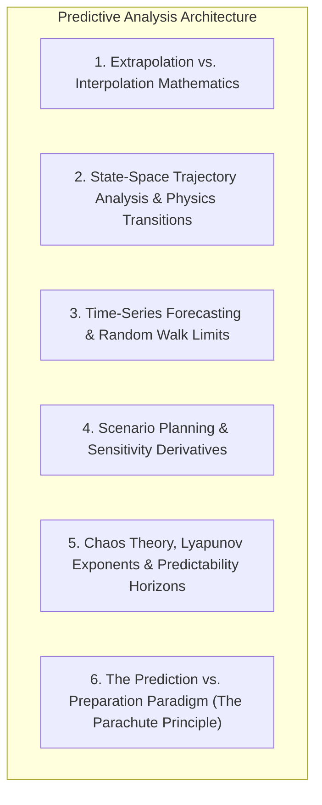
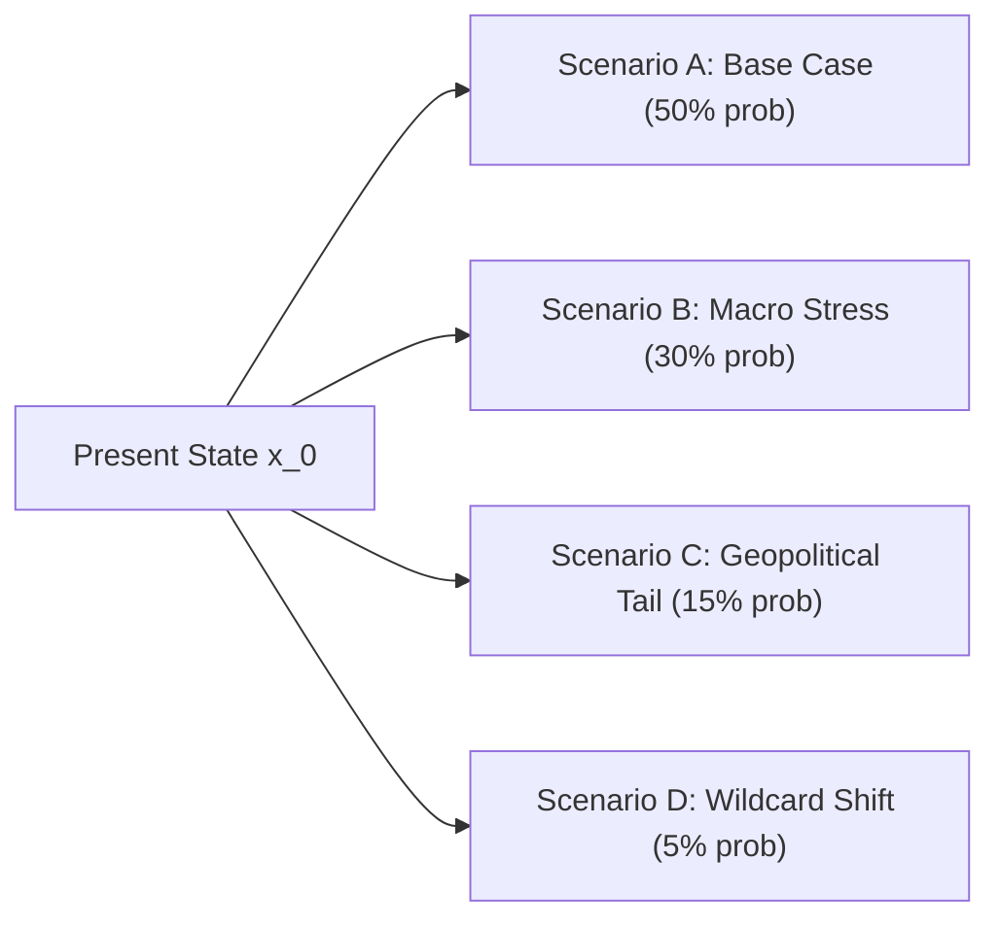
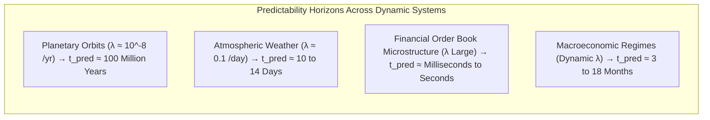
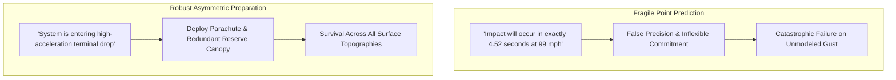

# Module 01: Predictive Analysis, Extrapolation Mathematics & State Trajectory Forecasting

## Executive Overview

Predictive analysis in complex macroeconomic and physical systems is the discipline of forecasting future state vectors $\mathbf{x}_{t+h}$ from present state observations $\mathbf{x}_t$ conditioned on governing dynamic laws, statistical regularities, and structural constraints.

This document establishes the mathematical foundations, state-space formulations, philosophical boundaries, and chaos-theoretic horizons of predictive analysis.



---

## 1. Extrapolation vs. Interpolation Mathematics

### Core Distinctions

| Dimension | Interpolation | Extrapolation |
| :--- | :--- | :--- |
| **Definition** | Estimating unobserved values within the range of known data points $[\min(x), \max(x)]$. | Estimating future or unobserved values beyond the known range $x > \max(x)$ or $x < \min(x)$. |
| **Epistemic Certainty** | High — bounded by observed empirical boundary conditions. | Low to Moderate — strictly conditioned on the assumption that underlying dynamic laws remain invariant. |
| **Risk Profile** | Bounded local estimation error. | Compounding, unbounded error divergence as forecast horizon $h \to \infty$. |
| **Visual Analog** | Connecting existing coordinate points on a bounded manifold. | Projecting a vector trajectory past the terminal observed coordinate. |

### Mathematical Formulation

Given a sequence of discrete observations $\mathcal{D} = \{(t_1, y_1), (t_2, y_2), \dots, (t_k, y_k)\}$:
- **Interpolation** computes $\hat{y}(t^*)$ where $t_{\min} < t^* < t_{\max}$.
- **Extrapolation** computes $\hat{y}(t_k + h)$ where $h > 0$ (forward forecasting) or $h < -k$ (historical counterfactual reconstruction).

### Extrapolation Models & Error Divergence

#### 1. Linear Extrapolation
\[
\hat{y}(t + h) = y_t + h \cdot \left. \frac{dy}{dt} \right|_t
\]
*Failure Mode*: Fails completely when the system is subjected to non-zero acceleration, non-linear feedback, or capacity saturation floors/ceilings.

#### 2. Quadratic / Polynomial Extrapolation (Physical Law)
For a falling body or ballistic trajectory under constant acceleration $g$:
\[
y(t) = y_0 + v_0 t - \frac{1}{2} g t^2
\]
Impact time $t_{\text{impact}}$ when terminal position $y(t) = 0$:
\[
t_{\text{impact}} = \frac{v_0 + \sqrt{v_0^2 + 2 g y_0}}{g}
\]
Terminal velocity at impact:
\[
v_{\text{impact}} = \sqrt{v_0^2 + 2 g y_0}
\]

#### 3. Exponential Growth / Decay
\[
\hat{y}(t + h) = y_t \cdot \exp(r \cdot h)
\]
*Failure Mode*: In physical and economic systems, unconstrained exponential growth violates finite resource constraints, invariably transitioning into a **Logistic Sigmoid manifold**:
\[
y(t) = \frac{K}{1 + \left(\frac{K - y_0}{y_0}\right) \exp(-r t)}
\]
Where $K$ represents carrying capacity.

---

## 2. State-Space Trajectory Analysis & Physics Transitions

In state-space analysis, the complete condition of an economic, physical, or geopolitical agent is represented as a state vector $\mathbf{x}_t \in \mathbb{R}^n$:

\[
\mathbf{x}_t = \begin{bmatrix} x_t^{(0)} \\ x_t^{(1)} \\ x_t^{(2)} \\ \vdots \\ x_t^{(n-1)} \end{bmatrix} = \begin{bmatrix} \text{Position / Asset Price} \\ \text{Velocity / Return Momentum} \\ \text{Acceleration / Convexity} \\ \vdots \\ \text{Latent Regime State} \end{bmatrix}
\]

### Discrete State Transition Equation
\[
\mathbf{x}_{t+1} = \mathbf{F}_t \mathbf{x}_t + \mathbf{B}_t \mathbf{u}_t + \mathbf{w}_t
\]
Where:
- $\mathbf{F}_t \in \mathbb{R}^{n \times n}$ is the state transition matrix governing internal physical/economic dynamics.
- $\mathbf{B}_t \in \mathbb{R}^{n \times m}$ is the control input matrix.
- $\mathbf{u}_t \in \mathbb{R}^m$ is the vector of external exogenous forces or policy interventions.
- $\mathbf{w}_t \sim \mathcal{N}(\mathbf{0}, \mathbf{Q}_t)$ is process noise.

### Measurement / Observation Equation
\[
\mathbf{z}_t = \mathbf{H}_t \mathbf{x}_t + \mathbf{v}_t
\]
Where $\mathbf{z}_t \in \mathbb{R}^p$ is the vector of noisy market prices and indicators, $\mathbf{H}_t \in \mathbb{R}^{p \times n}$ is the measurement sensitivity matrix, and $\mathbf{v}_t \sim \mathcal{N}(\mathbf{0}, \mathbf{R}_t)$ is observation noise.

```mermaid
flowchart LR
    StateT["State Vector x_t<br>[Price, Velocity, Regime]"] -->|F_t (Dynamics) + B_t u_t (Shocks)| StateT1["State Vector x_t+1"]
    StateT1 -->|H_t (Measurement Matrix)| ObsZ["Observed Telemetry z_t+1<br>(Market Ticks, Spreads)"]
    NoiseW["Process Noise w_t"] --> StateT1
    NoiseV["Sensor Noise v_t"] --> ObsZ
```

---

## 3. Time-Series Forecasting & Random Walk Limits

### The 4 Canonical Time-Series Components
\[
Y_t = T_t + S_t + C_t + \epsilon_t
\]
1. **Trend ($T_t$)**: Long-term secular direction (e.g. multi-decade GDP expansion).
2. **Seasonality ($S_t$)**: Deterministic, periodic cycles (e.g. agricultural crop harvest cycles, winter heating oil demand).
3. **Cyclicality ($C_t$)**: Non-periodic macroeconomic oscillations (e.g. 5–10 year credit and inventory cycles).
4. **Stochastic Noise ($\epsilon_t$)**: Idiosyncratic variance.

### The Random Walk Boundary
If a price series $P_t$ follows a martingale random walk:
\[
P_{t+1} = P_t + \epsilon_{t+1}, \quad \mathbb{E}[\epsilon_{t+1} \mid \mathcal{F}_t] = 0
\]
Then the optimal minimum mean squared error (MMSE) forecast for any arbitrary future horizon $h$ is strictly the present value:
\[
\hat{P}_{t+h} = P_t
\]
**Critical Epistemic Law**: In an efficient random walk, any perceived geometric chart pattern is a statistical artifact. Forecasting structural shifts requires identifying **causal input-output asymmetries, physical inventory imbalances, and non-linear regime transitions**, not extrapolating past price noise.

---

## 4. Scenario Planning & Sensitivity Derivatives

### Local Sensitivity Matrix (Jacobian Formulation)
To quantify how a marginal shock in input variable $X_j$ propagates into output target $Z_i$:
\[
\mathbf{J}_{ij} = \frac{\partial Z_i}{\partial X_j} \approx \frac{\Delta Z_i}{\Delta X_j}
\]

### Scenario Construction Matrix
Scenario analysis evaluates discrete non-linear branches across multiple orthogonal uncertainty axes:

$$\text{Present State } \mathbf{x}_0 \implies \begin{cases} 
\mathbf{S}_{\text{Base}} & \text{Continuation of modal baseline forces} \\
\mathbf{S}_{\text{Stress}} & \text{2-standard-deviation macro/geopolitical tightening} \\
\mathbf{S}_{\text{Tail}} & \text{Catastrophic multi-chokepoint physical disruption} \\
\mathbf{S}_{\text{Wildcard}} & \text{Asymmetric technological or institutional breakthrough}
\end{cases}$$



---

## 5. Chaos Theory, Lyapunov Exponents & Predictability Horizons

### The Butterfly Effect in Non-Linear Dynamics
In deterministic non-linear dynamical systems governed by differential equations $\dot{\mathbf{x}} = f(\mathbf{x})$, two infinitesimally close trajectories $\mathbf{x}(t)$ and $\mathbf{x}'(t)$ with initial separation $\delta \mathbf{x}_0$ diverge exponentially:
\[
|\delta \mathbf{x}(t)| \approx |\delta \mathbf{x}_0| \cdot \exp(\lambda_{\max} t)
\]
Where $\lambda_{\max}$ is the **Maximal Lyapunov Exponent**.

### The Predictability Horizon ($t_{\text{predictable}}$)
Given initial measurement uncertainty $\epsilon_{\text{initial}}$ and maximum tolerable forecast error $\epsilon_{\text{max}}$, the fundamental time boundary beyond which deterministic point forecasting is mathematically impossible is:
\[
t_{\text{predictable}} \approx \frac{1}{\lambda_{\max}} \ln\left( \frac{\epsilon_{\text{max}}}{\epsilon_{\text{initial}}} \right)
\]



---

## 6. The Prediction vs. Preparation Paradigm (The Parachute Principle)



### The 5-Tier Prediction Hierarchy

```
LEVEL 1: PHYSICAL LAWS (Confidence: 99.9%+)
├── Thermodynamics, conservation of energy, gravity, stoichiometric conversions
└── Example: Haber-Bosch natural gas consumption floor ($33.5 × P_gas + $65)

LEVEL 2: STATISTICAL INVENTORIES & NOWCASTING (Confidence: 85–95%)
├── High-frequency physical telemetry (Satellite SAR, Grid SCADA, AIS)
└── Example: Real-time grid MW load indicating factory operating rates

LEVEL 3: CAUSAL ECONOMIC CHANNELS (Confidence: 70–85%)
├── Validated DAG transmission mechanisms
└── Example: Central bank rate hikes contracting commercial loan creation

LEVEL 4: TREND EXTRAPOLATION (Confidence: 40–60%)
├── Price momentum and moving averages
└── Vulnerability: Breaks violently at inflection points and regime shifts

LEVEL 5: STRATEGIC SCENARIO PLANNING (Confidence: Unquantifiable; Value: Maximum)
├── Multi-chokepoint geopolitical war games and tail risk hedging
└── Function: Ensures structural survival and positive convexity
```
