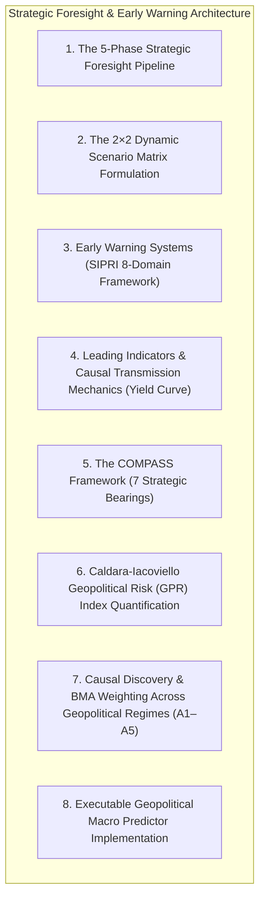
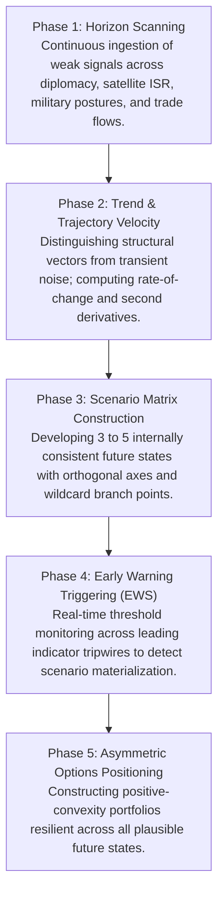
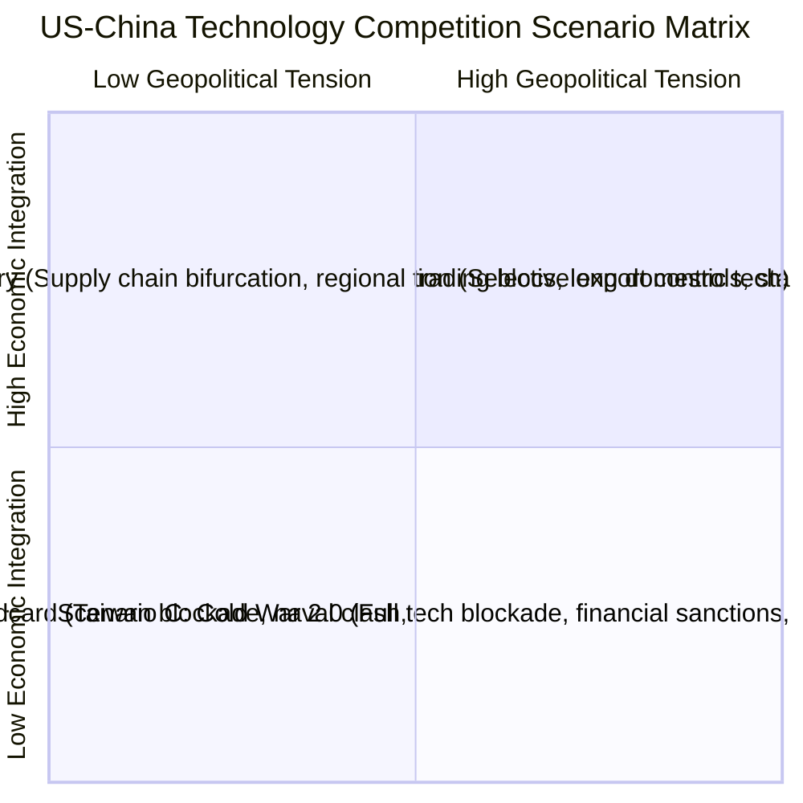
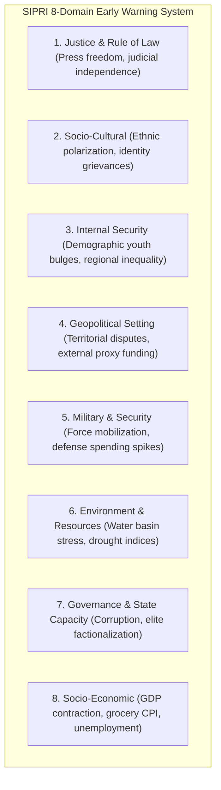
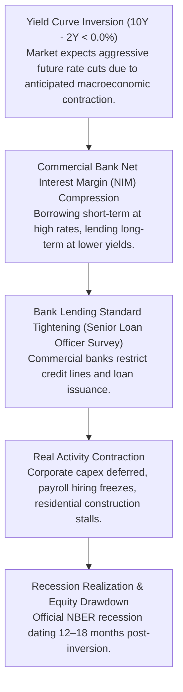
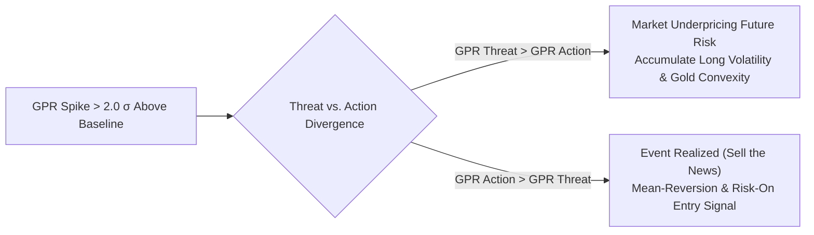
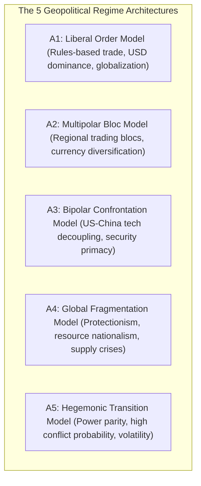

# Module 02: Geopolitical Macro Foresight, Scenario Planning & Early Warning Systems

## Executive Overview

This module formalizes the methodology for applying **Strategic Foresight, Dynamic Scenario Matrices, Early Warning Systems (EWS), and Bayesian Regime Switching** to geopolitical and macroeconomic forecasting.



---

## 1. The 5-Phase Strategic Foresight Pipeline

Strategic foresight is the disciplined practice of exploring, anticipating, and preparing for plausible futures by mapping weak signals, trajectory velocities, and systemic branch points.



---

## 2. The 2×2 Dynamic Scenario Matrix Formulation

The scenario matrix maps future states across the two most consequential, highly uncertain structural drivers:



### Trading & Positioning Implications by Scenario

| Scenario | Macro Regime | Key Asset Allocations | Invalidation / Trigger Events |
| :--- | :--- | :--- | :--- |
| **A. Managed Competition** | Moderate Growth, Low Risk Premium | Long EM tech, Long Global Trade, Neutral USD | Comprehensive diplomatic summits, bilateral trade stability. |
| **B. Decoupled Rivalry** | Bifurcated Capex, Structural Inflation | Long Domestic Semis, Long Infrastructure, Short Global Supply Chains | Expansion of export control categories, friend-shoring mandates. |
| **C. Cold War 2.0** | Stagflationary, Fragmented Capital | Long Defense Equities, Long Gold, Long USD, Short EM Equities | SWIFT exclusions, weaponized secondary sanctions, naval exclusion zones. |
| **D. Hot Conflict (Tail)** | Extreme Tail Volatility, Liquidity Freeze | Long VIX/Volatility, Long US Treasuries, Long Crude Oil, Short Equities | Cross-strait military mobilization, kinetic strikes on critical infrastructure. |

---

## 3. Early Warning Systems (SIPRI 8-Domain Framework)

The Early Warning System monitors indicator thresholds across **8 Structural Domains** derived from the Stockholm International Peace Research Institute (SIPRI) framework:



### Signal Processing & Sequential Tripwire Example (Russia-Ukraine 2022)

| Sequential Stage | Observed Tripwire Metric | Threshold Triggered | Signal Lead Time |
| :--- | :--- | :--- | :--- |
| **Stage 1** | Satellite SAR Force Concentration | $> 100\text{k}$ troops massed near borders | **3 Months Lead** (Nov 2021) |
| **Stage 2** | Diplomatic Ultimatum Rejection | Breakdown of Normandy Format | **2 Months Lead** (Dec 2021) |
| **Stage 3** | Cyber Pre-Emption Attacks | Ukrainian power grid & banking DDoS spikes | **1 Month Lead** (Jan 2022) |
| **Stage 4** | Sovereign Recognition of Enclaves | DPR / LPR independence decrees signed | **3 Days Lead** (Feb 21, 2022) |
| **Stage 5** | Full Military Invasion | Cross-border kinetic ground offensive | **Event Zero** (Feb 24, 2022) |

---

## 4. Leading Indicators & Causal Transmission Mechanics

### The Yield Curve Inversion Transmission Mechanism

The yield curve slope ($\text{Spread} = y_{10\text{Y}} - y_{2\text{Y}}$) is a leading indicator with a historical lead time of **12 to 18 months** preceding economic recessions:



---

## 5. The COMPASS Framework (7 Strategic Bearings)

The COMPASS Framework evaluates state trajectories across **7 Integrated Strategic Bearings**:


### Applied Case Study: China Strategic Trajectory Analysis

1. **Culture**: Nationalist historical narrative (*"Century of Humiliation"*) requires Taiwan reunification for party legitimacy $\to$ Aggressive posture invariant to leader changes.
2. **Organization**: Centralized executive authority $\to$ Low short-term policy volatility, but heightened succession risk.
3. **Military**: Rapid naval expansion and A2/AD hypersonic deployments $\to$ Targeting Taiwan military capability window (2027–2030).
4. **Production**: *"Dual Circulation"* strategy subsidizing domestic semiconductor and battery champions $\to$ Accelerating decoupling.
5. **Alliances**: Strategic partnership with Russia and BRICS+ expansion $\to$ Building non-dollar settlement corridors.
6. **Spatial**: Militarization of South China Sea reef infrastructure $\to$ Securing maritime energy transit through Malacca chokepoint.
7. **Sustainability**: Acute water stress in North China Plain ($< 6\%$ global freshwater vs. $20\%$ population) $\to$ High agricultural import dependency.

---

## 6. Caldara-Iacoviello Geopolitical Risk (GPR) Index Quantification

The Caldara-Iacoviello Geopolitical Risk (GPR) Index measures monthly text-based frequencies of geopolitical risk keywords across global news archives:

\[
\text{GPR}_t = \frac{\sum_{i=1}^N \mathbb{I}(\text{Article}_i \text{ contains GPR keywords at month } t)}{N_t} \times 100
\]



---

## 7. Causal Discovery & BMA Weighting Across Geopolitical Regimes

Different geopolitical regimes require distinct economic models. The system runs **Bayesian Model Averaging (BMA)** across 5 fundamental architecture archetypes:



### Bayesian Weight Updating with Memory Decay
\[
w_i(t) \propto w_i(t-1)^\lambda \cdot \exp\left( \sum_{k=1}^K \ell(s_k \mid A_i) \right)
\]
Where $\lambda = 0.99$ is the daily memory decay rate and $\ell(s_k \mid A_i)$ is the log-likelihood alignment score of newly observed geopolitical signals $s_k$.

---

## 8. Executable Geopolitical Macro Predictor Implementation

```python
"""
Executable Geopolitical Macro Predictor Engine
Integrates: Strategic Foresight, COMPASS, SIPRI Early Warning, and BMA Regime Weighting.
"""

from dataclasses import dataclass, field
from datetime import datetime
from enum import Enum
from typing import Dict, List, Optional
import numpy as np


class GeopoliticalRegime(Enum):
    LIBERAL_ORDER = "liberal_order"
    MULTIPOLAR = "multipolar"
    BIPOLAR = "bipolar"
    FRAGMENTATION = "fragmentation"
    HEGEMONIC_TRANSITION = "hegemonic_transition"


@dataclass(frozen=True)
class GeopoliticalSignal:
    timestamp: str
    domain: str          # 'military', 'economic', 'diplomatic', 'resource'
    indicator: str
    value: float
    direction: str       # 'escalating', 'de-escalating', 'stable'
    confidence: float    # 0.0 to 1.0
    source: str


@dataclass
class COMPASSScore:
    culture: float       # 0 to 100 risk score
    organization: float
    military: float
    production: float
    alliances: float
    spatial: float
    sustainability: float

    @property
    def composite_risk(self) -> float:
        return float(np.mean([
            self.culture, self.organization, self.military,
            self.production, self.alliances, self.spatial, self.sustainability
        ]))


class GeopoliticalMacroPredictor:
    """Core autonomous geopolitical foresight and BMA regime classifier."""

    def __init__(self, memory_decay: float = 0.99):
        self.decay = memory_decay
        self.regime_weights: Dict[GeopoliticalRegime, float] = {
            GeopoliticalRegime.LIBERAL_ORDER: 0.20,
            GeopoliticalRegime.MULTIPOLAR: 0.25,
            GeopoliticalRegime.BIPOLAR: 0.35,
            GeopoliticalRegime.FRAGMENTATION: 0.15,
            GeopoliticalRegime.HEGEMONIC_TRANSITION: 0.05,
        }

    def update_with_signals(self, signals: List[GeopoliticalSignal]) -> Dict[str, float]:
        """Update Bayesian posterior weights across geopolitical regimes."""
        likelihoods = {regime: 0.0 for regime in GeopoliticalRegime}

        for s in signals:
            if s.domain == "military" and s.direction == "escalating":
                likelihoods[GeopoliticalRegime.BIPOLAR] += 1.5 * s.confidence
                likelihoods[GeopoliticalRegime.HEGEMONIC_TRANSITION] += 2.0 * s.confidence
            elif s.domain == "economic" and "bloc" in s.indicator.lower():
                likelihoods[GeopoliticalRegime.MULTIPOLAR] += 1.8 * s.confidence
            elif s.domain == "diplomatic" and s.direction == "de-escalating":
                likelihoods[GeopoliticalRegime.LIBERAL_ORDER] += 1.5 * s.confidence

        # Apply Bayesian log-score update with memory decay
        unnorm_weights = {}
        for regime, prior_w in self.regime_weights.items():
            decayed_prior = prior_w ** self.decay
            unnorm_weights[regime] = decayed_prior * np.exp(likelihoods[regime])

        total = sum(unnorm_weights.values())
        self.regime_weights = {k: v / total for k, v in unnorm_weights.items()}

        return {k.value: round(v, 4) for k, v in self.regime_weights.items()}

    def evaluate_entropy_confidence(self) -> float:
        """Compute certainty score (1.0 - normalized Shannon entropy)."""
        probs = list(self.regime_weights.values())
        entropy = -sum(p * np.log(p + 1e-12) for p in probs if p > 0)
        max_entropy = np.log(len(probs))
        return float(1.0 - (entropy / max_entropy))
```
