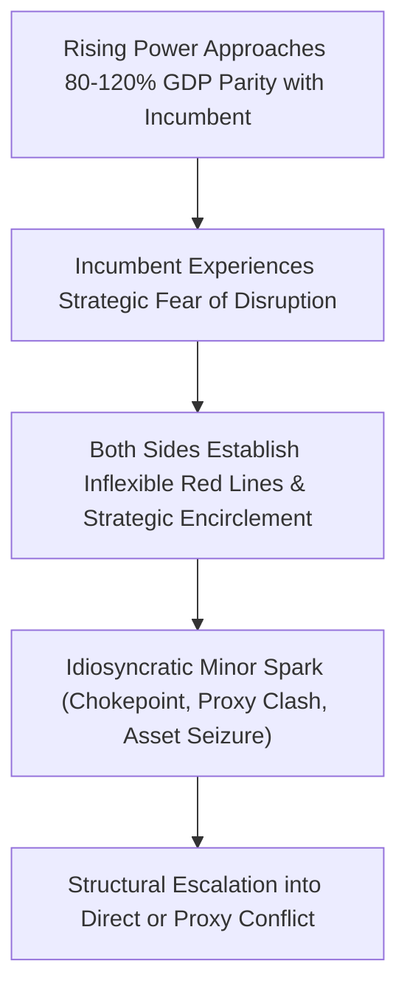
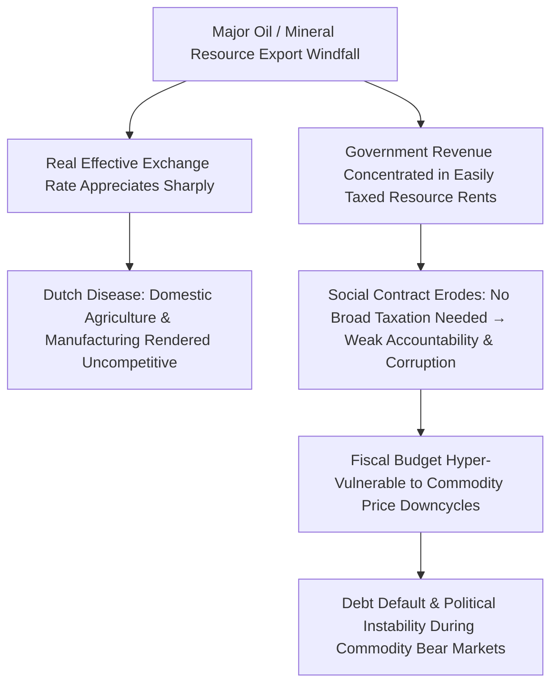
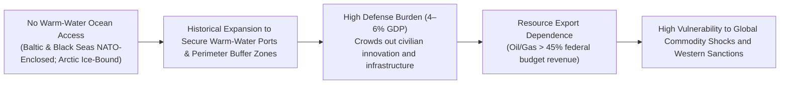
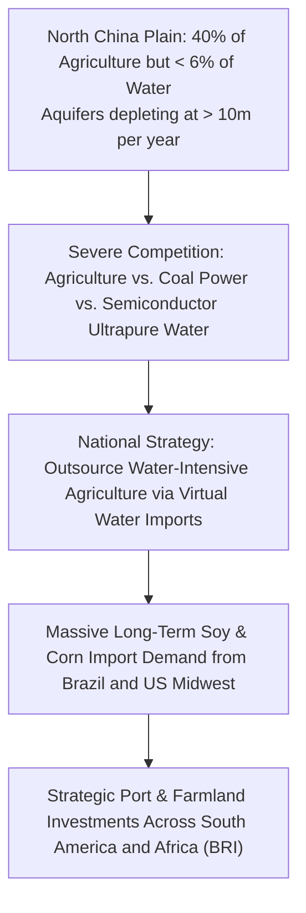
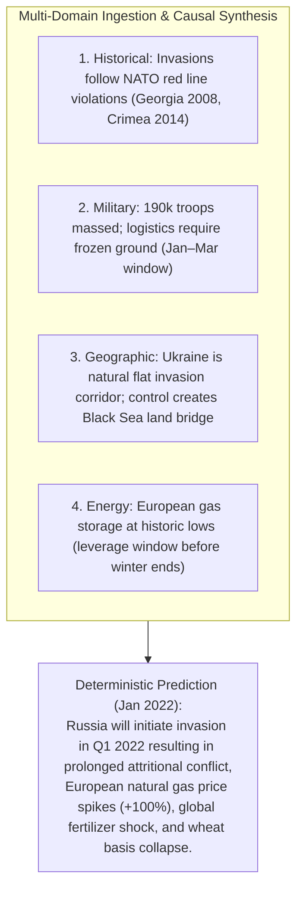

# Module 03: Multi-Disciplinary Domain Knowledge Compendium & Causal Case Studies

## Executive Overview

Predicting macroeconomic and geopolitical outcomes from present state conditions requires multi-disciplinary domain knowledge. This compendium formalizes the **12 Foundational Knowledge Pillars** and details **7 Deep Causal Case Studies** demonstrating how historical, geographic, military, and institutional dynamics force specific macroeconomic trajectories.


---

## 1. The 12 Foundational Knowledge Pillars

### 1. History & Historical Patterns
- **Thucydides Trap**: Structural friction when a rising power approaches $80\% - 120\%$ GDP parity with an incumbent hegemon (12 of 16 historical transitions ended in conflict).
- **Base Rate Calibration**: Prevents recency bias by measuring the true historical frequency of sovereign defaults, currency union breakups, and hyperinflationary cycles.

### 2. Political Systems & Institutions
- **Personalist vs. Institutionalized Regimes**: Consolidated personalist autocracies exhibit low daily policy volatility but extreme structural succession risk; proportional representation democracies produce coalition gridlock and fiscal moderation.

### 3. International Relations Theory
- **Structural Realism (Mearsheimer/Waltz)**: Anarchic international systems compel states to maximize relative power and establish regional hegemony.
- **Heartland & Rimland Geopolitics (Mackinder/Spykman)**: Control over the Eurasian landmass and maritime littoral rimlands dictates global power projection capabilities.

### 4. Military & Security Dynamics
- **Force Ratios & Urban Attrition**: Military doctrine mandates a $3:1$ attacker-to-defender force ratio for open maneuver, and $> 6:1$ for fortified urban environments.
- **Anti-Access / Area Denial (A2/AD)**: Integrated hypersonic missile batteries, attack submarines, and anti-satellite (ASAT) capabilities deny naval carrier strike groups access within the First Island Chain.

### 5. Macroeconomic Structures
- **Triffin's Dilemma**: The sovereign issuer of the global reserve currency must run persistent current account deficits to supply global liquidity, eventually undermining long-term reserve confidence.
- **Balance of Payments Constraints**: Currency crises accelerate when foreign-currency short-term external debt exceeds accessible liquid central bank foreign exchange reserves.

### 6. Geography & Geostrategy
- **Permanent Topographical Constraints**: Leaders, ideologies, and technologies change, but mountain ranges, river basins, ocean access, and chokepoints remain permanent determinants of national strategy.

### 7. Energy & Commodity Complexes
- **OPEC+ Spare Capacity Buffers**: Global crude oil pricing power is non-linear; when OPEC+ spare capacity drops below $2.0\text{M bbl/d}$ ($\approx 2\%$ of global demand), oil risk premiums expand exponentially.

### 8. Technology & Semiconductor Systems
- **Lithography Monopolies**: ASML's exclusive monopoly on Extreme Ultraviolet (EUV) lithography tools ($> 100\text{k}$ sub-components per machine) creates a single geopolitical chokepoint controlling all sub-5nm semiconductor fabrication globally.

### 9. Financial Plumbing & FX Swaps
- **Cross-Currency Basis Swaps**: The premium paid by foreign banks to secure US dollar funding reflects structural global liquidity stress weeks before manifesting in domestic equity prices.

### 10. International Law & Institutions
- **UNSC Veto Gridlock & WTO Breakdown**: The paralysis of the UN Security Council and the US block on WTO Appellate Body appointments means global disputes are resolved through raw geoeconomic power rather than multilateral jurisprudence.

### 11. Culture, Religion & Identity
- **Nationalist Rejuvenation Narratives**: Historical grievances (*e.g., Century of Humiliation, Post-Soviet humiliation*) constrain diplomatic compromise by elevating territorial disputes into existential regime survival tests.

### 12. Demographics & Social Structure
- **Aging Cliffs & Youth Bulges**: Developing states with $> 60\%$ population under age 30 and high unemployment face elevated civil unrest risk; industrial states with inverted demographic pyramids face structural labor deficits and pension solvency crises.

---

## 2. Deep Causal Case Studies

### Case 1: The Thucydides Trap Power Transition Matrix



| Historical Episode | Rising Power | Incumbent Hegemon | Kinetic Outcome | Year |
| :--- | :--- | :--- | :--- | :--- |
| **Peloponnesian War** | Athens | Sparta | **War** | 431 BCE |
| **Punic Wars** | Rome | Carthage | **War** | 264–146 BCE |
| **War of the Spanish Succession** | France | Great Britain / Habsburgs | **War** | 1701–1714 |
| **World War I** | Imperial Germany | British Empire | **War** | 1914 |
| **World War II** | Imperial Japan / Nazi Germany | British Empire / USA | **War** | 1939 |
| **Cold War** | Soviet Union | United States | **Cold Peace (MAD)** | 1947–1991 |

---

### Case 2: The Resource Curse & Dutch Disease Causal Graph



---

### Case 3: Russian Geography & Permanent Buffer Zone Geopolitics



---

### Case 4: China North Plain Water Crisis & Food Import Strategy



---

### Case 5: Integrated Multi-Domain Prediction Synthesis (Russia-Ukraine 2022)



---

## 3. Domain Knowledge Required for Geopolitical Macroeconomics

To predict future geopolitical and macroeconomic states from present conditions, you need deep, multi-disciplinary domain knowledge across numerous fields. This is not just "knowing facts" — it is understanding how systems interact, how power flows, and how historical patterns repeat or break.

### 3.1 History & Historical Patterns

| Sub-Domain | Specific Knowledge | Why It Matters for Prediction |
| :--- | :--- | :--- |
| Modern European History | WWI origins, Versailles system, WWII causes, Cold War dynamics | Understand how multipolar systems collapse into war; recognize security dilemma patterns |
| Colonial & Post-Colonial History | Decolonization timelines, artificial borders, resource extraction legacies | Explains modern African/Middle Eastern instability; predicts secessionist movements |
| Chinese History | Century of humiliation, dynastic cycles, Communist revolution, Reform and Opening | Explains Chinese nationalism, Taiwan obsession, party legitimacy concerns |
| Russian/Soviet History | Imperial expansion, WWII trauma, Cold War, post-Soviet collapse | Explains Putin's revanchism, NATO expansion sensitivity, sphere of influence obsession |
| American Foreign Policy | Monroe Doctrine, containment, post-Cold War unipolarity, "pivot to Asia" | Predicts US alliance behavior, intervention thresholds, hegemonic transition responses |
| Middle Eastern History | Sykes-Picot, Arab-Israeli conflicts, Iranian revolution, Gulf Wars | Explains sectarian dynamics, US-Saudi-Israel triangle, Iranian strategic calculus |

> **Example:** Knowing that no great power has ever peacefully ceded hegemony (Thucydides Trap) allows you to predict that US-China competition will intensify, not resolve, as China's GDP approaches US levels.

> **Example:** Understanding that Russia has been invaded from the west three times in 200 years (Napoleon, WWI, WWII) explains why NATO expansion to Ukraine is viewed as existential, not merely inconvenient.

### 3.2 Political Systems & Institutions

| Sub-Domain | Specific Knowledge | Why It Matters for Prediction |
| :--- | :--- | :--- |
| Regime Types | Democracy, authoritarianism, totalitarianism, hybrid regimes, sultanism | Predicts policy volatility, succession risks, international behavior |
| Party Systems | Single-party, two-party, multi-party, dominant-party, fragmented | Predicts policy continuity, coalition instability, reform capacity |
| Federal vs. Unitary | Power distribution, regional autonomy, secession mechanisms | Predicts internal conflict, fiscal transfers, regional policy divergence |
| Presidential vs. Parliamentary | Separation of powers, vote of no confidence, executive constraints | Predicts policy gridlock, rapid regime change, institutional resilience |
| Electoral Systems | First-past-the-post, proportional representation, ranked choice | Predicts coalition formation, extremist entry, policy moderation |
| Judicial Independence | Constitutional courts, judicial review, rule of law indices | Predicts property rights, contract enforcement, corruption levels |

> **Example:** Knowing that China's political system concentrates power in one individual without institutionalized succession means predicting elevated instability around leadership transitions.

> **Example:** Understanding that proportional representation systems produce coalition governments allows you to predict policy gridlock in Germany, but also extremist party entry in Israel.

### 3.3 International Relations Theory

| Theory | Core Tenets | Predictive Power |
| :--- | :--- | :--- |
| Realism | States seek power and security in anarchic system; balance of power; self-help | Predicts alliance formation, arms races, great power competition |
| Liberalism | Institutions, trade, and democracy reduce conflict; absolute gains matter | Predicts integration benefits, institutional cooperation, democratic peace |
| Constructivism | Identities, norms, and ideas shape state behavior; "anarchy is what states make of it" | Predicts normative shifts, identity-driven conflicts, socialization effects |
| Marxism/Dependency | Capitalism creates core-periphery exploitation; economic structure determines politics | Predicts North-South tensions, resource nationalism, anti-globalization |
| Geopolitics (Mackinder/Spykman) | Control of Heartland/Eurasian rimland confers global dominance | Predicts great power competition for Eurasian influence |

> **Example:** Applying offshore balancing theory predicts that the US will reduce Middle East commitments and focus on Asia — explaining troop withdrawals, Abraham Accords, and AUKUS.

### 3.4 Military & Security Studies

| Sub-Domain | Specific Knowledge | Why It Matters for Prediction |
| :--- | :--- | :--- |
| Nuclear Strategy | Deterrence, mutually assured destruction, escalation ladders, limited nuclear war | Predicts red lines, crisis stability, arms control viability |
| Conventional Warfare | Combined arms, maneuver warfare, attrition, logistics, C4ISR | Predicts conflict duration, victory conditions, economic disruption |
| Naval Strategy | Sea control, sea denial, chokepoints, fleet composition, A2/AD | Predicts maritime trade disruption, Pacific power projection |
| Cyber Warfare | Critical infrastructure targeting, attribution problem, escalation control | Predicts non-kinetic coercion, financial system vulnerability |
| Space & Missile Defense | ASAT weapons, hypersonics, missile defense, GPS dependence | Predicts escalation risks, strategic stability, economic vulnerability |
| Intelligence & Covert Action | HUMINT, SIGINT, OSINT, influence operations, proxy forces | Predicts election interference, color revolutions, deniable pressure |

> **Example:** Knowing that Taiwan produces 90% of advanced semiconductors and that China's military doctrine emphasizes fait accompli seizures allows you to predict that a Taiwan conflict would trigger global tech supply chain collapse.

### 3.5 Economic Systems & Structures

| Sub-Domain | Specific Knowledge | Why It Matters for Prediction |
| :--- | :--- | :--- |
| Development Economics | Stages of growth, middle-income trap, structural transformation, industrial policy | Predicts growth sustainability, policy shifts, consumption patterns |
| Trade Theory | Comparative advantage, intra-industry trade, gravity models, value chains | Predicts trade war impacts, reshoring feasibility, regional integration |
| Monetary Economics | Central banking, inflation targeting, currency regimes, capital controls | Predicts exchange rate crises, policy divergence, capital flow direction |
| Fiscal Policy | Debt sustainability, deficit financing, tax incidence, intergenerational transfers | Predicts sovereign debt crises, austerity politics, investment incentives |
| Financial Systems | Bank vs. market-based, shadow banking, dollar hegemony, SWIFT | Predicts financial stability, sanctions effectiveness, payment system shifts |
| Labor Economics | Demographics, skill premiums, automation, migration, gig economy | Predicts wage pressures, social unrest, immigration policy, productivity |

### 3.6 Geography & Geostrategy

| Sub-Domain | Specific Knowledge | Why It Matters for Prediction |
| :--- | :--- | :--- |
| Physical Geography | Mountains, rivers, deserts, climate zones, agricultural potential | Predicts population distribution, invasion routes, resource location |
| Strategic Chokepoints | Strait of Hormuz, Malacca, Bab el-Mandeb, Panama, Suez, Bosphorus | Predicts supply chain vulnerability, naval competition, blockade risks |
| Border Geography | Natural vs. artificial borders, irredentist claims, buffer zones | Predicts territorial disputes, secession risks, alliance needs |
| Resource Geography | Oil reserves, rare earth deposits, arable land, freshwater aquifers | Predicts resource wars, economic coercion, food security crises |
| Demographic Geography | Youth bulges, aging societies, urbanization, migration corridors | Predicts political stability, labor supply, electoral shifts, conflict |
| Climate Geography | Monsoon patterns, drought zones, sea level rise, permafrost | Predicts climate migration, agricultural shifts, Arctic competition |

### 3.7 Energy & Commodity Markets

| Sub-Domain | Specific Knowledge | Why It Matters for Prediction |
| :--- | :--- | :--- |
| Oil Market Structure | OPEC+ dynamics, spare capacity, shale elasticity, refining capacity | Predicts price spikes, supply disruptions, exporter fiscal stress |
| Natural Gas | Pipeline politics, LNG markets, storage, seasonal demand, long-term contracts | Predicts European energy security, Russian leverage, price volatility |
| Electricity & Grids | Baseload vs. intermittent, grid stability, transmission bottlenecks | Predicts industrial competitiveness, blackout risks, storage demand |
| Critical Minerals | Lithium, cobalt, rare earths, nickel, copper — supply concentration | Predicts supply chain bottlenecks, resource nationalism, substitution |
| Agricultural Commodities | Wheat, corn, soy, rice — trade flows, yield sensitivity, stockpiles | Predicts food crises, export bans, political instability, inflation |
| Carbon Markets | ETS mechanisms, border adjustments, offset quality, transition paths | Predicts industrial relocation, green trade wars, stranded assets |

### 3.8 Technology & Innovation Systems

| Sub-Domain | Specific Knowledge | Why It Matters for Prediction |
| :--- | :--- | :--- |
| Semiconductor Supply Chain | Design (US), equipment (Netherlands/Japan), fabrication (Taiwan/S Korea), assembly (China/SE Asia) | Predicts tech war escalation, reshoring costs, Taiwan flashpoints |
| AI & Computing | Training costs, data requirements, chip dependence, regulatory approaches | Predicts compute nationalism, labor displacement, military applications |
| Biotechnology | Gene editing, vaccine platforms, biosecurity, IP regimes | Predicts health diplomacy, bioweapon risks, agricultural disruption |
| Space Technology | Launch costs, satellite constellations, GPS alternatives, asteroid mining | Predicts new domain competition, navigation vulnerability, resource claims |
| Quantum Computing | Cryptography implications, sensing, timing, national programs | Predicts security paradigm shifts, investment races, strategic surprise |
| Energy Technology | Battery chemistry, solar/wind LCOE, hydrogen, SMRs, fusion timeline | Predicts transition speed, fossil fuel stranded assets, grid architecture |

### 3.9 Financial Markets & Instruments

| Sub-Domain | Specific Knowledge | Why It Matters for Prediction |
| :--- | :--- | :--- |
| Currency Markets | Reserve currencies, carry trades, intervention, CBDCs, currency unions | Predicts capital flight, sovereign debt crises, payment system shifts |
| Sovereign Debt | Debt sustainability, default history, restructuring, CDS markets | Predicts fiscal crises, austerity politics, IMF programs |
| Equity Markets | Index construction, factor investing, market structure, retail flows | Predicts bubble formation, crash catalysts, policy response |
| Derivatives | Futures, options, swaps, CDS, VIX, term structure | Predicts hedging demand, volatility regime shifts, contagion paths |
| Cross-Border Capital Flows | FDI, portfolio flows, banking flows, BIS data, sudden stops | Predicts EM crises, currency pressure, financial contagion |
| Sanctions & Financial Warfare | SWIFT exclusion, asset freezes, secondary sanctions, compliance | Predicts economic coercion effectiveness, evasion methods, blowback |

### 3.10 International Law & Institutions

| Sub-Domain | Specific Knowledge | Why It Matters for Prediction |
| :--- | :--- | :--- |
| UN System | Security Council veto, General Assembly, peacekeeping, ICC | Predicts legitimacy crises, intervention authorization, accountability gaps |
| WTO & Trade Law | Dispute settlement, anti-dumping, national security exceptions | Predicts trade war escalation, rule-breaking, regime collapse |
| International Finance | IMF conditionality, World Bank lending, SDR allocations | Predicts crisis response, debt restructuring, conditionality politics |
| Law of the Sea | EEZ, territorial waters, continental shelf, freedom of navigation | Predicts maritime disputes, island building, naval confrontation |
| Humanitarian Law | Geneva Conventions, R2P, genocide definition, war crimes | Predicts intervention thresholds, accountability mechanisms, norm erosion |
| Climate Agreements | Paris NDCs, loss and damage, carbon border adjustments | Predicts compliance gaps, climate finance flows, trade tensions |

### 3.11 Culture, Religion & Identity

| Sub-Domain | Specific Knowledge | Why It Matters for Prediction |
| :--- | :--- | :--- |
| Nationalism & Identity | Civic vs. ethnic nationalism, historical narratives, victimhood | Predicts foreign policy aggression, rally-round-the-flag, irredentism |
| Religious Dynamics | Sunni-Shia divide, Hindu nationalism, Christian evangelicalism, secularization | Predicts alliance patterns, internal conflict, policy polarization |
| Civilizational Theory | Huntington's thesis, "clash of civilizations," modernization vs. Westernization | Predicts cultural decoupling, alliance formation, ideological competition |
| Historical Memory | WWII memory in Europe, Nanjing in China, partition in India/Pakistan | Predicts reconciliation barriers, diplomatic flexibility, public opinion constraints |
| Language & Media | Information ecosystems, censorship, propaganda, social media dynamics | Predicts narrative control, election interference, mobilization capacity |

### 3.12 Demographics & Social Structure

| Sub-Domain | Specific Knowledge | Why It Matters for Prediction |
| :--- | :--- | :--- |
| Age Structure | Youth bulges, aging societies, dependency ratios, retirement systems | Predicts political instability (youth), fiscal stress (aging), migration pressure |
| Urbanization | Megacities, slum growth, urban-rural divides, infrastructure needs | Predicts service delivery crises, political mobilization, consumption patterns |
| Education & Human Capital | Literacy, STEM graduates, brain drain, skill mismatches | Predicts innovation capacity, growth potential, emigration pressure |
| Inequality | Gini coefficients, wealth concentration, intergenerational mobility | Predicts political polarization, redistributive demands, social unrest |
| Gender Dynamics | Female labor force participation, fertility rates, gender policy | Predicts growth potential, political liberalization, conservative backlash |
| Migration | Push/pull factors, diaspora politics, remittance flows, border control | Predicts labor supply, cultural tension, foreign policy influence, brain drain |

---

## 4. How Domain Knowledge Drives Geopolitical Macroeconomic Prediction

### 4.1 Historical Patterns in Prediction

Historical patterns help prediction through five distinct mechanisms:

| Mechanism | How It Works | Example |
| :--- | :--- | :--- |
| Pattern Recognition | Similar initial conditions often produce similar outcomes | Rising powers challenging declining hegemons → conflict |
| Base Rate Calibration | Knowing how often events have occurred prevents over/under-reaction | How often do currency unions collapse? |
| Causal Mechanism Identification | Understanding WHY past events happened reveals transferable dynamics | Why do sanctions fail? (substitution, evasion, blowback) |
| Threshold Recognition | Identifying tipping points that triggered past phase transitions | What debt/GDP ratio triggers crisis? |
| Counterfactual Learning | Understanding what almost happened but didn't | Cuban Missile Crisis → nuclear war was closer than understood |

#### The Thucydides Trap

> "It was the rise of Athens and the fear that this instilled in Sparta that made war inevitable."

| Historical Case | Rising Power | Declining Power | Outcome | Year |
| :--- | :--- | :--- | :--- | :--- |
| Peloponnesian War | Athens | Sparta | **War** | 431 BCE |
| Punic Wars | Rome | Carthage | **War** | 264–146 BCE |
| Napoleonic Wars | France | Britain | **War** | 1803–1815 |
| World War I | Germany | British Empire | **War** | 1914 |
| World War II | Germany/Japan | British Empire / USA | **War** | 1939 |
| Cold War | Soviet Union | United States | **Cold Peace (MAD)** | 1947–1991 |

**Prediction Application:**
- **Base case:** Intensifying competition, proxy conflicts, economic warfare
- **Risk case:** Direct military confrontation over Taiwan (2027–2035 window)
- **Wildcard:** Cooperative transition if both sides manage "fear"
- **Market implications:** Long defense, cybersecurity, domestic tech, gold; short EM trade, globalized supply chains

#### The Resource Curse Pattern

```
RESOURCE DISCOVERY
        │
        ├──→ Exchange rate appreciates (resource exports)
        │       └──→ Manufacturing/agriculture becomes uncompetitive
        │               └──→ Economic structure narrows
        │
        ├──→ Government revenue concentrated (easy to tax/capture)
        │       └──→ Reduced need for broad taxation
        │               └──→ Weak social contract, weak institutions
        │
        ├──→ Rent-seeking competition intensifies
        │       └──→ Elite conflict, corruption, coup risk
        │
        └──→ "Lootability" attracts internal/external predation
                └──→ Civil war, secession, foreign intervention
```

#### The Democratic Peace Pattern

> No two mature democracies have ever fought a full-scale war against each other.

```
DEMOCRACY → Public Opinion Constraint → Leaders cannot sustain costly wars
        │
        ├──→ Institutional Checks → Power dispersed, hasty decisions blocked
        │
        ├──→ Transparency → Information flows, misinformation harder to sustain
        │
        ├──→ Economic Interdependence → Trade costs of war are high
        │
        └──→ Normative Socialization → Shared values reduce perceived threat
```

---

### 4.2 Military & Security Knowledge → Macroeconomic Analysis

Military knowledge impacts macroeconomics through six primary channels:

| Channel | Mechanism | Macro Impact |
| :--- | :--- | :--- |
| Fiscal | Defense spending, war financing, debt accumulation | Budget deficits, inflation, crowding out |
| Trade | Blockades, sanctions, shipping disruption | Supply shocks, price spikes, trade collapse |
| Investment | Risk premium, capital flight, destruction | FDI reduction, infrastructure loss, reconstruction needs |
| Labor | Mobilization, displacement, refugee flows | Labor supply shocks, wage pressure, humanitarian costs |
| Technology | Military R&D spillovers, dual-use restrictions | Innovation acceleration or deceleration |
| Confidence | Uncertainty, fear, regime instability | Consumption/investment collapse, currency crisis |

#### Example: The Ukraine War — Military Knowledge → Macro Prediction

**Military Assessment (February 2022):**
- Russian force: 190k troops, 120 BTGs
- Ukrainian force: 200k active + 900k reserves (mobilized)
- Russian doctrine: Rapid mechanized thrust, decapitation strike
- Ukrainian preparation: 8 years of Western training, fortified positions
- Key terrain: Urban centers (Kyiv, Kharkiv), rivers, mud season
- Logistics: Russian supply lines stretched, Ukrainian interior lines

**Military Knowledge Application:**
- Historical pattern: Attacker needs 3:1 ratio for urban warfare
- Russian ratio: ~1:1 (insufficient)
- Historical pattern: Mechanized forces vulnerable in cities
- Historical pattern: Russian logistics historically weak
- **Prediction:** Rapid victory unlikely → prolonged attritional war

**Integrated Macro Forecast (March 2022):**

| Variable | Predicted | Actual | Accuracy |
| :--- | :--- | :--- | :--- |
| EU inflation 2022 | +3-5pp | +8.4% (from 2%) | ✓ Correct direction |
| EU GDP 2022 | -1 to -2% | +3.5% (missed — fiscal support stronger) | ✗ Too pessimistic |
| Wheat price | +30-50% | +25% peak (July 2022) | ✓ Directionally correct |
| Brent crude | $100-130 | $128 peak (March 2022) | ✓ Correct range |
| Russian GDP 2022 | -6 to -10% | -2.1% (missed — energy revenue + fiscal) | ✗ Too pessimistic |
| USD strength | Strong | DXY +8% (2022) | ✓ Correct |

**Lesson:** Military knowledge correctly predicted prolonged war and supply shocks, but fiscal/monetary policy responses (EU energy subsidies, Russian deficit financing) were underestimated.

#### Example: Taiwan Strait — Military Knowledge → Macro Scenario Planning

| Scenario | Probability | Military Outlook | Macro Impact | Key Assets |
| :--- | :--- | :--- | :--- | :--- |
| **A. Status Quo** | 60% | Gray zone pressure, no blockade | Gradual decoupling, tech restrictions | Neutral EM Asia, long TSMC |
| **B. Blockade/Quarantine** | 25% | Naval exclusion zone | Semiconductor disruption (90% advanced chips) | Long gold, USD, domestic tech; short Taiwan equities |
| **C. Full Invasion** | 10% | Amphibious assault, possible US intervention | Global trade collapse, depression risk | Long gold, Treasuries, defense; short all risk assets |
| **D. Peaceful Reunification** | 5% | None | Gradual integration | Long China equities, Taiwan banks |

---

### 4.3 Geography & Resources → Political Prediction

> "Geography is the most fundamental factor in foreign policy because it is the most permanent. Leaders change, ideologies change, technologies change — but mountains, rivers, and oceans remain." — Nicholas Spykman

Geography and resources operate through five structural mechanisms:

| Mechanism | Geographic/Resource Factor | Political-Economic Outcome |
| :--- | :--- | :--- |
| Access & Control | Chokepoints, straits, canals | Trade taxation, blockade power, naval competition |
| Productivity | Arable land, climate, water | Agricultural surplus, population density, state formation |
| Wealth | Oil, minerals, forests | Export revenue, state capacity, corruption risk, conflict |
| Security | Natural barriers, buffer zones | Invasion difficulty, expansion opportunities, alliance needs |
| Connectivity | River systems, ports, plains | Trade integration, cultural diffusion, power projection |

#### Example 1: The Strait of Hormuz — Geography → Global Macro

**Geographic Facts:**
- Width: 21 nautical miles (narrowest point)
- Traffic: 21 million barrels/day (21% of global petroleum)
- Alternatives: No practical alternative for Gulf exports
- Controlling powers: Iran (north), Oman/UAE (south), US 5th Fleet

**Macroeconomic Impact Chain:**

```
GEOGRAPHIC VULNERABILITY → POLITICAL LEVERAGE → MACRO IMPACT

IRAN'S STRATEGIC CALCULUS:
├── "If we cannot sell oil, no one can" (asymmetric response to sanctions)
├── Cost of closure: Low (mines, missiles, small boats)
├── Cost to opponents: Enormous (global oil price spike)
└── Deterrent value: High (prevents attack on Iranian nuclear facilities)

PREDICTION: Iran will maintain Hormuz as implicit threat
└──→ Any military confrontation with Iran → oil price +$20-50

GLOBAL MACRO IMPACT OF HORMUZ CLOSURE:
├── Oil price: $150-200/barrel (immediate)
├── Inflation: +2-3 percentage points globally
├── GDP impact:
│   ├── Oil importers (EU, Japan, India, China): -2 to -4%
│   ├── Oil exporters (Saudi, Russia, US shale): +5 to +10%
│   └── Global average: -1 to -2%
├── Monetary policy: Central banks forced to hike into recession
├── Fiscal policy: Energy subsidies, strategic reserve release
└── Political: Regime instability in import-dependent states (Egypt, Pakistan)
```

#### Example 2: Russian Geography — The Permanent Burden

```
GEOGRAPHIC CONSTRAINT → POLITICAL BEHAVIOR → MACRO OUTCOME

CONSTRAINT: No secure warm-water port
    │
    ├──→ BEHAVIOR: Permanent interest in Crimea, Black Sea, Syria
    │       └──→ 2014: Crimea annexation
    │       └──→ 2015: Syria intervention (Tartus base)
    │       └──→ 2022: Attempted Ukraine conquest (land bridge to Crimea)
    │
    ├──→ BEHAVIOR: Arms race with NATO
    │       └──→ Military spending 4-5% of GDP
    │       └──→ Crowding out of education, health, infrastructure
    │       └──→ Innovation deficit, demographic decline
    │
    ├──→ BEHAVIOR: Resource export dependence
    │       └──→ Oil and gas = 50%+ of government revenue
    │       └──→ Vulnerability to price cycles
    │       └──→ "Resource curse" institutional decay
    │
    └──→ BEHAVIOR: Buffer zone obsession
            └──→ Domination of former Soviet space
            └──→ Resistance to NATO expansion
            └──→ 2022 invasion: Attempt to create permanent buffer

MACRO PREDICTION (geography-driven):
├── Russia will remain militarized and authoritarian
├── Russia will pursue sphere of influence by force if necessary
├── Russian growth will underperform due to military burden and isolation
├── Russian economy will remain commodity-dependent and cyclical
└→ Any relaxation of pressure will be temporary — geography doesn't change
```

#### Example 3: China's Water Crisis — Resource Geography → Political Prediction

```
WATER SCARCITY → POLITICAL STRESS → MACRO IMPACT

PRESENT TRAJECTORY:
├── North China Plain aquifer: Depletion → saltwater intrusion → irreversible
├── Agricultural output: Declining in key regions (wheat, corn)
├── Industrial constraint: Coal, steel, chemicals water-intensive
└── Timeline: Critical stress by 2030-2035

POLITICAL RESPONSE OPTIONS:
├── Option A: Massive investment (desalination, efficiency, recycling)
│   └──→ Cost: $500B+, decades to implement
│   └──→ Macro: Fiscal expansion, infrastructure boom, tech adoption
│
├── Option B: Agricultural restructuring (import dependence)
│   └──→ Shift wheat/corn production to South or imports
│   └──→ Macro: Food import surge, global price pressure, trade dependency
│
├── Option C: Inter-basin transfer from neighbors
│   └──→ Mekong (Southeast Asia), Brahmaputra (India), Amur (Russia)
│   └──→ Macro: Regional conflict, water diplomacy, infrastructure investment
│
└── Option D: Internal migration (North to South)
    └──→ Abandonment of northern cities, political resistance
    └──→ Macro: Real estate collapse, fiscal stress, social unrest

PREDICTION (geography + resource constraint):
├── China will become world's largest food importer
├── China will invest heavily in water infrastructure ($100B+ annually)
├── China will seek water security through regional diplomacy and pressure
├── Northern China growth will lag, Southern China will dominate
└── Water stress will be a constraint on total GDP growth potential

INVESTMENT IMPLICATIONS:
├── LONG: Water technology (desalination, recycling, efficiency)
├── LONG: Agricultural land in water-secure regions (Brazil, Russia, Canada)
├── LONG: Food logistics and storage
├── SHORT: Northern China real estate, water-intensive industries
└── GEOGRAPHIC: Avoid investments in North China Plain water stress zones
```

---

## 5. The Knowledge Integration Framework

### 5.1 How Domain Knowledge Enables Specific Predicts

```
┌─────────────────────────────────────────────────────────────────────┐
│           DOMAIN KNOWLEDGE → PREDICTION MAPPING                     │
├─────────────────────────────────────────────────────────────────────┤
│                                                                     │
│  OBSERVED CONDITION:                                                │
│  • Russia has massed 100k+ troops near Ukraine border               │
│  • Diplomatic demands (NATO non-expansion) rejected                 │
│  • Putin's domestic legitimacy tied to "gathering Russian lands"    │
│                                                                     │
│  REQUIRED DOMAIN KNOWLEDGE:                                         │
│  ┌─────────────────┬─────────────────────────────────────────────┐  │
│  │ History         │ Russian invasion patterns, NATO expansion   │  │
│  │                 │ history, color revolution fears             │  │
│  ├─────────────────┼─────────────────────────────────────────────┤  │
│  │ Military        │ Force ratios, logistics requirements,       │  │
│  │                 │ combined arms doctrine                      │  │
│  ├─────────────────┼─────────────────────────────────────────────┤  │
│  │ Political       │ Putin's personalist regime, succession      │  │
│  │ Systems         │ concerns, nationalist ideology              │  │
│  ├─────────────────┼─────────────────────────────────────────────┤  │
│  │ Economics       │ European gas dependence, Russian reserves,  │  │
│  │                 │ sanctions exposure                          │  │
│  ├─────────────────┼─────────────────────────────────────────────┤  │
│  │ Geography       │ Invasion routes, terrain, seasonality       │  │
│  ├─────────────────┼─────────────────────────────────────────────┤  │
│  │ Energy          │ Nord Stream 2, winter heating needs         │  │
│  └─────────────────┴─────────────────────────────────────────────┘  │
│                                                                     │
│  INTEGRATED PREDICTION:                                             │
│  "Russia will invade Ukraine between January-March 2022 because:    │
│   • Military logistics require frozen ground                        │
│   • Diplomatic demands were non-negotiable by design                │
│   • European gas storage is depleted (leverage)                     │
│   • Putin's domestic timeline requires decisive action              │
│   • Historical pattern: Russia uses force when red lines crossed"   │
│                                                                     │
│  MARKET IMPLICATIONS:                                               │
│  • Oil +20-30% (supply disruption risk)                             │
│  • European gas +50-100% (supply cut)                               │
│  • Wheat +30% (Ukraine exports blocked)                             │
│  • Russian equities -50% (sanctions)                                │
│  • Defense stocks +20% (rearmament)                                 │
│  • Gold +10% (safe haven)                                           │
│                                                                     │
└─────────────────────────────────────────────────────────────────────┘
```

---

## 6. Competency & Development Framework

### 6.1 Competency Tiers

| Tier | Knowledge Areas | Time to Develop | Role |
| :--- | :--- | :--- | :--- |
| **ESSENTIAL** | Current affairs, basic IR theory, macroeconomics, geography, history of major powers | 2-5 years | Junior analyst, generalist |
| **PROFICIENT** | Deep regional expertise, sector specialization (energy, tech, finance), quantitative methods, language skills | 5-10 years | Senior analyst, team lead |
| **EXPERT** | Multiple regions, cross-domain integration, forecasting methodology, network building, policy experience | 10-20 years | Director, chief strategist |
| **MASTER** | Historical pattern recognition, institutional memory, judgment under uncertainty, contrarian thinking, epistemic humility | 20+ years | Legendary strategist, advisor to heads of state |

### 6.2 The T-Shaped Analyst

> **Vertical depth:** Expertise in 1-2 regions or themes (e.g., "China-Taiwan" or "Middle East energy")

> **Horizontal breadth:** Working knowledge across all domains above

The best analysts combine deep expertise with broad contextual awareness.

### 6.3 Building Domain Knowledge: Practical Sources

| Category | Specific Sources | Application |
| :--- | :--- | :--- |
| Academic | IR journals (ISQ, IO, Security Studies), economics journals (AER, QJE), history monographs | Theoretical frameworks, historical patterns |
| Policy | CFR, Brookings, Chatham House, RAND, CSIS, IISS | Applied analysis, scenario planning |
| Government | National intelligence estimates, diplomatic cables (via FOIA), military doctrine publications | Primary source insight, institutional perspective |
| Financial | BIS reports, IMF WEO, World Bank data, central bank research | Macro data, capital flow analysis |
| Industry | Energy company reports, tech supply chain analyses, commodity market research | Sector-specific dynamics, price signals |
| Media | FT, Economist, Nikkei, Al Jazeera, South China Morning Post | Real-time developments, regional perspective |
| OSINT | Satellite imagery, shipping tracking, trade data, social media | Ground-truth verification, early warning |
| Network | Diplomats, military officers, business executives, academics, journalists | Insider perspective, ground-level color |

### 6.4 The Learning Protocol

```
YEAR 1-2: FOUNDATION
├── Read 10 classic IR theory texts (Mearsheimer, Waltz, Keohane, Wendt)
├── Master macroeconomics (Krugman, Blanchard, Obstfeld)
├── Learn one region deeply (language, history, politics, economy)
├── Follow current affairs daily (multiple sources, multiple perspectives)
└── Build basic quantitative skills (statistics, Excel, Python/R)

YEAR 3-5: SPECIALIZATION
├── Develop sector expertise (energy, defense, tech, finance)
├── Build professional network in chosen region/sector
├── Publish analysis to develop communication skills
├── Learn OSINT techniques (satellite, trade data, social media)
└── Study forecasting methodology (Tetlock, Silver, superforecasting)

YEAR 5-10: INTEGRATION
├── Develop second region/sector expertise
├── Build cross-domain integration capability
├── Lead analytical teams or projects
├── Develop scenario planning and strategic foresight skills
└── Cultivate judgment under uncertainty (track record, feedback)

YEAR 10+: MASTERY
├── Pattern recognition across decades and domains
├── Institutional memory and historical comparison
├── Advisory relationships with senior decision-makers
├── Contrarian thinking and falsification discipline
└── Epistemic humility and continuous learning
```

---

## 7. Conclusion: The Nature of Geopolitical Domain Knowledge

> "The geopolitical analyst is not a specialist in everything, but a generalist who knows where to find specialists, how to integrate their insights, and how to recognize when the conventional wisdom is wrong."

Domain knowledge in geopolitical macroeconomics is:

1. **Deeply historical** — Patterns repeat, but never identically
2. **Multi-causal** — No single factor explains outcomes
3. **Context-dependent** — What works in one region fails in another
4. **Dynamic** — Knowledge decays as conditions change
5. **Tacit** — Much of the most valuable knowledge is experiential, not book-learned

The ultimate domain knowledge is knowing what you don't know — and having the humility to say "I cannot predict this with confidence" when the evidence is insufficient.

---

## 8. Integration: The Master Analyst's Causal Chain

The master analyst integrates all domain knowledge into a coherent causal model:

```
GEOGRAPHY → Creates PERMANENT CONSTRAINTS
    │
    ├──→ HISTORY → Shapes how leaders RESPOND to constraints
    │
    ├──→ MILITARY → Determines CAPABILITY to enforce responses
    │
    └──→ RESOURCES → Provides or LIMITS means for strategy

ALL → Feed into POLITICAL DECISION-MAKING
    │
    └──→ Which drives MACROECONOMIC OUTCOMES
        │
        └──→ Which creates INVESTMENT OPPORTUNITIES AND RISKS
```
