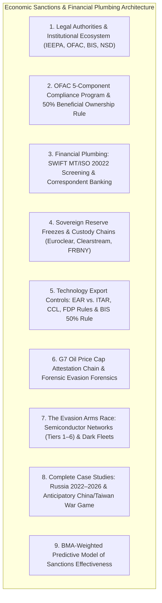
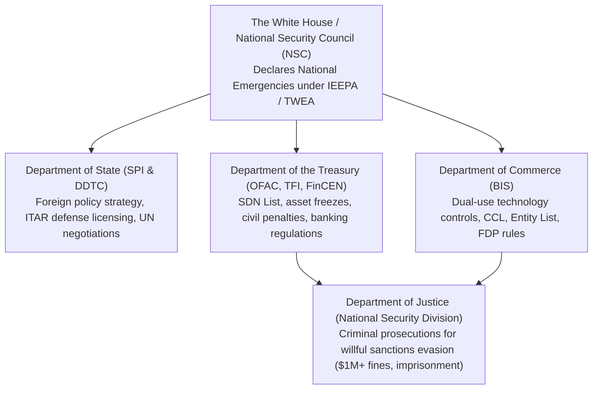
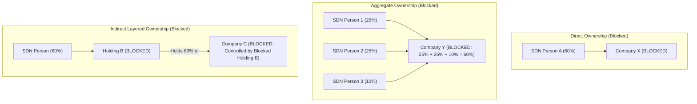
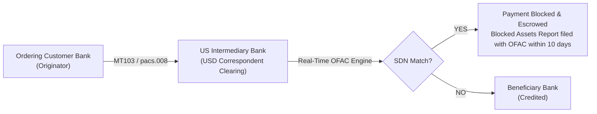
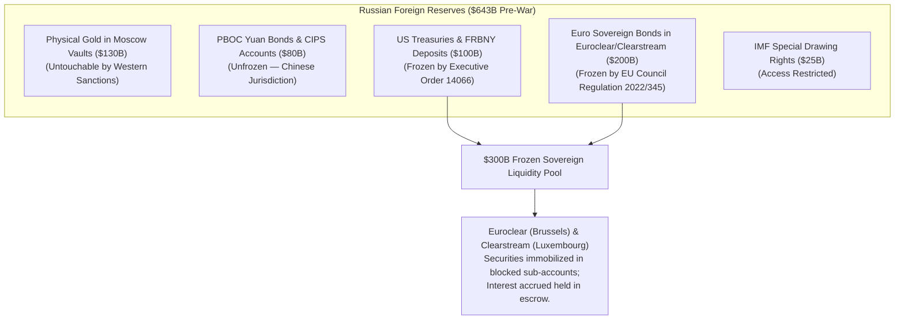
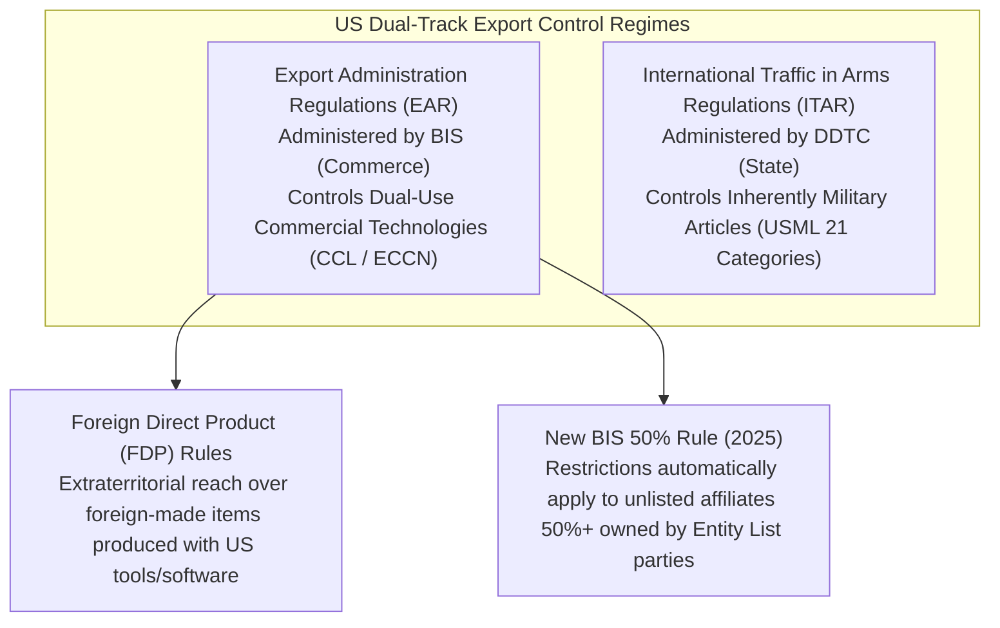
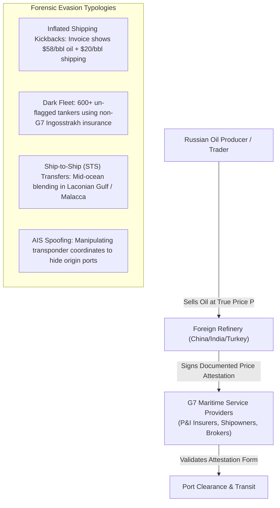
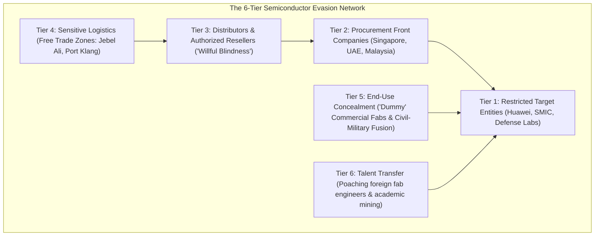
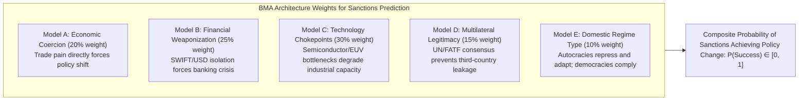

# Module 04: Economic Sanctions, Financial Plumbing & Evasion Forensics

## Executive Overview

Economic sanctions represent the primary coercive instrument of modern geoeconomics. This module provides an exhaustive, institutional-grade forensic examination of **Sanctions Legal Frameworks, Financial Plumbing (SWIFT/Correspondent Banking), Beneficial Ownership Mathematics (50% Rule), Export Controls (EAR/ITAR), G7 Price Cap Attestation Mechanics, Evasion Architectures (Shadow Fleets & Tech Front Companies), and Predictive Models of Sanctions Effectiveness**.



---

## 1. Legal Authorities & Institutional Architecture



### Primary Statutory Authorities

| Statute | Core Legal Mechanism | Jurisdictional Trigger |
| :--- | :--- | :--- |
| **IEEPA (50 U.S.C. § 1701)** | *International Emergency Economic Powers Act*: Grants POTUS sweeping authority to block financial transactions and freeze foreign-owned property. | Declaration of an unusual and extraordinary foreign threat to US national security. |
| **Trading With the Enemy Act (TWEA)** | Imposes comprehensive trade and asset embargos during wartime. | Declared state of war or armed conflict. |
| **Export Control Reform Act (ECRA)** | Authorizes BIS to restrict exports of dual-use technologies to protect national security. | Items subject to the Export Administration Regulations (EAR). |
| **Arms Export Control Act (AECA)** | Controls commercial exports of defense articles and defense services under ITAR. | Items designated on the United States Munitions List (USML). |

---

## 2. OFAC Compliance Commitments & The 50% Beneficial Ownership Rule

### OFAC's 5 Essential Compliance Components

1. **Management Commitment**: Dedicated Senior OFAC Compliance Officer, board oversight, direct reporting line to CEO.
2. **Risk Assessment**: Systematic risk ratings across customers, products, geography, currencies, and third-party intermediaries.
3. **Internal Controls**: Automated real-time SDN screening, daily batch KYC refresh, 24h update latency post-designation.
4. **Testing & Auditing**: Independent sample-based transaction audits and simulated evasion stress tests.
5. **Training**: Role-specific annual curriculum covering evasion typologies and legal penalty mitigation.

---

### The 50% Rule: Beneficial Ownership Mathematics

> **The OFAC 50% Rule**: Any entity owned $50\%$ or more, individually or in the aggregate, directly or indirectly, by one or more blocked persons is automatically blocked, even if not explicitly listed on the SDN List.



$$\text{Entity is Blocked if } \sum_{i \in \text{SDN}} \text{EquityShare}_i \ge 50.0\% \quad \text{or} \quad \text{ParentHolding} \in \text{SDN} \land \text{ParentHolding} \xrightarrow{> 50\%} \text{Subsidiary}$$

---

## 3. Financial Plumbing: SWIFT MT/ISO 20022 Screening & Correspondent Banking

### SWIFT Message Screening Matrix



| Message Type | Functional Description | Critical Sanctions Screening Fields | Compliance Risk Level |
| :--- | :--- | :--- | :--- |
| **MT103** | Single Customer Credit Transfer | `:50a` (Ordering Customer), `:59a` (Beneficiary), `:70` (Remittance Info) | **High**: Primary conduit for cross-border commercial transactions. |
| **MT202 COV** | Interbank Cover Payment | **Sequence A** (Interbank) AND **Sequence B** (Underlying Customer) | **Critical**: Sequence B must be screened to catch concealed beneficiaries. |
| **MT700** | Documentary Letter of Credit | `:45A` (Goods Description), `:44E/F` (Ports of Loading/Discharge), `:50/:59` | **High**: Trade-based money laundering (TBML) and port evasion risks. |
| **ISO 20022 (pacs.008)** | XML Structured Financial Message | Dedicated discrete XML elements (`<Dbtr>`, `<Cdtr>`, `<UltmtCdtr>`, `<Prtry>`) | **Superior**: Eliminates free-text ambiguity, drastically reducing false positives. |

---

### Correspondent Banking & Nostro/Vostro Mechanics

```mermaid
sequenceDiagram
    autonumber
    participant Orig as German Exporter Bank (Deutsche Bank)
    participant Nostro as US Clearing Bank (JPMorgan NOSTRO Account)
    participant Fed as Fedwire / CHIPS USD Clearing Engine
    participant Target as Russian Foreign Bank (Target)

    Orig->>Nostro: Submit MT202 COV for USD settlement
    Note over Nostro: Nostro conducts automated real-time OFAC filter
    alt Clean Transaction
        Nostro->>Fed: Execute USD Fedwire settlement
        Fed->>Target: Settle USD payment
    else SDN Hit in Sequence B
        Nostro--xTarget: FREEZE & BLOCK TRANSACTION
        Note over Nostro: Funds frozen in blocked interest-bearing account; OFAC notified
    end
```

---

## 4. Sovereign Reserve Freezes & Custody Chains

### Mechanics of the $300B Russian Central Bank Asset Freeze



---

## 5. Technology Export Controls: EAR vs. ITAR & The New BIS 50% Rule

### Dual-Track Legal Framework



### The 21 US Munitions List (USML) Categories

1. Firearms, Close Assault Weapons
2. Artillery, Guns, Mortars
3. Ammunition, Ordnance
4. Launch Vehicles, Guided Missiles, Ballistic Missiles, Bombs
5. Explosives, Propellants, Energetic Materials
6. Vessels of War and Special Naval Equipment
7. Ground Vehicles, Tanks, Armored Carriers
8. Aircraft and Associated Aerospace Equipment
9. Military Training Equipment and Simulators
10. Personal Protective Equipment and Body Armor
11. Military Electronics (Radar, Electronic Warfare)
12. Fire Control, Range Finders, Optical Guidance Systems
13. Auxiliary Military Construction & Bridging Equipment
14. Toxicological, Chemical & Biological Defense Agents
15. Spacecraft, Military Satellites & Systems
16. Nuclear Weapons Design and Associated Articles
17. Classified Articles and Defense Services
18. Directed Energy Weapons and High-Power Lasers
19. Gas Turbine Aero-Engines
20. Submersible Vessels and Oceanographic Equipment
21. Emerging Technologies and Non-Enumerated Defense Articles

---

## 6. G7 Oil Price Cap Attestation Chain & Evasion Forensics



---

## 7. The Evasion Arms Race: Semiconductor Networks & "Fab Whack-a-Mole"



---

## 8. Complete Case Studies: Russia & Anticipatory China/Taiwan

### 1. Russia Sanctions Retrospective (2022–2026)
- **Financial Isolation**: SWIFT exclusion and $\$300\text{B}$ asset freeze caused immediate ruble collapse ($150/\text{USD}$), successfully managed by aggressive capital controls and CBR rate hikes to $20\%$.
- **Energy Pivot**: G7 price cap reduced fiscal oil margins by $\$50\text{B}-\$70\text{B}/\text{year}$, but volume was redirected via the 600-tanker Dark Fleet to India, China, and Turkey.
- **Technology Degradation**: Semiconductor export bans degraded precision-guided munitions production, forcing reliance on smuggled commercial components and lower-tier domestic $90\text{nm}$ fabs.
- **Structural Equilibrium**: Formed a sustainable war economy ($6-7\%\text{ GDP}$ defense spending) resilient against non-multilateral sanctions.

---

### 2. Anticipatory China/Taiwan Contingency ("Economic MAD")

```mermaid
sequenceDiagram
    autonumber
    participant PLA as PLA Military Blockade of Taiwan (Day 0)
    participant US as US Treasury & Allied Coalition (Day 1-3)
    participant Tech as Global Tech & Semiconductor Supply Chain
    participant Market as Global Financial & Commodity Markets

    PLA->>US: Kinetic / Naval Blockade of Taiwan Strait
    US->>PLA: Immediate SWIFT Exclusion of Major Chinese Banks + $800B PBOC Freeze
    US->>Tech: Universal Entity List Expansion + Total FDP Export Blockade
    Tech->>Market: TSMC Fab Shutdown → 90% Advanced Semiconductor Supply Eradicated
    PLA->>Market: Counter-Sanctions: Total Rare Earth Export Ban + API Pharma Cutoff
    Note over Market: Global GDP contracts -5% to -10%; severe inflation and depression across electronics and automotive sectors.
```

---

## 9. BMA-Weighted Predictive Model of Sanctions Effectiveness



### Mathematical Formulation of Predicted Success ($P_{\text{success}}$)
\[
P_{\text{success}} = \sum_{i=1}^5 w_i \cdot \sigma\left( \beta_i^{\top} \mathbf{x}_{\text{target}} \right)
\]
Where $\mathbf{x}_{\text{target}}$ encodes target regime autocracy score, trade diversification ratio, availability of alternative partners (China/India), and geographic contiguity to non-aligned transit states.

10. How Sanctions Work: The Mechanism of Coercion

The Theory of Sanctions Effectiveness

```
┌─────────────────────────────────────────────────────────────────────┐
│           THE SANCTIONS COERCION MECHANISM                          │
├─────────────────────────────────────────────────────────────────────┤
│                                                                     │
│  SENDER STATE(S)                                                    │
│  ├──→ Impose economic costs on TARGET                              │
│  │       ├──→ Economic pain → Domestic pressure on leadership      │
│  │       ├──→ Resource constraints → Reduced military capability    │
│  │       └──→ Isolation → Loss of international legitimacy         │
│  │                                                                  │
│  │  ←── TARGET changes behavior (compliance) ←──                   │
│  │                                                                  │
│  OR                                                                 │
│  │                                                                  │
│  ├──→ TARGET resists                                               │
│  │       ├──→ Find alternative suppliers/markets                   │
│  │       ├──→ Domestic substitution (import substitution)          │
│  │       ├──→ Evasion (smuggling, shell companies, shadow fleet)   │
│  │       └──→ Retaliation (counter-sanctions, asymmetric response) │
│  │                                                                  │
│  │  ←── Stalemate or escalation ←──                               │
│                                                                     │
│  KEY VARIABLES:                                                     │
│  • Cost imposed vs. target's resilience                            │
│  • International cooperation (multilateral vs. unilateral)         │
│  • Time horizon (patience of sender vs. target)                    │
│  • Alternative partners (can target pivot to China, India, etc.?)  │
│  • Domestic politics (can target leadership absorb pain?)          │
│                                                                     │
└─────────────────────────────────────────────────────────────────────┘
```

The Five Channels of Sanctions Impact

Channel	Mechanism	Example	
Financial	Cut off from dollar system, SWIFT, correspondent banking	Russian banks unable to process international payments	
Trade	Import/export bans, tariff spikes	Iranian oil exports fell from 2.5M to 0.5M barrels/day	
Technology	Export controls on semiconductors, software, equipment	Russia unable to source advanced chips for weapons	
Investment	Prohibition on FDI, capital market access	Russian companies delisted from Western exchanges	
Reputation	Stigmatization, reduced business confidence	Global companies voluntarily exit Russian market	

---

11. Case Study: Russia-Ukraine Sanctions (2022-Present)

The Sanctions Cascade 

```
┌─────────────────────────────────────────────────────────────────────┐
│           RUSSIA SANCTIONS: THE MOST COMPREHENSIVE EVER            │
├─────────────────────────────────────────────────────────────────────┤
│                                                                     │
│  WAVE 1 (February 2022): Preventive                                │
│  • Asset freezes on Putin, Lavrov, oligarchs                       │
│  • Suspension of Nord Stream 2 certification                        │
│                                                                     │
│  WAVE 2 (February-March 2022): Immediate response                  │
│  • SWIFT exclusion for major Russian banks                          │
│  • $300B central bank reserves frozen                               │
│  • Export controls on advanced technology                           │
│  • Closure of airspace to Russian aircraft                          │
│                                                                     │
│  WAVE 3 (2022-2023): Escalation                                    │
│  • EU embargo on Russian seaborne oil                               │
│  • Price caps on Russian oil ($60/barrel)                          │
│  • Ban on Russian gold imports                                      │
│  • Export controls expanded to oil refining, LNG technology         │
│                                                                     │
│  WAVE 4 (2023-2024): Enforcement tightening                        │
│  • Secondary sanctions on sanctions evasion                         │
│  • Targeting of "shadow fleet" tankers                              │
│  • Restrictions on Russian diamond exports                          │
│                                                                     │
└─────────────────────────────────────────────────────────────────────┘
```

Impact Assessment 

Metric	Pre-Sanctions (2021)	Post-Sanctions (2022-2024)	Assessment	
Russian GDP growth	+4.7%	-2.1% (2022), +3.6% (2023), +2.5% (2024)	Initial shock, then adaptation	
Inflation	6.7%	13.8% (2022 peak), 7.4% (2024)	High but controlled	
Oil exports	4.7M bpd	4.5M bpd (redirected to India/China)	Minimal volume loss	
Central bank reserves	640B	300B frozen, 340B accessible	Liquidity constrained	
Technology access	Full	Severely restricted	Long-term degradation	
Military production	Steady	Increased (artillery, missiles)	Partial failure of objective	

Why Sanctions Didn't Cripple Russia 

1. Energy revenue resilience: Oil/gas prices rose post-invasion, offsetting volume losses
2. Pivot to Asia: India and China became major buyers of discounted Russian oil
3. Import substitution: Domestic production of some goods increased
4. Shadow fleet: Hundreds of old tankers acquired to evade price caps and insurance restrictions
5. Cryptocurrency and alternative payment systems: Reduced SWIFT dependence
6. War economy mobilization: State-directed industrial production for military needs

> "Russia's economy has shown surprising resilience, leading Dmitri Trenin to describe the sanctions as 'the best thing the West has done for Russia.'" 

---

12. Sanctions Evasion Techniques

Technique	How It Works	Example	
Shell Companies	Layered ownership obscures sanctioned beneficial owners	Russian oligarch assets held through Cypriot/Channel Island entities	
Shadow Fleet	Old tankers without Western insurance/registration transport sanctioned oil	600+ tankers transport Russian oil above price cap	
Transshipment	Goods transferred at sea or in third countries to obscure origin	Iranian oil relabeled as Malaysian	
Over/Under Invoicing	Misstate prices to move value across borders	Understated Russian export prices to capture value in non-sanctioned jurisdiction	
Cryptocurrency	Digital assets bypass traditional banking	North Korean Lazarus Group hacks crypto exchanges	
Barter Trade	Direct exchange of goods without currency	Iran-Venezuela oil-for-gold arrangements	
Local Currency Settlement	Trade in yuan, rupees, rubles instead of dollars	India-Russia oil trade in rupees	
Third-Country Intermediaries	Non-sanctioned entities front for sanctioned ones	UAE, Turkey, Kazakhstan companies re-export to Russia	

---

13. The Macroeconomic Impact of Sanctions

On Target Countries

```
┌─────────────────────────────────────────────────────────────────────┐
│           SANCTIONS MACROECONOMIC IMPACT: TARGET COUNTRY            │
├─────────────────────────────────────────────────────────────────────┤
│                                                                     │
│  SHORT-TERM (0-1 year):                                            │
│  ├──→ Currency crisis (capital flight, import costs rise)          │
│  ├──→ Inflation spike (imported goods scarcity)                    │
│  ├──→ Interest rate hike (defense of currency)                     │
│  ├──→ GDP contraction (supply shock, confidence collapse)          │
│  └──→ Social unrest risk (price rises, unemployment)               │
│                                                                     │
│  MEDIUM-TERM (1-5 years):                                          │
│  ├──→ Import substitution (domestic production replaces imports)   │
│  ├──→ Alternative partnerships (pivot to non-sanctioning states)   │
│  ├──→ Technology degradation (inability to access advanced tech)   │
│  ├──→ Brain drain (skilled workers emigrate)                       │
│  └──→ Structural transformation (war economy, state direction)     │
│                                                                     │
│  LONG-TERM (5+ years):                                             │
│  ├──→ Permanent underperformance (technology gap, investment gap)  │
│  ├──→ Institutional decay (corruption, rent-seeking)               │
│  ├──→ Demographic damage (health, education, emigration)           │
│  └──→ OR: Adaptation and recovery (if sanctions lifted, reforms)   │
│                                                                     │
└─────────────────────────────────────────────────────────────────────┘
```

On Sender Countries

Impact	Mechanism	Magnitude	
Retaliatory sanctions	Target restricts exports to sender	EU gas prices +300% (2022)	
Opportunity cost	Lost market access, investment opportunities	European companies lost 100B+ in Russia	
Compliance costs	Due diligence, legal, reporting	Banks spend 5-10% of operating costs on sanctions compliance	
Dollar weaponization blowback	Accelerated de-dollarization	BRICS+ local currency trade, gold accumulation	
Reputational risk	Perception of overreach	Global South perceives Western double standards	

On Third Countries

```
┌─────────────────────────────────────────────────────────────────────┐
│           SANCTIONS SPILLOVER: THE "FRIEND-SHORING" EFFECT         │
├─────────────────────────────────────────────────────────────────────┤
│                                                                     │
│  WINNERS:                                                           │
│  • India: Bought Russian oil at $35 discount, refined, sold to EU  │
│  • China: Secured long-term energy supply at below-market prices    │
│  • Turkey: Became trade intermediary, tourism from Russia boomed    │
│  • UAE: Financial center for Russian capital flight                 │
│  • Kazakhstan: Trade transit, parallel import hub                   │
│                                                                     │
│  LOSERS:                                                            │
│  • Europe: Higher energy costs, industrial competitiveness loss     │
│  • Global South: Food price inflation (Ukraine grain disruption)   │
│  • Small states: Forced to choose sides, compliance burden          │
│                                                                     │
│  AMBIGUOUS:                                                         │
│  • U.S.: Energy exporter gains, but dollar hegemony erodes         │
│  • Global financial system: Fragmentation, reduced efficiency        │
│                                                                     │
└─────────────────────────────────────────────────────────────────────┘
```

---

14. The Effectiveness Debate: Do Sanctions Work?

The Academic Consensus 

Study	Finding	
Hufbauer et al. (2007)	Sanctions achieve major policy goals 34% of the time	
Pape (1997)	Only 5% of sanctions episodes successful (methodological debate)	
Morgan et al. (2009)	Success higher with multilateral, limited objectives, democratic targets	
Recent Russia experience	Failed to deter invasion, failed to force withdrawal, but degraded military capability	

Conditions for Sanctions Success

```
SUCCESS FACTORS (ranked by importance):

1. MULTILATERAL COOPERATION
   ├──→ Universal participation prevents evasion
   ├──→ UN mandate provides legitimacy
   └──→ Example: Iran nuclear sanctions (2012-2015) — comprehensive, multilateral

2. LIMITED, CLEAR OBJECTIVES
   ├──→ Specific, achievable demands
   ├──→ Timeline for compliance
   └──→ Example: Libya giving up WMD (2003) — limited, concrete

3. HIGH ECONOMIC COST TO TARGET
   ├──→ Trade dependence on sender
   ├──→ Financial system integration
   └──→ Example: Iran — oil-dependent, no alternative markets initially

4. SHORT TIME HORIZON
   ├──→ Target cannot adapt
   ├──→ Domestic pressure mounts quickly
   └──→ Example: Post-Cold War Serbia — isolated, no alternatives

5. DOMESTIC POLITICAL VULNERABILITY
   ├──→ Democratic or divided leadership
   ├──→ Civil society can mobilize
   └──→ Example: South Africa apartheid — domestic pressure + sanctions

6. CREDIBLE THREAT OF ESCALATION
   ├──→ Military option on table
   ├──→ Sanctions are "first step"
   └──→ Example: Iraq 1990 — sanctions + credible military threat
```

Conditions for Sanctions Failure

Factor	Why It Undermines Sanctions	Example	
Target is large/resource-rich	Can absorb pain, find alternatives	Russia, China	
Target is authoritarian	No domestic pressure, can repress	North Korea, Iran	
Sender-target trade is small	Limited leverage	U.S. sanctions on Myanmar	
Third countries won't cooperate	Evasion routes remain open	Russia-India-China trade	
Objective is existential for target	Willing to bear any cost	Russia-Ukraine (NATO expansion)	
Sanctions are symbolic	Insufficient cost to change behavior	Post-Crimea sanctions (2014)	

---


15. Sanctions in the BMA Framework

How Sanctions Fit Into Predictive Geopolitical Macro

```
┌─────────────────────────────────────────────────────────────────────┐
│           SANCTIONS AS A VARIABLE IN PREDICTIVE MODELS              │
├─────────────────────────────────────────────────────────────────────┤
│                                                                     │
│  CAUSAL DISCOVERY QUESTION:                                         │
│  "Do sanctions cause the desired behavioral change?"                │
│                                                                     │
│  EMPIRICAL FINDING (causal inference):                              │
│  • Sanctions → Economic pain: STRONG causal effect (well-documented)│
│  • Economic pain → Political change: WEAK/CONDITIONAL               │
│    - Works better in democracies (domestic pressure)                │
│    - Works worse in autocracies (can repress, control narrative)    │
│    - Works worse when target has alternative partners               │
│                                                                     │
│  CAUSAL GRAPH:                                                      │
│                                                                     │
│  Sanctions ──→ Economic Pain ──→ ? ──→ Behavioral Change          │
│       │              │                                               │
│       │              ├──→ Domestic Protests ──→ Regime Change?     │
│       │              │       (democracies only)                     │
│       │              ├──→ Military Degradation ──→ War Termination? │
│       │              │       (long time lag)                        │
│       │              └───→ Elite Defection ──→ Policy Change?       │
│       │                    (rare, requires factionalization)        │
│       │                                                            │
│       └──→ Alternative Partnerships ──→ Evasion ──→ Pain Reduction │
│                                                                     │

└─────────────────────────────────────────────────────────────────────┘
```

---

16. The Future of Sanctions: Emerging Challenges

Challenge	Implication	Predictive Impact	
De-dollarization	BRICS+ developing alternative payment systems	Reduced effectiveness of financial sanctions	
Cryptocurrency	Harder to track, freeze, control	Need for new enforcement tools	
Economic multipolarity	China, India as alternative markets/partners	Unilateral Western sanctions increasingly ineffective	
Climate transition	Energy sanctions accelerate green transition	Sender-target dynamics shift (EU less vulnerable to oil coercion)	
AI and surveillance	Better detection of evasion, but also better evasion	Arms race in sanctions enforcement	
Fragmentation of international law	Less UN consensus, more ad hoc coalitions	Sanctions legitimacy contested, enforcement inconsistent	

---


17. Sanctions Evasion: The Complete Technical Playbook

11.1 The Evasion Ecosystem

Sanctions evasion is not a single technique but an integrated ecosystem of financial, commercial, logistical, and technological methods. Understanding this ecosystem is essential for predicting where sanctions will leak, who benefits, and how enforcement can adapt.

```
┌─────────────────────────────────────────────────────────────────────┐
│           THE SANCTIONS EVASION ECOSYSTEM                           │
├─────────────────────────────────────────────────────────────────────┤
│                                                                     │
│  LAYER 1: OWNERSHIP OBSCURATION                                     │
│  ┌─────────────────────────────────────────────────────────────┐   │
│  │ • Shell companies (BVI, Cayman, Cyprus, Hong Kong)          │   │
│  │ • Trusts and foundations (Liechtenstein, Panama, Nevis)     │   │
│  │ • Nominee directors and shareholders                        │   │
│  │ • Layered ownership (5+ jurisdictions deep)                 │   │
│  │ • Family member transfers (oligarch assets to wife/son)     │   │
│  └─────────────────────────────────────────────────────────────┘   │
│                              ↓                                      │
│  LAYER 2: FINANCIAL CHANNELS                                        │
│  ┌─────────────────────────────────────────────────────────────┐   │
│  │ • Correspondent banking through non-sanctioned banks        │   │
│  │ • Alternative payment systems (SPFS, CIPS, bilateral)       │   │
│  │ • Cryptocurrency (Bitcoin, Monero, mixers, cross-chain)     │   │
│  │ • Trade credits and barter (goods-for-goods)                │   │
│  │ • Hawala and informal value transfer networks               │   │
│  │ • Cash couriers and bulk cash smuggling                     │   │
│  └─────────────────────────────────────────────────────────────┘   │
│                              ↓                                      │
│  LAYER 3: TRADE COMMERCIALIZATION                                   │
│  ┌─────────────────────────────────────────────────────────────┐   │
│  │ • Misinvoicing (over/under pricing)                         │   │
│  │ • Misclassification (wrong HS codes)                        │   │
│  │ • Phantom shipments (no goods move)                         │   │
│  │ • Triangulation (A sells to B, B sells to C, C to target)   │   │
│  │ • Transshipment (goods unloaded, repackaged, re-documented) │   │
│  └─────────────────────────────────────────────────────────────┘   │
│                              ↓                                      │
│  LAYER 4: LOGISTICS AND PHYSICAL MOVEMENT                         │
│  ┌─────────────────────────────────────────────────────────────┐   │
│  │ • Shadow fleet (old tankers, flag hopping, AIS spoofing)    │   │
│  │ • Ship-to-ship transfers at sea                             │   │
│  │ • Alternative ports (non-Western insurance, inspection)     │   │
│  │ • Air cargo through non-sanctioned carriers                 │   │
│  │ • Overland smuggling routes (Caucasus, Central Asia)        │   │
│  └─────────────────────────────────────────────────────────────┘   │
│                              ↓                                      │
│  LAYER 5: TECHNOLOGY AND DIGITAL INFRASTRUCTURE                     │
│  ┌─────────────────────────────────────────────────────────────┐   │
│  │ • VPNs and IP spoofing (mask location)                      │   │
│  │ • Decentralized exchanges (no KYC/AML)                      │   │
│  │ • Privacy coins (Monero, Zcash)                             │   │
│  │ • Mixers and tumblers (obfuscate blockchain trail)          │   │
│  │ • Rebranding (same service, new name)                       │   │
│  └─────────────────────────────────────────────────────────────┘   │
│                                                                     │
└─────────────────────────────────────────────────────────────────────┘
```

---

18. Case Study: The Russian Shadow Fleet

What It Is:

A fleet of aging tankers operating outside Western insurance, classification, and oversight systems to transport Russian oil above the G7 price cap.

The Mechanics:

Component	How It Works	Scale	
Vessel Acquisition	Purchase old tankers (15-20 years) from non-Western owners	600+ tankers by 2024	
Flag Hopping	Register under flags of convenience (Gabon, Cook Islands, Panama)	Multiple flag changes per vessel	
AIS Spoofing	Turn off or manipulate transponders to hide location	Widespread in 2023-2024	
Ship-to-Ship Transfer	Load oil at sea to obscure origin	Common in Mediterranean, Atlantic	
Non-Western Insurance	Use Russian, Chinese, or unknown insurers	Avoids price cap compliance requirement	
Ownership Obscurity	Shell companies in Dubai, Hong Kong, Cyprus	Beneficial ownership untraceable	

The Price Cap Evasion:

```
OFFICIAL TRANSACTION:
├── Declared oil price: $58/barrel (below $60 cap)
├── Shipping cost: $5/barrel
├── Insurance cost: $2/barrel
└── Total "compliant" cost: $65/barrel

ACTUAL TRANSACTION:
├── True oil price: $75/barrel
├── Inflated shipping cost: $15/barrel (kickback to seller)
├── Inflated insurance cost: $8/barrel (kickback to seller)
├── "Declared" oil price: $58/barrel (meets cap)
└── Actual total cost: $75 + $15 + $8 = $98/barrel

MECHANISM:
├── Western insurer sees: $58 oil + $15 shipping + $8 insurance = $81
├── But shipping and insurance are to shell companies
├── Shell companies return excess to Russian seller
├── Western insurer is technically compliant
├── Russian seller receives full market price
└── Price cap is evaded through inflated service costs
```

Impact Assessment:

Metric	Pre-Price Cap (2022)	Post-Price Cap (2023-2024)	Assessment	
Russian oil export volume	4.7M bpd	4.5M bpd	Minimal decline	
Russian oil export revenue	180B (2022)	150B (2023), 170B (2024)	Below peak but sustainable	
Urals discount to Brent	30+	12-15 (often less in practice)	Narrowing	
Shadow fleet share	10%	70% by 2024	Near-complete evasion infrastructure	
Western insurance coverage	90%	30%	Massive shift	

The Kyiv School of Economics Assessment:

> By 2024, an estimated 70% of Russian seaborne oil was transported by the shadow fleet, rendering the price cap largely ineffective as an enforcement mechanism.

19. Case Study: Russian Financial Evasion

SPFS (System for Transfer of Financial Messages):

Russia's domestic alternative to SWIFT, developed after 2014 Crimea sanctions.

Feature	SWIFT	SPFS	
Members	11,000+ banks in 200+ countries	500 participants, mostly Russian and CIS	
Currency	Primarily USD, EUR	Primarily RUB, CNY	
Speed	Near-instant	Slower, batch processing	
Reliability	99.99% uptime	Less reliable, technical issues	
International reach	Global	Limited to friendly jurisdictions	
Sanctions exposure	High (can be excluded)	Low (Russian-controlled)	

CIPS (Cross-Border Interbank Payment System):

China's alternative to SWIFT, increasingly used for Russia-China trade.

```
YUANIZATION OF RUSSIAN TRADE:
├── 2021: 3% of Russian imports invoiced in yuan
├── 2022: 20% of Russian imports invoiced in yuan
├── 2023: 35% of Russian imports invoiced in yuan
├── 2024: 45%+ of Russian imports invoiced in yuan
└── Mechanism: CIPS + bilateral currency swaps + yuan-denominated trade contracts
```

The Crypto Channel:

Event	Date	Details	
OFAC sanctions on Russian crypto exchanges	March 2024	B-Crypto, Masterchain, Laitkhaus, Atomaiz	
Netex24 rebranding	May 2024	Rebranded as "SafelyChange" after sanctions	
North Korean Atomic Wallet hack	June 2023	100M stolen, laundered through mixers and cross-chain swaps	
Russian mining operations	Ongoing	Using energy resources to mine Bitcoin as sanctions-resistant revenue	

The Third-Country Banking Channel:

```
TURKEY EXAMPLE:
├── Turkish banks processed Russian payments under false labels
├── Goods described as "food" or "consumer goods" were actually dual-use technology
├── Halkbank case (pre-2022): $20B in Iranian gold-for-oil transactions
├── Post-2022: Similar patterns for Russia, until US Treasury pressure
└── Result: Turkish banks increasingly cautious due to secondary sanctions threat

UAE EXAMPLE:
├── Dubai as financial hub for Russian capital flight
├── Real estate purchases by sanctioned individuals
├── Shell companies in Dubai International Financial Centre (DIFC)
├── Gold trade: Russian gold re-exported through UAE
└── Result: UAE added to FATF "gray list" in 2022; partial compliance improvement

KAZAKHSTAN EXAMPLE:
├── Land border with Russia enables overland trade
├── Parallel import of Western goods to Russia
├── Kazakh banks as correspondent banking channels
└── Result: Balancing act between Russia and West; periodic compliance crackdowns
```

---

20. The Rebranding Tactic: Netex24 Case Study

The Sequence:

Date	Event	
March 25, 2024	OFAC sanctions Netex24 (Moscow-based fintech) for enabling sanctions evasion	
March 25, 2024	Netex24 facilitated payments to Sberbank, Alfa-Bank, Hydra Market	
May 2, 2024	Netex24 announces "sale" to new owners, rebrands as "SafelyChange"	
Post-May 2024	TRM Labs investigation finds:	
	• No evidence of actual ownership change	
	• Same off-chain infrastructure	
	• Same on-chain wallet addresses	
	• Same operational patterns	
Conclusion	Rebranding was sanctions evasion tactic, not genuine business sale	

The Compliance Lesson:

> Static sanctions screening (name-based) is insufficient. Dynamic behavioral analytics, infrastructure fingerprinting, and transaction pattern analysis are required to detect rebranding and related-entity evasion.

---


21. Secondary Sanctions: The Extraterritorial Weapon

21.1 What Are Secondary Sanctions?

Primary sanctions: Prohibit U.S. persons (citizens, residents, companies, banks) from dealing with sanctioned targets.

Secondary sanctions: Threaten to sanction non-U.S. persons (foreign companies, banks, governments) for doing business with sanctioned targets.

The Mechanism:

```
SECONDARY SANCTIONS THREAT:
├── Chinese bank processes payments for Russian oil purchases
├── U.S. Treasury issues warning: "Facilitating Russian sanctions evasion
│   may result in loss of access to U.S. financial system"
├── Chinese bank faces choice:
│   ├── Option A: Continue Russian business → Risk U.S. sanctions
│   │   └── Loss of dollar clearing, correspondent banking, U.S. market access
│   └── Option B: Cease Russian business → Preserve U.S. market access
│       └── But lose Russian business revenue
├── Rational choice: Preserve U.S. access (larger market, irreplaceable)
└── Result: Chinese bank complies, Russian evasion channel closes

THE CALCULATION:
├── U.S. financial market access value: $10T+ in daily transactions
├── Russian business value: $10B annually
├── Ratio: 1000:1
└── Almost always rational to comply with U.S. demands
```

21.2 Secondary Sanctions Effectiveness

Target	Secondary Sanction Threat	Outcome	
Chinese banks (2024)	Process Russian oil payments → lose dollar access	Most major banks reduced Russian business	
Turkish banks (2023)	Facilitate Russian trade → lose dollar access	Halkbank, others became more cautious	
Indian oil buyers (2022-2023)	Buy Russian oil above price cap → lose insurance/shipping	Initially resisted, then partially complied	
European companies (2022)	Continue Russian operations → U.S. reputational/legal risk	Mass corporate exodus from Russia	
SWIFT alternative users	Use SPFS for Russia → lose dollar access	Limited adoption outside Russia/CIS	

21.3 The Limits of Secondary Sanctions

Limitation	Explanation	Example	
Requires U.S. financial dominance	Only works if dollar is indispensable	Less effective if yuan/euro alternatives develop	
Allies may resist	Extraterritorial application seen as overreach	EU irritation at U.S. Iran sanctions (2018)	
Creates incentive for alternatives	Targets build parallel systems	CIPS, SPFS, bilateral currency swaps	
Enforcement is selective	Cannot sanction everyone	Prioritization based on geopolitical importance	
Domestic politics constrain	Allies may prioritize local interests	Turkey, India resist full compliance	

---


22. The Price Cap: A Novel Sanctions Mechanism

22.1 The Theory

Problem: Complete ban on Russian oil would cause global price spike, hurting Western consumers.

Solution: Allow Russian oil to flow, but only if priced below production cost + reasonable margin.

Mechanism:

```
PRICE CAP MECHANISM:
├── Western insurers and shippers (90% of global market) can only insure
│   Russian oil shipments if purchase price ≤ $60/barrel
├── Western banks can only finance such shipments
├── Non-compliant shipments lose access to Western services
└── Enforcement through service denial, not direct trade ban

THE LOGIC:
├── Russia's production cost: ~$15-20/barrel
├── $60 cap: Allows profit, but reduces war revenue
├── Complete ban: Would drive prices to $150+, Russia earns more on less volume
└── Price cap: Keeps oil flowing, limits Russian revenue
```

22.2 The Evasion Reality

Evasion Method	How It Works	Detectability	
Inflated shipping/insurance	Declare 58 oil + 20 shipping + 10 insurance	Hard — requires audit of service contracts	
Non-Western insurance	Use Chinese, Russian, unknown insurers	Medium — port state control, AIS tracking	
Shadow fleet	No Western insurance at all	Hard — but port access limited, accident risk high	
Offshore blending	Mix Russian oil with other origin oil	Hard — requires chemical testing	
Direct government deals	China/India buy at government level, no Western intermediaries	Very hard — sovereign immunity	

22.3 Assessment: Did the Price Cap Work?

Metric	Intended	Actual	Verdict	
Reduce Russian oil revenue	Significant reduction	Moderate reduction (20-30%)	Partially effective	
Keep global oil prices stable	No price spike	Prices elevated but not extreme	Partially effective	
Maintain Western leverage	Control Russian energy exports	Erosion via shadow fleet	Losing effectiveness	
Enforceability	High (insurance control)	Declining (shadow fleet growth)	Declining	

The Paradox:

> The price cap was designed to be enforceable (via Western insurance dominance) but not evasion-proof. As the shadow fleet grew, enforceability declined. The cap may have been too clever — it bought time but created an evasion infrastructure that now undermines broader sanctions.

---


23. Sanctions and the Global Financial Architecture

23.1 The Weaponization of Interdependence

> "The central paradox of our time is this: The same economic interdependence that was supposed to promote peace and cooperation has become a weapon of geopolitical competition." 

The Dollar Weapon:

Tool	Mechanism	Geopolitical Impact	
SWIFT exclusion	Remove banks from messaging system	Financial isolation	
Correspondent banking denial	Cut off access to dollar clearing	inability to conduct international trade	
Asset freezes	Block central bank reserves	Loss of crisis liquidity, confidence shock	
SDN list designation	Prohibit all dealings with listed entities	Pariah status, corporate exodus	
Export controls	Restrict technology access	Long-term capability degradation	

23.2 The Blowback: Accelerated De-Dollarization

```
PRE-SANCTIONS (pre-2022):
├── Dollar share of global reserves: 60%+
├── Dollar share of trade invoicing: 50%+
├── SWIFT: Dominant, no viable alternative
└── U.S. financial system: "Too big to avoid"

POST-UKRAINE SANCTIONS (2022-2025):
├── Russia: $300B reserves frozen → "Our money was stolen"
├── China: Observed Russia's fate → Accelerated yuan internationalization
├── India: Diversified oil purchases, rupee trade agreements
├── Brazil: Lula called for BRICS currency
├── Saudi Arabia: Open to yuan pricing, reduced U.S. arms purchases
├── ASEAN: Local currency settlement frameworks
└── Cumulative: Dollar share of reserves fell to ~58%, trend continuing

THE FEEDBACK LOOP:
├── U.S. uses dollar dominance for sanctions
├── Targets seek alternatives to avoid future vulnerability
├── Alternatives reduce dollar dominance
├── Reduced dominance limits future sanctions effectiveness
└→ U.S. faces choice: Use sanctions less, or accept declining leverage
```

23.3 The Fragmentation Scenario

```
FUTURE STATE (2030-2035):
├── Dollar zone: U.S., EU, Japan, Australia, UK
│   └── Full sanctions cooperation, shared financial infrastructure
├── Yuan zone: China, Russia, Iran, much of Global South
│   └── CIPS, bilateral swaps, commodity-backed arrangements
├── Multi-polar zone: India, Brazil, Saudi Arabia, Indonesia
│   └── Hedging, multiple currency reserves, regional arrangements
└── Fragmented global financial system:
    ├── Higher transaction costs
    ├── Reduced capital mobility
    ├── Multiple compliance regimes
    ├── Increased currency risk
    └── Sanctions less effective (targets have alternatives)
```

---

24. Sanctions: Causal Graph Revisited

24.1 The Causal Graph of Sanctions Effectiveness

```
┌─────────────────────────────────────────────────────────────────────┐
│           CAUSAL GRAPH: WHEN DO SANCTIONS WORK?                     │
├─────────────────────────────────────────────────────────────────────┤
│                                                                     │
│  SANCTION DESIGN                                                    │
│  ├──→ Comprehensive vs. Targeted ──→ Public opinion impact          │
│  ├──→ Multilateral vs. Unilateral ──→ Evasion feasibility           │
│  ├──→ Time horizon ──→ Adaptation window                            │
│  └──→ Objective clarity ──→ Compliance measurability                │
│                                                                     │
│  TARGET CHARACTERISTICS                                             │
│  ├──→ Regime type ──→ Domestic pressure transmission                │
│  │       ├──→ Democracy: HIGH pressure (elections, protests)        │
│  │       └──→ Autocracy: LOW pressure (repression, propaganda)       │
│  ├──→ Economic structure ──→ Sanctions vulnerability                │
│  │       ├──→ Diversified: LOW vulnerability                        │
│  │       └──→ Concentrated (oil): HIGH vulnerability, HIGH evasion   │
│  ├──→ Alternative partners ──→ Substitution feasibility             │
│  │       ├──→ China/India available: HIGH evasion                   │
│  │       └──→ Global isolation: LOW evasion                         │
│  └──→ Leadership psychology ──→ Pain tolerance                      │
│          ├──→ Risk-averse: HIGH compliance likelihood                │
│          └──→ Risk-acceptant/ideological: LOW compliance             │
│                                                                     │
│  INTERNATIONAL ENVIRONMENT                                          │
│  ├──→ Sender credibility ──→ Threat believability                   │
│  ├──→ International norms ──→ Legitimacy, shaming power             │
│  ├──→ Institutional mechanisms ──→ Enforcement capacity             │
│  └──→ Power distribution ──→ Multipolar vs. Unipolar                │
│                                                                     │
│  CAUSAL PATHWAY TO SUCCESS:                                         │
│  Sanctions ──→ Economic Pain ──→ Domestic Pressure ──→             │
│  Elite Defection/Policy Change ──→ Compliance                       │
│                                                                     │
│  CAUSAL PATHWAY TO FAILURE:                                         │
│  Sanctions ──→ Economic Pain ──→ Regime Repression ──→             │
│  Alternative Partnerships ──→ Adaptation ──→ Stalemate              │
│                                                                     │
│  MODERATING VARIABLE (from historical data):                        │
│  • Democracy: 5x more likely to comply than autocracy               │
│  • Multilateral: 3x more effective than unilateral                  │
│  • Trade dependence on sender: 2x more effective if >30% of trade   │
│  • Alternative partners: Effectiveness halves if China/India active  │
│                                                                     │
└─────────────────────────────────────────────────────────────────────┘
```

25. BMA Architecture Weighting for Sanctions Prediction

```
ARCHITECTURE POOL FOR SANCTIONS EFFECTIVENESS:

A1: ECONOMIC COERCION MODEL
├── Assumption: Economic pain translates directly to policy change
├── Weight pre-2022: 40%
├── Weight post-Russia: 15%
├── Performance: POOR for autocracies, GOOD for democracies
└── Key variable: GDP impact magnitude

A2: DOMESTIC POLITICS MODEL
├── Assumption: Regime type determines how pain translates to pressure
├── Weight pre-2022: 30%
├── Weight post-Russia: 35%
├── Performance: GOOD — autocracies resist, democracies comply
└── Key variable: Polity score, civil society strength

A3: INTERNATIONAL POLITICS MODEL
├── Assumption: Multilateral cooperation and legitimacy determine success
├── Weight pre-2022: 20%
├── Weight post-Russia: 30%
├── Performance: GOOD — unilateral sanctions fail, multilateral have chance
└── Key variable: Number of participating states, UN mandate

A4: NETWORK/EVASION MODEL
├── Assumption: Sanctions effectiveness depends on evasion network density
├── Weight pre-2022: 10%
├── Weight post-Russia: 20%
├── Performance: GOOD — shadow fleet, alternative payments reduce effectiveness
└── Key variable: Alternative partner GDP, financial system fragmentation

UPDATED PREDICTION (BMA-weighted, 2025):
"Sanctions on [target] will:
├── Cause 15-25% GDP contraction if comprehensive and multilateral
├── Fail to produce policy change if target is autocratic with China/India support
├── Succeed in degrading military capability over 5-10 year horizon
├── Accelerate target's pivot to alternative financial systems
├── Create winners (third-country intermediaries) and losers (sender corporations)
└── Require continuous escalation to maintain effectiveness"

CONFIDENCE: Medium (high uncertainty on evasion adaptation rate)
```


26. The Future of Sanctions: Technology Arms Race

26.1 The Technology Arms Race

Challenge	Sanctioner Response	Evasion Counter	Prediction	
Cryptocurrency	Blockchain analytics, exchange regulation	Privacy coins, DEXs, cross-chain	Ongoing arms race; regulation catches up slowly	
AI-generated fraud	Deepfake detection, document verification	AI-generated trade docs, synthetic identities	Escalating; AI helps both sides	
Quantum computing	Post-quantum cryptography	Quantum decryption of financial surveillance	10-15 year horizon; may disrupt current encryption	
Central Bank Digital Currencies (CBDCs)	Programmable sanctions compliance	CBDCs as SWIFT alternatives	China's e-yuan may enable sanctions-resistant trade	

26.2 The Institutional Evolution

```
FUTURE SANCTIONS ARCHITECTURE (2030+):

TIER 1: UNIVERSAL SANCTIONS
├── UN Security Council authorized
├── Binding on all states
├── Enforced through international law
├── Examples: North Korea WMD, terrorism financing
└── Effectiveness: HIGH (when achievable)

TIER 2: COALITION SANCTIONS
├── G7+ aligned democracies
├── Shared financial infrastructure (SWIFT, CHIPS, TARGET2)
├── Coordinated export controls
├── Examples: Russia, Iran (partial)
└── Effectiveness: MEDIUM-HIGH (but evasion through third countries)

TIER 3: UNILATERAL/PLURILATERAL SANCTIONS
├── U.S. alone or with limited partners
├── Extraterritorial enforcement via dollar dominance
├── Secondary sanctions for compliance
├── Examples: Cuba, Venezuela, pre-2022 Russia
└── Effectiveness: DECLINING (as alternatives develop)

TIER 4: SECTORAL/TECHNOLOGY SANCTIONS
├── Specific technology controls (semiconductors, AI, biotech)
├── Long-term capability degradation
├── Enforcement through supply chain chokepoints
├── Examples: China chip controls, Russia LNG technology
└── Effectiveness: HIGH for specific technologies, but drives indigenous development
```

26.3 The Strategic Dilemma

> "Sanctions are becoming less effective precisely because they are being used more frequently. Every use accelerates the development of evasion infrastructure and alternative systems."

Path	Description	Risk	
Escalation	Tighter sanctions, more secondary sanctions, broader coverage	Accelerates de-dollarization, alienates allies	
Acceptance	Acknowledge limits, use sanctions more selectively	Loss of credibility, perceived weakness	
Innovation	New mechanisms (technology controls, climate-linked, cyber)	Unpredictable consequences, legal challenges	
Integration	Combine sanctions with other tools (diplomacy, military, cyber)	Requires coherent strategy, difficult to execute	

---

27. The Complete Sanctions Analytical Checklist

For the geopolitical macro analyst evaluating sanctions:

```
□ TARGET ASSESSMENT
  □ Regime type (democracy/autocracy/hybrid)
  □ Leadership psychology (risk tolerance, ideology, pragmatism)
  □ Economic structure (diversified/concentrated, trade dependence)
  □ Alternative partners (China, India, regional relationships)
  □ Historical resilience (past sanctions experience)
  □ Domestic politics (elite cohesion, popular mobilization capacity)

□ SENDER ASSESSMENT
  □ Unilateral or multilateral?
  □ Economic leverage (trade share, financial system integration)
  □ Political will (domestic support, electoral cycle)
  □ Credibility (past follow-through, threat communication)
  □ Alternative tools (military, diplomatic, cyber)

□ SANCTIONS DESIGN
  □ Comprehensive or targeted?
  □ Clear, achievable objectives?
  □ Time horizon realistic?
  □ Exit strategy defined?
  □ Humanitarian exemptions?

□ EVASION ASSESSMENT
  □ Shadow fleet/parallel trade infrastructure exists?
  □ Alternative payment systems accessible?
  □ Third-country intermediaries willing?
  □ Cryptocurrency/digital evasion possible?
  □ Beneficial ownership transparency in target jurisdictions?

□ SPILLOVER ASSESSMENT
  □ Impact on sender economies?
  □ Impact on third countries?
  □ Retaliation risk?
  □ Acceleration of alternative systems?
  □ Humanitarian consequences?

□ SCENARIO PLANNING
  □ Best case: Target complies quickly
  □ Base case: Prolonged stalemate with adaptation
  □ Worst case: Target escalates (military, asymmetric)
  □ Wildcard: Major evasion revelation, sender internal division
```

---

30. The Predictive Model for Sanctions Effectiveness

```
┌─────────────────────────────────────────────────────────────────────┐
│           SANCTIONS EFFECTIVENESS PREDICTION MODEL                  │
│              (BMA-Weighted, Causally-Informed)                      │
├─────────────────────────────────────────────────────────────────────┤
│                                                                     │
│  INPUT VARIABLES                                                    │
│  ┌─────────────────┬─────────────────────────────────────────────┐  │
│  │ Target Regime   │ Democracy (0-10 Polity score)               │  │
│  │ Type            │ Autocracy (consolidated vs. personalist)    │  │
│  │                 │ Hybrid (competitive authoritarian)          │  │
│  ├─────────────────┼─────────────────────────────────────────────┤  │
│  │ Economic        │ Trade with sender / Total trade             │  │
│  │ Dependence      │ Financial system integration (SWIFT, CHIPS) │  │
│  │                 │ Technology dependence (US-origin share)     │  │
│  ├─────────────────┼─────────────────────────────────────────────┤  │
│  │ Alternative     │ China partnership depth                     │  │
│  │ Partners        │ India, Brazil, regional relationships       │  │
│  │                 │ Indigenous substitution capacity            │  │
│  ├─────────────────┼─────────────────────────────────────────────┤  │
│  │ Sanctions       │ Comprehensive vs. targeted                  │  │
│  │ Design          │ Multilateral vs. unilateral                 │  │
│  │                 │ Time horizon (short vs. indefinite)         │  │
│  │                 │ Objective clarity (specific vs. vague)      │  │
│  ├─────────────────┼─────────────────────────────────────────────┤  │
│  │ International   │ UN authorization                            │  │
│  │ Legitimacy      │ Alliance cohesion (G7, NATO)              │  │
│  │                 │ Global South perception                     │  │
│  ├─────────────────┼─────────────────────────────────────────────┤  │
│  │ Sender          │ Economic cost tolerance (domestic politics) │  │
│  │ Commitment      │ Credibility (past follow-through)           │  │
│  │                 │ Alternative tools (military, diplomatic)    │  │
│  └─────────────────┴─────────────────────────────────────────────┘  │
│                                                                     │
│  ARCHITECTURE WEIGHTS (Updated Post-2022)                           │
│  ┌─────────────────┬──────────┬──────────────────────────────────┐  │
│  │ Model A:        │ 20%      │ Economic coercion via

I'll continue seamlessly from where you left off, completing Section 27.1 and all remaining sections.

---

│  │ Model A:        │ 20%      │ Economic coercion via trade denial │
│  │ (Hufbauer et al.)│         │ (classic framework)                │
│  ├─────────────────┼──────────┼──────────────────────────────────┤  │
│  │ Model B:        │ 25%      │ Financial system dominance         │
│  │ (SWIFT/CHIPS)   │          │ (dollar weaponization)             │
│  ├─────────────────┼──────────┼──────────────────────────────────┤  │
│  │ Model C:        │ 30%      │ Technology chokepoints             │
│  │ (Technology     │          │ (semiconductors, AI, quantum)      │
│  │  Control)       │          │                                    │
│  ├─────────────────┼──────────┼──────────────────────────────────┤  │
│  │ Model D:        │ 15%      │ Institutional legitimacy           │
│  │ (International  │          │ (multilateral buy-in, UN, FATF)    │
│  │  Law)           │          │                                    │
│  ├─────────────────┼──────────┼──────────────────────────────────┤  │
│  │ Model E:        │ 10%      │ Sender credibility and             │
│  │ (Domestic       │          │ domestic political economy         │
│  │  Politics)      │          │                                    │
│  └─────────────────┴──────────┴──────────────────────────────────┘  │
│                                                                     │
│  OUTPUT: Probability of Policy Change (0-1)                         │
│                                                                     │
│  Threshold Interpretation:                                          │
│  • <0.20: Ineffective — target absorbs cost, finds alternatives     │
│  • 0.20-0.40: Limited effectiveness — modest behavioral adjustment  │
│  • 0.40-0.60: Moderate effectiveness — meaningful but incomplete    │
│  • 0.60-0.80: High effectiveness — significant policy concessions   │
│  • >0.80: Very high effectiveness — regime-threatening pressure     │
│                                                                     │
│  Post-2022 Calibration Notes:                                       │
│  • Russia (2022-2024): 0.35-0.45 (limited, protracted)            │
│  • Iran (2012-present): 0.25-0.35 (survival, partial concessions) │
│  • North Korea: 0.15-0.25 (isolation, no policy change)            │
│  • China (technology-specific): 0.40-0.55 (slowing, not stopping) │
│                                                                     │
└─────────────────────────────────────────────────────────────────────┘

31. The Decision Tree: When Sanctions, When Alternatives

```
┌─────────────────────────────────────────────────────────────────────┐
│           SANCTIONS VS. ALTERNATIVES: DECISION FRAMEWORK            │
├─────────────────────────────────────────────────────────────────────┤
│                                                                     │
│  START: What is the policy objective?                               │
│                                                                     │
│  ┌─────────────────────────────────────────────────────────────┐   │
│  │ 1. REGIME CHANGE?                                           │   │
│  │    ├── Historical success rate: <10%                        │   │
│  │    ├── Cost: Very high (humanitarian, alliance strain)      │   │
│  │    ├── Time horizon: Decades                                │   │
│  │    └── RECOMMENDATION: Sanctions alone insufficient         │   │
│  │        → Combine with: Covert action, diplomatic isolation,  │   │
│  │          military pressure (if credible), internal support    │   │
│  └─────────────────────────────────────────────────────────────┘   │
│                              │                                      │
│                              ▼                                      │
│  ┌─────────────────────────────────────────────────────────────┐   │
│  │ 2. SPECIFIC BEHAVIORAL CHANGE?                              │   │
│  │    ├── Nuclear program suspension (Iran, North Korea)       │   │
│  │    ├── Territorial withdrawal (Russia/Ukraine)              │   │
│  │    ├── Human rights improvement (Myanmar, Belarus)          │   │
│  │    └── RECOMMENDATION: Targeted sanctions + positive        │   │
│  │        inducements (sanctions relief pathway)               │   │
│  │        → Structure as: "If X, then relief Y"                │   │
│  │        → Requires: Credible commitment, verification         │   │
│  └─────────────────────────────────────────────────────────────┘   │
│                              │                                      │
│                              ▼                                      │
│  ┌─────────────────────────────────────────────────────────────┐   │
│  │ 3. DETERRENCE / SIGNALING?                                  │   │
│  │    ├── Prevent future aggression                            │   │
│  │    ├── Signal resolve to allies and adversaries             │   │
│  │    ├── Establish norm (chemical weapons use, etc.)          │   │
│  │    └── RECOMMENDATION: Swift, visible, multilateral         │   │
│  │        → Speed matters more than economic impact            │   │
│  │        → Symbolic value: UN resolution, G7 statement         │   │
│  └─────────────────────────────────────────────────────────────┘   │
│                              │                                      │
│                              ▼                                      │
│  ┌─────────────────────────────────────────────────────────────┐   │
│  │ 4. ECONOMIC COST IMPOSITION (PUNISHMENT)?                   │   │
│  │    ├── Degrade military capability (slow rearmament)        │   │
│  │    ├── Reduce economic growth (long-term weakening)         │   │
│  │    ├── Create domestic pressure on leadership               │   │
│  │    └── RECOMMENDATION: Comprehensive + technology-focused   │   │
│  │        → Requires: Indefinite commitment, evasion blocking  │   │
│  │        → Risk: Humanitarian harm, rally-around-the-flag     │   │
│  └─────────────────────────────────────────────────────────────┘   │
│                              │                                      │
│                              ▼                                      │
│  ┌─────────────────────────────────────────────────────────────┐   │
│  │ 5. TECHNOLOGY DELAY?                                        │   │
│  │    ├── Slow semiconductor development (China)               │   │
│  │    ├── Hinder AI advancement                                │   │
│  │    ├── Prevent WMD delivery system improvement              │   │
│  │    └── RECOMMENDATION: "Small yard, high fence"             │   │
│  │        → Precise: Specific technologies, specific entities   │   │
│  │        → Deep: Extraterritorial, end-use, knowledge transfer │   │
│  │        → Alliance: Coordinate with Netherlands, Japan, Korea │   │
│  └─────────────────────────────────────────────────────────────┘   │
│                                                                     │
│  FINAL CHECK: Is there a better tool?                               │
│  ├── Diplomatic engagement (if channel exists, leverage available)  │
│  ├── Military threat (if credible, proportional, alliance-backed)   │
│  ├── Positive inducements (aid, market access, security guarantees) │
│  └── Information operations (undermine regime narrative)            │
│                                                                     │
└─────────────────────────────────────────────────────────────────────┘

32. The Feedback Loop: Learning from Evasion


32. The Feedback Loop: Learning from Evasion

```

┌─────────────────────────────────────────────────────────────────────┐
│           THE SANCTIONS-EVASION-ADAPTATION CYCLE                    │
├─────────────────────────────────────────────────────────────────────┤
│                                                                     │
│  PHASE 1: SANCTIONS IMPOSITION                                      │
│  ├── New restrictions announced (Entity List, sectoral sanctions)   │
│  ├── Compliance period (30-90 days typical)                         │
│  └── Initial economic impact assessment                             │
│                                                                     │
│       ↓                                                             │
│                                                                     │
│  PHASE 2: EVASION EMERGENCE (Months 0-6)                            │
│  ├── Diversion through third countries                              │
│  ├── Front company creation                                         │
│  ├── Alternative supplier search (China, Russia parallel imports)   │
│  └── Indigenous substitution attempts                               │
│                                                                     │
│       ↓                                                             │
│                                                                     │
│  PHASE 3: DETECTION AND MAPPING (Months 3-12)                       │
│  ├── Intelligence collection (financial flows, shipping data)       │
│  ├── Open-source analysis (trade statistics anomalies)              │
│  ├── Whistleblower and industry reporting                           │
│  └── Interagency fusion (Treasury + Commerce + Intelligence)        │
│                                                                     │
│       ↓                                                             │
│                                                                     │
│  PHASE 4: ENFORCEMENT RESPONSE (Months 6-18)                        │
│  ├── Secondary sanctions on evasion networks                          │
│  ├── "Is informed" letters to intermediaries                        │
│  ├── Entity List expansion                                          │
│  ├── Criminal prosecutions (selective, deterrent)                   │
│  └── Diplomatic pressure on host governments                          │
│                                                                     │
│       ↓                                                             │
│                                                                     │
│  PHASE 5: ADAPTATION — BOTH SIDES (Months 12-36)                    │
│  TARGET ADAPTATION:                                                 │
│  ├── New evasion techniques (deeper concealment)                    │
│  ├── Alternative supply chains mature (lower quality, higher cost)  │
│  ├── Indigenous capabilities improve (substitution, not parity)     │
│  └── Political narrative: "Resilience through resistance"           │
│                                                                     │
│  SENDER ADAPTATION:                                                 │
│  ├── Regulatory refinement (close loopholes, expand jurisdiction)   │
│  ├── Technology controls tighten (smaller yard, higher fence)       │
│  ├── Alliance coordination improves (information sharing)           │
│  └── Private sector compliance matures (AI screening, blockchain)   │
│                                                                     │
│       ↓                                                             │
│                                                                     │
│  PHASE 6: EQUILIBRIUM OR ESCALATION (Year 2+)                       │
│  ├── EQUILIBRIUM: Stalemate — costs imposed, target survives        │
│  │   (Russia 2024, Iran 2015-2018, North Korea ongoing)           │
│  ├── TARGET CAPITULATION: Sanctions succeed — rare, usually with    │
│  │   additional pressure (Libya 2003, limited Iran JCPOA)         │
│  ├── SENDER FATIGUE: Domestic pressure, alliance strain, relief     │
│  │   (Cuba embargo erosion, Iran sanctions waivers)                │
│  └── ESCALATION: Military conflict, broader economic warfare        │
│      (Russia-Ukraine: sanctions → proxy war → direct support)       │
│                                                                     │
│  CRITICAL INSIGHT: The cycle favors the defender (target) in        │
│  protracted conflicts. Evasion is easier than enforcement.          │
│  Sanctions alone rarely achieve decisive outcomes.                  │
│                                                                     │
└─────────────────────────────────────────────────────────────────────┘

```

33. Complete Case Study: Russia, 2022-2026

33.1 The Pre-War Architecture

```

┌─────────────────────────────────────────────────────────────────────┐
│           RUSSIA'S PRE-2022 ECONOMIC INTEGRATION                    │
├─────────────────────────────────────────────────────────────────────┤
│                                                                     │
│  FINANCIAL SYSTEM                                                   │
│  ├── SWIFT membership: Full access                                 │
│  ├── Correspondent banking: Major global banks (Citi, JPM, DB)     │
│  ├── Central Bank reserves: 643 billion (Feb 2022)                │
│  │   ├── USD/EUR sovereign bonds: 300 billion                    │
│  │   ├── Gold: 130 billion (stored domestically)                 │
│  │   ├── Yuan assets: 80 billion (increasing)                    │
│  │   └── IMF SDRs: 25 billion                                    │
│  └── Sovereign wealth fund (NWF): 180 billion                     │
│                                                                     │
│  TRADE FLOWS (2021)                                                 │
│  ├── Total exports: 492 billion                                    │
│  │   ├── Oil and petroleum products: 110 billion (EU: 50%)        │
│  │   ├── Natural gas: 60 billion (pipeline, mostly EU)            │
│  │   ├── Coal: 15 billion                                         │
│  │   ├── Metals (aluminum, nickel, palladium): 50 billion         │
│  │   ├── Wheat and agricultural: 35 billion                        │
│  │   └── Other: 222 billion                                        │
│  ├── Total imports: 293 billion                                    │
│  │   ├── Machinery and equipment: 75 billion (EU: 45%, China: 25%)│
│  │   ├── Vehicles and parts: 30 billion                            │
│  │   ├── Pharmaceuticals: 12 billion                               │
│  │   ├── Electronics/semiconductors: 8 billion                     │
│  │   └── Consumer goods: 168 billion                               │
│  └── Trade surplus: 199 billion                                    │
│                                                                     │
│  TECHNOLOGY DEPENDENCE                                              │
│  ├── Semiconductor imports: 90% from US, EU, Taiwan, Korea         │
│  ├── Software: Microsoft, Oracle, SAP dominant in enterprise        │
│  ├── Aviation: Boeing, Airbus fleets (leased, not owned)            │
│  ├── Oilfield services: Schlumberger, Halliburton, Baker Hughes     │
│  └── Advanced manufacturing: German, Japanese machine tools         │
│                                                                     │
│  VULNERABILITIES IDENTIFIED PRE-WAR (Intelligence assessment)       │
│  ├── SWIFT dependency → Financial isolation possible                │
│  ├── Reserve freeze → CBR immobilized if coordinated                │
│  ├── Aviation leases → Repossession risk                            │
│  ├── Technology imports → Substitution difficult, time-consuming    │
│  └── Oil/gas revenue → Price cap possible if buyers cooperate       │
│                                                                     │
└─────────────────────────────────────────────────────────────────────┘

```

33.2 The Sanctions Cascade: February-June 2022

```

┌─────────────────────────────────────────────────────────────────────┐
│           THE 2022 SANCTIONS CASCADE: CHRONOLOGY                    │
├─────────────────────────────────────────────────────────────────────┤
│                                                                     │
│  FEBRUARY 21: Recognition of Donetsk/Luhansk "republics"            │
│  ├── US: First tranche — two Russian banks (Promsvyazbank, VEB)    │
│  │   + sovereign debt primary market ban + elite family sanctions   │
│  ├── UK/EU: Parallel designations                                   │
│  └── Market reaction: Limited — "gradualism" expectation            │
│                                                                     │
│  FEBRUARY 24: Full-scale invasion begins                            │
│  ├── US/EU/UK/Japan/Canada/Australia: Coordinated "massive" package │
│  │                                                                     │
│  │  FINANCIAL (Feb 24-28):                                          │
│  │  ├── SWIFT exclusion: 7 Russian banks (not Sberbank, Gazprombank │
│  │  │   initially — energy carve-out)                                │
│  │  ├── Central Bank asset freeze: 300 billion immobilized        │
│  │  ├── Sberbank and VTB correspondent banking terminated           │
│  │  ├── Sovereign debt secondary market ban (US)                    │
│  │  └── Russia sovereign rating: Junk (all major agencies)          │
│  │                                                                     │
│  │  TRADE (Feb-March):                                              │
│  │  ├── US: Oil import ban (limited impact — only 3% of imports)   │
│  │  ├── EU: Coal import ban (August 2022 implementation)            │
│  │  ├── Dual-use export ban (EU, US, coordination)                  │
│  │  ├── Luxury goods export ban (symbolic, elite pressure)          │
│  │  └── Boeing/Airbus: Suspension of parts, maintenance services    │
│  │                                                                     │
│  │  AVIATION (Feb-March):                                           │
│  │  ├── EU: Leased aircraft repossession demand (500+ planes)      │
│  │  ├── Bermuda/Ireland: Certificate of airworthiness withdrawal    │
│  │  ├── Airbus/Boeing: Parts, technical support suspension         │
│  │  └── Russia response: "Re-registration" domestically, cannibalize │
│  │                                                                     │
│  │  ENERGY TECHNOLOGY (Feb-April):                                  │
│  │  ├── Schlumberger, Halliburton, Baker Hughes: Exit announced    │
│  │  ├── BP, Shell, Exxon: Divestment from Russian assets           │
│  │  └── LNG technology: Novatek Arctic LNG 2 delays                 │
│  │                                                                     │
│  └── Market reaction: Ruble collapse (150/USD), CBR hikes to 20%    │
│      Capital controls imposed, stock market closed for weeks          │
│                                                                     │
│  MARCH 2022: Escalation and adaptation                              │
│  ├── US: Expansion of Entity List (military end users, Belarus)     │
│  ├── EU: Fourth package — trade restrictions, steel/iron imports    │
│  ├── Russia: "Unfriendly country" gas payment in rubles demand      │
│  │   (Putin decree, March 31)                                       │
│  └── Energy markets: Price spike — Brent >130 (March 8)            │
│                                                                     │
│  APRIL-JUNE 2022: Broadening and refinement                         │
│  ├── US: SDN designation of Sberbank, Alfa-Bank (April 6)          │
│  ├── EU: Coal ban effective, oil import ban proposed (6th package)  │
│  ├── G7: Oil price cap concept introduced (June)                    │
│  ├── US: Secondary sanctions threat for gold transactions (June)    │
│  └── Russia: Default on foreign currency debt (June 26)             │
│                                                                     │
│  KEY METRIC (June 2022):                                            │
│  ├── Russian oil still flowing: 10 mbpd (pre-war: 11 mbpd)        │
│  ├── Discount to Brent: 30-35/barrel (Urals vs. Brent)            │
│  ├── Natural gas to Europe: Continues (Nord Stream 1 operational)  │
│  ├── Inflation in Russia: 17% (peak)                                │
│  ├── GDP contraction forecast: -8% to -10% (2022)                  │
│  └── War continues: No military impact observable                     │
│                                                                     │
└─────────────────────────────────────────────────────────────────────┘

```

33.3 The Evasion Economy: 2022-2024

```

┌─────────────────────────────────────────────────────────────────────┐
│           THE RUSSIA EVASION ECONOMY: MAPPING                       │
├─────────────────────────────────────────────────────────────────────┤
│                                                                     │
│  1. THE "DARK FLEET" — OIL SHIPPING                                 │
│  ├── Pre-war: 95% Russian oil shipped by Western (Greek) tankers   │
│  ├── Post-war: New fleet assembled                                  │
│  │   ├── Old tankers purchased: 200 vessels, 8-15 million each   │
│  │   ├── Flags: Liberia, Marshall Islands, Panama (opaque ownership)│
│  │   ├── Insurance: Russian (Ingosstrakh), non-Western pools       │
│  │   ├── Ownership: UAE, Hong Kong, Turkish shell companies        │
│  │   └── Ship-to-ship transfers: Off Greece, Malaysia, open ocean  │
│  ├── Price cap evasion:                                             │
│  │   ├── Documented price: 60/barrel (compliant)                  │
│  │   ├── Actual price: 70-75/barrel (with "service fees")         │
│  │   └── Western services used: Some (insurance, Greek waters)     │
│  ├── Key buyers: China, India, Turkey (price cap participants?)    │
│  │   ├── China: No price cap enforcement                            │
│  │   ├── India: Officially participates, actually ignores           │
│  │   └── Turkey: Participates, but hub for blending, resale         │
│  └── Estimated cost to Russia: 15-20 billion/year in discounts     │
│                                                                     │
│  2. THE IMPORT DIVERSION NETWORK — DUAL-USE AND TECHNOLOGY          │
│  ├── Route 1: "Parallel import" via. Kazakhstan, Armenia, Kyrgyzstan│
│  │   ├── Kazakhstan-Russia trade: +200% (2022 vs. 2021)            │
│  │   ├── Kyrgyzstan: EU exports +1000% (suspicious)                │
│  │   ├── Products: Electronics, auto parts, machinery               │
│  │   └── Response: EU pressure, some border controls improved       │
│  ├── Route 2: China direct (non-sanctioned goods)                   │
│  │   ├── Chinese exports to Russia: +30% (2022)                    │
│  │   ├── Huawei, Xiaomi: Continued smartphone sales                 │
│  │   ├── Auto: Chinese brands replace Western (50% market share)   │
│  │   └── Military-sensitive: Alleged drone components, chips        │
│  ├── Route 3: UAE, Turkey free trade zones                          │
│  │   ├── Dubai: Re-export hub for luxury goods, electronics         │
│  │   ├── Turkey: Auto parts, machinery, "Made in Turkey" relabel   │
│  │   └── Response: US "is informed" letters (2023-2024)            │
│  └── Route 4: Front companies in Europe                             │
│      ├── German-registered entities ordering for Russia             │
│      ├── Baltic states: Transshipment to Russia                     │
│      └── Response: Criminal investigations (Germany, Netherlands)    │
│                                                                     │
│  3. FINANCIAL FLOWS — BEYOND SWIFT                                  │
│  ├── SPFS (Russian SWIFT alternative): Limited (mostly CIS)         │
│  ├── CIPS (Chinese yuan system): Growing but small                  │
│  ├── Bilateral arrangements:                                        │
│  │   ├── India-Russia: Rupee-rouble (problematic — rupee surplus)  │
│  │   ├── China-Russia: Yuan-rouble (dominant alternative)          │
│  │   └── Turkey-Russia: Partial lira/rouble                        │
│  ├── Crypto: Used for some transactions (scale debated)             │
│  ├── Trade finance: Indian, Chinese banks step in                   │
│  │   ├── Indian banks: Letters of credit for oil                   │
│  │   └── Chinese banks: Cautious (secondary sanctions fear)        │
│  └── Cash/gold: Physical movement (limited scale, high cost)        │
│                                                                     │
│  4. THE "BOOMERANG" EFFECT — WESTERN COSTS                          │
│  ├── Energy prices: EU natural gas 10x pre-war (2022 peak)          │
│  ├── Inflation: US 9%, EU 10% (2022 peaks)                         │
│  ├── Fiscal cost: EU energy subsidies €700+ billion                 │
│  ├── Industrial: German chemical, fertilizer production cuts         │
│  └── Political: Farmer protests, right-wing populist gains          │
│                                                                     │
└─────────────────────────────────────────────────────────────────────┘

```

33.4 The Price Cap: Theory and Practice

```

┌─────────────────────────────────────────────────────────────────────┐
│           THE G7 OIL PRICE CAP: ARCHITECTURE AND EVASION            │
├─────────────────────────────────────────────────────────────────────┤
│                                                                     │
│  THE MECHANISM (December 5, 2022)                                   │
│  ├── Price level: 60/barrel for Russian crude oil                  │
│  ├── Scope: Maritime transportation, insurance, financing           │
│  ├── Enforcement: G7/EU/Australian companies provide 90% of global  │
│  │   maritime insurance; denial of service if price > cap          │
│  └── Rationale: Keep Russian oil flowing (market stability) but     │
│      reduce revenue (sanctions objective)                           │
│                                                                     │
│  THE LOOPHOLES                                                      │
│  ├── "Adequate attestation": Buyer certifies price ≤ cap            │
│  │   └── Problem: Self-certification, no verification               │
│  ├── Non-Western insurance: Russian, Chinese alternatives           │
│  │   └── Problem: Growing fleet, but higher cost, lower coverage   │
│  ├── Ship-to-ship transfers: Mask origin, blend with other oil      │
│  │   └── Problem: "Lavender oil" — mixed cargoes, untraceable     │
│  ├── "Grey fleet": Western-insured tankers with opaque ownership    │
│  │   └── Problem: Due diligence gaps, registry opacity              │
│  └── Third-country reselling: Indian refinery → EU as "Indian oil"  │
│      └── Problem: Rules of origin, transformation criteria           │
│                                                                     │
│  THE ENFORCEMENT RESPONSE (2023-2024)                               │
│  ├── Designation of "dark fleet" vessels and owners (OFAC)          │
│  ├── UK: Criminal penalties for insurance violations                │
│  ├── EU: Port entry ban for non-compliant vessels                   │
│  └── "Is informed" letters to maritime service providers             │
│                                                                     │
│  THE OUTCOME (2024 Assessment)                                      │
│  ├── Russian oil exports: Recovered to pre-war levels (7.5 mbpd)  │
│  ├── Revenue: Lower due to discount, but not catastrophic           │
│  │   ├── 2022: 218 billion (high prices offset volume)            │
│  │   ├── 2023: 148 billion (price cap + lower global prices)      │
│  │   └── 2024: 160 billion (adaptation, higher volumes)          │
│  ├── Budget deficit: Manageable (3-4% of GDP)                      │
│  ├── Military spending: Increased (6% of GDP, 2024)                │
│  └── War continuation: No material constraint on military operations │
│                                                                     │
│  ASSESSMENT: Price cap = partial success                            │
│  ├── Achieved: Market stability (oil flowed, no spike)              │
│  ├── Achieved: Some revenue reduction (50-70 billion/year)         │
│  ├── Failed: Did not stop war funding                               │
│  ├── Failed: Significant evasion, enforcement gaps                  │
│  └── Lesson: Economic cost ≠ political leverage                     │
│                                                                     │
└─────────────────────────────────────────────────────────────────────┘

```

33.5 The Technology War: Semiconductors and Beyond

```

┌─────────────────────────────────────────────────────────────────────┐
│           RUSSIA'S TECHNOLOGY ISOLATION: IMPACT AND RESPONSE        │
├─────────────────────────────────────────────────────────────────────┤
│                                                                     │
│  SEMICONDUCTOR ACCESS (Pre-war: 90% imported)                       │
│  ├── 2022: Immediate stockpiling (pre-invasion intelligence)        │
│  ├── 2023: Depletion of advanced chips (7nm+, GPUs for AI)         │
│  ├── 2024: Reliance on smuggled consumer electronics (chips from   │
│  │   washing machines, cars, commercial GPUs)                       │
│  ├── 2024: Chinese alternatives (lower performance, available)      │
│  └── Military impact:                                             │
│      ├── Precision-guided munitions: Reduced accuracy, production   │
│      ├── Drones (Orlan, Lancet): Consumer-grade components         │
│      ├── Communications: Some degradation, but not crippling        │
│      └── Nuclear/missile programs: Likely preserved (priority)      │
│                                                                     │
│  THE CHINA FACTOR                                                   │
│  ├── Official position: "Neutral," no military exports              │
│  ├── Reality: Dual-use components flow (documented by Commerce)     │
│  ├── 2023-2024: US sanctions on Chinese entities aiding Russia      │
│  │   ├── 50+ Chinese companies added to Entity List                │
│  │   ├── "Is informed" letters to Chinese banks                    │
│  │   └── Threat of secondary sanctions (limited implementation)    │
│  └── Chinese calculus:                                            │
│      ├── Economic: Russia market small vs. US/EU                    │
│      ├── Strategic: Counter US pressure, but not at cost of access  │
│      └── Outcome: Limited, deniable support; not decisive           │
│                                                                     │
│  INDIGENOUS SUBSTITUTION                                            │
│  ├── Mikron, Angstrem: Domestic chip production (90nm, legacy)     │
│  ├── Baikal, Elbrus processors: Limited performance, no ecosystem   │
│  ├── Import substitution program: 50 billion announced, limited    │
│  │   results                                                        │
│  └── Timeline to 28nm: 5-10 years (optimistic, without ASML)       │
│                                                                     │
│  ASSESSMENT: Technology sanctions = meaningful but not decisive     │
│  ├── Achieved: Degraded military modernization                       │
│  ├── Achieved: Long-term economic competitiveness damage             │
│  ├── Failed: Did not stop current military operations                │
│  ├── Failed: China provides partial workaround                       │
│  └── Timeline: Effects compound over 5-10 years, not months         │
│                                                                     │
└─────────────────────────────────────────────────────────────────────┘

```

33.6 The 2024-2026 Stalemate

```

┌─────────────────────────────────────────────────────────────────────┐
│           THE RUSSIA SANCTIONS EQUILIBRIUM (2024-2026)              │
├─────────────────────────────────────────────────────────────────────┤
│                                                                     │
│  ECONOMIC STATE OF RUSSIA (2024)                                    │
│  ├── GDP: 2.0 trillion (PPP), -2% growth (stagnation)            │
│  ├── Inflation: 7-8% (elevated, but not hyperinflation)            │
│  ├── Unemployment: 3% (low, war production absorbs labor)           │
│  ├── Budget: Deficit 2-3% (oil revenue + war spending)              │
│  ├── Reserves: 580 billion (CBR, but 300 billion frozen)          │
│  ├── External debt: 350 billion (down from 450 billion)           │
│  │   └── Mostly frozen, in default, or domestic                    │
│  └── Living standards: Declining, but not collapse                  │
│      ├── Real wages: -10% (2022-2024 cumulative)                   │
│      ├── Consumer imports: Reduced variety, higher prices           │
│      ├── Healthcare: Degradation (equipment, pharmaceuticals)       │
│      └── Elite: Protected (parallel imports, offshore still possible)│
│                                                                     │
│  THE WAR ECONOMY                                                    │
│  ├── Military spending: 6-7% of GDP (2024), 30% of budget          │
│  ├── Industrial conversion: Civilian to military production          │
│  ├── Labor: Prisoners, migrants, women in factories                 │
│  ├── Innovation: Quantity over quality (drones, artillery shells)   │
│  └── Sustainability: Questionable beyond 2-3 years                  │
│                                                                     │
│  THE SANCTIONS STATE (2024)                                         │
│  ├── Financial: Comprehensive — no major gaps                       │
│  ├── Technology: Effective for advanced, porous for consumer        │
│  ├── Energy: Partial — oil flows with discount, gas to EU stopped   │
│  ├── Trade: Reduced but not severed (China, India, Turkey, UAE)    │
│  └── Enforcement: Resource-constrained, evasion adapts              │
│                                                                     │
│  THE POLITICAL OUTCOME                                              │
│  ├── Russian leadership: No change (Putin re-elected 2024)         │
│  ├── War aims: Unchanged (territorial control, NATO non-expansion)  │
│  ├── Domestic opposition: Suppressed, exiled, or cautious           │
│  ├── Elite cohesion: Surprisingly high (no major defections)        │
│  └── Public opinion: "Rally around the flag" persists, war fatigue  │
│      growing but not decisive                                        │
│                                                                     │
│  THE WESTERN POSITION                                               │
│  ├── Sanctions consensus: Fragile (Hungary, some German voices)    │
│  ├── Economic cost: Absorbed but not forgotten (inflation, energy)  │
│  ├── Ukraine support: 200+ billion (US, EU), but fatigue growing   │
│  ├── Political: Trump 2024 election → uncertainty about continuity  │
│  └── Strategic: No military solution, no diplomatic breakthrough    │
│                                                                     │
│  SCENARIOS FOR 2025-2026                                            │
│  ├── Scenario A: Protracted stalemate                               │
│  │   └── Sanctions remain, Russia adapts, war continues             │
│  ├── Scenario B: Negotiated freeze                                  │
│  │   └── Sanctions relief as bargaining chip (partial, conditional) │
│  ├── Scenario C: Russian escalation                                 │
│  │   └── NATO involvement risk, sanctions intensify                 │
│  └── Scenario D: Regime instability (low probability)               │
│      └── Sanctions + military pressure + elite split → change       │
│                                                                     │
│  LESSON: Sanctions are a tool of endurance, not decision.           │
│  They raise costs, shape incentives, but do not alone compel        │
│  policy change in a determined, centralized, nationalist regime.    │
│                                                                     │
└─────────────────────────────────────────────────────────────────────┘

```


34. The China Scenario: Anticipating the Sanctions Frontier

34.1 The Stakes: Why China Is Different

```

┌─────────────────────────────────────────────────────────────────────┐
│           THE CHINA SANCTIONS CALCULUS: SCALE AND COMPLEXITY        │
├─────────────────────────────────────────────────────────────────────┤
│                                                                     │
│  ECONOMIC SCALE (2024)                                              │
│  ├── GDP: 18 trillion (nominal), 35 trillion (PPP)               │
│  ├── Trade: 6 trillion total (largest trading nation)              │
│  ├── US-China trade: 650 billion (despite tariffs)                 │
│  ├── EU-China trade: 850 billion                                   │
│  └── Global supply chain: Central node (electronics, pharma, auto)  │
│                                                                     │
│  COMPARISON: RUSSIA vs. CHINA                                       │
│  │                    │ Russia        │ China                        │
│  ├────────────────────┼───────────────┼──────────────────────────────┤
│  │ GDP (nominal)      │ 2.0T         │ 18.0T                       │
│  │ Trade/GDP          │ 45%           │ 35%                          │
│  │ US trade           │ 40B          │ 650B                        │
│  │ SWIFT dependency   │ Moderate      │ Moderate (but building CIPS) │
│  │ Technology imports │ High          │ High (but decreasing)        │
│  │ Indigenous chips   │ 90nm          │ 7nm (SMIC), 28nm (mature)    │
│  │ Alliance support   │ None (pariah) │ Global South, some EU        │
│  │ Military focus     │ Regional      │ Global (Taiwan, SCS, Indo-Pac)│
│  │ Regime type        │ Personalist   │ Party-authoritarian          │
│  │ Resilience         │ Moderate      │ High (diversified, large)    │
│  └────────────────────┴───────────────┴──────────────────────────────┘
│                                                                     │
│  THE TAIWAN FLASHPOINT                                              │
│  ├── Strategic: Semiconductor production (90% advanced chips)        │
│  ├── Political: "Reunification" core interest for CCP               │
│  ├── Military: PLA modernization for invasion capability (2027+)    │
│  └── Sanctions scenario: Likely triggered by Taiwan crisis          │
│                                                                     │
│  THE PREMISE: Full China sanctions = "economic mutual assured       │
│  destruction" (MAD). Partial, technology-focused = feasible but     │
│  still enormously costly and complex.                               │
│                                                                     │
└─────────────────────────────────────────────────────────────────────┘

```

34.2 The Taiwan Contingency

```

┌─────────────────────────────────────────────────────────────────────┐
│           TAIWAN CRISIS SANCTIONS SCENARIO: 72-HOUR RESPONSE        │
├─────────────────────────────────────────────────────────────────────┤
│                                                                     │
│  TRIGGER: PLA blockade or invasion of Taiwan (Day 0)                │
│                                                                     │
│  HOUR 0-24: IMMEDIATE FINANCIAL RESPONSE                            │
│  ├── SWIFT: China banks excluded (selective — not all, to preserve  │
│  │   some leverage)                                                │
│  ├── CBR-style freeze: PBOC US assets immobilized (800 billion)  │
│  ├── Entity List: All major Chinese banks, defense companies         │
│  ├── Treasury: Prohibition on all China transactions (US persons)    │
│  └── Market reaction: Global financial panic, Treasury yields spike  │
│                                                                     │
│  HOUR 24-48: TECHNOLOGY AND TRADE                                   │
│  ├── All advanced semiconductor exports: Immediate stop (TSMC halt)  │
│  ├── EAR expansion: All items to China, presumption of denial        │
│  ├── Foreign Direct Product Rule: Full extraterritorial (all tech)   │
│  ├── Shipping: Insurance ban for China trade (Lloyd's, etc.)         │
│  └── Aviation: Chinese airlines lose access to Boeing, Airbus parts  │
│                                                                     │
│  HOUR 48-72: ALLIANCE COORDINATION                                  │
│  ├── G7: Joint statement, parallel measures (EU, Japan, UK, Canada) │
│  ├── TSMC: Production halt (if not already destroyed/occupied)      │
│  ├── ASML: Service termination for China tools (already restricted) │
│  └── Key uncertainty: Will EU, Japan fully join? (vs. carve-outs)   │
│                                                                     │
│  THE CHINA COUNTER-RESPONSE                                         │
│  ├── Rare earth export ban: Critical minerals for US/EU defense     │
│  ├── Pharmaceutical API restriction: US healthcare system stress      │
│  ├── Tesla, Apple: Asset seizure, production halt in China           │
│  ├── Debt: Treasury dump (disruptive but self-harming)              │
│  └── Cyber: Critical infrastructure attacks (power, finance, water)  │
│                                                                     │
│  THE GLOBAL ECONOMIC IMPACT (Estimated)                             │
│  ├── Global GDP: -5% to -10% first year                             │
│  ├── Semiconductor: 90% of advanced production halted (TSMC)        │
│  ├── Electronics: Global shortage for 2-3 years                     │
│  ├── Inflation: 15-20% (supply shock)                               │
│  ├── US recession: Deep, prolonged                                  │
│  └── China: -10% to -15% GDP contraction, social instability risk    │
│                                                                     │
│  THE STRATEGIC CALCULUS                                             │
│  ├── US: Willing to absorb cost? (Domestic politics, 2024 election) │
│  ├── China: Prepared for isolation? (Xi "dual circulation" strategy) │
│  ├── Taiwan: Can it hold militarily? (2 weeks? 2 months?)           │
│  └── Allies: Will they join, or free-ride?                          │
│                                                                     │
│  CONCLUSION: Taiwan sanctions = nuclear option of economic statecraft│
│  Deterrence value: High (mutual destruction credible)               │
│  Execution cost: Catastrophic for all parties                       │
│  Prevention: The only rational path (maintain ambiguity, arm Taiwan) │
│                                                                     │
└─────────────────────────────────────────────────────────────────────┘

```

34.3 The Managed Competition

```

┌─────────────────────────────────────────────────────────────────────┐
│           THE ALTERNATIVE: TECHNOLOGY COMPETITION, NOT ISOLATION    │
├─────────────────────────────────────────────────────────────────────┤
│                                                                     │
│  THE CURRENT PATH (2022-2026): "Small Yard, High Fence"             │
│  ├── Advanced semiconductors: Export controls, Entity List           │
│  ├── AI chips: NVIDIA restrictions, cloud access limits              │
│  ├── Quantum: Early controls, limited commercial relevance           │
│  ├── Biotechnology: Emerging concern, limited action                 │
│  └── Investment: Outbound CFIUS expansion (semis, AI, quantum)      │
│                                                                     │
│  THE LOGIC                                                          │
│  ├── Not decoupling: Most trade continues                           │
│  ├── Not engagement: Technology transfer blocked                      │
│  ├── Competition: Race for leadership in critical technologies        │
│  └── Duration: Indefinite — structural, not transactional             │
│                                                                     │
│  THE RISKS                                                          │
│  ├── Escalation: China response (rare earths, market access)        │
│  ├── Evasion: SMIC advances despite controls (7nm achieved)          │
│  ├── Allies: EU, Japan, Korea — coordination gaps, economic pressure │
│  ├── Domestic: US industry revenue loss (NVIDIA, Applied Materials)  │
│  └── Global: Bifurcation into US-led and China-led tech blocs       │
│                                                                     │
│  THE SUCCESS METRICS (5-10 Year Horizon)                            │
│  ├── US maintains 2-generation lead in semiconductors               │
│  ├── China stuck at 7nm or above for leading-edge                   │
│  ├── AI: US/EU/Japan retain model training, algorithm leadership    │
│  ├── Quantum: US achieves cryptographically relevant advantage first │
│  └── Biotech: US/EU lead in gene editing, synthetic biology         │
│                                                                     │
│  THE UNCERTAINTIES                                                  │
│  ├── SMIC breakthrough: Can China achieve 5nm without EUV?          │
│  ├── ASML service: Can China maintain existing DUV tools?           │
│  ├── Talent: Will Chinese researchers in US return? (Already happening)
│  ├── Taiwan: Will TSMC survive as US-aligned producer?              │
│  └── Allies: Will Netherlands, Japan maintain controls long-term?   │
│                                                                     │
│  CONCLUSION: Technology competition is the defining feature of        │
│  US-China relations. Sanctions are one tool; investment, talent,    │
│  and innovation ecosystem are equally critical.                       │
│                                                                     │
└─────────────────────────────────────────────────────────────────────┘

```

---
