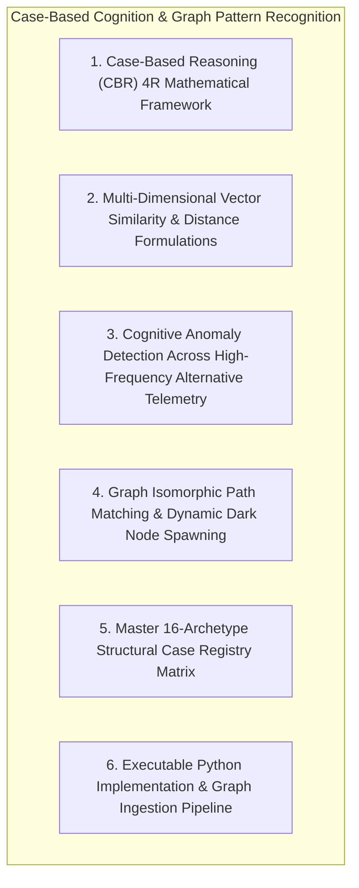
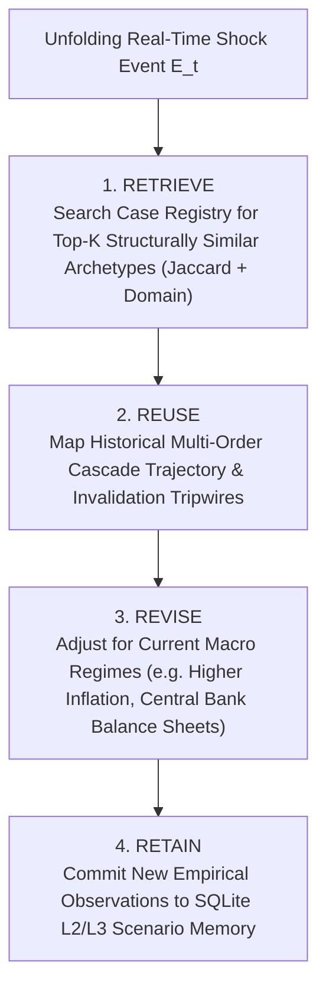
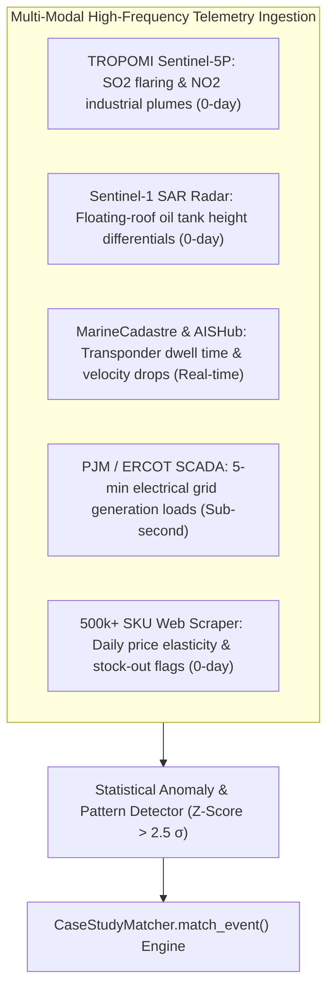
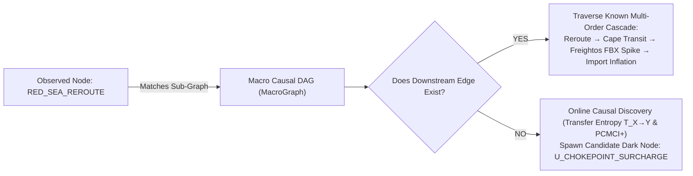

# Module 05: Case Study Matching, Graph Cognition & Analogical Pattern Recognition

## Executive Overview

This module formalizes the **Case-Based Reasoning (CBR) Matching Engine**, the **Causal Graph Isomorphic Path Traversal**, and the **High-Frequency Cognitive Pattern Recognition Architecture**.

When an unprecedented or volatile macroeconomic disruption occurs, the autonomous system does not rely solely on unconditioned statistical regressions. Instead, it deploys **Analogical Case-Based Cognition** to retrieve historical structural twins, compute multi-dimensional similarity distances, trace multi-order cascade paths through the causal knowledge graph, and project empirical trajectories conditioned on physical and institutional constraints.



---

## 1. Case-Based Reasoning (CBR) 4R Mathematical Framework

Case-Based Reasoning operates through a continuous cognitive learning loop:



---

## 2. Multi-Dimensional Vector Similarity & Distance Formulations

To measure how closely an unfolding event $\mathcal{E}$ resembles historical case study $\mathcal{C}_k$, the engine computes a composite similarity index:

\[
\mathcal{S}(\mathcal{E}, \mathcal{C}_k) = w_{\text{ent}} \cdot J(\mathbf{V}_{\mathcal{E}}^{\text{ent}}, \mathbf{V}_{\mathcal{C}_k}^{\text{ent}}) + w_{\text{choke}} \cdot J(\mathbf{V}_{\mathcal{E}}^{\text{choke}}, \mathbf{V}_{\mathcal{C}_k}^{\text{choke}}) + w_{\text{spread}} \cdot J(\mathbf{V}_{\mathcal{E}}^{\text{spread}}, \mathbf{V}_{\mathcal{C}_k}^{\text{spread}}) + w_{\text{dom}} \cdot \mathbb{I}(\text{Domain}_{\mathcal{E}} = \text{Domain}_{\mathcal{C}_k})
\]

Where:
- $J(A, B) = \frac{|A \cap B|}{|A \cup B|}$ is the **Jaccard Similarity Coefficient**.
- Default calibrated weights: $w_{\text{ent}} = 0.35$, $w_{\text{choke}} = 0.25$, $w_{\text{spread}} = 0.15$, $w_{\text{dom}} = 0.25$.
- $\mathcal{S}(\mathcal{E}, \mathcal{C}_k) \in [0.0, 1.0]$. A score $\mathcal{S} > 0.60$ indicates a strong structural analogue.

---

## 3. Cognitive Anomaly Detection on Alternative Telemetry



---

## 4. Graph Isomorphic Path Matching & Dark Node Detection



---

## 5. Master 16-Archetype Structural Case Registry Matrix

| Case ID | Archetype Name | Primary Domain | Core Chokepoints Affected | Primary Entities & Transmission Channels | $\tau_{\text{substitution}}$ |
| :--- | :--- | :--- | :--- | :--- | :--- |
| `case_a_hormuz_blockade` | Strait of Hormuz Energy/Fertilizer Shock | `MARITIME_CHOKEPOINT` | Hormuz, Persian Gulf | `WTI_OIL`, `INFLATION`, `CROP_HEALTH` $\to$ Ammonia $\$480\to\$700$, Soy shift | `SEASON` |
| `case_b_red_sea_reroute` | Red Sea / Bab el-Mandeb Reroute | `MARITIME_CHOKEPOINT` | Bab el-Mandeb, Suez | `SHIPPING_FLOW`, `FREIGHT_VOLUME` $\to$ FBX $+275\%$, $+14\text{d}$ transit | `DAYS` |
| `case_c_ukraine_neon_semis` | Ukrainian Neon Gas Lithography Shock | `TECH_HARDWARE` | Black Sea, Mariupol | `CORPORATE_HEALTH`, `GROWTH` $\to$ Laser neon $+600\%$, Auto MCU 52w lead | `YEARS` |
| `case_d_fukushima_thailand_hdd`| Fukushima + Bangkok Floods JIT Collapse | `TECH_HARDWARE` | Bangkok, Tohoku | `CORPORATE_HEALTH`, `EQUITIES` $\to$ 50% global HDD offline, Cloud shift | `YEARS` |
| `case_e_texas_storm_uri_pvc` | Texas Winter Storm Uri Petrochem Freeze| `ENERGY_PETROCHEM` | ERCOT, US Gulf Coast | `GRID_LOAD`, `HOUSING_ACTIVITY` $\to$ 60% US PVC offline, Lumber spike | `SEASON` |
| `case_f_ever_given_suez` | Ever Given Suez Canal Grounding | `MARITIME_CHOKEPOINT` | Suez Canal | `SHIPPING_FLOW` $\to$ $\$9.6\text{B}/\text{day}$ blocked, Rotterdam arrival tsunami | `DAYS` |
| `case_g_colonial_pipeline_cyber`| Colonial Pipeline Ransomware Shutdown | `CYBER_PHYSICAL` | Colonial Pipeline System| `OIL_STORAGE`, `CONSUMER_SPENDING` $\to$ 45% East Coast fuel offline | `DAYS` |
| `case_h_kakhovka_dam_agri` | Kakhovka Dam Agricultural Wipeout | `WATER_ENVIRONMENT` | Dnipro Basin, Black Sea | `CROP_HEALTH`, `INFLATION` $\to$ 500k ha irrigation lost, Wheat contango | `SEASON` |
| `case_i_indonesia_nickel_hpal` | Indonesian Nickel Ban & HPAL Cascade | `CRITICAL_MINERALS` | Sulawesi, LME Warehouses| `GROWTH`, `FUTURES_LIQUIDITY` $\to$ NPI matte flood, LME short squeeze | `YEARS` |
| `case_j_yangtze_drought_power` | Yangtze Drought & Sichuan Power Cuts | `WATER_ENVIRONMENT` | Yangtze, Sichuan Grid | `GRID_LOAD`, `GROWTH` $\to$ Hydro cut 50%, Polysilicon shutdown, EUA surge| `SEASON` |
| `case_k_russia_sanctions_2022` | Russia 2022 Reserve Freeze & Dark Fleet | `SANCTIONS_FINANCE` | SWIFT, Euroclear, Baltic| `LIQUIDITY_STRESS`, `WTI_OIL` $\to$ $\$300\text{B}$ freeze, 600-tanker dark fleet | `YEARS` |
| `case_l_svb_banking_stress_2023`| March 2023 US Regional Bank Deposit Run| `SOVEREIGN_LIQUIDITY` | Fed Discount, BTFP | `LIQUIDITY_STRESS`, `CREDIT_SPREAD` $\to$ $\$42\text{B}$ outflow, BTFP creation | `DAYS` |
| `brexit_2016` | Brexit Referendum FX Volatility Shock | `GEOPOLITICAL_EVENT` | Dover, UK Ports | `GBP`, `GOLD`, `VIX`, `EQUITIES` $\to$ Historic GBP gap, safe-haven surge | `MONTHS` |
| `trump_election_2016` | US 2016 Election Reflation Trade | `MACRO_REGIME` | US Treasury Market | `DXY`, `NOMINAL_BOND_YIELD`, `EM_FX` $\to$ Yield surge, financial rally | `MONTHS` |
| `trade_war_2018` | US-China Trade War Escalation | `GEOECONOMIC_TRADE` | US/China Tariff Ports | `EM_FX`, `EQUITIES`, `DXY` $\to$ Tariff headlines, supply chain shifts | `YEARS` |
| `covid_crash_2020` | COVID-19 Global Liquidity Crash | `SYSTEMIC_SHOCK` | Global Transport Hubs | `VIX`, `GOLD`, `DXY`, `WTI_OIL` $\to$ Dash for cash, WTI -$37/bbl expiry | `DAYS` |

---

## 6. Executable Python Implementation & Usage

```python
from intelligence.case_study_matcher import CaseStudyMatcher, get_case_study_matcher

# Instantiate the matcher
matcher = get_case_study_matcher()

# Match an unfolding maritime crisis (e.g. Red Sea / Bab el-Mandeb)
matches = matcher.match_event(
    event_domain="MARITIME_CHOKEPOINT",
    affected_entities=["SHIPPING_FLOW", "FREIGHT_VOLUME", "INFLATION"],
    affected_chokepoints=["BAB_EL_MANDEB", "RED_SEA"],
    observed_spreads=["FREIGHTOS_FBX_CONTAINER"],
    top_k=3
)

for m in matches:
    print(f"Matched Case: {m.label} (Similarity: {m.similarity_score * 100:.1f}%)")
    print(f"  • Substitution Horizon: {m.tau_horizon}")
    print(f"  • Historical Outcomes: {m.projected_trajectory}")
    print(f"  • Invalidation Tripwires: {m.falsification_tripwires}")
```
