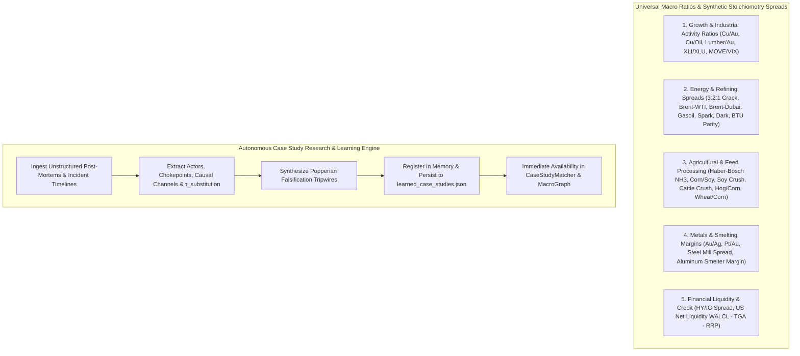
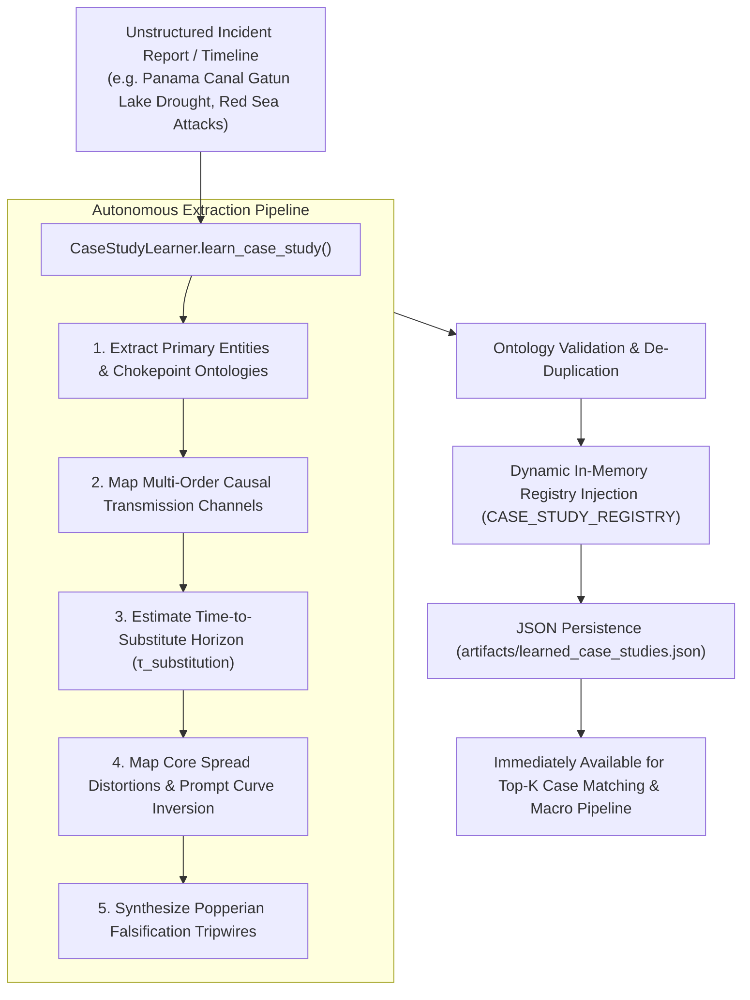

# Module 06: Universal Global Macro Ratios, Synthetic Physical Spreads & Autonomous Case Learning

## Executive Overview

This module provides the **Universal Master Compendium of Global Macro Ratios, Synthetic Physical Spreads, and Intermarket Barometers**, expanding far beyond individual commodities (like copper, corn, and soy) to capture the total multi-sector physical and financial dynamics of the global macro economy.

It also establishes the **Autonomous Case Study Research & Learning Architecture** (`intelligence/case_study_learner.py`), enabling the system to continuously discover, parse, validate, and assimilate new real-world shocks, geopolitical actors, and physical bottlenecks into the live knowledge base.



---

## 1. Master Compendium of Global Macro Ratios & Intermarket Barometers

### A. Macro Growth, Industrial Activity & Risk Appetite Barometers

| Ratio / Index | Mathematical Formulation | Economic & Market Intuition | Typical Regime Ranges |
| :--- | :--- | :--- | :--- |
| **Copper / Gold Ratio** | $\frac{P_{\text{Copper (lb)}}}{P_{\text{Gold (oz)}}} \times 1000$ | **Canonical Global Growth & Nominal Yield Barometer**. Copper reflects physical manufacturing demand; Gold reflects monetary debasement and real yield suppression. Leads US 10-Year Treasury Yields by 30–60 days. | $> 2.20$: Reflation / Boom<br>$1.60 - 2.20$: Trend Growth<br>$< 1.60$: Global Slowdown / Recession |
| **Copper / Crude Oil Ratio** | $\frac{P_{\text{Copper}}}{P_{\text{WTI\_Crude}} / 100}$ | **Industrial Demand vs Supply-Side Energy Friction**. A rising ratio signals demand-led expansion; a falling ratio signals stagflationary supply-push inflation squeezing manufacturing margins. | $> 6.0$: Demand Expansion<br>$4.5 - 6.0$: Equilibrium<br>$< 4.5$: Margin Squeeze |
| **Lumber / Gold Ratio** | $\frac{P_{\text{Lumber (1000 bd ft)}}}{P_{\text{Gold (oz)}}}$ | **Leading Residential Housing & Cyclical Risk-On Barometer**. Lumber is hyper-sensitive to mortgage rates and homebuilding; Gold is defensive. Historically leads broad equity pullbacks by 6–10 weeks. | $> 0.35$: Housing Boom<br>$0.20 - 0.35$: Normal<br>$< 0.20$: Housing Contraction |
| **Cyclicals / Defensives Ratio** | $\frac{P_{\text{XLI (Industrials)}}}{P_{\text{XLU (Utilities)}}}$ | **Internal Equity Market Risk Appetite**. High ratio indicates capital allocation to capex and industrial manufacturing over dividend safety. | $> 1.80$: Cyclical Risk-On<br>$1.40 - 1.80$: Neutral<br>$< 1.40$: Defensive Flight |
| **MOVE / VIX Ratio** | $\frac{\text{MOVE Index}}{\text{VIX Index}}$ | **Bond Market Volatility vs Equity Volatility**. Bond markets price macroeconomic regime shifts and liquidity stress first. An elevated MOVE/VIX ratio signals an impending equity market shock. | $> 7.5$: Bond Stress Divergence<br>$5.0 - 7.5$: Normal Pricing<br>$< 5.0$: Complacent Rates |

---

### B. Energy, Refining & Power Generation Stoichiometry Spreads

| Spread / Metric | Mathematical Formulation | Physical & Economic Reality | Key Thresholds |
| :--- | :--- | :--- | :--- |
| **3:2:1 Refinery Crack Spread** | $\frac{2(42 \cdot P_{\text{Gasoline}}) + 1(42 \cdot P_{\text{HeatingOil}}) - 3(P_{\text{Crude}})}{3}$ | **Refinery Profitability Floor**. Cost of converting 3 barrels of crude into 2 barrels of gasoline and 1 barrel of distillate. | $> \$30/\text{bbl}$: Extreme Refinery Tightness<br>$\$18 - \$30/\text{bbl}$: Healthy Margin<br>$< \$12/\text{bbl}$: Economic Run Cuts |
| **Brent-WTI Transatlantic Spread** | $P_{\text{Brent}} - P_{\text{WTI}}$ | **US Crude Export Arbitrage**. Wider spread incentivizes US Gulf Coast exports to Europe/Asia via VLCC tankers. | $> \$6.00/\text{bbl}$: Heavy US Export Pull<br>$\$3 - \$6/\text{bbl}$: Normal Arbitrage<br>$< \$2.00/\text{bbl}$: Export Disincentive |
| **Brent-Dubai Exchange of Futures for Swaps (EFS)** | $P_{\text{Brent}} - P_{\text{Dubai}}$ | **Sweet vs Sour Arbitrage & Asian Demand Premium**. High EFS makes light sweet Atlantic Basin crude expensive for Asian refiners, shifting demand to Middle East sour grades. | $> \$3.50/\text{bbl}$: Sweet Crude Premium<br>$\$1.50 - \$3.50/\text{bbl}$: Parity Range |
| **Gasoil Crack Spread** | $P_{\text{LowSulfurGasoil (bbl)}} - P_{\text{Brent (bbl)}}$ | **Global Industrial Transport & Diesel Margin**. Pure measure of trucking, maritime freight, and heavy machinery activity. | $> \$30/\text{bbl}$: Industrial Supply Crunch<br>$\$15 - \$30/\text{bbl}$: Equilibrium |
| **BTU Energy Parity Ratio** | $\frac{P_{\text{WTI Crude}}}{6.0 \cdot P_{\text{HenryHub NatGas}}}$ | **Thermal Fuel Switching Incentive**. 1 barrel crude contains ~5.8 MMBtu. High ratio (>5.0) incentivizes industrial power plants and chemical crackers to switch from oil products to natural gas. | $> 5.0$: Severe Oil Disadvantage (Switch to Gas)<br>$3.0 - 5.0$: Normal Parity<br>$< 3.0$: Gas Disadvantage |
| **Clean Spark Spread** | $P_{\text{Power}} - (7.0 \cdot P_{\text{NatGas}}) - \text{CarbonCost}$ | **Gas-Fired Power Plant Operating Margin**. Evaluates the profitability of generating electricity from natural gas after accounting for heat rate and emissions allowances. | $> \$25/\text{MWh}$: Gas Generation Favored<br>$< \$5/\text{MWh}$: Gas Plants Offline |
| **Clean Dark Spread** | $P_{\text{Power}} - (0.38 \cdot P_{\text{Coal}}) - (0.85 \cdot \text{CarbonCost})$ | **Coal-Fired Power Plant Operating Margin**. Profitability of burning thermal coal for baseload power generation. | Negative indicates coal phase-out acceleration. |

---

### C. Agricultural, Feedlot & Fertilizer Conversion Spreads

| Spread / Metric | Mathematical Formulation | Biological & Physical Reality | Regime Action |
| :--- | :--- | :--- | :--- |
| **Haber-Bosch Ammonia Cash-Cost** | $33.5 \cdot P_{\text{NatGas}} + \$65.00/\text{ton}$ | **Synthetic Nitrogen Fertilizer Floor**. Stoichiometry requires ~33.5 MMBtu natural gas to synthesize 1 ton anhydrous ammonia ($NH_3$). Natural gas price directly sets nitrogen fertilizer cost. | NatGas spike $\to$ Ammonia spike $\to$ Corn planting input cost surge $\to$ Acres shift to Soy. |
| **Corn / Soybean Price Ratio** | $\frac{P_{\text{Soybeans}}}{P_{\text{Corn}}}$ | **Midwestern Acreage Allocation**. Soybeans require ~0 nitrogen fertilizer (symbiotic *Rhizobium* bacteria fix atmospheric $N_2$), whereas corn requires ~150–200 lbs N/acre. | $\text{Ratio} > 2.50 \implies \text{SOY\_FAVORED}$<br>$2.20 \le \text{Ratio} \le 2.50 \implies \text{EQUILIBRIUM}$<br>$\text{Ratio} < 2.20 \implies \text{CORN\_FAVORED}$ |
| **Soybean Crush Spread** | $\left( \frac{P_{\text{Meal}}}{2000} \cdot 44 \right) + (P_{\text{Oil}} \cdot 11) - P_{\text{Soybean}}$ | **Crush Processing Margin**. 1 bushel (60 lbs) soybeans yields 44 lbs high-protein soybean meal (animal feed) and 11 lbs soybean oil (biofuel/food). | $> \$2.00/\text{bu}$: High Processing Incentive<br>$< \$0.80/\text{bu}$: Smelter / Processor Cutbacks |
| **Cattle Crush / Feedlot Margin** | $P_{\text{LiveCattle}} - (0.65 \cdot P_{\text{FeederCattle}}) - (6.5 \cdot P_{\text{Corn}})$ | **Feedlot Conversion Economics**. Margin of fattening a 750 lb feeder steer to a 1,350 lb finished slaughter animal on a corn-based diet. | Negative margin $\to$ Feedlots delay placements, slaughter cows early, shrinking long-term herd. |
| **Hog / Corn Ratio** | $\frac{P_{\text{LiveHogs (cwt)}}}{P_{\text{Corn (bu)}}}$ | **Breeding Herd Expansion vs Liquidation**. Number of bushels of corn equal in value to 100 lbs of live hog. | $> 20.0$: Herd Expansion<br>$14.0 - 20.0$: Neutral<br>$< 14.0$: Breeding Herd Liquidation |
| **Wheat / Corn Spread** | $P_{\text{Wheat (bu)}} - P_{\text{Corn (bu)}}$ | **Feed Grain Substitution Floor**. When wheat trades at a small premium (<$0.50) to corn, livestock producers substitute feed wheat for corn. | Spread $< \$0.60/\text{bu}$ triggers massive feed substitution. |

---

### D. Metals, Materials & Industrial Smelting Margins

| Ratio / Spread | Mathematical Formulation | Metallurgical & Physical Reality | Structural Signal |
| :--- | :--- | :--- | :--- |
| **Gold / Silver Ratio** | $\frac{P_{\text{Gold}}}{P_{\text{Silver}}}$ | **Monetary vs Industrial Demand Ratio**. Silver has >50% industrial demand (photovoltaic solar cells, electronics). High ratio signals industrial contraction and defensive hoarding. | $> 85$: Recessionary / Deflationary<br>$65 - 85$: Normal<br>$< 65$: Global Industrial Manufacturing Boom |
| **Platinum / Gold Ratio** | $\frac{P_{\text{Platinum}}}{P_{\text{Gold}}}$ | **Autocatalyst & Industrial Demand vs Safe Haven**. Platinum is used heavily in catalytic converters and hydrogen fuel cells. | Rising ratio indicates automotive and industrial growth outperforming monetary fears. |
| **Steel Mill Spread (HRC Margin)** | $P_{\text{HRC Steel}} - (1.6 \cdot P_{\text{IronOre}}) - (0.77 \cdot P_{\text{CokingCoal}})$ | **Blast Furnace Operating Margin**. Producing 1 ton hot-rolled coil steel requires ~1.6 tons iron ore and ~0.77 tons metallurgical coking coal. | Negative spread $\to$ Steel mills declare maintenance outages, cutting raw material imports. |
| **Aluminum Smelter Margin** | $P_{\text{Aluminum}} - (2.0 \cdot P_{\text{Alumina}}) - (14.0 \text{ MWh} \cdot P_{\text{Power}})$ | **Hall-Héroult Electrolytic Smelter Margin**. Converting alumina to aluminum requires ~14 MWh of electricity per ton. | High power prices in Europe/China force immediate smelter curtailments. |

---

### E. Financial Plumbing, Liquidity & Credit Stress

| Metric | Mathematical Formulation | Plumbing & Systemic Reality | Impact |
| :--- | :--- | :--- | :--- |
| **High Yield / Investment Grade OAS Ratio** | $\frac{\text{US High Yield OAS (bps)}}{\text{US Investment Grade OAS (bps)}}$ | **Default Risk Acceleration Ratio**. Measures whether credit markets are penalizing vulnerable junk issuers relative to blue-chip borrowers. | $> 3.5$: High Distress / Credit Contagion<br>$< 2.8$: Benign Credit Environment |
| **US Net Liquidity** | $\text{WALCL} - \text{TGA} - \text{ON\_RRP}$ | **True Domestic Financial Dollar Liquidity**. Fed Total Assets minus Treasury Cash at Fed minus Reverse Repo absorbs cash from the banking system. | Direct 0.90 correlation to S&P 500 and crypto liquidity cycles. |

---

## 2. Autonomous Case Study Research & Learning Architecture

The system features an autonomous engine (`intelligence/case_study_learner.py`) to continuously expand the knowledge base as new global events unfold.



---

## 3. Live CLI Operations

### A. View Universal Macro Ratios & Spreads
```bash
python mt5_trader.py macro ratios
```

### B. Ingest and Learn a New Case Study from JSON
```bash
python mt5_trader.py macro learn-case --file path/to/case_study.json
```

### C. Match Live Market Conditions Against All (Built-In + Learned) Case Studies
```bash
python mt5_trader.py macro case-match --domain MARITIME_CHOKEPOINT
```
