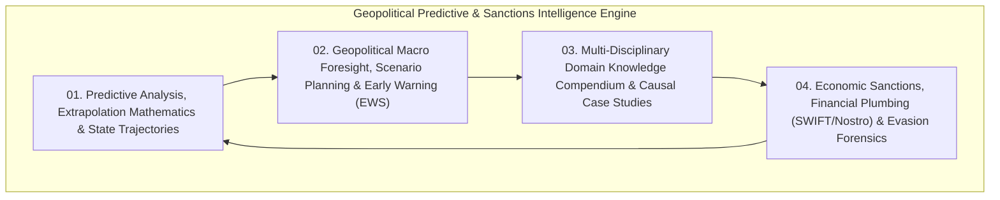
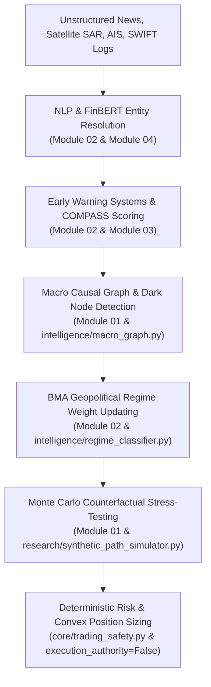

# Geopolitical Predictive Analysis, Strategic Foresight & Sanctions Intelligence: Master Compendium

## Overview of the Sub-System

This directory encapsulates the dedicated theoretical and operational knowledge base for **Predicting Future Macroeconomic States from Present Conditions, Geopolitical Foresight, Multi-Disciplinary Domain Dynamics, and Sanctions/Financial Plumbing Forensics**.

Located in: [`docs/analytical_frameworks_and_epistemology/bma_causal_autonomous_system/geopolitical_predictive_and_sanctions_intelligence/`](file:///c:/Users/User/OneDrive/Desktop/selfmade%20game%20projects/llm%20trader%20-%20Checkpoint%20dicisipline%20soilder%20-%20used%20in%20antigravity/docs/analytical_frameworks_and_epistemology/bma_causal_autonomous_system/geopolitical_predictive_and_sanctions_intelligence)

---

## Module Index

### 1. [Module 01: Predictive Analysis, Extrapolation Mathematics & State Trajectory Forecasting](file:///c:/Users/User/OneDrive/Desktop/selfmade%20game%20projects/llm%20trader%20-%20Checkpoint%20dicisipline%20soilder%20-%20used%20in%20antigravity/docs/analytical_frameworks_and_epistemology/bma_causal_autonomous_system/geopolitical_predictive_and_sanctions_intelligence/01_PREDICTIVE_ANALYSIS_AND_EXTRAPOLATION_MATHEMATICS.md)
- **Core Topics**: Extrapolation vs. Interpolation, State-Space Vector Trajectories ($\mathbf{x}_{t+1} = \mathbf{F}\mathbf{x}_t + \mathbf{B}\mathbf{u}_t + \mathbf{w}_t$), Time-Series Martingale Random Walk limits, Chaos Theory & Maximal Lyapunov Exponents ($|\delta \mathbf{x}(t)| \approx |\delta \mathbf{x}_0|e^{\lambda t}$), Predictability Horizons ($t_{\text{predictable}}$), and the 5-Tier Prediction vs. Preparation Hierarchy (The Parachute Principle).

### 2. [Module 02: Geopolitical Macro Foresight, Scenario Planning & Early Warning Systems](file:///c:/Users/User/OneDrive/Desktop/selfmade%20game%20projects/llm%20trader%20-%20Checkpoint%20dicisipline%20soilder%20-%20used%20in%20antigravity/docs/analytical_frameworks_and_epistemology/bma_causal_autonomous_system/geopolitical_predictive_and_sanctions_intelligence/02_GEOPOLITICAL_MACRO_FORESIGHT_AND_SCENARIO_PLANNING.md)
- **Core Topics**: The 5-Phase Strategic Foresight Pipeline, 2×2 Dynamic Scenario Matrices (US-China Tech Competition), Early Warning Systems across SIPRI's 8 Domains, Yield Curve Inversion Causal Transmission, The COMPASS Framework (7 Strategic Bearings), Caldara-Iacoviello GPR Index quantification, BMA across Geopolitical Regimes ($A_1-A_5$), and full executable Python implementation.

### 3. [Module 03: Multi-Disciplinary Domain Knowledge Compendium & Causal Case Studies](file:///c:/Users/User/OneDrive/Desktop/selfmade%20game%20projects/llm%20trader%20-%20Checkpoint%20dicisipline%20soilder%20-%20used%20in%20antigravity/docs/analytical_frameworks_and_epistemology/bma_causal_autonomous_system/geopolitical_predictive_and_sanctions_intelligence/03_MULTI_DISCIPLINARY_DOMAIN_KNOWLEDGE_COMPENDIUM.md)
- **Core Topics**: The 12 Foundational Knowledge Pillars (History, Political Systems, IR Theory, Military/Security C4ISR & A2/AD, Economics, Geography & Geostrategy, Energy/Commodities, Tech/Semiconductors, Financial Plumbing, International Law, Culture/Identity, Demographics), Deep Causal Case Studies (Thucydides Trap, Resource Curse & Dutch Disease, Russian Warm-Water Port Constraints, China North Plain Water Crisis, Ukraine 2022 Pre-Invasion Multi-Domain Synthesis), Extended Domain Knowledge Breakdown (12 categories with predictive applications), How Domain Knowledge Drives Prediction (historical patterns, military/security → macro, geography/resources → political prediction), Competency Tiers (Essential → Master), T-Shaped Analyst framework, Learning Protocol, and Master Analyst Causal Chain integration.

### 4. [Module 04: Economic Sanctions, Financial Plumbing & Evasion Forensics](file:///c:/Users/User/OneDrive/Desktop/selfmade%20game%20projects/llm%20trader%20-%20Checkpoint%20dicisipline%20soilder%20-%20used%20in%20antigravity/docs/analytical_frameworks_and_epistemology/bma_causal_autonomous_system/geopolitical_predictive_and_sanctions_intelligence/04_ECONOMIC_SANCTIONS_FINANCIAL_PLUMBING_AND_EVASION_FORENSICS.md)
- **Core Topics**: Statutory Authorities (IEEPA, TWEA), Institutional Ecosystem (NSC, State SPI, Treasury OFAC, Commerce BIS, Justice NSD), OFAC 5-Component Compliance Program (SCP), The 50% Rule for Beneficial Ownership (Direct, Indirect, Aggregate), SWIFT Message Plumbing (MT103, MT202 COV, MT700, ISO 20022), Correspondent Banking Nostro/Vostro mechanics, Sovereign Reserve Freezes ($300B Russian assets), Export Controls (EAR vs. ITAR, CCL/ECCN, Deemed Exports, New BIS 50% Rule, FDP Rules), G7 Oil Price Cap Attestation Chain, Semiconductor Evasion Networks (Tiers 1–6), "Is Informed" letters, Comprehensive Russia (2022–2026) Retrospective, Anticipatory China/Taiwan Contingency, and BMA Sanctions Effectiveness Model.

### 5. [Module 05: Case Study Matching, Graph Cognition & Analogical Pattern Recognition](file:///c:/Users/User/OneDrive/Desktop/selfmade%20game%20projects/llm%20trader%20-%20Checkpoint%20dicisipline%20soilder%20-%20used%20in%20antigravity/docs/analytical_frameworks_and_epistemology/bma_causal_autonomous_system/geopolitical_predictive_and_sanctions_intelligence/05_CASE_STUDY_MATCHING_GRAPH_COGNITION_AND_PATTERN_RECOGNITION.md)
- **Core Topics**: Case-Based Reasoning (CBR) 4R Mathematical Framework (Retrieve, Reuse, Revise, Retain), Multi-Dimensional Jaccard & Domain Vector Similarity Formulations, Cognitive Anomaly Detection across High-Frequency Telemetry (TROPOMI, SAR, AIS, SCADA, PriceStats), Graph Isomorphic Path Traversal & Dynamic Dark Node Spawning, and the Master 16-Archetype Structural Case Registry Matrix (Hormuz, Red Sea, Ukraine Neon, Fukushima, Texas Uri, Ever Given, Colonial Pipeline, Kakhovka Dam, Indonesian Nickel, Yangtze Drought, Russian Sanctions, SVB Banking, Brexit, Trade War, Repo Stress, Covid Crash).

### 6. [Module 06: Universal Global Macro Ratios, Synthetic Physical Spreads & Autonomous Case Learning](file:///c:/Users/User/OneDrive/Desktop/selfmade%20game%20projects/llm%20trader%20-%20Checkpoint%20dicisipline%20soilder%20-%20used%20in%20antigravity/docs/analytical_frameworks_and_epistemology/bma_causal_autonomous_system/geopolitical_predictive_and_sanctions_intelligence/06_GLOBAL_MACRO_RATIOS_SYNTHETIC_SPREADS_AND_AUTONOMOUS_LEARNING.md)
- **Core Topics**: The Universal 23-Barometer Macro Suite (Copper/Gold, Copper/Oil, Lumber/Gold, XLI/XLU, MOVE/VIX, 3:2:1 Crack, Brent-WTI, Brent-Dubai EFS, Gasoil Crack, BTU Parity, Spark Spread, Clean Dark Spread, Haber-Bosch Ammonia Cost, Corn/Soy Ratio, Soy Crush, Cattle Feedlot Crush Margin, Hog/Corn Ratio, Wheat/Corn Spread, Gold/Silver Ratio, Platinum/Gold Ratio, Steel Mill Spread, Aluminum Smelter Margin, HY/IG OAS Spread, US Net Liquidity), and the Autonomous Case Study Research & Learning Architecture (`intelligence/case_study_learner.py`).

---

## Integration with the BMA Causal Autonomous Architecture

