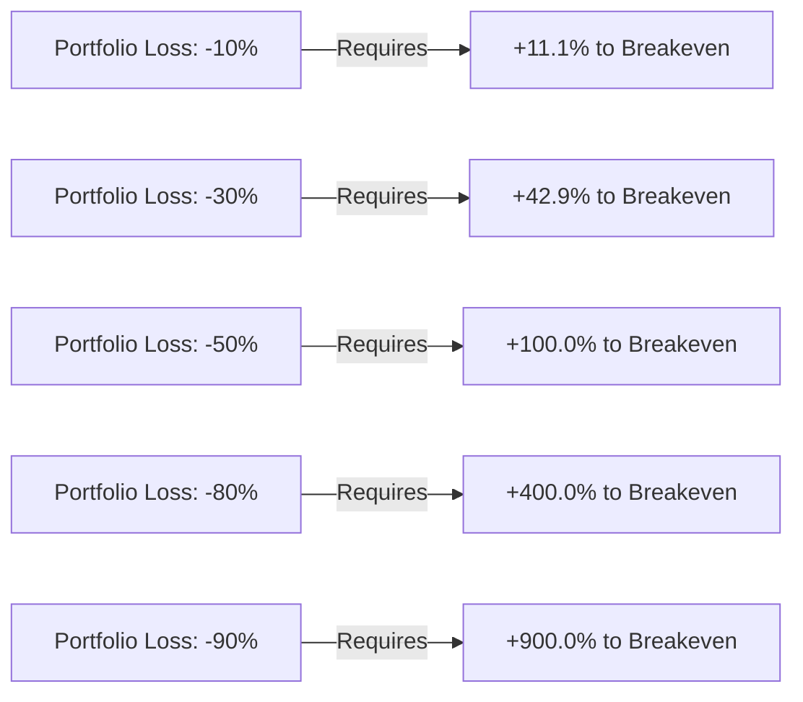
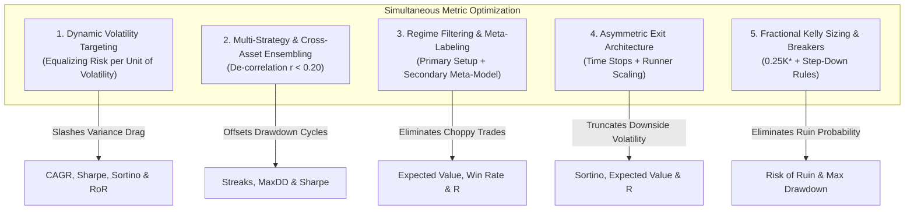
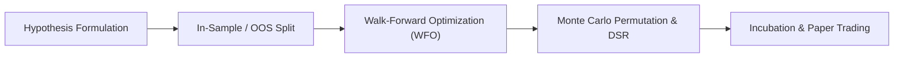

# Module 01: Mathematical Pillars, Metrics Optimization & Hierarchical Meta-Portfolio Model

## Overview & Foundational Principles

Improving trading performance requires treating mathematical metrics as an **interconnected, dynamic system** rather than isolated numbers. In quantitative trading, single metrics can easily be distorted by curve-fitting or hidden tail risks. True profitability and longevity stem from aligning execution mechanics, risk budgets, regime awareness, and probability theory into a unified operational framework.

---

## 1. The 6 Core Trading Metrics Optimization Playbook

Below is the actionable playbook for optimizing each core metric alongside the governing structural and execution factors.

### 1. Expected Value ($\text{EV}$) — The Mathematical Edge

Expected Value is the statistical foundation of trading. It calculates the expected net return per trade over a large statistical sample.

$$\text{EV} = (P_{\text{win}} \times W) - (P_{\text{loss}} \times L)$$

Where:
* $P_{\text{win}}$: Probability of a winning trade (Win Rate)
* $W$: Average profit on a winning trade (in dollars or R-units)
* $P_{\text{loss}}$: Probability of a losing trade ($1 - P_{\text{win}}$)
* $L$: Average loss on a losing trade (in dollars or R-units)

#### Core Factors That Affect It:
* **Execution Friction**: Spreads, commissions, swap/funding fees, and slippage directly degrade expectancy on every transaction.
* **Market Regime Match**: Trend-following strategies yield negative $\text{EV}$ in sideways ranges; mean-reversion strategies suffer in breakout environments.
* **Entry Precision**: Entering too late widens your required stop-loss, artificially suppressing the average R-payoff.

#### Actionable Steps to Improve:
* **Implement Regime Filters**: Add a volatility or directional filter (e.g., $\text{ADX} > 25$ for trend setups, ATR percentiles for breakouts) to filter out low-probability environments.
* **Tighten Invalidation Points**: Place stop-losses at the exact price point where the trade idea is disproven, rather than arbitrary fixed percentages. A tighter stop size increases your payoff multiple ($R_{\text{win}}$) on winners.
* **Minimize Order Slippage**: Shift from market orders to passive limit orders with execution algorithms (TWAP/VWAP) to capture liquidity rebates and avoid crossing the spread.
* **The Discard Rule**: If net strategy expectancy after transaction friction is $\text{EV} \le 0$, immediately cease live execution. No amount of psychological discipline or trade management can fix a negative-expectancy system.

---

### 2. Risk of Ruin ($\text{RoR}$) — Downside Survival & Asymmetry

Risk of Ruin calculates the exact mathematical probability that an account will suffer total liquidation before reaching its profit target. Survival is the ultimate priority in trading because running out of capital eliminates your ability to participate in future positive $\text{EV}$ opportunities.

$$\text{RoR} \approx \left(\frac{1 - \text{Edge}}{1 + \text{Edge}}\right)^{\text{Capital Units}}$$

Where:
* $\text{Edge}$: System expectancy normalized per trade unit: $\text{Edge} = \frac{\text{EV}}{L}$
* $\text{Capital Units}$: Total account balance divided by risk per trade ($\text{Units} = \frac{1}{\text{Risk \%}}$)

#### The Asymmetric Recovery Curve of Capital Losses:
* A **$50\%$ portfolio loss** requires a **$+100\%$ return** to reach breakeven.
* An **$80\%$ portfolio loss** requires a **$+400\%$ return** to reach breakeven.
* A **$90\%$ portfolio loss** requires a **$+900\%$ return** to reach breakeven.



#### Core Factors That Affect It:
* **Position Size (% Risk per Trade)**: The single largest determinant. Doubling risk per trade increases ruin probability exponentially, not linearly.
* **Portfolio Correlation (Heat)**: Holding 5 simultaneous long trades in correlated assets (e.g., Tech stocks or Crypto) effectively turns a 1% risk model into a 5% single-asset risk.
* **Volatility of Returns**: Large distribution tails (fat-tailed losses) rapidly deplete account buffer.

#### Actionable Steps to Improve:
* **Apply Fractional Kelly Sizing**: Calculate the theoretical optimal Kelly Criterion ($K^*$) and risk only $\frac{1}{4}K^*$ or $\frac{1}{2}K^*$ to protect against estimation error:
  $$K^* = \frac{P_{\text{win}} \times R - (1 - P_{\text{win}})}{R}, \quad \text{Applied Risk \%} = 0.25 \times K^*$$
* **Hard Capital Allocation Caps**: Cap total portfolio risk exposure to a maximum of 3%–5% across all open, uncorrelated positions combined.
* **De-correlate Trades**: Limit concurrent positions to instruments with a rolling correlation coefficient of $r < 0.30$.
* **Step-Down Circuit Breakers**:
  * Down $-3.0R$ on the day: Halt trading for the remainder of the session (24 hours).
  * Down $-6.0R$ on the week: Cut standard position size by 50% until $+2.0R$ is recovered.
  * Down $-15\%$ Peak-to-Trough: Liquidate all active positions to cash and initiate a comprehensive performance audit.

---

### 3. Sharpe & Sortino Ratios — Risk-Adjusted Return

The Sharpe Ratio is the benchmark for measuring risk-adjusted returns: *"How much excess return are you generating for each unit of volatility endured?"* You cannot achieve excess market return without accepting portfolio volatility ("no gain without pain").

The Sortino Ratio replaces total variance with downside deviation ($\sigma_d$), penalizing only volatility below a target return.

$$\text{Sharpe} = \frac{R_p - R_f}{\sigma_p}, \qquad \text{Sortino} = \frac{R_p - R_f}{\sigma_{\text{downside}}}$$

Where:
* $R_p$: Average annualized portfolio return
* $R_f$: Risk-free rate (e.g., 3-month US Treasury yield)
* $\sigma_p$: Standard deviation of portfolio returns
* $\sigma_{\text{downside}}$: Standard deviation of negative returns only ($\sigma_d = \sqrt{\frac{1}{N}\sum \min(0, R_i - R_f)^2}$)

#### Core Factors That Affect It:
* **Portfolio Volatility Drag**: Large swings in equity curves drive up total standard deviation ($\sigma$).
* **Trading Frequency**: Higher frequency with a verified edge compresses standard error ($\sigma / \sqrt{N}$), expanding the annualized Sharpe ratio.
* **Tail-Risk Exposure**: Weekend/overnight gaps create asymmetric downside variance.

#### Actionable Steps to Improve:
* **Multi-Strategy Ensembles**: Combine non-correlated systems (e.g., combine a 60% win-rate intraday mean-reversion strategy with a 35% win-rate multi-day trend-following system) to smooth return distributions.
* **Dynamic Volatility Scaling**: Scale position sizes inversely to market volatility (e.g., using 20-period ATR) so that higher market volatility does not inflate portfolio return variance.
* **Target Asymmetric Exits for Sortino**: Implement trailing stops on runners while keeping tight initial stops; this preserves upside variance while suppressing downside variance ($\sigma_{\text{downside}}$).
* **Benchmark Performance**:
  * $< 1.0$: Sub-optimal strategy; taking excessive risk for mediocre gains.
  * $1.0 - 1.99$: Solid, tradeable strategy.
  * $\ge 2.0$: Institutional-grade performance.
* **Strategy Comparison Rule**: When choosing between two profitable systems, deploy capital to the one with the higher Sharpe/Sortino ratio, even if its raw dollar return is lower.

---

### 4. R-Multiple Distribution — Standardizing Risk & Removing Bias

Popularized in modern retail trading by Brian Lee and Van Tharp, R-multiples express profit and loss strictly as a multiple of your initial planned risk ($1.0R$).

$$R = \frac{P_{\text{exit}} - P_{\text{entry}}}{P_{\text{entry}} - P_{\text{stop}}}$$

#### Core Factors That Affect It:
* **Premature Profit Taking**: Exiting trades out of emotional anxiety before structural targets are met truncates positive outlier trades ($+3.0R \to +10.0R$).
* **Widening Stop-Losses**: Moving stops further away during a drawdown artificially transforms a $-1.0R$ trade into a $-2.5R$ disaster.

#### Actionable Steps to Improve:
* **Define 1R Before Entry**: Calculate your precise stop-loss distance. Your position size must ensure that hitting this stop equals exactly $1.0R$ of account equity (e.g., $\$100$ on a $\$10,000$ account).
* **Log All Performance in R**: Replace dollar amounts in your trade log with R-units (e.g., $+2.5R, -1.0R, +0.2R$). Viewing P&L in dollars triggers emotional bias (e.g., calculating what goods or rent payments a $\$2,000$ loss represents). Standardizing results in terms of risk units detaches emotions from trading execution and provides a consistent performance metric across varying account sizes.
* **Scale-Out Strategy with Runners**: Take partial profits (e.g., 50% at $+2.0R$ to cover initial risk) and let the remaining position trail via market structure (e.g., prior swing lows or moving average breaks) to catch macro extensions.
* **Time-Based Stop (Time Stops)**: If an asset fails to show momentum within a specified time window ($X$ bars or Ornstein-Uhlenbeck half-life $\tau_{1/2}$), close the trade at a fractional loss (e.g., $-0.2R$) rather than waiting for a full $-1.0R$ hit.
* **Automate Trade Management**: Hardcode trade rules directly into execution platforms to prevent manual tampering with stops or targets.
* **Target Asymmetric Exits**: Target an average winning trade size of at least $\ge +2.0R$ while keeping average losses strictly at $\le -1.0R$.

---

### 5. Compound Annual Growth Rate ($\text{CAGR}$) — True Compounding

$\text{CAGR}$ measures the smoothed, annualized geometric growth rate of capital over multi-year horizons.

$$\text{CAGR} = \left(\frac{\text{End Value}}{\text{Start Value}}\right)^{\frac{1}{n}} - 1 \approx \text{Arithmetic Mean Return} - \frac{1}{2}\sigma^2$$

#### Core Factors That Affect It:
* **Variance Drag ($\frac{1}{2}\sigma^2$)**: A volatile 20% average annual return yields a lower $\text{CAGR}$ than a steady, low-volatility 15% return due to geometric compounding friction.
* **The Problem with Raw Returns**: A strategy reporting a $+50\%$ return over 5 years might have gained all 50% in Year 1 and remained flat for the next 4 years.
* **Benchmarking**: A claimed $+300\%$ gain sounds impressive, but over a 10-year period, its annualized $\text{CAGR}$ is $\sim 14.87\%$. If this does not outperform the broad market benchmark (e.g., S&P 500 / SPY), the active trading risk is not justified.
* **Opportunity Velocity (Turnover)**: Cash sitting idle generates zero compound interest.

#### Actionable Steps to Improve:
* **Prioritize Drawdown Suppression**: Protecting capital prevents the mathematical asymmetry of compounding recovery (avoiding the need for a 100% gain to fix a 50% drawdown).
* **Annualize All Backtests**: Convert aggregate percentage returns into $\text{CAGR}$ across the total backtest duration.
* **Dynamic Capital Reinvestment**: Update position sizing dynamically on a weekly or monthly interval using fixed fractional sizing so lot sizes scale seamlessly with account growth based on high-water equity marks. Never increase sizing mid-drawdown.
* **Diversify Across Asset Classes**: Deploy capital into multiple liquid asset classes (equities, commodities, forex) to ensure capital is deployed in active market cycles.
* **Calculate the Calmar Ratio**: Divide strategy $\text{CAGR}$ by its Maximum Historical Drawdown:
  $$\text{Calmar Ratio} = \frac{\text{CAGR}}{|\text{Max Historical Drawdown}|} \ge 1.5$$
  Aim for a Calmar Ratio $\ge 1.5$ to ensure returns justify drawdown risk.

---

### 6. Probability of Streaks & Drawdown Duration — Run Theory

Run theory calculates the exact statistical probability of experiencing consecutive winning or losing trades over a given sample size $N$.

$$P(k) = (1 - P_{\text{win}})^k = (P_{\text{loss}})^k$$

$$\text{Expected Maximum Losing Streak } (L_{\text{max}}) \approx \frac{\ln(N)}{\ln(1 / P_{\text{loss}})}$$

#### The Reality of Variance & Fatal Trader Errors:
* Even a system with a **$70\%$ win rate** will routinely hit **5 to 6 consecutive losses** over a standard trading year.
* At a **$50\%$ win rate**, there is a **$\sim 95\%$ probability of experiencing 5 consecutive losses** over a multi-month sample ($N = 200$, $L_{\text{max}} \approx 7.64 \implies 7\text{ to }8$ consecutive losses).
* **The Fatal Error**: Unprepared traders mistake standard statistical loss streaks for system failure, leading them to abandon or over-tweak a valid strategy right before it mean-reverts to profitability.

#### Core Factors That Affect It:
* **Discrete Win Rate ($P_{\text{win}}$)**: Lower win rates fundamentally suffer from longer consecutive loss clusters regardless of strategy quality.
* **Revenge Trading & Tilt**: Psychological degradation following 3–4 losses leads to abandoned rules and synthetic losing streaks.

#### Actionable Steps to Improve:
* **Pre-Calculate Expected Streaks**: For a 200-trade sample with a 50% win rate ($P_{\text{loss}} = 0.50$), know that an 8-trade loss streak is statistically normal.
* **Set Sample Evaluation Thresholds**: Commit to a minimum sample size of 50 to 100 trades before evaluating any strategy parameter changes.
* **Drawdown Circuit Breakers**: Implement step-down rules:
  * Down $-3.0R$ on the day: Halt all trading for 24 hours.
  * Down $-6.0R$ on the week: Reduce position sizing by 50% until $+2.0R$ is recovered.
* **Monte Carlo Validation**: Run 10,000 permutations on your trade history to compute your expected maximum losing streak at a 99% confidence level. Knowing that a 7-trade loss streak is statistically expected eliminates panic modifications during drawdowns.

---

## 2. Institutional Techniques for Simultaneous Metric Optimization

To systematically improve all six trading metrics simultaneously, institutional quantitative desks focus on **structural system design** rather than trying to predict market direction with higher accuracy.



### 1. Dynamic Volatility Targeting (Equalizing Risk per Unit of Volatility)
Instead of trading fixed share sizes or fixed dollar amounts, scale position size inversely to market volatility using Average True Range (ATR) or rolling standard deviation ($\sigma$).
* **How it works**: When volatility spikes (widening risk), your position size automatically shrinks; when markets are calm, position size scales up.
* **Metrics Improved**:
  * **CAGR**: Slashes geometric variance drag ($\text{CAGR} \approx \text{Arithmetic Mean} - \frac{1}{2}\sigma^2$) by smoothing out volatility swings.
  * **Sharpe & Sortino Ratios**: Compresses portfolio return standard deviation ($\sigma$), producing higher risk-adjusted multiples.
  * **Risk of Ruin**: Prevents black swan liquidation events during high-volatility market crashes.

### 2. Multi-Strategy & Cross-Asset Ensembling (De-Correlation)
Deploying capital across 3 to 5 non-correlated strategies (e.g., combining trend following on commodities with intraday mean reversion on equities) creates portfolio-level diversification where individual strategy drawdowns cancel each other out:
* **How it works**: When Strategy A goes through a normal 6-trade losing streak, Strategy B is hitting mean profitability, keeping portfolio equity flat or positive.
* **Metrics Improved**:
  * **Probability of Streaks & Max Drawdown**: Breaks consecutive losing runs at the portfolio level, shortening drawdown duration.
  * **Sharpe Ratio**: Increases the portfolio System Quality Number (SQN) because the standard error of aggregate returns drops proportionally to $\sqrt{N}$.
  * **CAGR**: Smooth, continuous equity curves allow uninterrupted compounding.

### 3. Regime Filtering & Meta-Labeling
Separate your trading system into two distinct layers:
* **Primary Model**: Identifies directional trade setups.
* **Secondary Regime Filter (Meta-Model)**: Assesses whether current macro/market conditions favor that setup (e.g., trend strength via $\text{ADX} > 25$, 200 EMA slope, or ATR percentile compression).
* **How it works**: If market conditions enter a choppy, low-liquidity, or hostile regime, the meta-filter vetoes trade execution or scales sizing down to zero.
* **Metrics Improved**:
  * **Expected Value ($\text{EV}$)**: Eliminates low-probability chop trades that drain capital through friction and false breakouts.
  * **Win Rate & R-Multiple**: Concentrates trades into high-momentum environments where price moves cleanly toward profit targets.

### 4. Asymmetric Exit Architecture (Time Stops + Runner Scaling)
Structure exits so downside risk is truncated early, while upside gains are allowed to reach statistical fat-tail distributions ($+3.0R \text{ to } +8.0R$).
* **How it works**:
  * **Time-Based Stops**: If a trade fails to show momentum within $X$ bars, exit at a fractional loss (e.g., $-0.2R$) rather than waiting for a full $-1.0R$ stop hit.
  * **Partial Take-Profit + Trailing Runner**: Close 50% of the position at $+2.0R$ to lock in positive expectancy, and trail the remainder behind structural swing points or a 20-period moving average.
* **Metrics Improved**:
  * **Sortino Ratio**: Preserves upside volatility while aggressively reducing downside deviation ($\sigma_{\text{downside}}$).
  * **Expected Value**: Lowers average loss ($R_{\text{loss}} < 1.0$) while raising average win ($R_{\text{win}} > 2.5$).

### 5. Fractional Kelly Sizing with Drawdown Circuit Breakers
Apply a conservative fraction of the theoretical Kelly Criterion ($0.25K^* \text{ to } 0.50K^*$) combined with systematic risk step-downs during drawdowns.
* **How it works**:
  * **Base Sizing**: Quarter-Kelly captures $\sim 75\%$ of the maximum theoretical growth rate of full Kelly while reducing drawdown depth by $\sim 80\%$.
  * **Step-Down Circuit Breakers**: If account drawdown reaches $-5\%$, reduce risk per trade by 25%; if drawdown reaches $-10\%$, cut risk by 50% until equity recovers to $-2\%$.
* **Metrics Improved**:
  * **Risk of Ruin**: Drives theoretical ruin probability to $0.0\%$.
  * **Psychological Drawdown Immunity**: Prevents exponential equity decay during inevitable multi-loss streaks.

---

## 3. Mathematical Reference & Impact Matrices

### Strategy Optimization Matrix
| Metric | Primary Levers | Primary Risk Factor | Key Optimization Tool |
| :--- | :--- | :--- | :--- |
| **Expected Value** | Win Rate, Payoff ($R$) | Market friction, bad entries | Structural regime filters & limit orders |
| **Risk of Ruin** | Risk per trade, Correlation | High leverage, correlated trades | Fractional Kelly Criterion ($\le 0.50K^*$) |
| **Sharpe / Sortino** | Standard deviation ($\sigma$) | Fat-tail market events | Volatility-adjusted sizing & multi-asset pairing |
| **R-Multiple** | Entry timing, Trailing exits | Premature exits, stop tampering | Trailing stop rules & structural profit targets |
| **CAGR** | Drawdown suppression, Turnover | Volatility drag ($\frac{1}{2}\sigma^2$) | Fixed-fractional compounding & capital rebalancing |
| **Streak Tolerance** | Sample size ($N$), Discipline | Revenge trading during drawdowns | Step-down circuit breakers & Monte Carlo modeling |

### Technique Impact Matrix
| Quantitative Technique | Primary Metrics Impacted | Direct Operational Mechanism |
| :--- | :--- | :--- |
| **Volatility Sizing (ATR)** | Sharpe, Sortino, CAGR, RoR | Sizes lot sizes inversely to asset volatility to eliminate variance drag. |
| **Strategy Ensembling** | Streaks, Drawdown, Sharpe | Pairs uncorrelated strategies ($r < 0.20$) to offset individual drawdown cycles. |
| **Regime Filtering** | Expected Value, Win Rate, R | Vetoes setups during hostile/choppy market regimes to eliminate false signals. |
| **Asymmetric Exits** | Sortino, Expected Value, R | Uses time stops to cap losses early and trails structural runners for fat-tail gains. |
| **Quarter-Kelly & Breakers** | Risk of Ruin, Max Drawdown | Enforces strict risk fractions and reduces exposure during negative performance runs. |

### Master Workflow: Applying the 6 Formulas to Your Account
1. **Establish Strategy Expectancy (EV)**: Backtest at least 100 setups. Calculate win rate and average win/loss payoff to ensure positive EV ($> +0.20R$ net of slippage and fees).
2. **Cap Risk of Ruin & Fixed Sizing**: Set fixed risk per trade at 1% of total account capital. Divide capital into 100 discrete R-units to mathematically push the Risk of Ruin to near 0%.
3. **Standardize Trade Logs in R-Multiples**: Convert trade entries, stop losses, and profit targets into R-units. Target minimum 2.0R profit objectives on primary setups.
4. **Stress-Test Drawdown & Streak Expectancy**: Calculate maximum expected consecutive losing runs based on your win rate. Program circuit-breaker rules to reduce sizing by 50% during deep drawdowns.
5. **Audit Annualized Growth & Risk Ratios**: Track rolling 6-month CAGR, Sharpe Ratio, and Sortino Ratio against the S&P 500 benchmark to verify strategy edge efficiency.

### Complete Reference Matrix (Unbiased Trading Extraction)
| Formula | Primary Equation | Target Benchmark |
| :--- | :--- | :--- |
| **1. Expected Value** | $\text{EV} = (P_{\text{win}} \times W) - (P_{\text{loss}} \times L)$ | $> +0.20R$ per trade |
| **2. Risk of Ruin** | $\text{RoR} \approx \left(\frac{1 - \text{Edge}}{1 + \text{Edge}}\right)^{\text{Units}}$ | $\mathbf{0.00\%}$ probability |
| **3. Sharpe / Sortino** | $\text{Sharpe} = \frac{R_p - R_f}{\sigma_p}, \quad \text{Sortino} = \frac{R_p - R_f}{\sigma_d}$ | $\text{Sharpe} \ge 1.5, \; \text{Sortino} \ge 2.0$ |
| **4. R-Multiple** | $R = \frac{P_{\text{exit}} - P_{\text{entry}}}{P_{\text{entry}} - P_{\text{stop}}}$ | Average win $\ge +2.0R$ |
| **5. CAGR** | $\text{CAGR} = (\text{End} / \text{Start})^{1/n} - 1$ | Outperform SPY baseline |
| **6. Streak Probability** | $P(k) = (1 - P_{\text{win}})^k, \quad L_{\text{max}} \approx \frac{\ln(N)}{\ln(1/P_{\text{loss}})}$ | Modeled across $N$ sample size |

### The Mega Millions Lottery Expected Value Proof:
* **The Odds**: $1 \text{ in } 175,000,000$ ($0.00000057\%$)
* **The Prize**: $\$43,000,000$ jackpot
* **The Calculation**: $\text{EV} = (1 / 175,000,000) \times \$43,000,000 \approx \$0.24$ per ticket
* **The Reality**: A ticket costs $\$3.00$. You burn approximately **$-\$2.76$ in negative $\text{EV}$** on every ticket purchased.
* **Trading Application**: In trading, executing setups with negative or zero $\text{EV}$ guarantees capital loss over the long run, regardless of short-term winning streaks.

---

## 4. Four-Stage Strategy Selection, Validation & Portfolio Pipeline

Quantitative trading firms select, validate, and manage strategies through a four-stage pipeline: **Statistical Validation, Regime Classification, Dynamic Strategy Switching, and Execution/Risk Management Architecture**.



### 1. Strategy Selection & Validation: Proving the Edge
A strategy is never proven by a standard backtest alone; simple historical curves are almost always overfitted to past noise. Institutional desks use a systematic validation framework to confirm a mathematical anomaly is persistent:
* **Economic Rationale (The Hypothesis)**: Every strategy must exploit a specific market inefficiency (e.g., liquidity provider imbalances, earnings reaction drift, or index rebalancing flows), not just a random curve-fitted combination of technical indicators.
* **Walk-Forward Optimization (WFO)**:
  * Historical data is divided into rolling blocks: In-Sample (Train) and Out-of-Sample (Test).
  * Parameters are calibrated on the train set (e.g., 2018–2020) and run without adjustments on unseen future data (e.g., 2021). The window then shifts forward.
  * A strategy passes only if the **Walk-Forward Efficiency (WFE)** exceeds 60%:
    $$\text{WFE} = \frac{\text{Annualized Return}_{\text{Out-of-Sample}}}{\text{Annualized Return}_{\text{In-Sample}}} \ge 60\%$$
* **Monte Carlo Permutation & Deflated Sharpe Ratio (DSR)**:
  * The order of historical trades is shuffled 10,000 times to verify if performance was driven by statistical luck or a true positive expected value ($p < 0.01$).
  * The **Deflated Sharpe Ratio** adjusts for the number of backtest trials run, ensuring that running 1,000 backtests to find one high-Sharpe curve is statistically penalized.
* **Incubation & Paper Trading**:
  * Strategies run in live forward testing with real market feeds for 30–90 days.
  * Desks measure slippage decay: if live fills erode more than 20% of backtested theoretical alpha, the strategy is decommissioned.

### 2. Regime Detection & Dynamic Strategy Switching
Markets operate in distinct macro environments. A trend-following strategy will bleed capital in sideways chop, while a mean-reversion system suffers catastrophic drawdowns in high-momentum breakout runs.

#### The 4 Core Market Regimes
```
                  Low Volatility                High Volatility
          ┌─────────────────────────────┬─────────────────────────────┐
 Trending │ 1. Calm Bull / Slow Trend   │ 2. Violent Trend / Crash    │
          │    (Momentum / Breakouts)   │    (Trend Following / CTA)  │
          ├─────────────────────────────┼─────────────────────────────┤
 Range    │ 3. Quiet Consolidation      │ 4. Chaotic Chop / Crisis    │
          │    (Mean Reversion / Arb)   │    (Cash / Long Volatility) │
          └─────────────────────────────┴─────────────────────────────┘
```

#### Quantitative Regime Detection Tools:
* **Hurst Exponent ($H$)**: Measures the auto-correlation of price series:
  * $H > 0.50$: Trending series (persistent).
  * $H < 0.50$: Mean-reverting series (anti-persistent).
  * $H \approx 0.50$: Geometric Brownian motion (random walk).
* **Hidden Markov Models (HMM)**: Machine learning models that classify unobservable market "states" (e.g., State 0: Low Volatility Bull, State 1: High Volatility Bear) based on daily returns and volatility clustering.
* **Volatility & Trend Filters**: Rolling 20-period ATR percentiles paired with the Average Directional Index ($\text{ADX} > 25$) and 200-day moving average slopes.

#### The Regime Allocation Matrix
Instead of completely turning strategies on and off manually, systems use a **Dynamic Strategy Router** that shifts capital weights dynamically:

| Detected Regime | Quantitative Conditions | Strategy Allocation | Capital Multiplier |
| :--- | :--- | :--- | :--- |
| **Low-Vol Trend** | $H > 0.55, \; \text{ADX} > 25, \; \text{Low ATR}$ | Equity Momentum, Breakout Systems | $1.0\times - 1.2\times$ |
| **Low-Vol Range** | $H < 0.45, \; \text{ADX} < 20, \; \text{Low ATR}$ | Bollinger/RSI Mean Reversion, Statistical Arbitrage | $1.0\times$ |
| **High-Vol Trend** | $H > 0.55, \; \text{VIX / ATR} > 85\text{th percentile}$ | Multi-Asset CTA Trend-Following, Short S&P | $0.5\times - 0.75\times$ |
| **High-Vol Range / Crisis** | $H \approx 0.50, \; \text{Extreme ATR Spikes}$ | Long Volatility Options, Cash Preservation | $0.0\times - 0.25\times$ |

### 3. How Strategy and Portfolio Management Work Together
A quantitative fund is divided into three isolated layers: the **Signal Engine**, the **Portfolio Sizing Engine**, and the **Risk Overlay**. The strategy never decides how much to buy—it only generates a directional conviction score.

```
┌─────────────────┐       ┌─────────────────┐       ┌─────────────────┐       ┌─────────────────┐
│  Signal Engine  │ ────► │  Sizing Engine  │ ────► │  Risk Overlay   │ ────► │ Order Execution │
│  (Direction &   │       │ (Volatility Parity│     │(Correlation &   │       │ (Limit/TWAP/VWAP│
│   Conviction)   │       │  & Kelly Sizing)│     │ Kill Switches)  │       │  Slippage Mini) │
└─────────────────┘       └─────────────────┘       └─────────────────┘       └─────────────────┘
```

* **Layer 1: Signal Engine**:
  * Calculates directional entry and invalidation levels (e.g., $+1$ for Long, $-1$ for Short, $0$ for Neutral).
  * Outputs raw statistical conviction based on current regime alignment.
* **Layer 2: Portfolio Sizing Engine**:
  * **Volatility Parity Allocation**: Each active strategy is allocated position size inversely to its asset's rolling volatility:
    $$\text{Position Size}_i = \frac{\text{Portfolio Risk Budget}}{\sigma_i \times \text{Price}_i}$$
  * **Fractional Kelly Scaling**: Allocates capital based on verified strategy win rates while applying a quarter-Kelly ($0.25K^*$) safety multiplier to eliminate risk of ruin.
* **Layer 3: Risk Overlay & Hard Circuit Breakers**:
  The Risk Management Engine operates independently above all strategies with veto power:
  * **Correlation Caps**: If open positions across multiple strategies develop a rolling correlation $r > 0.60$, aggregate exposure is automatically halved.
  * **Drawdown Circuit Breakers**:
    * **Level 1 ($-3.0R$ Intra-day)**: Freeze new order generation for 24 hours.
    * **Level 2 ($-6.0R$ Weekly)**: Reduce all position sizing across the entire book by 50%.
    * **Level 3 ($-15\%$ Peak-to-Trough)**: Liquidate all active positions to cash and initiate a full quantitative post-mortem.

---

## 5. Hierarchical Meta-Portfolio Model & Dynamic Multi-Regime Architecture

An individual strategy's performance metrics ($P_{\text{win}}$, average R-payoff, and $\text{EV}$) change dramatically depending on the market regime. To turn these fluctuating strategies into one single, unified model, quantitative funds build a **Hierarchical Meta-Portfolio Model**—a multi-layered architecture that calculates regime-conditioned expectancy and dynamically routes capital to the right strategy while enforcing a single, unified risk budget.

### How Strategy Metrics Diverge Across Regimes
A single strategy does not maintain static metrics over time. Its edge expands or collapses depending on market conditions:

| Strategy Type | Metric Behavior in Trending Regime | Metric Behavior in Choppy / Range Regime |
| :--- | :--- | :--- |
| **Trend-Following / Breakout** | Win Rate: $\mathbf{35\% - 45\%}$<br/>Payoff: $\mathbf{+3.5R} \text{ to } \mathbf{+5.0R}$<br/>$\text{EV}$: **High Positive (+0.60R)** | Win Rate: $\mathbf{15\% - 25\%}$<br/>Payoff: $\mathbf{+1.0R}$ (false breakouts)<br/>$\text{EV}$: **Negative (-0.40R)** |
| **Mean-Reversion / Range** | Win Rate: $\mathbf{20\% - 30\%}$ (blown through stops)<br/>Payoff: $\mathbf{-1.5R}$ (trend runaway)<br/>$\text{EV}$: **Negative (-0.50R)** | Win Rate: $\mathbf{65\% - 75\%}$<br/>Payoff: $\mathbf{+1.2R} \text{ to } \mathbf{+1.5R}$<br/>$\text{EV}$: **High Positive (+0.55R)** |

If you trade either system in isolation, its Risk of Ruin and Drawdown Streaks spike whenever the market enters an unfavorable regime.

### The Unified Master Model: The 4 Architectural Layers
To unify these sub-strategies into a single model, institutional desks use a 4-layer quantitative pipeline:

```
┌────────────────────────────────────────────────────────┐
│ 1. REGIME DETECTION ENGINE (HMM / Volatility / Hurst)   │
└───────────────────────────┬────────────────────────────┘
                            │ (Outputs Regime Probabilities)
                            ▼
┌────────────────────────────────────────────────────────┐
│ 2. DYNAMIC STRATEGY ROUTER (Weights Allocation w_i)    │
│    • Strategy A (Trend)        • Strategy B (Mean-Rev) │
└───────────────────────────┬────────────────────────────┘
                            │ (Outputs Raw Order Signals)
                            ▼
┌────────────────────────────────────────────────────────┐
│ 3. MASTER EXPECTANCY ENGINE (Portfolio-Level EV)       │
└───────────────────────────┬────────────────────────────┘
                            │ (Calculates Net Book Risk)
                            ▼
┌────────────────────────────────────────────────────────┐
│ 4. CENTRALIZED RISK ENGINE (Universal 1R & RoR Guard)  │
└────────────────────────────────────────────────────────┘
```

#### 1. Regime-Conditioned Master Expectancy
Instead of assuming a static expected value, the master model calculates total portfolio expectancy as the probability-weighted sum of all strategies across all regimes:
$$\text{EV}_{\text{Master}} = \sum_{k} P(\text{Regime}_k) \sum_i (w_{i,k} \times \text{EV}_{i,k})$$
Where:
* $P(\text{Regime}_k)$: The real-time probability of being in Regime $k$ (e.g., 70% Trending, 30% Range).
* $w_{i,k}$: The capital allocation weight assigned to Strategy $i$ under Regime $k$.
* $\text{EV}_{i,k}$: The statistical edge of Strategy $i$ in Regime $k$.

#### 2. Dynamic Weight Router
The master model shifts capital dynamically based on the active regime:
* When $\text{Regime} = \text{Trend}$: Strategy A weight $w_A \to 80\%$, Strategy B weight $w_B \to 0\%$.
* When $\text{Regime} = \text{Range}$: Strategy A weight $w_A \to 0\%$, Strategy B weight $w_B \to 80\%$.
* When $\text{Regime} = \text{High-Vol Crisis}$: All tactical weights $w \to 0\%$, capital shifts to 100% cash or long volatility hedges.

#### 3. The Universal R-Multiple Currency
The master model does not measure strategies in shares, contracts, or dollars. Everything is converted into a standardized currency: **1R (Base Account Risk)**.
* Strategy A might risk $\$500$ over a 50-point stop loss.
* Strategy B might risk $\$500$ over a 5-point stop loss.
* Both execute as $1.0R$, allowing the master model to track system health, SQN, and drawdown streaks across completely different instruments and timeframes simultaneously.

#### 4. Centralized Risk of Ruin & Portfolio Circuit Breaker
Sub-strategies do not have their own separate bankrolls. They draw from a single shared risk budget:
* **Portfolio Heat Cap**: Total open risk across all active sub-strategies is capped at a strict threshold (e.g., maximum $3.0R \text{ to } 5.0R$ total active exposure).
* **Cross-Strategy Correlation Gate**: If Strategy A (Long S&P Trend) and Strategy B (Long Nasdaq Breakout) fire at the same time, the master engine recognizes an $r > 0.85$ correlation and reduces both sizes by 50% to prevent accidental leverage doubling.

#### The Mathematical Result:
When sub-strategies with offsetting performance cycles are combined under a dynamic regime router, individual drawdown streaks cancel each other out. This produces a synthetic portfolio whose **Sharpe ratio is significantly higher, Risk of Ruin is reduced to near zero, and CAGR compounds smoothly** regardless of which market regime is active.

---

## 6. Seven-Step Master Execution Protocol (Transitioning from Discretionary to Quantitative)

Surviving and compounding in financial markets requires transitioning from discretionary prediction to a systematic, risk-first quantitative framework. Long-term profitability is governed by position sizing, downside containment, and statistical expectancy across varying market regimes:

1. **Establish Capital Isolation and Standardize 1R Risk** (Mandatory first step to eliminate emotional bias and risk of ruin):
   * **Segregate Capital**: Allocate money that is completely decoupled from living expenses. Trading with capital needed for survival forces emotional intervention and premature exits.
   * **Define the 1R Unit**: Set a hard ceiling where no single trade risks more than $0.5\% \text{ to } 1.0\%$ of total account equity.
   * **Standardize Denomination**: If your account is $\$20,000$, $1R = \$200$. Convert all entries, stops, and targets into R-multiples ($+2.0R, -1.0R$) so you evaluate performance based on statistical edge rather than dollar values.
2. **Formulate an Economically Grounded Hypothesis** (A valid strategy must exploit a known structural market inefficiency):
   * **Avoid Pure Curve-Fitting**: Do not combine random technical indicators until a backtest looks attractive. Identify why the inefficiency exists:
     * Liquidity provider imbalances (mean-reversion at session extremes).
     * Structural momentum/trend-following (institutional order flow and post-earnings announcement drift).
     * Index rebalancing or options expiration gamma imbalances.
   * **Define Structural Invalidation**: Every trade idea must possess an objective price point where the thesis is disproven. The stop-loss is placed at this invalidation level, and position size is calculated backward from that distance:
     $$\text{Lots} = \frac{\text{Risk \$}}{\text{Stop Distance} \times \text{Tick Value}}$$
3. **Execute the Quantitative Validation Pipeline** (Proving edge statistically before risking live money):
   * **In-Sample / Out-of-Sample (OOS) Split**: Split historical data into 70% training (In-Sample) and 30% testing (Out-of-Sample). Calibrate parameters strictly on training data.
   * **Walk-Forward Analysis**: Run rolling optimization windows to verify that Walk-Forward Efficiency ($\text{WFE}$) exceeds 60%.
   * **Monte Carlo Permutation (10,000 Iterations)**: Shuffle trade sequences randomly to model drawdown depth and streak probability at a 99% confidence level.
   * **Calculate Maximum Streak Expectancy**:
     $$L_{\text{max}} \approx \frac{\ln(N)}{\ln(1 / P_{\text{loss}})}$$
     (For 200 trades at a 50% win rate, expect an inevitable streak of 7–8 consecutive losses).
4. **Model Execution Friction and Trading Costs** (Slippage and fees destroy marginal edges):
   * **Quantify Slippage & Commissions**: Deduct estimated bid-ask spread crossing, broker commissions, and exchange fees from every backtested trade.
   * **Execution Routing**: Use limit orders and liquidity-providing execution algorithms (TWAP/VWAP) for entries wherever possible to capture maker rebates rather than paying taker market fees.
   * **Expectancy Floor**: Ensure net expectancy after all transaction friction satisfies $\text{EV} \ge +0.20R$ per trade:
     $$\text{EV}_{\text{net}} = (P_{\text{win}} \times R_{\text{win}}) - (P_{\text{loss}} \times R_{\text{loss}}) - \text{Friction} \ge +0.20R$$
5. **Integrate Regime Filters and Strategy Ensembling** (Preventing strategy decay across different market environments):
   * **Regime Classification**: Deploy objective trend and volatility filters (e.g., $\text{ADX} > 25$, 200 EMA slope, 20-period ATR percentiles, or Hurst Exponent).
   * **Dynamic Capital Routing**:
     * Low-Vol Trend: Deploy momentum and breakout models.
     * Low-Vol Range: Deploy mean-reversion and statistical arbitrage models.
     * High-Vol Shock: Reduce position sizes by 50% or shift to cash.
   * **Strategy De-Correlation**: Combine at least 2 to 3 uncorrelated systems ($r < 0.30$) so that drawdowns in one system are smoothed by normal gains in another.
6. **Execute Controlled Live Staging (Incubation)** (Bridging the gap between simulation and real market fills):
   * **Phase 1 (Forward Paper Testing — 30 to 60 Days)**: Connect your algorithm/rules to live broker data to verify order fill logic and system stability.
   * **Phase 2 (Micro-Live Staging — 0.25x Sizing)**: Deploy live capital at 25% of standard sizing. Track slippage decay: if live fills erode more than 20% of theoretical alpha, halt execution to optimize entry routing.
   * **Phase 3 (Full Sizing)**: Scale to full $1.0R$ allocation once 50 live trades confirm performance matches out-of-sample expectations.
7. **Deploy Compounding and Asymmetric Risk Architecture** (How to scale capital while preventing catastrophic drawdowns):
   * **Geometric Compounding**: Recalculate your dollar $1R$ value on a weekly or monthly rebalancing schedule based on high-water equity marks. Never increase sizing mid-drawdown.
   * **Enforce Hard Circuit Breakers**:
     * Intraday Level ($-3.0R$): Halt all new trade execution for 24 hours.
     * Weekly Level ($-6.0R$): Cut standard position sizing by 50% across all strategies until $+2.0R$ is recovered.
     * Portfolio Level ($-15\%$ from Peak): Close all active trades to cash and initiate a comprehensive performance audit.

### Key Metric Thresholds for Live Deployment
| Stage | Compulsory Metric | Required Target | Operational Consequence if Failed |
| :--- | :--- | :--- | :--- |
| **Edge Proof** | Net Expectancy ($\text{EV}$) | $\ge +0.20R$ | System discarded; cannot be traded live. |
| **Survival** | Risk of Ruin ($\text{RoR}$) | $\mathbf{0.00\%}$ | Reduce risk per trade (e.g., $1.0\% \to 0.5\%$). |
| **Efficiency** | Sharpe / Sortino Ratio | $\text{Sharpe} \ge 1.5, \; \text{Sortino} \ge 2.0$ | Redesign exits to cut downside volatility. |
| **Drawdown Risk** | Calmar Ratio | $\ge 1.5 \; (\text{CAGR} / |\text{MaxDD}|)$ | Strategy carries excessive drawdown relative to return. |
| **Validation** | Walk-Forward Efficiency | $\ge 60\%$ | Indicates curve-fitting/overfitting; discard model. |

---

## 7. Master Unified System of Metrics: Chronological Reference Table

Below is the complete, unified quantitative metrics taxonomy across all 6 stages of the trading lifecycle:

| Stage | Metric Name | Mathematical Formula | Primary Quantitative Purpose | Target Threshold |
| :--- | :--- | :--- | :--- | :--- |
| **Stage 1: Trade-Level Standardization (Micro)** | **Stop Distance ($\Delta P_{\text{stop}}$)** | $\Delta P_{\text{stop}} = \vert{}P_{\text{entry}} - P_{\text{invalidation}}\vert{}$ | Quantifies structural invalidation risk in price points. | Exact market structure point |
| | **1R Dollar Risk ($R_{\$}$)** | $R_{\$} = \text{Account Equity} \times \text{Risk \%}$ | Establishes uniform dollar risk unit per trade. | $0.5\% \text{ to } 1.0\%$ of equity |
| | **Position Size (Lots)** | $\text{Size} = \frac{R_{\$}}{\Delta P_{\text{stop}} \times \text{Tick Value}}$ | Normalizes trade exposure across different volatilities. | Exact integer/lot boundary |
| | **Realized R-Multiple ($R$)** | $R = \frac{P_{\text{exit}} - P_{\text{entry}}}{P_{\text{entry}} - P_{\text{stop}}}$ | Standardizes P&L as a dimensionless multiple of risk. | Avg Win $\ge +2.0R$, Loss $\le -1.0R$ |
| **Stage 2: Strategy Validation (Proof Engine)** | **Win Rate ($P_{\text{win}}$)** | $P_{\text{win}} = \frac{N_{\text{wins}}}{N_{\text{total}}}$ | Measures discrete trade success frequency. | $35\% - 45\%$ (Trend), $65\% - 75\%$ (Range) |
| | **Payoff Ratio ($R_{\text{ratio}}$)** | $R_{\text{ratio}} = \frac{\text{Average Win (\$)}}{\text{Average Loss (\$)}} = \frac{\mu_{W}}{\mu_{L}}$ | Measures asymmetric reward-to-risk ratio. | $\ge 2.0$ (Trend), $\ge 1.2$ (Mean-Rev) |
| | **Expected Value ($\text{EV}$)** | $\text{EV} = (P_{\text{win}} \times R_{\text{win}}) - (P_{\text{loss}} \times R_{\text{loss}})$ | Measures net mathematical expectancy per trade in R. | $\ge +0.20R$ net of all friction |
| | **System Quality Number ($\text{SQN}$)** | $\text{SQN} = \sqrt{N} \times \frac{\mu_R}{\sigma_R}$ | Quantifies strategy score normalized by sample size. | $\text{SQN} \ge 2.5$ (Excellent $\ge 3.0$) |
| | **Walk-Forward Efficiency ($\text{WFE}$)** | $\text{WFE} = \frac{\text{Annualized Return}_{\text{OOS}}}{\text{Annualized Return}_{\text{IS}}}$ | Verifies parameter robustness on unseen out-of-sample data. | $\text{WFE} \ge 60\%$ |
| | **Deflated Sharpe Ratio ($\text{DSR}$)** | $P(\widehat{\text{Sharpe}} \le \text{Sharpe}_0 \mid \text{Trials}, \gamma_3, \gamma_4)$ | Adjusts Sharpe ratio for multiple testing / selection bias. | $p\text{-value} < 0.05$ |
| **Stage 3: Survival & Drawdown Physics** | **Maximum Drawdown ($\text{MaxDD}$)** | $\text{MaxDD} = \max_{t} \left(\frac{\text{Peak}_t - \text{Equity}_t}{\text{Peak}_t}\right)$ | Quantifies maximum peak-to-trough equity drop. | $\le 15\%$ total book drawdown |
| | **Streak Probability ($P(k)$)** | $P(k) = (1 - P_{\text{win}})^k$ | Calculates probability of $k$ consecutive losses. | Modeled statistically |
| | **Expected Max Losing Streak ($L_{\text{max}}$)** | $L_{\text{max}} \approx \frac{\ln(N)}{\ln(1 / P_{\text{loss}})}$ | Computes statistically expected maximum loss cluster. | Pre-calculated for sizing |
| | **Risk of Ruin ($\text{RoR}$)** | $\text{RoR} \approx \left(\frac{1 - \text{Edge}}{1 + \text{Edge}}\right)^{\text{Capital Units}}$ | Calculates mathematical probability of account liquidation. | $\mathbf{0.00\%}$ |
| | **Calmar / MAR Ratio** | $\text{Calmar} = \frac{\text{CAGR}}{\vert{}\text{MaxDD}\vert{}}$ | Measures return generated per unit of historical drawdown. | $\ge 1.5$ |
| **Stage 4: Capital Allocation & Sizing** | **Volatility Sizing (ATR)** | $\text{Size}_i = \frac{\text{Account Equity} \times \text{Target Vol}}{\text{ATR}_{20} \times \text{Contract Multiplier}}$ | Equalizes dollar risk per unit of market volatility. | Dynamic across assets |
| | **Kelly Criterion ($K^*$)** | $K^* = \frac{P_{\text{win}} \times R - (1 - P_{\text{win}})}{R}$ | Computes theoretical growth-maximizing risk fraction. | Theoretical upper bound |
| | **Quarter-Kelly Sizing** | $\text{Applied Risk \%} = 0.25 \times K^*$ | Scales Kelly sizing down by 75% to eliminate ruin risk. | $0.5\% \text{ to } 1.0\%$ applied risk |
| | **Portfolio Heat Cap** | $\sum_{i=1}^M \text{Open Risk}_i \le \text{Heat Cap}$ | Caps total simultaneous portfolio exposure. | $\le 3.0R - 5.0R$ total open risk |
| | **Asset Correlation ($r_{xy}$)** | $r_{xy} = \frac{\text{Cov}(R_x, R_y)}{\sigma_x \sigma_y}$ | Restricts exposure across correlated assets. | Rolling $r < 0.30$ |
| **Stage 5: Regime Detection & Routing** | **Hurst Exponent ($H$)** | $\mathbb{E}\left[\frac{R(n)}{S(n)}\right] = C n^H$ | Quantifies price series persistence (Trend vs Range). | $H > 0.55$ (Trend), $H < 0.45$ (Range) |
| | **Average Directional Index ($\text{ADX}$)** | $\text{ADX}_{14} = 100 \times \frac{\vert{}\text{DI}^+ - \text{DI}^-\vert{}}{\text{DI}^+ + \text{DI}^-}$ | Measures directional momentum strength. | $\text{ADX} > 25$ (Trend), $< 20$ (Range) |
| | **ATR Volatility Percentile** | $\text{Percentile}(\text{ATR}_{20}, 252\text{ bars})$ | Measures volatility expansion vs compression state. | Breakout vs Range gating |
| | **Regime Probability Vector** | $\mathbf{P}_t = [P(\text{Trend}), P(\text{Range}), P(\text{Crisis})]$ | Probabilistic state distribution for dynamic routing. | Continuous softmax / HMM output |
| | **Master Expectancy ($\text{EV}_{\text{Master}}$)** | $\text{EV}_{\text{Master}} = \sum_k P(\text{Regime}_k) \sum_i (w_{i,k} \text{EV}_{i,k})$ | Computes aggregate portfolio edge across all regimes. | $\ge +0.25R$ composite expectancy |
| **Stage 6: Compounding & Macro Performance** | **Compound Annual Growth Rate ($\text{CAGR}$)** | $\text{CAGR} = (\text{End}/\text{Start})^{1/n} - 1 \approx \mu - \frac{1}{2}\sigma^2$ | Measures true geometric growth rate of capital. | Outperform SPY benchmark |
| | **Sharpe Ratio** | $\text{Sharpe} = \frac{R_p - R_f}{\sigma_p}$ | Measures excess return generated per unit of total risk. | $\text{Sharpe} \ge 1.5 - 2.0$ |
| | **Sortino Ratio** | $\text{Sortino} = \frac{R_p - R_f}{\sigma_d}$ | Measures excess return generated per unit of downside risk. | $\text{Sortino} \ge 2.0$ |
| | **Information Coefficient ($\text{IC}$)** | $\text{IC} = \text{Corr}(\text{Forecast}, \text{Realized Returns})$ | Tracks raw predictive accuracy of alpha features. | $\text{IC} \ge 0.03 - 0.05$ |
