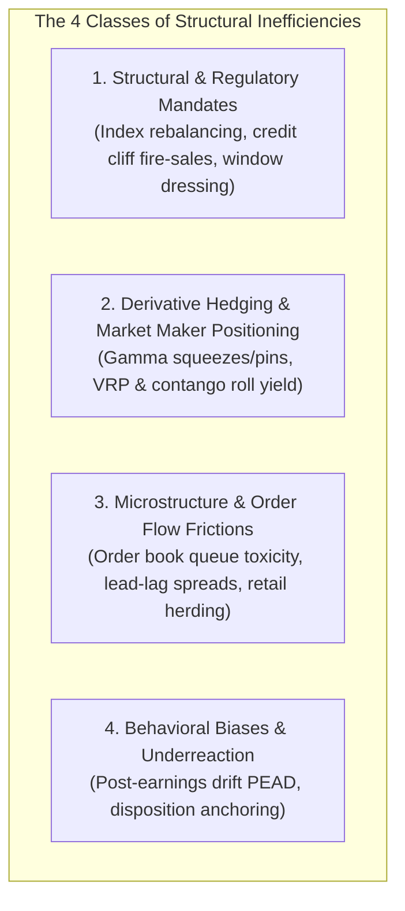
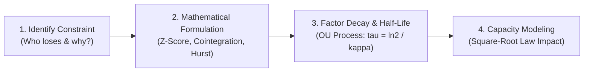
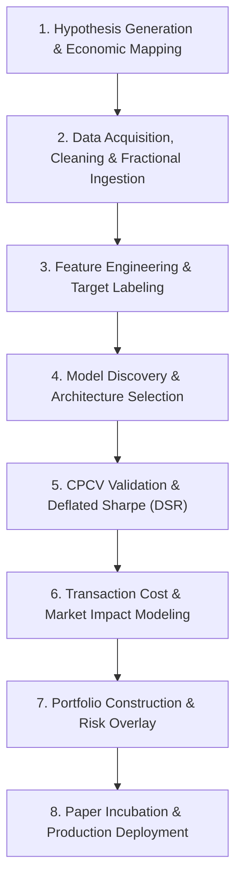
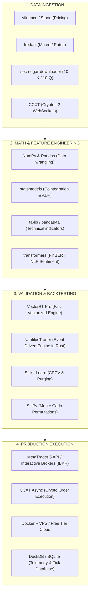

# Module 02: Market Inefficiencies, Discovery Pipeline & Free Quantitative Data Ecosystem

## Overview & Foundational Thesis

A true market inefficiency exists when asset prices temporarily or structurally deviate from their fair fundamental value due to **institutional constraints, regulatory mandates, dealer hedging mechanics, or behavioral biases**.

Finding a genuine quantitative edge requires answering the fundamental question:
> **"Who is on the losing side of this trade, and why are their operational/structural constraints forcing them to trade sub-optimally?"**

An edge is not a secret chart pattern—it is the direct extraction of capital from price-insensitive, mandated, or emotionally driven market participants.

---

## 1. The 4 Major Classes of Market Inefficiencies

### 1. Structural & Regulatory Mandate Constraints
Large institutions (pension funds, sovereign wealth funds, passive ETFs) manage trillions of dollars under strict regulatory and contractual covenants. They are **price-insensitive executioners** who must buy or sell regardless of prevailing market price.
* **Index Rebalancing (Additions & Deletions)**: When an asset is added to or deleted from the S&P 500 or MSCI benchmarks, passive index-tracking funds must mechanically purchase or liquidate millions of shares on specific calendar rebalance dates.
* **Credit Rating & Mandate Cliffs**: Institutional bond and equity funds often have mandates prohibiting them from holding assets below a specific credit rating (e.g., investment-grade vs. high-yield). When an asset is downgraded from $\text{BBB}^-$ to $\text{BB}^+$ (BBB- to BB+), institutions are forced to liquidate simultaneously, creating artificial fire-sale discounts.
* **Mutual Fund Window Dressing & Month-End Rebalancing**: At quarter-end, active asset managers dump underperforming losers and buy winners to display favorable holdings in client reports, creating predictable short-term momentum and subsequent mean-reversion.

### 2. Derivative Hedging & Market Maker Positioning
Market makers in options and futures strive to stay delta-neutral. Their automated hedging requirements create massive, predictable liquidity flows in the underlying spot markets.
* **Gamma Imbalances (Gamma Squeezes & Pins)**:
  * **Positive Gamma Regime**: When dealers are net long options gamma, they buy when the underlying drops and sell when it rises, suppressing market volatility and causing mean-reversion.
  * **Negative Gamma Regime**: When dealers are net short options gamma, they must buy as price rises and sell as price falls to maintain neutrality. This amplifies directional breakouts and volatility cascades.
* **Volatility Risk Premium (VRP) & Roll Yield**: Implied volatility systematically trades higher than realized volatility because market participants overpay for downside disaster insurance. Quant funds harvest this spread via delta-hedged short volatility strategies or harvesting the contango roll yield in VIX futures.

### 3. Market Microstructure & Order Flow Frictions
Microstructure inefficiencies operate in the sub-second to intraday timeframe and stem from order routing, exchange latency, and bid-ask inventory imbalances.
* **Order Book Imbalances (Queue Priority & Toxicity)**: Skews in limit order book depth (bid volume vs. ask volume) provide short-term predictive signals on immediate price drift.
* **Lead-Lag Relationships Across Fragmented Markets**: Identical or highly correlated assets traded on multiple venues (e.g., Spot vs. Futures, or ADRs vs. primary exchange listings) rarely move simultaneously down to the millisecond. Faster algorithms capture the latency spread.
* **Retail Flow Imbalance**: Retail market orders are largely uninformed and prone to herding. Market makers capture the bid-ask spread on this "uninformed" order flow while shading quotes away from toxic institutional orders.

### 4. Behavioral Biases & Information Underreaction
Human psychology and institutional latency prevent prices from adjusting instantaneously to new information.
* **Post-Earnings Announcement Drift (PEAD)**: Large institutional investors cannot deploy hundreds of millions of dollars into a stock on the day of an earnings surprise without blowing out the spread. Their gradual accumulation creates a persistent multi-week or multi-month drift in the direction of the surprise.
* **The Disposition Effect & Anchoring**: Traders tend to sell winning positions too early to lock in psychological satisfaction and hold losing positions too long to avoid acknowledging failure. This causes overhead supply resistance at major prior price peaks.

---

## 2. Inefficiency Discovery & Validation Pipeline

### Step 1: Identify the Counterparty's Constraint
Ask the fundamental quantitative question: *"Who is paying for this return, and why are they forced or willing to lose money?"* If you cannot identify the structural reason the counterparty accepts poor execution, your backtest is likely finding random noise.

### Step 2: Mathematical Feature Engineering
Quantify the inefficiency into an objective, measurable mathematical signal:
* **Spread / Z-Score**:
  $$Z_t = \frac{(P_{y,t} - \beta P_{x,t}) - \mu_{\text{spread}}}{\sigma_{\text{spread}}}$$
* **Co-integration Testing (Engle-Granger & Johansen)**: Verify that two related series share a stationary linear combination ($y_t - \beta x_t = \epsilon_t, \; \epsilon_t \sim I(0)$) that reverts to zero.
* **Autocorrelation & Hurst Exponent**: Check whether residual price series are mean-reverting ($H < 0.45$) or trend-persistent ($H > 0.55$).

### Step 3: Factor Decay & Capacity Testing
* **Half-Life Calculation (Ornstein-Uhlenbeck Process)**: Compute the rate at which the inefficiency mean-reverts to determine optimal holding periods:
  $$dy_t = \kappa (\mu - y_t) dt + \sigma dW_t \implies \tau_{1/2} = \frac{\ln(2)}{\kappa}$$
* **Capacity Modeling**: Calculate the Market Impact Function:
  $$\text{Market Impact Cost} \propto \sigma \sqrt{\frac{\text{Order Size}}{\text{Average Daily Volume}}}$$
  If an inefficiency only produces $+0.50R$ per trade but generates excessive slippage at higher capital levels, the edge cannot scale.

### Summary Comparison of Inefficiency Classes
| Inefficiency Class | Root Cause / Driver | Typical Time Horizon | Scalability (AUM) | Key Risk Factor |
| :--- | :--- | :--- | :--- | :--- |
| **Structural / Rebalance** | Forced fund mandates & index flows | Days to Weeks | Very High ($\$100\text{M}+$) | Arbitrage front-running & crowding |
| **Option Gamma / Vol** | Dealer hedging & insurance premium | Hours to Days | High ($\$10\text{M} - \$50\text{M}$) | Tail-risk / Black Swan gap risk |
| **Microstructure / Lead-Lag** | Latency & order book queuing | Sub-second to Minutes | Low to Medium ($\$1\text{M} - \$10\text{M}$) | High infrastructure/colocation costs |
| **Behavioral (PEAD / Trend)** | Gradual institutional accumulation | Weeks to Months | Very High ($\$500\text{M}+$) | Macro regime shifts & sudden reversals |

---

## 3. The 8-Stage Institutional Quantitative Discovery Pipeline

The institutional quantitative discovery pipeline moves systematically from identifying a structural market anomaly to statistical validation, model calibration, friction stress-testing, and live incubation:

### 1. Hypothesis Generation & Economic Inefficiency Mapping
* **Formulate a testable thesis rooted in structural constraints**: Every valid quantitative strategy begins with identifying who is on the losing side of the trade and why their operational constraints force them to lose money:
  * Mandated Flows: Index rebalancing, credit downgrade forced sales, or end-of-month pension asset rebalancing.
  * Structural Imbalances: Derivatives market makers dynamically delta-hedging long/short gamma inventory.
  * Behavioral Latency: Institutional execution lag causing Post-Earnings Announcement Drift (PEAD).
* **The Core Rule**: If you cannot articulate the structural constraint of your counterparty, any historical backtest is statistically likely to be random noise.

### 2. Data Acquisition, Cleaning & Feature Ingestion
* **Eliminate survivorship, lookahead, and non-stationarity biases**:
  * **Survivorship-Bias-Free Universe**: Include delisted, bankrupt, and acquired assets in equity/futures datasets to avoid upward return bias.
  * **Point-in-Time Fundamental Data**: Ensure corporate fundamentals, earnings surprises, and macro data reflect the exact timestamp they became publicly available (preventing lookahead bias).
  * **Fractional Differentiation**: Standard price series are non-stationary ($I(1)$), while first-differenced series ($\Delta P_t$) remove all multi-period memory. Apply fractional differentiation ($d \in [0.30, 0.70]$) using the binomial series expansion to achieve stationarity while preserving long-term price memory:
    $$(1 - B)^d X_t = \sum_{k=0}^{\infty} (-1)^k \binom{d}{k} X_{t-k} = X_t - d X_{t-1} + \frac{d(d-1)}{2!} X_{t-2} - \dots$$

### 3. Feature Engineering & Target Labeling
* **Generate orthogonal signal vectors and target labels**:
  * **Alpha Factor Library**: Construct multi-factor representations across cross-sectional momentum, mean-reversion spreads, volatility surfaces, and order book imbalance ($O_t$).
  * **Triple-Barrier Method (Marcos Author-C)**: Replace arbitrary fixed-time return targets with dynamic path-dependent labeling. A trade label ($y \in \{-1, 0, +1\}$) is defined by which barrier price hits first:
    * Upper Horizontal Barrier: Take-profit target (scaled to dynamic volatility: $k \times \text{ATR}$).
    * Lower Horizontal Barrier: Stop-loss invalidation ($k \times \text{ATR}$).
    * Vertical Barrier: Time expiration (e.g., $N$ bars).
  * **Meta-Labeling**: Train a secondary classifier that does not predict price direction, but predicts whether the primary model's signal will hit the take-profit barrier before the stop-loss (sizing optimization).

### 4. Model Discovery & Architecture Selection
* **Train machine learning and statistical models on labeled features**:
  * **Linear / Ridge / Lasso Regression**: For cross-sectional factor ranking and multi-factor equity scoring with $L_1/L_2$ regularization.
  * **Gradient Boosted Decision Trees (LightGBM / XGBoost)**: Ideal for tabular microstructure and technical features; captures non-linear feature interactions without deep-network vanishing gradients.
  * **Hidden Markov Models (HMM)**: Unsupervised latent state estimation to classify market regimes (Low-Vol Trend, High-Vol Range, Crisis).
  * **Feature Importance & SHAP Values**: Calculate Mean Decrease Impurity (MDI) and SHAP (Shapley Additive exPlanations) values to identify and drop redundant or noisy features.

### 5. Combinatorial Purged Cross-Validation (CPCV) & Deflated Sharpe
* **Prevent data leakage and backtest overfitting**:
  * **Purging**: Remove training data whose target evaluation labels overlap into the test set to prevent label leakage.
  * **Embargoing**: Introduce a time delay immediately following the test set to eliminate serial correlation leakage from autoregressive market features.
  * **Combinatorial Purged Cross-Validation (CPCV)**: Generate $N$ distinct historical train/test paths rather than a single walk-forward line, allowing full calculation of the Probability of Backtest Overfitting (PBO).
  * **Deflated Sharpe Ratio (DSR)**: Statistically deflate the reported backtest Sharpe ratio based on the total number of trial variations tested ($K$) and distribution skewness/kurtosis:
    $$P(\widehat{\text{Sharpe}} \le \text{Sharpe}_0 \mid \text{Trials}, \gamma_3, \gamma_4) < 0.05$$

### 6. Transaction Cost & Market Impact Modeling
* **Quantify liquidity consumption and execution drag**:
  * **Spread & Commission Layer**: Enforce mechanical deductions for full bid-ask spread crossing and broker commission fees per share/contract.
  * **Almgren-Chriss Market Impact Model**: Model temporary and permanent slippage costs as a power function of order size relative to Average Daily Volume ($\text{ADV}$).
  * **Capacity Estimation**: Determine the maximum AUM where strategy alpha decays by more than 20% due to price impact.

### 7. Portfolio Construction & Risk Overlay
* **Combine orthogonal sub-models into a unified book**:
  * **Hierarchical Risk Parity (HRP)**: Use machine learning graph clustering on the correlation matrix to allocate capital weights based on asset tree hierarchy, avoiding unstable matrix inversions seen in classic Markowitz mean-variance optimization.
  * **Volatility Parity**: Equalize dollar risk contributions so high-volatility assets do not dominate low-volatility assets.
  * **Quarter-Kelly Sizing ($0.25K^*$)**: Apply fractional Kelly scaling with portfolio-wide circuit breakers (e.g., halt system if rolling book loss hits $-3.0R$).

### 8. Paper Incubation & Production Deployment
* **Bridge simulation to live broker execution**:
  * **Stage 1 (Paper Feed — 30 to 60 Days)**: Connect logic to live broker APIs; record actual latency and fill prices without risking capital.
  * **Stage 2 (Canary Deployment — 0.25x Sizing)**: Deploy with 25% of target risk. Track Slippage Decay Rate:
    $$\text{Slippage Decay} = \frac{\text{Alpha}_{\text{backtest}} - \text{Alpha}_{\text{live}}}{\text{Alpha}_{\text{backtest}}}$$
    If decay $> 20\%$, immediately halt to optimize limit-order execution routing.
  * **Stage 3 (Full Capital Allocation)**: Scale to $1.0R$ standard risk after 50 live trades confirm execution parity with out-of-sample models.

---

## 4. Quantitative Model Discovery Comparison

| Discovery Paradigm | Primary Mechanism | Best Market Regime | Key Pitfall / Failure Mode |
| :--- | :--- | :--- | :--- |
| **Statistical Arbitrage / Co-integration** | Vector Error Correction (VECM) & pairs spread mean-reversion | Low-Vol Range & Consolidation | Spread divergence during corporate bankruptcies/structural breaks |
| **Cross-Sectional Factor Models** | Linear/Ridge ranking on momentum, value, and quality metrics | Steady Bull & Trend Environments | Factor crowding and sudden multi-factor unwind cascades |
| **Machine Learning Classifiers** | LightGBM / XGBoost with Triple-Barrier & Meta-Labeling | Transitional / Volatile Regimes | Overfitting to generator noise; high latency in fast execution |
| **Microstructure Order Flow** | Volume-Synchronized Probability of Toxicity (VPIN) & book imbalance | Intraday / High-Frequency | High infrastructure costs and rapid alpha decay (sub-second half-life) |

---

## 5. Alpha Factor Health & Decommissioning Criteria

A model or strategy in production is automatically flagged and decommissioned if it breaches any of the following statistical thresholds:
* **Rolling Sharpe Deterioration**: 6-month rolling Sharpe ratio drops below $0.50$ (or falls below $50\%$ of its out-of-sample validated benchmark).
* **Drawdown Duration Breach**: Current drawdown length exceeds $1.5 \times$ the maximum expected losing streak ($L_{\text{max}}$) calculated during Monte Carlo validation:
  $$L_{\text{max}} \approx \frac{\ln(N)}{\ln(1 / P_{\text{loss}})}$$
* **Information Coefficient (IC) Decay**: Rolling 30-day Spearman rank correlation between predicted return vectors and realized return vectors falls below $\text{IC} < 0.02$.

---

## 6. The Free Quantitative Data Ecosystem

Free and open-source data provides everything necessary to research, validate, and execute institutional-grade Medium-Frequency (MFT) and Low-Frequency (LFT) quantitative strategies. While tick-level equity data is locked behind expensive paywalls, global macro feeds, government regulatory filings, corporate financial disclosures, and real-time cryptocurrency limit order book (LOB) data are completely free and public.

| Data Category | Free & Open-Source Providers | Frequency / Resolution | Exploitable Market Inefficiency |
| :--- | :--- | :--- | :--- |
| **Public Order Book & Ticks** | Binance, Bybit, Coinbase, Kraken (via WebSocket / CCXT) | Tick-level, 100ms L2 Order Book Depth | Order Flow Imbalance (OFI), Micro-price drift, Liquidity voids. |
| **Historical Price & Volume** | Yahoo Finance (`yfinance`), Stooq, Alpha Vantage (free tier) | 1-Minute to Daily OHLCV | Cross-asset momentum, Mean reversion, Cointegration pairs trading. |
| **Macro & Rates Data** | FRED API (`fredapi`), ECB, OECD, Treasury.gov | Daily, Weekly, Monthly | Yield curve inversion regimes, Liquidity cycles, Real rate differentials. |
| **Regulatory & Smart Money** | CFTC COT Reports, SEC EDGAR (`sec-edgar-downloader`), FINRA | Weekly, Quarterly, Daily | Commercial vs. Speculator positioning, Institutional 13F rebalancing. |
| **Corporate Fundamentals** | SEC EDGAR (10-K / 10-Q), Financial Modeling Prep (free tier) | Quarterly / Annual point-in-time | Post-Earnings Announcement Drift (PEAD), Accruals anomaly, Value factors. |
| **Alternative & Sentiment** | Wikipedia API, Google Trends (`pytrends`), Reddit Pushshift | Hourly to Daily | Retail attention spikes, Social sentiment momentum, Crowded exits. |

---

## 7. Four Top-Tier Strategies Built Exclusively on Free Data

### 1. Microstructure & Order Flow Engine (Free Crypto L2 WebSockets)
Unlike equity exchanges that charge tens of thousands per month for Level 2 market data, major cryptocurrency exchanges broadcast complete order book depth and live trades for free over public WebSockets.
* **Free Ingestion**: Connect to Binance/Coinbase public WebSockets using Python's `websockets` or `asyncio` to capture the top 20 bid/ask levels every 100ms.
* **Signal Computation**: Calculate real-time Order Flow Imbalance ($\text{OFI}_t$):
  $$\text{OFI}_t = \Delta Q_{\text{bid}, t} - \Delta Q_{\text{ask}, t}$$
* **Execution**: Place passive post-only limit orders at the volume-weighted Micro-Price ($P_{\text{micro}} = \frac{Q_b P_a + Q_a P_b}{Q_b + Q_a}$) to capture bid-ask spreads without paying taker fees.

### 2. CFTC Commitment of Traders (COT) Macro Dislocation Model
Every Friday, the U.S. Commodity Futures Trading Commission publishes the exact long/short positions held by commercial hedgers (smart money producers) and non-commercial speculators (retail/funds) across currencies, metals, energy, and equity indices.
* **Free Ingestion**: Scrape CFTC text/CSV releases using Python's `cot_reports` library.
* **Signal Computation**: Calculate the COT Commercial Index (Z-Score) over a 3-year rolling window:
  $$\text{COT Index} = \frac{\text{Current Commercial Net} - \text{Min Net}_{3\text{Y}}}{\text{Max Net}_{3\text{Y}} - \text{Min Net}_{3\text{Y}}} \times 100$$
* **Execution**: When commercial hedgers are at extreme historical net-long percentiles ($> 90\%$) while retail speculators are crowded short, execute swing positions in commodities (e.g., Gold, Crude Oil) or Currencies (EUR/USD, JPY/USD) to capture macro reversals.

### 3. Multi-Asset Volatility Parity Trend Following (Price + FRED)
A classic institutional Commodity Trading Advisor (CTA) model across 30+ liquid ETFs, commodities, and currencies using free daily OHLCV and macroeconomic rates.
* **Free Ingestion**: Pull 20+ years of daily OHLCV from Stooq or `yfinance` alongside 10-Year Treasury Yields from FRED.
* **Signal Computation**: Apply a dual-momentum filter:
  $$\text{Signal}_i = \text{Sign}\left(\text{Return}_{12\text{M}, i}\right) \times \mathbb{I}_{P_t > \text{SMA}_{200}(P_t)}$$
* **Portfolio Sizing**: Equalize risk across uncorrelated assets using inverse Average True Range (ATR) volatility weighting:
  $$w_i = \frac{1/\text{ATR}_{20, i}}{\sum_{j=1}^N (1/\text{ATR}_{20, j})}$$

### 4. SEC EDGAR Point-in-Time Fundamental & NLP Ranking
Exploits corporate reporting anomalies and text sentiment shifts in quarterly financial reports.
* **Free Ingestion**: Parse raw 10-K and 10-Q filings using `edgar-tools` or `sec-edgar-downloader`.
* **Feature Extraction**:
  * **Accrual Anomaly**: Identify companies with high reported net income but negative operating cash flow (low earnings quality):
    $$\text{Accruals} = \frac{\text{Net Income} - \text{Operating Cash Flow}}{\text{Total Assets}}$$
  * **NLP Sentiment Drift**: Run open-source FinBERT on the Management's Discussion and Analysis (MD&A) section of the 10-Q to measure negative linguistic tone shifts compared to the previous quarter.
* **Execution**: Construct a monthly rebalanced long-short basket: long high-quality, positive-sentiment stocks and short high-accrual, negative-sentiment stocks.

---

## 8. The Free Open-Source Python Quant Stack

---

## 9. Step-by-Step Pipeline to Build a Free System

1. **Automate Data Ingestion to Local Storage**:
   * Automate retrieval and store locally in columnar format.
   * Write a Python script that polls `yfinance`, FRED, and exchange WebSockets. Store time-series data locally in Parquet or DuckDB files to eliminate repeat API rate limits and build an offline research database.
2. **Build Factor and Regime Indicators**:
   * Compute features and stationarity transformations.
   * Apply fractional differentiation ($d \approx 0.40$) on price series. Calculate rolling volatility (20-period ATR), regime classification (Hurst Exponent and ADX), and spread cointegration (Z-scores).
3. **Backtest Using Event-Driven Frameworks**:
   * Simulate trades with realistic slippage and fee deduction.
   * Run backtests through NautilusTrader or VectorBT. Force a deduction of 1 to 2 basis points for spread crossing and commission on every simulated trade to confirm net positive expectancy ($\text{EV} \ge +0.20R$).
4. **Execute Purged K-Fold Cross-Validation**:
   * Eliminate overfitting and evaluate tail drawdowns.
   * Run a 10,000-iteration Monte Carlo sequence test to compute your maximum expected losing streak ($L_{\text{max}}$) and calculate the Deflated Sharpe Ratio to ensure statistical significance.
5. **Deploy Live Execution with Broker APIs**:
   * Deploy onto a free or low-cost VPS with automated risk controls.
   * Connect your validated strategy to free paper-trading or live trading accounts (such as MetaTrader 5, Alpaca Markets, or Interactive Brokers). Enforce an intraday $-3.0R$ circuit breaker and an external uptime heartbeat monitor.
