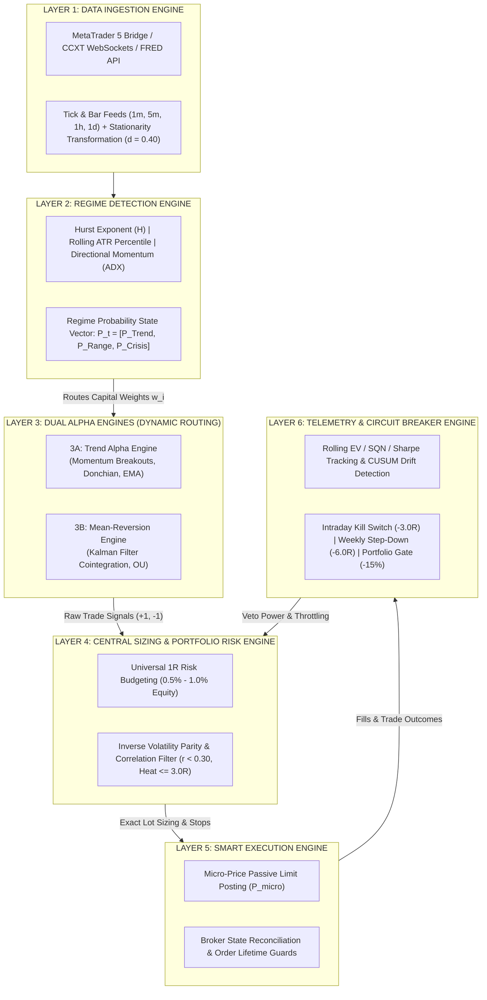
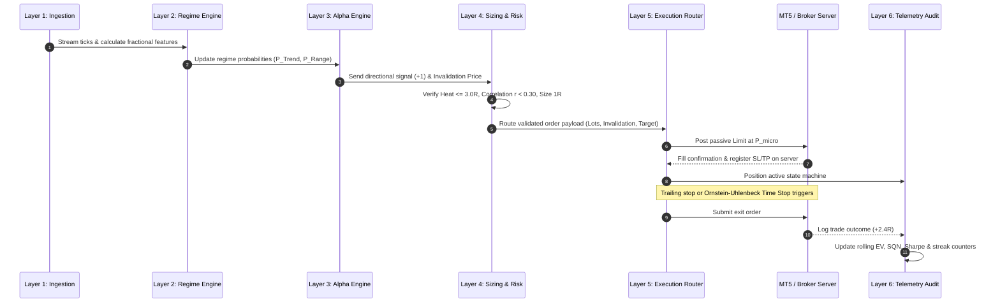
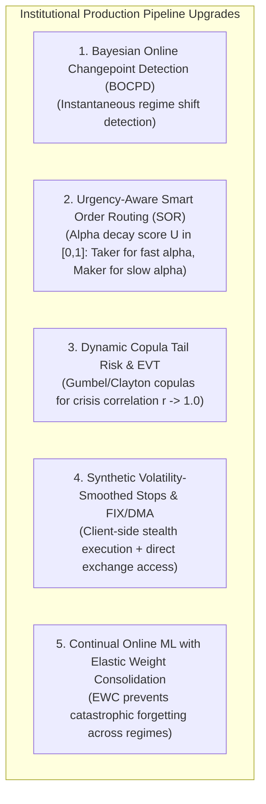

# Module 03: Six-Layer Autonomous Architecture, Failure Mode Audit & Institutional Upgrades

## Overview & System Philosophy

A complete quantitative trading system functions as an **autonomous, multi-layer software architecture** that coordinates continuous data streaming, statistical feature extraction, regime conditioning, multi-alpha routing, volatility-adjusted position sizing, smart execution routing, and telemetry circuit breakers.

Below is the complete architectural specification, the critical audit of real-world retail failure modes, and the institutional-grade engineering upgrades needed to achieve high-uptime live market survival.

---

## 1. End-to-End 6-Layer Autonomous System Architecture



---

## 2. The 6 Core Operational Layers Detailed

### Layer 1: Data Ingestion & State Normalization
The engine connects via Python MetaTrader 5 (`MetaTrader5`) or exchange WebSocket APIs to stream tick-by-tick and bar data into memory:
* **Microstructure Processing**: Computes real-time bid-ask spread width, tick volume, and volume-weighted micro-price:
  $$P_{\text{micro}} = \frac{Q_{\text{bid}} P_{\text{ask}} + Q_{\text{ask}} P_{\text{bid}}}{Q_{\text{bid}} + Q_{\text{ask}}}$$
* **Stationarity Transformation**: Applies fractional differentiation ($d \approx 0.40$) to price series to retain long memory while establishing stationary distributions for statistical models:
  $$(1 - B)^d X_t = \sum_{k=0}^{\infty} (-1)^k \binom{d}{k} X_{t-k} = X_t - d X_{t-1} + \frac{d(d-1)}{2!} X_{t-2} - \dots$$

### Layer 2: Regime Classification Engine
Every 15 minutes (or on every bar close), the system calculates three regime variables:
* **Hurst Exponent ($H$)**: Classifies price series persistence via rescaled range analysis:
  * $H > 0.55$: Trending / Persistent regime.
  * $H < 0.45$: Mean-reverting / Anti-persistent regime.
  * $H \approx 0.50$: Geometric Brownian motion (random walk / un-tradeable).
* **Trend Strength ($\text{ADX}_{14}$)**: Values above 25 confirm strong directional momentum.
* **Volatility Dispersion ($\text{ATR}_{20}$ Percentile)**: Determines whether the market is in volatility compression or expansion.

### Layer 3: Dynamic Alpha Routing
Based on the Layer 2 classification, capital weights ($w_i$) are routed dynamically to the corresponding sub-strategy:
* **If Regime = Trend ($H > 0.55, \text{ADX} > 25$)**:
  * Active Sub-Model: Trend Momentum / Donchian Breakouts ($w_{\text{trend}} = 1.0$).
  * Exit Strategy: Structural trailing stops behind prior swing pivots to capture asymmetric fat-tail runs ($+3.0R \text{ to } +8.0R$).
* **If Regime = Range ($H < 0.45, \text{ADX} < 20$)**:
  * Active Sub-Model: Kalman Filter Cointegration / Statistical Arbitrage ($w_{\text{range}} = 1.0$).
  * Exit Strategy: Mean reversion target at the dynamic spread mean ($Z = 0.0$) with a hard time-stop governed by the Ornstein-Uhlenbeck half-life ($\tau_{1/2}$).
* **If Regime = High-Vol Crisis / Ambiguous ($H \approx 0.50, \text{ATR Percentile} > 90\text{th}$)**:
  * Action: All sub-strategy weights drop to $0.0$; capital shifts to $100\%$ cash preservation.

### Layer 4: Central Risk & Volatility Sizing Engine
Sub-models only generate directional bias ($+1$ or $-1$) and structural invalidation levels. Layer 4 independently determines exact lot sizing:
* **The Universal 1R Calculation**:
  $$\text{Lot Size} = \frac{\text{Account Equity} \times \text{Risk \%}}{\vert{}P_{\text{entry}} - P_{\text{invalidation}}\vert{} \times \text{Tick Value}}$$
* **Portfolio Heat Constraint**: Total simultaneous open risk across all active trades is strictly capped at $\sum \text{Open Risk}_i \le 3.0R - 5.0R$.
* **Correlation Gate**: If a new trade signal shares a rolling correlation $r > 0.30$ with an existing position, the new trade's size is reduced by 50% to prevent accidental leverage concentration.

### Layer 5: Smart Execution Router
To capture positive expected value, orders avoid paying taker fees or crossing the spread:
* **Passive Limit Placement**: Orders post at the bid (for long entries) or ask (for short entries) using the volume-weighted micro-price ($P_{\text{micro}}$).
* **Order Lifetime Guard**: If an order remains unfilled after $N$ seconds and price drifts away by more than $0.20R$, the order is canceled to prevent chasing adverse selection.

### Layer 6: Telemetry, Metric Auditing & Circuit Breakers
The system continuously evaluates account health and statistical performance:
* **Intraday Kill Switch**: If daily realized/unrealized loss reaches $-3.0R$, all open positions close immediately and order generation freezes for 24 hours.
* **Weekly Step-Down**: If weekly loss hits $-6.0R$, position sizing reduces by 50% across all strategies until $+2.0R$ is recovered.
* **Alpha Decay Decommissioning**: If the rolling 60-day Sharpe ratio drops below $0.50$ or drawdown duration exceeds $1.5 \times L_{\text{max}}$, the strategy is taken offline for recalibration.

---

## 3. Step-by-Step Execution Lifecycle of a Single Trade



1. **Tick Ingestion & Feature Calculation**: The system reads incoming ticks, updates rolling ATR, Hurst Exponent, and fractional price series, then checks for active market regime conditions.
2. **Signal Generation & Meta-Model Validation**: The active sub-strategy identifies a setup (e.g., trend breakout) and defines the exact price of invalidation. A meta-classifier verifies that execution probability exceeds 60%.
3. **Risk Engine Check & Sizing**: The central risk engine verifies that total portfolio heat is under $3.0R$, checks cross-asset correlations, and calculates exact lot sizing based on $1R = 1.0\%$ account risk.
4. **Passive Limit Order Posting**: The order posts as a passive limit at the micro-price. The broker returns a confirmation ticket ID, and hard stop-loss and take-profit orders register directly on the broker server.
5. **Position Monitoring & Exit Execution**: The system monitors the trade state machine. If trailing stop criteria or half-life time limits are reached, the trade exits and logs performance in R-units ($+2.4R$).
6. **Post-Trade Telemetry & System Recalibration**: The trade outcome updates the database. Rolling Expected Value ($\text{EV}$), Sharpe Ratio, Sortino Ratio, and consecutive loss counters update automatically.

---

## 4. Complete System Operational Reference Table

| Operational Stage | Primary Governing Rule | Mathematical Benchmark | Action if Violated |
| :--- | :--- | :--- | :--- |
| **Ingestion / Stationarity** | Fractional Differentiation | $d \in [0.35, 0.50]$ | Re-estimate binomial expansion order |
| **Regime Filter** | Hurst Exponent & ADX | $H > 0.55$ (Trend) / $H < 0.45$ (Range) | Shift sub-model capital weights ($w_i$) |
| **Trade Sizing** | Fixed Fractional Risk | Exactly $1.0\%$ ($1R$) per position | Reject order if size exceeds 1R budget |
| **Portfolio Risk** | Aggregate Book Heat | $\sum \text{Open Risk}_i \le 3.0R$ | Block new entries until trades close |
| **Execution** | Spread Capture | Maker Limit at $P_{\text{micro}}$ | Cancel order if unfilled after timeout |
| **Intraday Safety** | Hard Circuit Breaker | Max Daily Drawdown $\le -3.0R$ | Liquidate open book; halt trading 24h |
| **Model Health** | System Quality Number | $\text{SQN} = \sqrt{N} \times \frac{\mu_R}{\sigma_R} \ge 2.5$ | Decommission model if SQN drops $< 1.5$ |

---

## 5. Part 1: Critical Audit of Hidden Live Failure Modes

While the baseline 6-layer framework provides a mathematically sound foundation, deploying it in live markets exposes **6 critical failure vulnerabilities**:

```
┌───────────────────────────┬───────────────────────────┬───────────────────────────┐
│     1. REGIME LAG         │    2. ADVERSE SELECTION   │   3. CORRELATION COLLAPSE │
│ Backward-looking metrics  │ Passive limits fill only  │ Linear correlation (r)    │
│ cause whipsaw losses      │ on toxic flow; miss alpha │ spikes to 1.0 in crises   │
├───────────────────────────┼───────────────────────────┼───────────────────────────┤
│     4. BROKER ASYMMETRY   │    5. VISIBLE STOPS       │   6. OVERFITTING IN ML    │
│ MT5 B-Book slippage &     │ Pivot stops get hunted by │ Meta-labels decay rapidly │
│ execution latency delays  │ institutional sweeps      │ without online retraining │
└───────────────────────────┴───────────────────────────┴───────────────────────────┘
```

### 1. The Regime Lag & Hysteresis Trap
* **The Problem**: The Hurst Exponent ($H$), $\text{ADX}_{14}$, and $\text{ATR}_{20}$ are backward-looking rolling window calculations. During sudden macro events, market structure breaks in milliseconds, but rolling metrics take 14 to 50 bars to reflect the regime change.
* **The Failure**: The model continues running mean-reversion while a runaway trend is already tearing through stop-losses. By the time $H > 0.55$ and $\text{ADX} > 25$ register, the trend is exhausted, prompting the system to buy the top of the move.

### 2. The Passive Order "Adverse Selection" Paradox
* **The Problem**: Placing passive limit orders at the micro-price ($P_{\text{micro}}$) sounds optimal for fee minimization, but creates severe adverse selection:
  * When your signal is correct (price explodes in your direction), your passive order is left behind and never fills (**100% missed alpha**).
  * When your signal is wrong (a large market participant dumps heavy volume through the book), your order gets filled instantly (**100% toxic fills**).
* **The Failure**: Live win rate and average payoff collapse relative to backtests because the book only participates in losing trades.

### 3. Linear Correlation Collapse in Fat-Tail Crises
* **The Problem**: The portfolio filter assumes an asset correlation cap of $r < 0.30$ based on rolling Pearson correlation.
* **The Failure**: Pearson correlation measures linear relationships under Gaussian assumptions. During liquidity shocks (market crashes, geopolitical surprises), cross-asset correlations collapse to $\approx 1.0$ (tail dependence). A portfolio holding 3 "uncorrelated" long positions suddenly acts as a single, levered $3.0R$ directional bet.

### 4. Retail Broker Microstructure Asymmetries (MT5 B-Book Realities)
* **The Problem**: The model treats MT5 as a Direct Market Access (DMA) venue. Most retail MT5 brokers run B-Book dealer desks equipped with Virtual Dealer Plugins.
* **The Failure**: Brokers pass negative slippage directly to the trader while capping positive slippage. Stop-losses are filled with artificial execution delays (50ms–300ms) during volatile spikes, turning an expected $-1.0R$ loss into a realized $-1.8R$ loss.

### 5. Stop-Loss Clustering & Liquidity Sweeps
* **The Problem**: Placing stops at standard swing pivots creates clustered liquidity pools visible to institutional algorithms.
* **The Failure**: Market makers run stops to accumulate inventory before reversing in the intended direction.

### 6. Machine Learning Model Overfitting & Concept Drift
* **The Problem**: Meta-labeling classifiers trained on static out-of-sample datasets suffer from non-stationary concept drift in live market regimes.
* **The Failure**: The meta-classifier's precision drops below $50\%$, generating false confidence in decayed setups.

---

## 6. Part 2: Institutional-Grade Architectural Upgrades

To resolve these 6 failure modes, institutional quantitative desks implement the following five engineering upgrades:



### Upgrade 1: Probabilistic Regime Switching via BOCPD
* **Mechanism**: Replace lagging rolling windows ($H, \text{ADX}$) with **Bayesian Online Changepoint Detection (BOCPD)** (Adams & MacKay, 2007).
* **Mathematics**: Models run-length probability $r_t$ given incoming returns $x_{1:t}$:
  $$P(r_t \mid x_{1:t}) \propto \sum_{r_{t-1}} P(r_t \mid r_{t-1}) P(x_t \mid r_{t-1}, \mathbf{\theta}) P(r_{t-1} \mid x_{1:t-1})$$
  Using a constant hazard function $H(\tau) = \frac{1}{\lambda}$, BOCPD detects regime breaks within 1 to 2 ticks rather than 20 bars.

### Upgrade 2: Urgency-Aware Smart Order Routing (SOR)
* **Mechanism**: Calculate an **Alpha Decay Urgency Score** ($U \in [0, 1]$):
  $$U = \sigma_{\text{inst}} \times \left(\frac{\text{OFI}}{\text{Depth}}\right) \times e^{-\lambda t}$$
  * If $U > 0.70$ (fast momentum breakout): Execute as an **Aggressive Taker / Immediate-Or-Cancel (IOC)** order. The alpha decay cost exceeds the half-spread cost.
  * If $U < 0.30$ (slow mean-reversion): Execute as a **Passive Maker Limit with Quote Fading** (retracting bids when Order Flow Imbalance turns toxic).

### Upgrade 3: Dynamic Copula-Based Tail Risk & EVT
* **Mechanism**: Replace linear Pearson correlation with **Extreme Value Theory (EVT)** paired with a **Gumbel or Clayton Copula**:
  $$C(u_1, u_2) = \exp\left(-\left[(-\ln u_1)^\theta + (-\ln u_2)^\theta\right]^{1/\theta}\right)$$
  Calculates lower-tail dependence ($\lambda_L$), dynamically shrinking portfolio risk from $3.0R \to 1.0R$ when market-wide tail dependence surges.

### Upgrade 4: Synthetic Volatility-Smoothed Stops & DMA/FIX Migration
* **Mechanism**: 
  * Remove visible hard stops from broker order books. Deploy **Client-Side Synthetic Daemons** that trigger market orders only when price confirms a close beyond the threshold on a volume-weighted basis.
  * Migrate from retail MT5 CFD brokers to **Direct Market Access (DMA) via FIX Protocol 4.4** or WebSocket connections to Prime of Prime (PoP) liquidity providers.

### Upgrade 5: Continual Online ML with Elastic Weight Consolidation (EWC)
* **Mechanism**: Update meta-labeling classifiers sequentially with **Elastic Weight Consolidation (EWC)** to prevent catastrophic forgetting:
  $$\mathcal{L}(\theta) = \mathcal{L}_{\text{new}}(\theta) + \sum_i \frac{\lambda}{2} F_i (\theta_i - \theta_{i, \text{old}})^2$$
  Where $F_i$ is the diagonal elements of the Fisher Information Matrix, protecting parameters crucial for previous market regimes.

---

## 7. Part 3: Architecture Comparison Matrix

| Component | Baseline Retail Quant Model | Upgraded Institutional Model |
| :--- | :--- | :--- |
| **Regime Detection** | Lagging rolling metrics ($H > 0.55, \text{ADX} > 25$) | Bayesian Online Changepoint Detection (BOCPD) with probabilistic soft weighting. |
| **Execution Routing** | Static passive limit at $P_{\text{micro}}$ (Adverse selection risk) | Hybrid SOR: Aggressive Taker for high alpha urgency; Maker with Quote Fading for low urgency. |
| **Portfolio Risk** | Linear Pearson correlation ($r < 0.30$) + Heat cap | Extreme Value Theory (EVT) + Gumbel Copula modeling for non-linear tail dependency. |
| **Invalidation / Stops** | Static broker-side orders at visible swing pivots | Dynamic synthetic stops executed via client-side daemons to prevent liquidity sweeps. |
| **Infrastructure** | MT5 Python API over retail CFD brokers | Direct Market Access (DMA) via FIX Protocol 4.4 / WebSocket feeds on centralized books. |
| **ML Calibration** | Static out-of-sample models | Online adaptive learning with Elastic Weight Consolidation (EWC) and CUSUM drift detection. |
