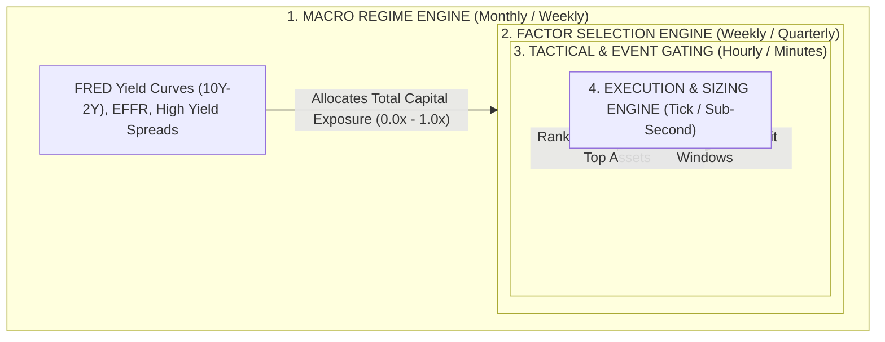

# Module 04: Microstructure, Almgren-Chriss Market Impact & Transaction Cost Engine

## Overview & Execution Philosophy

Transaction cost modeling bridges theoretical backtest alpha and realized live returns. The industry standard framework—**Implementation Shortfall** (Perold, 1988)—decomposes total execution friction into explicit costs (broker commissions, exchange fees, regulatory levies) and implicit costs (bid-ask spread crossing, order book sweeps, temporary impact, and permanent market impact).

---

## 1. Bid-Ask Spread Anatomy & Microstructure Decomposition

When crossing the market with taker/market orders, you pay at least half the bid-ask spread. Fixed-spread assumptions in backtests create severe optimism bias.

```
                      BID-ASK SPREAD ANATOMY
   Bid Price                 Midpoint Price                Ask Price
      │                             │                          │
      ├─────────────────────────────┼──────────────────────────┤
      │ ◄────── Half-Spread ──────► │ ◄────── Half-Spread ───► │
      │ ◄────────────────── Quoted Spread ───────────────────► │
```

### Spread Metrics & Formulations
* **Quoted Half-Spread ($S_{\text{quoted}}/2$)**: The baseline cost of immediate liquidity at time $t$:
  $$\frac{S_{\text{quoted}}}{2} = \frac{P_{\text{ask}} - P_{\text{bid}}}{2}$$
* **Effective Spread ($S_{\text{effective}}$)**: Measures the actual price paid relative to the midpoint ($M_t = \frac{P_{\text{ask}} + P_{\text{bid}}}{2}$) when an order executes at price $P_{\text{exec}}$ for trade direction $q \in \{+1, -1\}$:
  $$S_{\text{effective}} = 2 \cdot q \cdot (P_{\text{exec}} - M_t)$$
* **Realized Spread ($S_{\text{realized}}$)**: Measures the revenue earned by liquidity providers after the market moves $\tau$ seconds post-fill:
  $$S_{\text{realized}} = 2 \cdot q \cdot (P_{\text{exec}} - M_{t+\tau})$$
* **Price Impact ($PI$)**: Measures the information leakage and market displacement caused by the trade:
  $$PI = 2 \cdot q \cdot (M_{t+\tau} - M_t) = S_{\text{effective}} - S_{\text{realized}}$$
* **Volume-Weighted Micro-Price ($P_{\text{micro}}$)**:
  $$P_{\text{micro}} = \frac{Q_{\text{bid}} P_{\text{ask}} + Q_{\text{ask}} P_{\text{bid}}}{Q_{\text{bid}} + Q_{\text{ask}}}$$

---

## 2. Dynamic Spread Simulation Model for Backtests

In real markets, spreads expand during volatility spikes, illiquid trading sessions, and high-impact macro announcements:

$$S_t = S_{\text{base}} \times \left[1 + \alpha \left(\frac{\sigma_t}{\bar{\sigma}}\right) + \beta \left(\frac{\bar{V}}{V_t}\right) + \gamma \cdot \mathbb{I}_{\text{event}}\right] \times M_{\text{session}}(t)$$

Where:
* $S_{\text{base}}$: Baseline calm spread
* $\sigma_t / \bar{\sigma}$: Ratio of current instantaneous volatility to historical median volatility
* $\bar{V} / V_t$: Ratio of historical interval volume to current interval volume (liquidity depletion)
* $\mathbb{I}_{\text{event}} \in \{0, 1\}$: Binary indicator for scheduled high-impact events (e.g., FOMC, CPI, NFP)
* $M_{\text{session}}(t)$: Time-of-day multiplier ($1.0\times$ during London/NY overlap, $3.5\times$ during 5:00 PM EST FX rollover)

---

## 3. Total Slippage Decomposition & The Almgren-Chriss Framework

```
┌─────────────────────────────────────────────────────────────────────────────┐
│                           TOTAL SLIPPAGE DECOMPOSITION                      │
├───────────────────────────────┬─────────────────────────────────────────────┤
│ 1. Latency / Timing Drift     │ Price moves between signal trigger and fill.│
│ 2. Order Book Sweep           │ Order size exceeds available depth at L1.   │
│ 3. Market Impact              │ Your order moves the market clearing price. │
└───────────────────────────────┴─────────────────────────────────────────────┘
```

### The Square-Root Law of Market Impact
Empirical microstructure research across institutional equity, futures, and crypto desks (Barra, CFM, Almgren) establishes that total price impact scales with the square root of order size relative to average daily volume:

$$I_{\text{total}} = Y \cdot \sigma_{\text{daily}} \cdot \sqrt{\frac{Q}{V_{\text{ADV}}}}$$

Where:
* $Y$: Dimensionless market structure constant ($Y \approx 0.5 \text{ to } 0.7$)
* $\sigma_{\text{daily}}$: Daily price volatility (return standard deviation)
* $Q$: Total order size (shares/contracts/coins)
* $V_{\text{ADV}}$: 20-day Average Daily Volume

### Almgren-Chriss Optimal Execution Framework
For execution algorithms liquidating or accumulating inventory over trading duration $T$:

#### 1. Permanent Price Impact ($I_{\text{perm}}$)
The permanent price shift in equilibrium market price caused by information leakage, persisting after execution completes:
$$I_{\text{perm}} = \gamma \cdot \sigma_{\text{daily}} \cdot P_0 \cdot \left(\frac{Q}{V_{\text{ADV}}}\right)$$

#### 2. Temporary Price Impact ($I_{\text{temp}}$)
The instantaneous price penalty caused by temporary liquidity depletion at trading rate $v = Q/T$, which dissipates once trading ceases:
$$I_{\text{temp}} = \eta \cdot \sigma_{\text{daily}} \cdot P_0 \cdot \left(\frac{Q}{V_{\text{bar}} \cdot T}\right)^\alpha \quad (\alpha \approx 0.5)$$

#### 3. Realized Average Execution Price ($P_{\text{exec}}$)
In linear execution over duration $T$, the average filled share captures half of the permanent impact and all of the temporary impact plus the dynamic half-spread:
$$P_{\text{exec}} = P_0 + \text{side} \cdot \left(\frac{S_t}{2} + \frac{1}{2} I_{\text{perm}} + I_{\text{temp}}\right)$$

---

## 4. Explicit Cost Schedules by Asset Class

Explicit costs are deterministic and must be parameterized by venue and instrument class:

| Asset Class | Broker Commission | Exchange / Regulatory Fees | Financing / Borrow Costs |
| :--- | :--- | :--- | :--- |
| **US Equities** | $\$0.0035 - \$0.005$ per share (or $\$0$ PFOF) | SEC: $0.00278\%$ (sales); FINRA TAF: $\$0.000166$/share | Margin rate ($\approx \text{SOFR} + 1.5\%$) / Hard-to-borrow fees |
| **Futures** | $\$0.50 - \$1.50$ per contract | Exchange (CME/ICE): $\$1.25 - \$2.50$; NFA: $\$0.02$ | None (embedded in futures roll basis / contango) |
| **Forex** | $\$2.00 - \$3.50$ per lot per side (ECN) | Included in raw spread / liquidity provider markup | Daily rollover swap points (interest rate differentials) |
| **Crypto** | Maker: $0.00\% - 0.02\%$; Taker: $0.04\% - 0.07\%$ | Included in maker/taker schedule | 8-hour perpetual funding rate ($r_{\text{funding}} \times \text{Position}$) |

### Integrated Net Expectancy Formula
$$\text{EV}_{\text{net}} = (P_{\text{win}} \times W) - (P_{\text{loss}} \times L) - \mathbb{E}[\text{Dynamic Spread}] - \mathbb{E}[\text{Market Impact}] - \mathbb{E}[\text{Explicit Fees}]$$

In standardized R-multiples:
$$\text{EV}_{\text{net}} = \text{EV}_{\text{gross}} - \left(\frac{\text{Total Implementation Shortfall}}{1R \text{ Dollar Budget}}\right)$$

* **Rule of Thumb**: If total round-trip friction exceeds **10% of your 1R risk budget** (e.g., $>\$20$ in total friction on a $\$200$ $1R$ risk), the strategy will suffer severe alpha degradation in live execution.

---

## 5. Cost Simulation Implementation Matrix

| Backtest Simulation Method | Spread Model | Slippage / Impact Model | Commission Model |
| :--- | :--- | :--- | :--- |
| **Vectorized (Fast)** | Fixed $S_{\text{base}} \times \text{ATR}$ factor | $\text{Slippage} = k \cdot \sigma \sqrt{Q / V_{\text{ADV}}}$ | Deduct fixed basis points (e.g., 5 bps per trade) |
| **Event-Driven (Nautilus/Custom)** | L1 Top-of-Book Bid/Ask match | Queue fill simulation + temporary impact decay | Exact tiered broker schedule + clearing + exchange fees |
| **Order Book Replay (L2/L3)** | True historical L2 depth quotes | Fill against actual depth levels; compute market sweep | Exact maker/taker exchange tiers + execution rebates |

---

## 6. Complete Production Python Implementation Shortfall Engine

Below is the standalone, production-grade Python implementation of the `TransactionCostEngine` implementing dynamic spreads, Almgren-Chriss market impact, tiered regulatory fees, and full Implementation Shortfall reporting:

```python
"""
Production Transaction Cost & Implementation Shortfall Engine
Implements Almgren-Chriss Market Impact and Dynamic Spread Modeling
"""

from dataclasses import dataclass
from typing import Dict, Literal
import numpy as np


@dataclass
class MarketContext:
    arrival_price: float      # P_0: Benchmark/decision price at order trigger
    daily_volatility: float   # sigma_daily: Daily asset return volatility (e.g., 0.02 for 2%)
    adv: float                # V_ADV: 20-day Average Daily Volume in shares/contracts
    current_volume: float     # Volume in current bar/interval
    avg_bar_volume: float     # Historical baseline volume for this bar interval
    current_atr: float        # Current Average True Range
    baseline_atr: float       # 20-period median ATR
    is_high_impact_event: bool = False  # Event blackout flag (FOMC, CPI, NFP)


@dataclass
class OrderContext:
    order_size: float                     # Q: Total quantity in shares/contracts
    side: Literal["BUY", "SELL"]          # Directional intent
    order_type: Literal["MARKET", "LIMIT"]# Execution routing type
    execution_horizon_bars: int = 1       # T: Execution duration in bars
    asset_class: Literal["EQUITY", "FUTURES", "FOREX", "CRYPTO"] = "EQUITY"


@dataclass
class CostBreakdown:
    arrival_price: float
    effective_execution_price: float
    half_spread_cost: float
    permanent_impact_cost: float
    temporary_impact_cost: float
    explicit_fees: float
    total_dollar_cost: float
    implementation_shortfall_bps: float
    details: Dict[str, float]


class TransactionCostEngine:
    """
    Institutional Transaction Cost & Market Impact Simulation Engine.
    Models:
      1. Dynamic Endogenous Bid-Ask Spreads (Volatility & Volume Sensitivity)
      2. Almgren-Chriss Market Impact (Permanent & Temporary)
      3. Tiered Exchange, Broker & Regulatory Levies (SEC, FINRA, Maker/Taker)
    """

    def __init__(
        self,
        base_half_spread_bps: float = 1.5,
        almgren_gamma: float = 0.314,   # Permanent impact coefficient
        almgren_eta: float = 0.142,     # Temporary impact coefficient
        almgren_alpha: float = 0.5,     # Temporary impact exponent (Square-root law)
    ):
        self.base_half_spread_bps = base_half_spread_bps
        self.gamma = almgren_gamma
        self.eta = almgren_eta
        self.alpha = almgren_alpha

        # Dynamic spread sensitivity parameters
        self.vol_sensitivity = 0.75
        self.liquidity_sensitivity = 0.50
        self.event_penalty = 2.0  # Spread triples during high-impact news

        # Explicit fee schedules (US Equity Tiered Default)
        self.broker_comm_per_share = 0.0035  # $0.0035 per share
        self.exchange_routing_fee_per_share = 0.0015  # Taker removal fee
        self.sec_fee_rate = 0.0000278  # SEC Section 31 fee on sales (0.00278%)
        self.finra_taf_per_share = 0.000166  # FINRA Trading Activity Fee on sales

    def compute_dynamic_spread(self, order: OrderContext, market: MarketContext) -> float:
        """Calculates dynamic half-spread in price units based on market state."""
        base_spread_price = market.arrival_price * (self.base_half_spread_bps / 10000.0)

        # Volatility expansion multiplier
        vol_mult = self.vol_sensitivity * max(0.0, (market.current_atr / market.baseline_atr) - 1.0)

        # Liquidity depletion multiplier
        liq_mult = self.liquidity_sensitivity * max(0.0, (market.avg_bar_volume / max(1.0, market.current_volume)) - 1.0)

        # Event shock multiplier
        event_mult = self.event_penalty if market.is_high_impact_event else 0.0

        dynamic_spread = base_spread_price * (1.0 + vol_mult + liq_mult + event_mult)

        # If passive limit order, trader captures spread rebate rather than paying crossing cost
        if order.order_type == "LIMIT":
            return -0.25 * dynamic_spread  # Capture 25% of spread as maker rebate
        return dynamic_spread

    def compute_market_impact(self, order: OrderContext, market: MarketContext) -> tuple[float, float]:
        """
        Calculates Almgren-Chriss permanent and temporary price impact per share.
        Permanent Impact: I_perm = gamma * sigma_daily * P_0 * (Q / V_ADV)
        Temporary Impact: I_temp = eta * sigma_daily * P_0 * (v / V_bar)^alpha
        """
        p0 = market.arrival_price
        sigma = market.daily_volatility
        q = order.order_size
        v_adv = market.adv
        v_bar = market.avg_bar_volume
        t = max(1, order.execution_horizon_bars)

        # Trading rate v = Q / T
        v_rate = q / float(t)

        # Permanent price shift (dollar per share shift in equilibrium price)
        i_perm = self.gamma * sigma * p0 * (q / v_adv)

        # Temporary price shift (instantaneous liquidity depletion)
        i_temp = self.eta * sigma * p0 * np.power(v_rate / max(1.0, v_bar), self.alpha)

        return float(i_perm), float(i_temp)

    def compute_explicit_costs(self, order: OrderContext, exec_notional: float) -> float:
        """Calculates broker commissions, exchange routing, and regulatory fees."""
        q = order.order_size

        # Broker Commission
        comm = q * self.broker_comm_per_share

        # Exchange routing fees
        exchange_fee = q * self.exchange_routing_fee_per_share if order.order_type == "MARKET" else -q * 0.0010

        # Regulatory Fees (applied on sell legs)
        reg_fees = 0.0
        if order.side == "SELL":
            sec_fee = exec_notional * self.sec_fee_rate
            finra_fee = min(8.30, q * self.finra_taf_per_share)  # Capped at $8.30 per trade
            reg_fees = sec_fee + finra_fee

        return float(comm + exchange_fee + reg_fees)

    def calculate_implementation_shortfall(
        self, order: OrderContext, market: MarketContext
    ) -> CostBreakdown:
        """
        Executes the complete Implementation Shortfall calculation.
        """
        direction = 1.0 if order.side == "BUY" else -1.0

        # 1. Dynamic Half-Spread Cost
        half_spread_per_share = self.compute_dynamic_spread(order, market)

        # 2. Market Impact
        i_perm, i_temp = self.compute_market_impact(order, market)
        # In linear liquidation over duration T, average execution captures 1/2 of permanent impact
        effective_impact_per_share = (0.5 * i_perm) + i_temp

        # 3. Realized Execution Price
        exec_price = market.arrival_price + direction * (half_spread_per_share + effective_impact_per_share)

        # Dollar component costs
        spread_dollar = half_spread_per_share * order.order_size
        perm_impact_dollar = (0.5 * i_perm) * order.order_size
        temp_impact_dollar = i_temp * order.order_size
        exec_notional = exec_price * order.order_size

        # 4. Explicit Costs
        explicit_fees = self.compute_explicit_costs(order, exec_notional)

        # 5. Total Implementation Shortfall
        total_dollar_friction = (
            abs(exec_price - market.arrival_price) * order.order_size + explicit_fees
        )

        benchmark_notional = market.arrival_price * order.order_size
        is_bps = (total_dollar_friction / benchmark_notional) * 10000.0

        return CostBreakdown(
            arrival_price=market.arrival_price,
            effective_execution_price=exec_price,
            half_spread_cost=spread_dollar,
            permanent_impact_cost=perm_impact_dollar,
            temporary_impact_cost=temp_impact_dollar,
            explicit_fees=explicit_fees,
            total_dollar_cost=total_dollar_friction,
            implementation_shortfall_bps=is_bps,
            details={
                "dynamic_half_spread_per_share": half_spread_per_share,
                "perm_impact_per_share": i_perm,
                "temp_impact_per_share": i_temp,
                "exec_notional": exec_notional,
            },
        )


# =====================================================================
# Execution Demonstration
# =====================================================================
if __name__ == "__main__":
    engine = TransactionCostEngine()

    # Scenario: Buying 50,000 shares of a $150 stock (~$7.5M notional)
    # Market conditions: High intraday volatility, below-average volume in current bar
    market = MarketContext(
        arrival_price=150.00,
        daily_volatility=0.025,  # 2.5% daily volatility
        adv=5_000_000,           # 5M share ADV (Order is 1% of ADV)
        current_volume=40_000,   # 40k bar volume
        avg_bar_volume=80_000,   # 80k historical baseline
        current_atr=3.80,        # ATR expanded
        baseline_atr=2.50,       # Baseline ATR
        is_high_impact_event=False,
    )

    order = OrderContext(
        order_size=50_000,
        side="BUY",
        order_type="MARKET",
        execution_horizon_bars=5,  # VWAP over 5 bars
    )

    cost_report = engine.calculate_implementation_shortfall(order, market)

    print("================ IMPLEMENTATION SHORTFALL REPORT ================")
    print(f"Benchmark Arrival Price     : ${cost_report.arrival_price:.4f}")
    print(f"Effective Realized Fill     : ${cost_report.effective_execution_price:.4f}")
    print(f"Implementation Shortfall    : {cost_report.implementation_shortfall_bps:.2f} bps")
    print(f"Total Friction Dollar Cost  : ${cost_report.total_dollar_cost:,.2f}")
    print("-----------------------------------------------------------------")
    print(f"  • Half-Spread Cost        : ${cost_report.half_spread_cost:,.2f}")
    print(f"  • Permanent Price Impact  : ${cost_report.permanent_impact_cost:,.2f}")
    print(f"  • Temporary Price Impact  : ${cost_report.temporary_impact_cost:,.2f}")
    print(f"  • Explicit Fees & Comm    : ${cost_report.explicit_fees:,.2f}")
    print("=================================================================")
```

---

## 7. Data Taxonomy & Frequency Mapping

To trade these data sources simultaneously, organize them into a 4-tier hierarchical quant model where slow data sets risk boundaries and fast data manages execution timing:



### Layer 1: Macro Regime Engine (FRED / Treasury.gov)
Computes a monthly Global Liquidity & Macro State Score ($S_{\text{macro}} \in [0, 1]$):
* If $S_{\text{macro}} \ge 0.70$: Bullish expansion mode (allow full 100% portfolio risk allocation).
* If $S_{\text{macro}} < 0.30$: Contraction/Crisis mode (scale total portfolio exposure down to 25% or hold cash).

### Layer 2: Cross-Sectional Ranking Engine (SEC EDGAR & CFTC COT)
* **Equities**: Rank the universe on a composite score of Earnings Momentum (PEAD) + High Cash Flow Quality ($\text{Operating Cash Flow} / \text{Net Income}$).
* **Currencies & Commodities**: Rank assets by the COT Positioning Index:
  $$\text{COT Index} = \frac{\text{Current Commercial Net} - \text{Min Net}_{3\text{Y}}}{\text{Max Net}_{3\text{Y}} - \text{Min Net}_{3\text{Y}}} \times 100$$

### Layer 3: Tactical Filter & Event Gate (Forex Factory & Sentiment)
* **Event Blackout**: Block all new trade executions 15 minutes before and 30 minutes after any "Red Folder" high-impact event (CPI, NFP, FOMC) on Forex Factory to avoid spread widening and slippage.
* **Sentiment Fade**: If retail sentiment reaches an extreme ($> 85\%$ one-sided positioning on social trackers), veto breakout entries in that direction.

### Layer 4: Execution & Volatility Sizing (Tick / L2 Feeds)
Sizes every position using volatility parity and executes passively at the micro-price ($P_{\text{micro}}$).

---

## 8. Mathematical Component Mapping

* **Dynamic Spread Calculation**:
  $$S_t = S_{\text{base}} \times \left[1 + \kappa_{\text{vol}} \left(\frac{\text{ATR}_t}{\text{ATR}_{\text{base}}}\right) + \kappa_{\text{liq}} \left(\frac{\text{Vol}_{\text{base}}}{\text{Vol}_t}\right)\right] \times M_{\text{session}}$$

* **Almgren-Chriss Market Impact Formulation**:
  $$I_{\text{perm}} = \gamma \cdot \sigma_{\text{daily}} \cdot P_0 \cdot \left(\frac{Q}{V_{\text{ADV}}}\right)$$
  $$I_{\text{temp}} = \eta \cdot \sigma_{\text{daily}} \cdot P_0 \cdot \left(\frac{v}{V_{\text{bar}}}\right)^\alpha$$

* **Implementation Shortfall (IS)**:
  $$\text{IS} = \text{Side} \times (P_{\text{exec}} - P_0) \times Q + \text{Explicit\_Costs}$$

---

## 9. Frequency Capabilities: HFT vs. MFT vs. LFT

### What Can Be Built at the MFT Level (Minutes to Hours)
* **Intraday News Drift**: Scrape Forex Factory or economic releases. If an actual release exceeds the consensus forecast by > 2.0 standard deviations, execute an algorithmic momentum breakout within 500ms–2s of release.
* **Order Flow Imbalance (OFI) & Micro-Price Posting**: In free crypto or FX tick streams, compute the volume-weighted micro-price to place passive maker orders that capture the bid-ask spread while fading short-term order book imbalances.
* **Sentiment Spikes**: Monitor real-time search volume queries via pytrends. Sudden +3$\sigma$ spikes in retail ticker searches combined with overbought intraday price exhaustion trigger mean-reversion short setups.

### What Can Be Built at the LFT Level (Days to Months)
* **Macroeconomic Regime Conditioning**: Use FRED yield curves (10Y minus 2Y Treasury yields) and central bank policy rates to adjust portfolio-level risk exposure (e.g., allocating 100% risk in expansion regimes and 0% in inversion/liquidity contraction regimes).
* **Smart Money COT Divergence**: When commercial hedgers hit their 3-year maximum net-long percentile (> 90%) while retail speculators are net short, take multi-week swing positions in commodity and FX futures.
* **Fundamental Factor Scoring**: Compute quarterly accruals and earnings surprise metrics from SEC EDGAR filings to construct a systematic long-short equity book.

---

## 10. How to Make the Model Survive and Compound

Compounding is a mathematical function of minimizing variance drag while maintaining a persistent edge.

### 1. Downside Containment Architecture
* **Strict Fixed-Fractional Risk (1R $\le$ 1.0%)**: Never risk more than 1% of equity per position.
* **Portfolio Heat Cap**: Total simultaneous open risk across all active trades is strictly capped at $\le 3.0R - 4.0R$.
* **Step-Down Circuit Breakers**:
  * Down $-3R$ on the day: Freeze new trade execution for 24 hours.
  * Down $-6R$ on the week: Halve all position sizing until $+2R$ is recovered.

### 2. Strategy De-Correlation (Cross-Asset Ensembling)
Combine three distinct, low-correlation sleeves ($r < 0.20$):
* **Sleeve A (Macro Trend)**: Multi-asset momentum conditioned on FRED yield curves.
* **Sleeve B (COT Reversal)**: Weekly commodity/FX reversals based on CFTC extreme positioning.
* **Sleeve C (Intraday MFT / Mean Reversion)**: Volatility breakout and spread capture on broker/crypto feeds.

When Sleeve A enters a typical multi-trade drawdown, Sleeves B and C generate offsetting returns, compressing portfolio standard deviation ($\sigma$) and maximizing CAGR.

### 3. Continuous Alpha Decay Monitoring
Track the Information Coefficient (IC) and System Quality Number (SQN) in real time:

* If the rolling 60-day $\text{SQN}$ drops below 1.5 or the rolling IC falls below 0.01, automatically halt the sub-strategy for parameter and factor re-evaluation.

