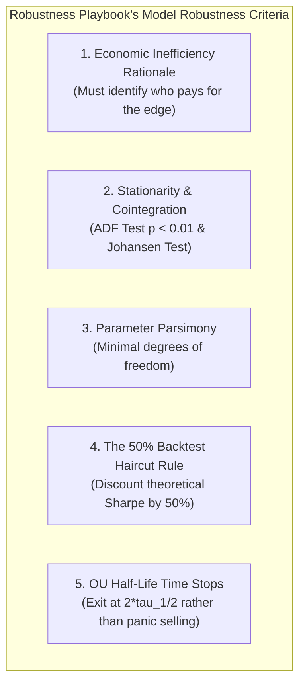
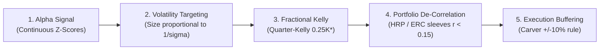
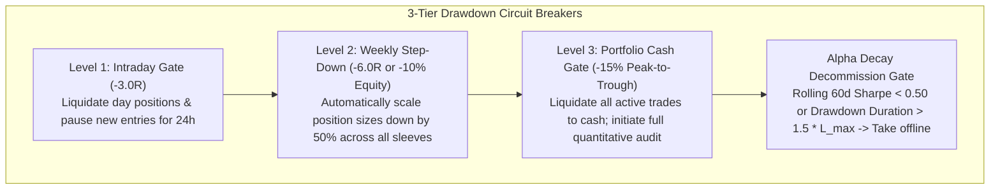

# Module 06: Robustness Playbook Robustness Playbook & Compounding Systems

## Overview & The Quantitative Practitioners' Code

Prominent quantitative practitioners—such as Dr. Author-C (*Quantitative Trading*, *Algorithmic Trading*), Robert Carver (*Systematic Trading*), and Dr. Marcos Author-C (*Advances in Financial Machine Learning*)—emphasize that long-term trading survival is not achieved through proprietary indicators. It is achieved through **economic realism, statistical parsimony, volatility targeting, and disciplined compounding mathematics**.

---

## 1. Part 1: Core Principles of Robust Models (The Robustness Playbook Playbook)

### 1. Economic Rationale Precedes Optimization
Every strategy must exploit a specific market structural defect (e.g., corporate earnings announcement drift, liquidity provider inventory rebalancing, ETF arbitrage), rather than a curve-fitted combination of technical indicators.

### 2. Rigorous Stationarity & Cointegration Testing
* For mean-reverting pairs or baskets, never rely on raw price correlation ($r$).
* You must verify cointegration using the **Augmented Dickey-Fuller (ADF) test** ($p < 0.01$) on residual spreads, or the **Johansen Test** for portfolios of $\ge 3$ assets.
* Raw asset prices are non-stationary ($I(1)$), but a stationary linear combination ($I(0)$) ensures prices are fundamentally tethered.

### 3. Parameter Parsimony
* The fewer free parameters a model contains, the lower the risk of overfitting.
* A strategy with 2 robust parameters that persists across 10 years is infinitely superior to a 10-parameter model optimized to perfection over past data.

### 4. The 50% Backtest "Haircut" Rule
* Always assume live Sharpe ratios and $\text{CAGR}$ will be **at least 50% lower** than backtested results due to market impact, delayed quotes, queue position degradation, and selection bias.
* **Hurdle Rate**: A retail quant strategy must demonstrate a backtested Sharpe ratio $\ge 2.0$ (before costs) and $\ge 1.0$ (after full friction modeling) with $\text{CAGR} \ge 30\%$ and $\text{MaxDD} \le 15\%$ to be viable for live deployment.

### 5. Ornstein-Uhlenbeck Time Stops Over Fixed Price Stops
* Arbitrary fixed percentage price stops often harm mean-reverting strategies by liquidating positions right at the point of maximum temporary dislocation before the reversion occurs.
* Instead, calculate the spread's empirical half-life of mean reversion ($\tau_{1/2}$):
  $$\tau_{1/2} = \frac{\ln(2)}{\kappa}$$
* If a position fails to mean-revert within $2\tau_{1/2} \text{ to } 3\tau_{1/2}$ bars, close the trade. This acts as an objective, time-based decay exit.

---

## 2. Part 2: The 5 Pillars of a Compounding Growth Model

Long-term geometric wealth generation is governed by the mathematical drag of portfolio return volatility:

$$\text{CAGR} \approx \mu - \frac{1}{2}\sigma^2$$

To maximize compound growth, you must maximize expected return ($\mu$) while aggressively suppressing return variance ($\sigma^2$).

### 1. The Alpha Signal Layer
* Generates continuous forecast values or standardized Z-scores rather than binary all-or-nothing buy/sell signals.
* Incorporates market regime filters (e.g., using rolling volatility or trend indicators) so that mean-reversion engines scale down during violent directional breaks.

### 2. Dynamic Volatility Targeting (Equalizing Asset Risk)
* Standardize exposure so that high-volatility instruments (e.g., Tech equities, Crypto) do not dominate low-volatility instruments (e.g., Fixed Income, FX).
* Sizing per instrument is inversely proportional to its current annualized volatility ($\sigma_{\text{inst}}$):
  $$\text{Target Weight}_i = \frac{\text{Portfolio Target Volatility}}{\sigma_{\text{inst}, i}}$$
* This prevents sudden market volatility expansions from causing asymmetric drawdowns.

### 3. The Compounding Engine: Fractional Kelly Sizing
* The theoretical Kelly Criterion ($f^*$) maximizes the asymptotic logarithmic growth rate of capital:
  $$f^* = \frac{\mu - r_f}{\sigma^2} = \frac{P_{\text{win}} \times R - (1 - P_{\text{win}})}{R}$$
* **Why Full Kelly Fails in Reality**: Full Kelly assumes parameters ($\mu, \sigma$) are known with 100% certainty. In live markets, parameter estimation error causes over-betting, leading to a $>99\%$ probability of suffering an 80% drawdown.
* **The Solution (Quarter-Kelly Sizing)**:
  $$\text{Applied Risk \%} = 0.25 \times f^*$$
* **Mathematical Advantage**: Quarter-Kelly achieves **75% of the maximum theoretical compounding rate** while cutting drawdown depth and return variance by **$\approx 80\%$**.

### 4. Portfolio De-Correlation & Hierarchical Risk Parity
* A single strategy compounding at 15% $\text{CAGR}$ with 15% volatility produces a Sharpe of 1.0.
* Combining 4 uncorrelated sleeves ($r \le 0.15$)—such as Equity Momentum, Fixed-Income Carry, Commodity Trend, and FX Stat-Arb—reduces portfolio volatility from 15% to $\approx 7.5\%$.
* Because variance drag ($\frac{1}{2}\sigma^2$) is slashed, the portfolio compounds significantly faster with minimal peak-to-trough drawdowns.

### 5. Trade Buffering & Friction Suppression (Robert Carver Rule)
* Constantly rebalancing small position fluctuations generates excessive broker commissions, bid-ask spread crossing, and tax drag.
* **Position Buffering**: Establish an execution buffer band (e.g., $\pm 10\%$). Only route orders to the broker when the target position deviates from the current position by more than 10%.

---

## 3. Part 3: Institutional vs. Naive Retail Model Aspects Matrix

| Model Dimension | Naive Retail Approach | Robust Institutional Framework (Author-C / Carver / Author-C2) |
| :--- | :--- | :--- |
| **Strategy Logic** | Indicator crossovers (RSI, MACD) on single charts | Statistically verified cointegration (ADF/Johansen) or economic flow imbalances |
| **Stop Management** | Arbitrary fixed % stops (hunted by noise) | Ornstein-Uhlenbeck half-life time stops ($\Delta t > 2\tau_{1/2}$) + volatility invalidation |
| **Position Sizing** | Fixed lot size or arbitrary 10% allocation | Dynamic Volatility Targeting combined with Quarter-Kelly Sizing ($0.25K^*$) |
| **Portfolio Sizing** | Simple equal dollar allocation | Hierarchical Risk Parity (HRP) or Inverse Volatility Parity |
| **Validation Method** | In-sample backtest optimization | Combinatorial Purged Cross-Validation (CPCV) & Deflated Sharpe Ratio (DSR) |
| **Rebalancing** | Continuous recalculation (high churn) | Buffered rebalancing ($\pm 10\%$ threshold) to eliminate fee drag |
| **Execution** | Market orders / Taker crossing | Passive limit orders at micro-price ($P_{\text{micro}}$) with Order Flow Imbalance (OFI) fading |

---

## 4. Part 4: Risk Management & Circuit Breakers

To ensure account survival and uninterrupted compounding, institutional quant models enforce non-negotiable risk boundaries above all alpha signals:

### Master Risk Rules
1. **Portfolio Heat Ceiling**: Aggregate risk exposure across all active positions must not exceed $3.0R \text{ to } 4.0R$ ($3\% - 4\%$ of total account equity).
2. **Leverage Constraints**: Total gross leverage is capped at $\le 2.0\times$ for equities and $\le 4.0\times$ for futures/FX to prevent liquidation during tail-risk events.
3. **The 3-Tier Circuit Breaker**:
   * **Intraday Gate ($-3.0R$)**: Liquidate active day positions and pause new entries for 24 hours.
   * **Rolling Drawdown Step-Down ($-10\%$ Equity or $-6.0R$ Weekly)**: Automatically scale all position sizing down by 50% across all sleeves until positive expectancy resumes ($+2.0R$ recovery).
   * **Portfolio Cash Gate ($-15\%$ Peak-to-Trough)**: Liquidate entire book to cash and initiate comprehensive performance review.
4. **Hard Model Decommission Gate**: If the rolling 60-day Sharpe ratio drops below $0.50$ or drawdown duration exceeds $1.5 \times$ the historical maximum losing streak ($L_{\text{max}}$), take the model offline for recalibration.
