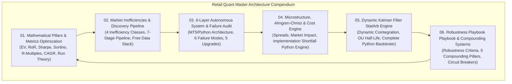

# Retail Quant Master Architecture: Comprehensive Compendium

## Overview of the Architecture

The **Retail Quant Master Architecture** encapsulates the mathematical formulas, econometric foundations, market microstructure models, execution engines, failure mode audits, and compounding risk frameworks necessary to build, validate, and trade institutional-grade systematic strategies on open-source infrastructure.

Located in: [`docs/analytical_frameworks_and_epistemology/bma_causal_autonomous_system/retail_quant_master_architecture/`](file:///c:/Users/User/OneDrive/Desktop/selfmade%20game%20projects/llm%20trader%20-%20Checkpoint%20dicisipline%20soilder%20-%20used%20in%20antigravity/docs/analytical_frameworks_and_epistemology/bma_causal_autonomous_system/retail_quant_master_architecture)

---

## Compendium of Modules

### 1. [Module 01: Mathematical Pillars & Trading Metrics Optimization](file:///c:/Users/User/OneDrive/Desktop/selfmade%20game%20projects/llm%20trader%20-%20Checkpoint%20dicisipline%20soilder%20-%20used%20in%20antigravity/docs/analytical_frameworks_and_epistemology/bma_causal_autonomous_system/retail_quant_master_architecture/01_MATHEMATICAL_PILLARS_AND_METRICS_OPTIMIZATION.md)
* **Core Principles**: The 6 core trading formulas ($\text{EV}, \text{RoR}, \text{Sharpe}, \text{Sortino}, \text{R-Multiple}, \text{CAGR}, \text{Streak Probability}$), Lottery mathematical expectancy proof ($-\$2.76$ per ticket), Ralph Vince / Balsara ruin probability models, Asymmetric capital loss recovery curve ($-50\% \to +100\%, -80\% \to +400\%$), Run theory and expected maximum loss streaks ($L_{\text{max}} \approx \frac{\ln N}{\ln(1/P_{\text{loss}})}$).
* **Institutional Techniques**: Simultaneous metric optimization via Dynamic Volatility Targeting, Multi-Strategy Ensembling, Meta-Labeling, Asymmetric Exits, and Quarter-Kelly Sizing ($0.25K^*$).
* **Reference Artifacts**: Strategy Optimization Matrix, Technique Impact Matrix, Master 5-Step Account Workflow, and Complete 6-Stage Chronological Metrics Reference Table.

### 2. [Module 02: Market Inefficiencies, Validation Pipeline & Open Data Stack](file:///c:/Users/User/OneDrive/Desktop/selfmade%20game%20projects/llm%20trader%20-%20Checkpoint%20dicisipline%20soilder%20-%20used%20in%20antigravity/docs/analytical_frameworks_and_epistemology/bma_causal_autonomous_system/retail_quant_master_architecture/02_MARKET_INEFFICIENCIES_AND_DISCOVERY_PIPELINE.md)
* **Core Principles**: The 4 major classes of market inefficiencies (Structural/Mandate, Options Gamma/VRP, Microstructure/Order Flow, Behavioral/PEAD).
* **Discovery Pipeline**: 4-step inefficiency extraction (Constraint identification $\to$ Feature engineering $\to$ OU Half-Life $\tau_{1/2} = \frac{\ln 2}{\kappa} \to$ Square-Root Law capacity modeling).
* **7-Stage Institutional Pipeline**: Hypothesis $\to$ Data Acquisition $\to$ Fractional Differentiation ($d \approx 0.40$) & Triple Barrier Meta-Labeling $\to$ Regime Conditioning $\to$ Combinatorial Purged Cross-Validation (CPCV) & Deflated Sharpe Ratio (DSR) $\to$ Transaction Cost Friction $\to$ Live Staging & Dynamic Allocation.
* **Open Data Stack**: FRED, Treasury, yfinance, CCXT, Tiingo, Forex Factory, and SEC EDGAR/FinBERT sentiment scoring with 4-tier pipeline diagrams.

### 3. [Module 03: Six-Layer Autonomous Architecture, Failure Mode Audit & Institutional Upgrades](file:///c:/Users/User/OneDrive/Desktop/selfmade%20game%20projects/llm%20trader%20-%20Checkpoint%20dicisipline%20soilder%20-%20used%20in%20antigravity/docs/analytical_frameworks_and_epistemology/bma_causal_autonomous_system/retail_quant_master_architecture/03_SIX_LAYER_AUTONOMOUS_SYSTEM_AND_FAILURE_AUDIT.md)
* **Core Principles**: End-to-end 6-layer architecture (Data Ingestion, Regime Detection, Dual Alpha Engines 3A/3B, Central Sizing & Portfolio Risk, Smart Execution Router, Telemetry & Circuit Breakers) with single-trade 6-step lifecycle and system operational reference matrix.
* **Failure Mode Audit**: 6 critical live failure vulnerabilities (Regime Lag/Hysteresis, Passive Limit Adverse Selection, Linear Correlation Collapse, Retail B-Book Broker Asymmetries & Execution Delays, Stop-Loss Hunting Sweeps, ML Concept Drift).
* **Institutional Upgrades**: Bayesian Online Changepoint Detection (BOCPD), Urgency-Aware Smart Order Routing (SOR), Dynamic Copula Tail Risk & Extreme Value Theory (EVT), Synthetic Stealth Stops & DMA/FIX 4.4 Migration, and Online Continual ML with Elastic Weight Consolidation (EWC).

### 4. [Module 04: Microstructure, Almgren-Chriss Market Impact & Transaction Cost Engine](file:///c:/Users/User/OneDrive/Desktop/selfmade%20game%20projects/llm%20trader%20-%20Checkpoint%20dicisipline%20soilder%20-%20used%20in%20antigravity/docs/analytical_frameworks_and_epistemology/bma_causal_autonomous_system/retail_quant_master_architecture/04_TRANSACTION_COST_ENGINE_AND_MARKET_IMPACT.md)
* **Core Principles**: Bid-Ask Spread Anatomy (Quoted, Effective, Realized Half-Spreads, Price Impact, Volume-Weighted Micro-Price $P_{\text{micro}}$), Dynamic Spread Simulation Model ($S_t = S_{\text{base}} \times [1 + \alpha(\sigma/\bar{\sigma}) + \beta(\bar{V}/V) + \gamma \mathbb{I}_{\text{event}}] \times M_{\text{session}}$).
* **Impact Formulations**: The Square-Root Law of Market Impact ($I_{\text{total}} = Y \sigma_{\text{daily}} \sqrt{Q/V_{\text{ADV}}}$), Almgren-Chriss permanent ($I_{\text{perm}}$) and temporary ($I_{\text{temp}}$) price impact, and Realized Execution Price ($P_{\text{exec}}$).
* **Production Code**: Complete executable Python class `TransactionCostEngine` with `OrderContext`, `MarketContext`, `CostBreakdown`, tiered broker/exchange/SEC/FINRA fee schedules, and runnable 50,000-share simulation.

### 5. [Module 05: Dynamic Kalman Filter Statistical Arbitrage Alpha Engine](file:///c:/Users/User/OneDrive/Desktop/selfmade%20game%20projects/llm%20trader%20-%20Checkpoint%20dicisipline%20soilder%20-%20used%20in%20antigravity/docs/analytical_frameworks_and_epistemology/bma_causal_autonomous_system/retail_quant_master_architecture/05_DYNAMIC_KALMAN_STATARB_ENGINE.md)
* **Core Principles**: Dynamic cointegration in state space ($\mathbf{\theta}_t = [\alpha_t, \beta_t]^T$), State and Measurement equations, Recursive Kalman Gain ($\mathbf{K}_t$), State Covariance updates, Ornstein-Uhlenbeck continuous mean-reversion process, and analytical half-life ($\tau_{1/2} = \frac{\ln 2}{\kappa}$).
* **Execution State Machine**: Standardized Z-Score entry ($|Z| > 2.0$), Mean-reversion target exit ($|Z| \le 0.20$), Structural stop ($|Z| \ge 3.0$), and Time decay exit ($t > 2\tau_{1/2}$).
* **Production Code**: Standalone executable Python class `DynamicKalmanStatArb` with `yfinance` ingestion, online Kalman state tracking, OU half-life computation, event-driven backtester with $1.0R$ risk sizing, cost modeling, and full audit telemetry (CAGR, Sharpe, Sortino, Calmar, MaxDD, Win Rate, Payoff, EV, SQN) tested on GDX vs GLD.

### 6. [Module 06: Robustness Playbook Robustness Playbook & Compounding Systems](file:///c:/Users/User/OneDrive/Desktop/selfmade%20game%20projects/llm%20trader%20-%20Checkpoint%20dicisipline%20soilder%20-%20used%20in%20antigravity/docs/analytical_frameworks_and_epistemology/bma_causal_autonomous_system/retail_quant_master_architecture/06_ROBUSTNESS_PLAYBOOK_PLAYBOOK_AND_COMPOUNDING_SYSTEMS.md)
* **Core Principles**: Dr. Author-C's Model Robustness Criteria (Economic Inefficiency Rationale, ADF/Johansen Cointegration Testing, Parameter Parsimony, The 50% Backtest Haircut Rule & Hurdle Rates, OU Time Stops over Fixed Price Stops).
* **5 Compounding Pillars**: Continuous Alpha Signal Layer, Dynamic Volatility Targeting ($\text{Size}_i \propto 1/\sigma_i$), Fractional Kelly Sizing ($0.25K^*$), Portfolio De-Correlation (combining 4 sleeves $r \le 0.15$ slashes portfolio volatility from 15% to 7.5%), and Trade Buffering (Robert Carver $\pm 10\%$ rule).
* **Institutional Comparison & Risk Safeguards**: Institutional vs Naive Retail Model Aspects Matrix, Portfolio Heat Ceiling ($3.0R - 4.0R$), Leverage constraints, 3-tier circuit breakers ($-3.0R$ intraday, $-6.0R$ weekly, $-15\%$ portfolio), and Hard Model Decommission Gate.

---

## Codebase Implementation Cross-References

| Quant Architecture Component | Module Reference | Codebase Implementation |
| :--- | :--- | :--- |
| **Deterministic Risk Gate & Sizing** | [Module 01](file:///c:/Users/User/OneDrive/Desktop/selfmade%20game%20projects/llm%20trader%20-%20Checkpoint%20dicisipline%20soilder%20-%20used%20in%20antigravity/docs/analytical_frameworks_and_epistemology/bma_causal_autonomous_system/retail_quant_master_architecture/01_MATHEMATICAL_PILLARS_AND_METRICS_OPTIMIZATION.md) & [Module 06](file:///c:/Users/User/OneDrive/Desktop/selfmade%20game%20projects/llm%20trader%20-%20Checkpoint%20dicisipline%20soilder%20-%20used%20in%20antigravity/docs/analytical_frameworks_and_epistemology/bma_causal_autonomous_system/retail_quant_master_architecture/06_ROBUSTNESS_PLAYBOOK_PLAYBOOK_AND_COMPOUNDING_SYSTEMS.md) | [`core/trading_safety.py`](file:///c:/Users/User/OneDrive/Desktop/selfmade%20game%20projects/llm%20trader%20-%20Checkpoint%20dicisipline%20soilder%20-%20used%20in%20antigravity/core/trading_safety.py) & [`core/risk_manager.py`](file:///c:/Users/User/OneDrive/Desktop/selfmade%20game%20projects/llm%20trader%20-%20Checkpoint%20dicisipline%20soilder%20-%20used%20in%20antigravity/core/risk_manager.py) |
| **Regime Detection & HMM Engine** | [Module 03](file:///c:/Users/User/OneDrive/Desktop/selfmade%20game%20projects/llm%20trader%20-%20Checkpoint%20dicisipline%20soilder%20-%20used%20in%20antigravity/docs/analytical_frameworks_and_epistemology/bma_causal_autonomous_system/retail_quant_master_architecture/03_SIX_LAYER_AUTONOMOUS_SYSTEM_AND_FAILURE_AUDIT.md) | [`intelligence/regime_classifier.py`](file:///c:/Users/User/OneDrive/Desktop/selfmade%20game%20projects/llm%20trader%20-%20Checkpoint%20dicisipline%20soilder%20-%20used%20in%20antigravity/intelligence/regime_classifier.py) |
| **Risk Parity & Volatility Allocation** | [Module 01](file:///c:/Users/User/OneDrive/Desktop/selfmade%20game%20projects/llm%20trader%20-%20Checkpoint%20dicisipline%20soilder%20-%20used%20in%20antigravity/docs/analytical_frameworks_and_epistemology/bma_causal_autonomous_system/retail_quant_master_architecture/01_MATHEMATICAL_PILLARS_AND_METRICS_OPTIMIZATION.md) & [Module 06](file:///c:/Users/User/OneDrive/Desktop/selfmade%20game%20projects/llm%20trader%20-%20Checkpoint%20dicisipline%20soilder%20-%20used%20in%20antigravity/docs/analytical_frameworks_and_epistemology/bma_causal_autonomous_system/retail_quant_master_architecture/06_ROBUSTNESS_PLAYBOOK_PLAYBOOK_AND_COMPOUNDING_SYSTEMS.md) | [`research/risk_parity_engine.py`](file:///c:/Users/User/OneDrive/Desktop/selfmade%20game%20projects/llm%20trader%20-%20Checkpoint%20dicisipline%20soilder%20-%20used%20in%20antigravity/research/risk_parity_engine.py) |
| **Synthetic AR(1) Monte Carlo** | [Module 01](file:///c:/Users/User/OneDrive/Desktop/selfmade%20game%20projects/llm%20trader%20-%20Checkpoint%20dicisipline%20soilder%20-%20used%20in%20antigravity/docs/analytical_frameworks_and_epistemology/bma_causal_autonomous_system/retail_quant_master_architecture/01_MATHEMATICAL_PILLARS_AND_METRICS_OPTIMIZATION.md) & [Module 02](file:///c:/Users/User/OneDrive/Desktop/selfmade%20game%20projects/llm%20trader%20-%20Checkpoint%20dicisipline%20soilder%20-%20used%20in%20antigravity/docs/analytical_frameworks_and_epistemology/bma_causal_autonomous_system/retail_quant_master_architecture/02_MARKET_INEFFICIENCIES_AND_DISCOVERY_PIPELINE.md) | [`research/synthetic_path_simulator.py`](file:///c:/Users/User/OneDrive/Desktop/selfmade%20game%20projects/llm%20trader%20-%20Checkpoint%20dicisipline%20soilder%20-%20used%20in%20antigravity/research/synthetic_path_simulator.py) |
| **Meta-Reflective Health Audit** | [Module 03](file:///c:/Users/User/OneDrive/Desktop/selfmade%20game%20projects/llm%20trader%20-%20Checkpoint%20dicisipline%20soilder%20-%20used%20in%20antigravity/docs/analytical_frameworks_and_epistemology/bma_causal_autonomous_system/retail_quant_master_architecture/03_SIX_LAYER_AUTONOMOUS_SYSTEM_AND_FAILURE_AUDIT.md) & [Module 06](file:///c:/Users/User/OneDrive/Desktop/selfmade%20game%20projects/llm%20trader%20-%20Checkpoint%20dicisipline%20soilder%20-%20used%20in%20antigravity/docs/analytical_frameworks_and_epistemology/bma_causal_autonomous_system/retail_quant_master_architecture/06_ROBUSTNESS_PLAYBOOK_PLAYBOOK_AND_COMPOUNDING_SYSTEMS.md) | [`intelligence/meta_reflector.py`](file:///c:/Users/User/OneDrive/Desktop/selfmade%20game%20projects/llm%20trader%20-%20Checkpoint%20dicisipline%20soilder%20-%20used%20in%20antigravity/intelligence/meta_reflector.py) |
| **Macro Data & Calendar Ingestion** | [Module 02](file:///c:/Users/User/OneDrive/Desktop/selfmade%20game%20projects/llm%20trader%20-%20Checkpoint%20dicisipline%20soilder%20-%20used%20in%20antigravity/docs/analytical_frameworks_and_epistemology/bma_causal_autonomous_system/retail_quant_master_architecture/02_MARKET_INEFFICIENCIES_AND_DISCOVERY_PIPELINE.md) & [Module 04](file:///c:/Users/User/OneDrive/Desktop/selfmade%20game%20projects/llm%20trader%20-%20Checkpoint%20dicisipline%20soilder%20-%20used%20in%20antigravity/docs/analytical_frameworks_and_epistemology/bma_causal_autonomous_system/retail_quant_master_architecture/04_TRANSACTION_COST_ENGINE_AND_MARKET_IMPACT.md) | [`intelligence/macrofundamental_pipeline.py`](file:///c:/Users/User/OneDrive/Desktop/selfmade%20game%20projects/llm%20trader%20-%20Checkpoint%20dicisipline%20soilder%20-%20used%20in%20antigravity/intelligence/macrofundamental_pipeline.py) |
