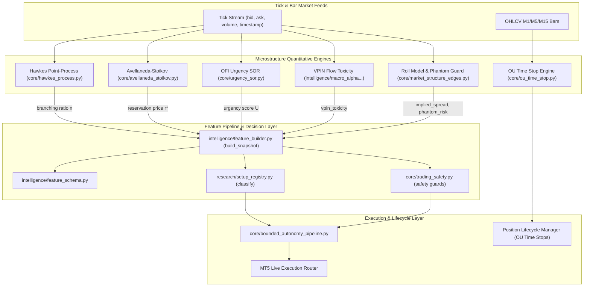

# Microstructure Scalp Trading Pipeline Design

**Date:** 2026-09-29  
**Status:** Approved  
**Author:** Antigravity  

---

## 1. Executive Summary & Goals

This specification defines the architectural design for transforming the system's scalping framework into a complete, institutional-grade **Microstructure Scalp Trading Pipeline**. 

The implementation achieves two primary goals:
1. **Phase 1: Deep Runtime Integration of Existing Standalone Engines**:
   - Order Flow Imbalance (OFI) & Urgency Scoring (`core/urgency_sor.py`).
   - Volume-Synchronized Probability of Toxicity (VPIN) (`intelligence/macro_alpha_signals_and_microstructure.py`).
   - Roll Model Effective Spread & Phantom Liquidity / Quote Stuffing Guards (`core/market_structure_edges.py`).
   - Ornstein-Uhlenbeck (OU) Dynamic Half-Life Time Stops (`core/ou_time_stop.py`).
2. **Phase 2: Research & Implementation of Missing Theoretical Models**:
   - **Hawkes Process Engine** (`core/hawkes_process.py`): Self-exciting point-process detecting order clustering and momentum cascades ($n = \alpha/\beta \ge 0.85$).
   - **Avellaneda-Stoikov Engine** (`core/avellaneda_stoikov.py`): Reservation pricing ($r^* = s - q\gamma\sigma^2(T-t)$) and optimal spread calculation for passive maker execution and inventory skew penalization.
   - **New Registered Setup**: `momentum_cascade_v1` in `research/setup_registry.py`.

---

## 2. Architecture & Data Flow

---

## 3. Detailed Component Specifications

### 3.1 Hawkes Process Engine (`core/hawkes_process.py`)
- **Mathematical Model**:
  The conditional intensity of trade arrivals is modeled as:
  $$\lambda(t) = \mu + \sum_{t_i < t} \alpha e^{-\beta (t - t_i)}$$
  Where:
  - $\mu > 0$: Exogenous baseline intensity (unprompted order flow).
  - $\alpha \ge 0$: Excitation factor (how much each trade increases arrival rate).
  - $\beta > 0$: Exponential decay rate of memory.
  - **Branching Ratio ($n$)**: $n = \frac{\alpha}{\beta}$.
- **Regimes & Signal Logic**:
  - $n \ge 0.85$: **Momentum Cascade** (self-exciting cluster indicating aggressive institutional continuation).
  - $n < 0.30$: **Poisson Baseline** (stationary, un-clustered order flow; ideal for range mean-reversion).
  - $n \ge 1.0$: **Super-Critical Explosion** (liquidity evaporation / runaway cascading wicks; pre-flight pause triggered).
- **Calibration**:
  Fast analytical/numerical Maximum Likelihood Estimation (MLE) over rolling tick arrival timestamps ($N \in [100, 500]$ ticks). Zero external heavy dependencies (pure NumPy/SciPy).

### 3.2 Avellaneda-Stoikov Engine (`core/avellaneda_stoikov.py`)
- **Mathematical Model**:
  - **Reservation / Indifference Price**:
    $$r(s, q, t) = s - q \gamma \sigma^2 (T - t)$$
    Where:
    - $s$: Current mid-price.
    - $q$: Current net inventory / open position exposure in units.
    - $\gamma$: Agent risk-aversion parameter ($0.1 \le \gamma \le 1.0$).
    - $\sigma^2$: Instantaneous asset return variance.
    - $T - t$: Scalp holding horizon (e.g., 15 minutes normalized).
  - **Optimal Half-Spread**:
    $$\delta^* = \frac{1}{2} \gamma \sigma^2 (T - t) + \frac{1}{\gamma} \ln\left(1 + \frac{\gamma}{\kappa}\right)$$
    Where $\kappa$ is order book depth liquidity density parameter.
- **Application in Scalp Routing**:
  - For passive limit orders ($U \le 0.30$), price entry at $r(s, q, t)$ instead of naive mid-price, capturing spread while avoiding adverse inventory skew.
  - Generates `avellaneda_reservation_price` and `avellaneda_spread_premium`.

### 3.3 Phase 1 Runtime Wiring
1. **`intelligence/feature_builder.py`**:
   - Enhance `build_snapshot` to accept optional microstructure context (`microstructure_context: Dict[str, Any]`).
   - Extract and output new scalar features:
     - `hawkes_branching_ratio`: float (clamped $[0.0, 2.0]$).
     - `hawkes_cascade_active`: bool ($n \ge 0.85$).
     - `vpin_toxicity`: float ($[0.0, 1.0]$).
     - `ofi_urgency_score`: float ($[0.0, 1.0]$).
     - `roll_implied_spread`: float ($> 0.0$).
     - `phantom_liquidity_flag`: bool.
     - `ou_half_life_bars`: float ($> 0.0$).
2. **`intelligence/feature_schema.py`**:
   - Register optional scalar definitions in `FEATURE_DEFINITIONS` with proper validation rules, finite-value checks, and hash stability.
3. **`research/setup_registry.py`**:
   - Register `momentum_cascade_v1`:
     - Requires: `hawkes_cascade_active == True`, `adx >= 25.0`, `volume_confirmed == True`, `confirmed_candle == True`, and `vpin_toxicity < 0.70`.
     - Target: $\ge 2.0R$.
   - Maintain 100% compatibility with `trend_pullback_v1`, `liquidity_sweep_reversal_v1`, `range_reversal_v1`, and `asian_range_breakout_v1`.
4. **`core/trading_safety.py`**:
   - Add safety pre-flight check:
     - Block entry if `phantom_liquidity_flag == True` or `vpin_toxicity >= 0.75` (toxic adverse selection guard).

---

## 4. Verification & Testing Strategy
- Unit tests for Hawkes MLE estimation and synthetic burst datasets (`tests/test_hawkes_process.py`).
- Unit tests for Avellaneda-Stoikov reservation pricing under varying inventory $q \in \{-2, 0, +2\}$ (`tests/test_avellaneda_stoikov.py`).
- Integration tests ensuring `feature_builder` and `setup_registry` remain 100% backward compatible with existing snapshot schemas (`tests/test_microstructure_scalp_pipeline.py`).
