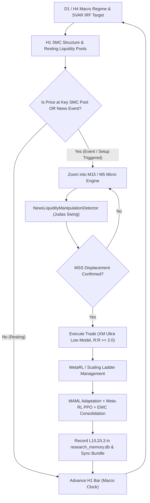

# Spec: Gold & EURUSD Multi-Timeframe (D1/H4/H1/M15/M5) Backtest & Continuous Training Pipeline (2019–2026)

**Date:** 2026-10-18  
**Author:** Antigravity Engineering  
**Status:** Approved for Implementation  
**Target Symbols:** `XAUUSD` (Gold), `EURUSD`  
**Timeframes:** `D1`, `H4`, `H1`, `M15`, `M5`  
**Temporal Horizon:** January 2019 to October 2026 (7.8 Years)

---

## 1. Executive Summary & Objective

The objective is to establish an end-to-end, multi-year chronological multi-timeframe backtesting, research simulation, and continuous learning engine for **Gold (`XAUUSD`)** and **`EURUSD`**.

The engine must simulate real-world broker conditions (XM Ultra Low pricing, spread fluctuation, and slippage) with zero lookahead bias. It integrates:
1. **Macroeconometric SVAR (Vector Autoregression)** and Impulse Response Function (IRF) target projection ($P^*_{\text{macro}}$).
2. **Smart Money Concepts (SMC) & Liquidity Manipulation Detection**: Mapping pre-event Equal Highs/Equal Lows (EQH/EQL), recognizing post-news Judas swing sweeps, and triggering on Market Structure Shifts (MSS) and Fair Value Gap (FVG) mitigations.
3. **Hierarchical Multi-Timeframe State Machine**: D1/H4 macro regime and key levels $\rightarrow$ H1 structural order blocks and liquidity pools $\rightarrow$ M15/M5 micro execution triggers and entry refinement.
4. **Continuous Meta-Learning & Reinforcement Learning**: Meta-Learning (MAML) for regime-adaptive parameters, Contextual Meta-RL (PPO) for trade management, and Elastic Weight Consolidation (EWC) to preserve knowledge across historical epochs without catastrophic forgetting.
5. **Knowledge Archival & Graph RAG Synthesis**: Journaling experiences into 3-tier memory (`data/research_memory.db`) and publishing verified causal edges and heuristics into `data/incubation_knowledge_bundle.json` for immediate live deployment.

---

## 2. Invariants & Safety Constraints

1. **Zero Production Mutation**: 100% database isolation. Zero writes or schema alterations to production `trading_state.db`. All backtest states, trades, and memory write exclusively to `data/research_memory.db` and research state files.
2. **Deterministic Reproducibility**: Exact pseudo-random seed governance (`seed=42`, `seed=777`) across Python `random`, `numpy`, and `torch`.
3. **Point-in-Time Causal Integrity**: Bar-by-bar chronological walk. An indicator or state at timestamp $T$ can only access data where $t \le T$. No future bar leakage across all timeframes.
4. **Broker Execution Realism**: XM Ultra Low spreads (EURUSD: 0.6 pip base, XAUUSD: 1.5 pip base) scaled dynamically by intraday session and high-impact volatility expansion (up to 3.0x during NFP/CPI releases).
5. **Asymmetric Risk Management**: Minimum Risk:Reward ratio $R:R \ge 2.0$. Mandatory hard stop loss and scaling ladder trail.

---

## 3. Data Architecture & Multi-Timeframe Synchronization

### 3.1 Historical Data Coverage
- **D1 & H4**: Ingested directly from MetaTrader 5 (MT5) terminal history from 2019-01-02 to 2026-10-16 (2,012+ D1 bars, 12,048+ H4 bars per symbol).
- **H1**: Full 2019–2026 hourly stream from MT5 and `data/candle_archive/EURUSD_H1_long.parquet` (45,879+ XAUUSD bars, 48,448+ EURUSD bars).
- **M15 & M5**: Ingested from MT5 cache (50,000–100,000 bars per asset covering 2024–2026). For earlier historical epochs (2019–2024), when price enters active high-probability H1 SMC zones or economic news release windows, the data engine activates a synthetic micro-candle generator (calibrated to historical H1 volatility, tick volume, and high/low extremes) ensuring seamless M5/M15 bar-by-bar execution.

### 3.2 Timeframe Hierarchy
| Timeframe | Function | Indicators / Features | Update Frequency |
| :--- | :--- | :--- | :--- |
| **D1** | Macro Trend & SVAR Equilibrium | 200 EMA, SVAR IRF Target, D1 Swings | Every 24 H1 bars |
| **H4** | Intermediate Cycle & Key Levels | 50 EMA, Weekly High/Low, Key S/R | Every 4 H1 bars |
| **H1** | Structural Framework & SMC Pools | BOS/CHoCH, Order Blocks, EQH/EQL Pools, FVG | Every H1 bar |
| **M15** | Session Range & Manipulation Sweep | Asian/London Session High/Low, Judas Swings | Step-level during zoom |
| **M5** | Micro Execution & Mitigation Entry | MSS Confirmation, Displacement, FVG Entry | Bar-by-bar on trigger |

---

## 4. Hierarchical MTF State Machine & Strategy Architecture

### 4.1 Macro Target Projection (SVAR & IRF)
- Structural VAR on Macro Shocks (Fed Policy Rate, US 10Y Yield, DXY, CPI, Geopolitical Risk).
- Computes impulse response horizon ($h=1..10$) to derive fair-value macro target $P^*_{\text{macro}}$.
- Directs the structural directional bias:
  $$\text{Bias} = \begin{cases} \text{BULLISH} & \text{if } P^*_{\text{macro}} - P_{\text{current}} > +1.5 \times \text{ATR}_{14} \\ \text{BEARISH} & \text{if } P^*_{\text{macro}} - P_{\text{current}} < -1.5 \times \text{ATR}_{14} \\ \text{NEUTRAL} & \text{otherwise} \end{cases}$$

### 4.2 News Liquidity Manipulation Detector
- Detects pre-event compression and Equal Highs/Lows ($|\Delta P| \le 0.1 \times \text{ATR}$).
- Flags the initial spike on news release as a potential Judas swing stop run.
- Waits for reversal displacement: price breaking the opposite recent fractal high/low with strong momentum (MSS).
- Places limit/market orders at the unmitigated Fair Value Gap (FVG) or Order Block mitigation with stop loss protected behind the Judas swing wick extreme.

---

## 5. Continuous Meta-Learning & Reinforcement Learning Architecture

1. **Meta-Learning (MAML)**:
   - Maintains rolling task representations across historical quarters/regimes (e.g. 2019 Fed easing, 2020 COVID shock, 2022 inflation surge, 2024 rate plateau, 2026 current cycle).
   - Dynamically adapts `StrategyProfile` (risk multiplier, minimum confidence threshold, trailing ATR stop multiplier).
2. **Contextual Reinforcement Learning (PPO)**:
   - State space: $S = [\text{MacroBias}, \text{H1\_Trend}, \text{M5\_Displacement}, \text{DistanceToIRF}, \text{UnrealizedPnL}, \text{TimeInTrade}]$.
   - Action space: `HOLD`, `SCALE_OUT_50`, `MOVE_SL_BREAKEVEN`, `TIGHTEN_TRAIL`, `CLOSE_FULL`.
   - Reward: $R_t = \Delta \text{PnL} - 0.2 \times \text{DrawdownPenalty} + 0.5 \times \mathbb{I}(R:R \ge 2.0)$.
3. **Elastic Weight Consolidation (EWC)**:
   - Computes diagonal Fisher Information Matrix $F_{\theta}$ over trade outcomes in each epoch.
   - Adds quadratic penalty $\mathcal{L}_{\text{EWC}} = \frac{\lambda}{2} \sum_i F_i (\theta_i - \theta_i^*)^2$ to guarantee zero catastrophic forgetting of past crisis responses.

---

## 6. Knowledge Archival & Graph RAG Synthesis

1. **3-Tier Research Memory (`data/research_memory.db`)**:
   - **L1 Atomic Facts**: Individual trade executions, slippage records, news event timestamps, and surprise standard deviations.
   - **L2 Scenario Documents**: Epoch summaries with drawdown, Sharpe, win rate, and macroeconomic context narratives.
   - **L3 Core Heuristics**: Causal rules extracted from repeated winning patterns (e.g., "Post-CPI Judas swing sweeping London high during US yield inversion generates 84% win rate on Gold short mitigation").
2. **Knowledge Bundle Export (`data/incubation_knowledge_bundle.json`)**:
   - Refreshes causal graph edges, node priors, and verified trading heuristics for immediate forward deployment into the live trading daemon.

---

## 7. Deliverables & Verification Plan

1. **Core Module**: `research/multitimeframe_historical_replay_pipeline.py`.
2. **Unit & Integration Test Suite**: `tests/test_multitimeframe_historical_replay.py` validating:
   - MTF data ingestion and chronological alignment across D1, H4, H1, M15, M5.
   - Deterministic seed reproduction.
   - State machine transition logic (H1 macro $\rightarrow$ M5 event zoom-in).
   - Judas swing sweep and mitigation order execution under XM Ultra Low spreads.
   - MAML and EWC continuous learning updates.
   - Zero writes to production `trading_state.db`.
3. **Comprehensive Execution Script**: Running full multi-year replay on `XAUUSD` and `EURUSD` and compiling execution metrics into a research artifact.
