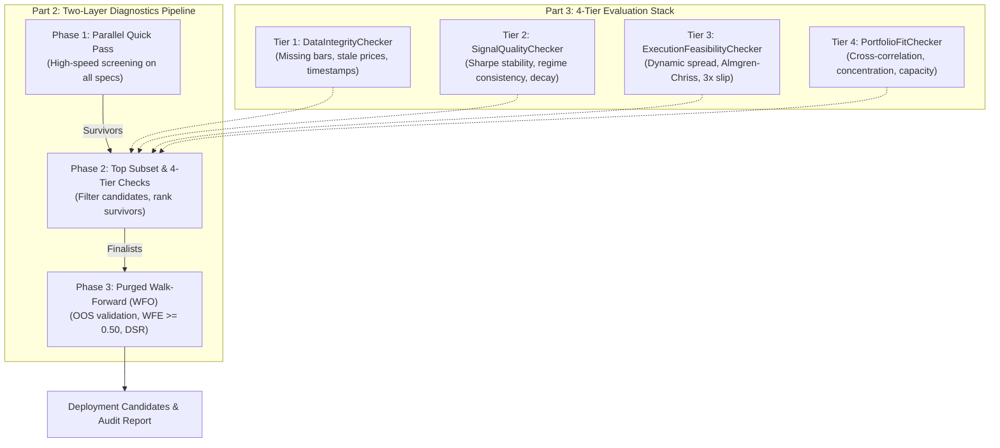

# Design Spec: Parallel & Sequential Diagnostics Pipeline & 4-Tier Evaluation Engine

**Date:** 2026-10-22  
**Status:** Approved  
**Author:** Pair Programming Agent & User  
**Target Architecture:** `core/diagnostics_engine.py`, `core/strategy_universe.py`, `core/transaction_cost_engine.py`

---

## 1. Overview & Purpose

This specification implements **Part 2** ("Run diagnostics in parallel and sequentially") and **Part 3** ("Build the evaluation engine correctly") of the 15-part institutional quant operating framework.

The engine provides:
1. **A 4-Tier Evaluation Stack**: Data integrity verification, signal quality and decay analysis, execution feasibility and slippage stress-testing, and portfolio fit / correlation controls.
2. **A 3-Phase Diagnostics Pipeline**:
   - **Phase 1: Quick Pass**: Fast screening of all generated strategies across a common dataset using Polars and Numba.
   - **Phase 2: Top Subset Filter**: Deep 4-tier audit to eliminate brittle or cost-sensitive candidates.
   - **Phase 3: Deep Walk-Forward Optimization (WFO)**: Purged and embargoed out-of-sample validation verifying Walk-Forward Efficiency (WFE) and Deflated Sharpe Ratio (DSR).
3. **Autonomous Telemetry**: Emits detailed event payloads via `core.agent_event_bus` at each milestone.

---

## 2. Technical Architecture

---

## 3. Detailed Component Specifications

### 3.1 Tier 1: Data Integrity Checker (`DataIntegrityChecker`)
- Validates price dataset before backtesting:
  - Missing bars: checks for gaps between successive timestamps exceeding normal bar interval.
  - Stale prices: flags periods where price remains unchanged for $> 10$ consecutive bars.
  - Non-monotonicity: flags out-of-order timestamps.
  - Negative or zero price values.
- Dataclass: `DataIntegrityReport(is_clean: bool, missing_bars: int, stale_bars: int, issues: List[str])`.

### 3.2 Tier 2: Signal Quality Checker (`SignalQualityChecker`)
- Evaluates statistical robustness of signals:
  - Fold Sharpe stability: compares first half vs second half Sharpe ratio; flags strategies where Sharpe drops by $> 50\%$.
  - Regime consistency: tests performance across market regimes (`BULL_TREND`, `BEAR_TREND`, `SIDEWAYS`, `HIGH_VOL`); requires positive Sharpe in $\ge 60\%$ of regimes.
  - Alpha decay / turnover: tracks trade frequency per 100 bars.
- Dataclass: `SignalQualityReport(passed: bool, sharpe_stability: float, regime_consistency_pct: float, issues: List[str])`.

### 3.3 Tier 3: Execution Feasibility Checker (`ExecutionFeasibilityChecker`)
- Stress-tests execution frictions:
  - Computes baseline dynamic spread and Almgren-Chriss market impact using `core/transaction_cost_engine.py`.
  - Simulates performance under $1\times, 2\times,$ and $3\times$ baseline slippage.
  - Fails strategy if $3\times$ slippage reduces net return by $> 60\%$ or turns net PnL negative.
- Dataclass: `ExecutionCheckReport(is_viable: bool, baseline_cost_bps: float, slippage_degradation_pct: float, issues: List[str])`.

### 3.4 Tier 4: Portfolio Fit Checker (`PortfolioFitChecker`)
- Evaluates fit into existing multi-strategy portfolio:
  - Cross-correlation: computes Pearson correlation against benchmark or active strategies; requires $\rho < 0.70$.
  - Capacity estimation: estimates maximum trade capacity based on 2% ADV participation constraint.
- Dataclass: `PortfolioFitReport(fit_passed: bool, max_correlation: float, capacity_usd: float, issues: List[str])`.

### 3.5 Two-Layer Diagnostics Pipeline (`DiagnosticsPipeline`)
- Orchestrates multi-phase evaluation:
  - `run_phase1_quick_pass(specs, dataset) -> List[StrategySpec]`: filters out Sharpe $< 0.4$, MaxDD $> 30\%$, Trades $< 10$. Emits `DIAGNOSTIC_PHASE1_COMPLETED`.
  - `run_phase2_tier_audit(survivors, dataset) -> List[StrategySpec]`: executes all 4 evaluation tiers. Emits `DIAGNOSTIC_PHASE2_COMPLETED`.
  - `run_phase3_walk_forward(finalists, dataset, n_splits=4) -> DiagnosticsPipelineReport`: runs rolling purged walk-forward splits. Requires WFE $\ge 0.50$. Emits `DIAGNOSTIC_PHASE3_COMPLETED`.

---

## 4. Deliverables

1. `core/diagnostics_engine.py`: 4 checkers, evaluation report dataclasses, and `DiagnosticsPipeline`.
2. `tests/test_diagnostics_engine.py`: Unit and integration tests covering all 4 tiers and the 3-phase pipeline.
