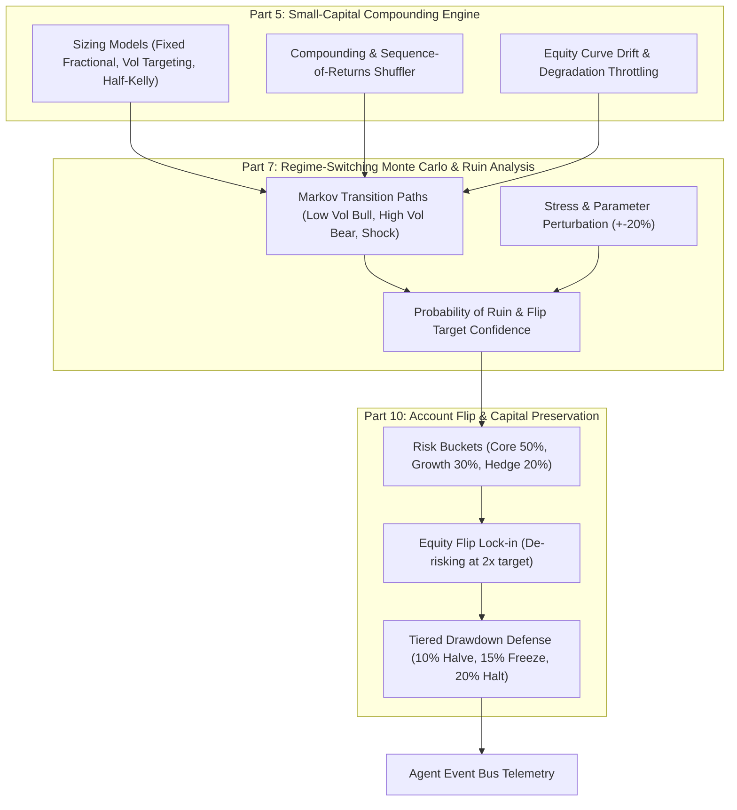

# Design Spec: Small-Capital Compounding, Regime Monte Carlo & Account Flip Engine

**Date:** 2026-10-23  
**Status:** Approved  
**Author:** Pair Programming Agent & User  
**Target Architecture:** `core/growth_and_ruin_engine.py`, `operations/account_growth.py`, `research/regime_monte_carlo.py`

---

## 1. Scope & System Vision

This specification unifies **Part 5** ("Separate small-capital growth backtest"), **Part 7** ("Monte Carlo simulations & survivability"), and **Part 10** ("Account flip planning & capital preservation") into a unified, high-performance module: `core/growth_and_ruin_engine.py`.

The engine guarantees:
1. Mathematical modeling of compounding micro/small capital ($500–$10k) under strict drawdown constraints.
2. Sequence-of-returns path shuffling and Kelly/vol-targeting risk bounds.
3. Vectorized Monte Carlo simulation across Markov regimes and parameter perturbations.
4. Bucket-based account flip planning, automatic de-risking at capital double thresholds, and tiered drawdown defense.
5. Fail-closed security (`execution_authority = False` by default).

---

## 2. Technical Architecture

---

## 3. Detailed Specifications

### 3.1 `SmallCapitalGrowthSimulator` (Part 5)
- **Sizing Modes**:
  - `FIXED_FRACTIONAL`: Risk fixed fraction $f$ of equity (default 1.0%).
  - `VOLATILITY_TARGETING`: Risk inversely proportional to volatility.
  - `HALF_KELLY`: $f^* = \frac{1}{2} \cdot \left(p - \frac{1-p}{b}\right)$, bounded between 0.2% and 2.0%.
  - `DYNAMIC_LEVERAGE`: Scales leverage inversely to drawdown depth.
- **Drawdown Kill Switch**: Path terminates if drawdown reaches `kill_dd_pct` (default 15.0%).
- **Sequence Permutations**: Simulates $N=1,000$ random shuffles of trade sequences to determine sequence-of-returns risk.
- **Drift Throttling**: Reduces suggested risk by 50% if rolling expectancy over 20 trades degrades by $\ge 25\%$.

### 3.2 `AdvancedMonteCarloEngine` (Part 7)
- **Markov Transition Engine**: Generates state paths across 3 regimes (`BULL`, `BEAR`, `SHOCK`) with transition probabilities.
- **Perturbation Testing**: Perturbs win rate by $\pm 10\%$ and payoff ratio by $\pm 20\%$.
- **Outputs**:
  - `probability_of_ruin`: Fraction of paths breaching 50% drawdown.
  - `probability_dd_over_20`: Fraction of paths breaching 20% drawdown.
  - `median_cagr`, `p5_equity`, `p95_equity`.
  - `probability_target_flip`: Probability of doubling starting capital within $N$ trades.

### 3.3 `AccountFlipController` (Part 10)
- **Risk Buckets**:
  - `CORE` (50% risk budget)
  - `GROWTH` (30% risk budget)
  - `HEDGE` (20% risk budget)
- **Equity Flip Trigger**: When current equity reaches $2.0 \times$ starting baseline, triggers `ACCOUNT_FLIP_TRIGGERED`, locks baseline profits, and resets risk fraction to conservative floor.
- **Tiered Drawdown Escalation**:
  - $DD \ge 10\%$: Risk multiplier = 0.50.
  - $DD \ge 15\%$: Growth bucket disabled, risk multiplier = 0.25.
  - $DD \ge 20\%$: Emergency halt, `is_halted = True`.

---

## 4. Deliverables

1. `core/growth_and_ruin_engine.py`:
   - `SizingMode(str, Enum)`, `GrowthSimulationResult`, `MonteCarloRuinResult`, `AccountFlipState`.
   - `SmallCapitalGrowthSimulator`, `AdvancedMonteCarloEngine`, `AccountFlipController`.
   - Integrated event bus telemetry dispatches.
2. `tests/test_growth_and_ruin_engine.py`:
   - Unit tests covering compounding, sizing models, sequence permutations, Monte Carlo ruin calculations, and account flip de-risking logic.
