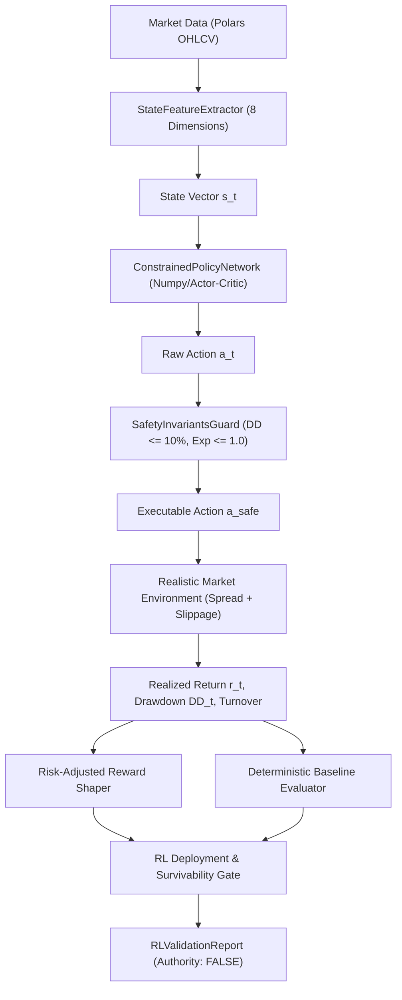

# Part 8: Constrained Reinforcement Learning (RL) Policy Engine — Subsystem Design

**Document ID:** `DESIGN-2026-10-24-CONSTRAINED-RL-POLICY`  
**Standard:** Institutional Quantitative Operating Framework (Part 8)  
**Status:** Approved  
**Date:** 2026-10-24  

---

## 1. Overview & Objectives

Part 8 of the quantitative framework governs the deployment of Reinforcement Learning (RL). RL is explicitly prohibited from being treated as an unconstrained or unverified "black-box" model. It must operate within hard mathematical boundaries:
1. **Realistic State Feature Space (8 Factors):**
   - Volatility ($\text{ATR}_{14} / \text{Price}$ or rolling return std).
   - Trend (EMA slope or 20/50 crossover).
   - Momentum (RSI 14 or ROC 10).
   - Spread (in basis points).
   - Macro sentiment / rate bias score.
   - Market Liquidity (volume / rolling ADV).
   - Order book top-of-book skew / microstructure pressure.
   - Regime classification flag (integer code 0–5 for `BULL`, `BEAR`, `SIDEWAYS`, `HIGH_VOL`, `LOW_VOL`, `STRESS`).

2. **Discrete Constrained Action Space (6 Actions):**
   - `HOLD` (0): Maintain existing position state.
   - `ADD_EXPOSURE` (1): Increment exposure by +0.25 (capped at max exposure).
   - `TRIM_EXPOSURE` (2): Decrement exposure by 50%.
   - `HEDGE` (3): Open an inverse beta offset to neutralize delta.
   - `FLATTEN` (4): Immediately liquidate all positions.
   - `REBALANCE` (5): Align exposure strictly with inverse volatility target.

3. **Hard Safety Constraints:**
   - **Max Drawdown Cap:** If drawdown $\ge 10.0\%$, the action is forcefully overridden to `FLATTEN` and further risk-taking is locked out.
   - **Exposure Cap:** Exposure is bounded in $[-1.0, +1.0]$. Leverage exceeding $1.0\times$ is rejected.
   - **Turnover Cap:** Excessive churn is penalized via quadratic friction penalty.
   - **Risk Budget:** Risk per trade cannot exceed $1.0\%$ of capital.

4. **Risk-Adjusted Reward Function:**
   Instead of raw P&L, rewards reflect risk-adjusted Sharpe accretion:
   $$R_t = r_t - \lambda_{dd} \cdot \max(0, \Delta DD_t) - \lambda_{turnover} \cdot |\Delta a_t| \cdot \text{Cost}_{bps} - \lambda_{vol} \cdot \sigma_t$$

5. **Deterministic Baseline Gate:**
   The RL policy must be evaluated directly against a deterministic supervised/rule-based baseline (e.g. static trend-following / dual momentum). If the RL policy fails to achieve higher Sharpe or lower drawdown than the deterministic baseline, it is rejected.

6. **Safety Standard:**
   `execution_authority = False` hard-latched across all telemetry and reports.

---

## 2. Architecture & Data Flow



---

## 3. Data Structures

```python
@dataclass
class RLStateVector:
    volatility: float
    trend: float
    momentum: float
    spread_bps: float
    macro_score: float
    liquidity_ratio: float
    order_book_imbalance: float
    regime_code: int

@dataclass
class PolicyEvaluationResult:
    total_return_pct: float
    sharpe: float
    sortino: float
    max_drawdown_pct: float
    turnover: float
    win_rate_pct: float
    pnl_mean: float
    pnl_std: float

@dataclass
class ConstrainedRLReport:
    symbol: str
    timeframe: str
    total_bars: int
    rl_metrics: PolicyEvaluationResult
    baseline_metrics: PolicyEvaluationResult
    sharpe_outperformance: float
    drawdown_reduction_pct: float
    gate_passed: bool
    rejection_reasons: List[str]
    execution_authority: bool = False
```
