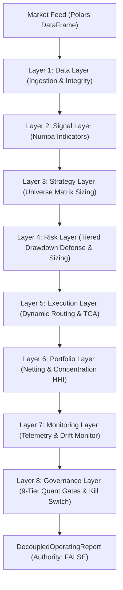

# Part 13: 8-Layer Decoupled Operating Structure — Subsystem Design

**Document ID:** `DESIGN-2026-10-24-DECOUPLED-OPERATING-LAYERS`  
**Standard:** Institutional Quantitative Operating Framework (Part 13)  
**Status:** Approved  
**Date:** 2026-10-24  

---

## 1. Overview & Objectives

Part 13 formalizes the structural decoupling of the institutional trading engine into 8 strictly isolated operating layers. In quantitative finance, modular decoupling prevents cross-contamination between data anomalies, alpha signal generation, risk boundaries, and execution venues:

1. **Layer 1: Data Layer (`DataLayer`):**
   - High-throughput ingestion of market OHLCV data using Polars.
   - Bar alignment, timezone normalization, gap detection, and Tier 1 data integrity verification.
2. **Layer 2: Signal Layer (`SignalLayer`):**
   - Fast vectorized technical indicator generation using Numba kernels.
   - Microstructure feature calculation and multi-timeframe alpha factor extraction.
3. **Layer 3: Strategy Layer (`StrategyLayer`):**
   - Strategy Universe Matrix taxonomy (15 styles $\times$ 12 types).
   - Generates raw unconstrained trade intents and directional signals.
4. **Layer 4: Risk Layer (`RiskLayer`):**
   - Tiered drawdown defense:
     - Drawdown $\ge 10\% \implies$ halve exposure (scale factor 0.50).
     - Drawdown $\ge 15\% \implies$ freeze new entries (scale factor 0.0).
     - Drawdown $\ge 20\% \implies$ halt all operations and force emergency liquidation.
   - Sizing spine: volatility targeting and 1% risk per trade cap.
5. **Layer 5: Execution Layer (`ExecutionLayer`):**
   - Dynamic order router: TWAP, VWAP, POV, and Iceberg simulation.
   - Microstructure transaction cost engine (endogenous spread + slippage + market impact).
6. **Layer 6: Portfolio Layer (`PortfolioLayer`):**
   - Multi-asset position netting.
   - Cross-strategy correlation checks and Herfindahl concentration index ($HHI \le 0.40$).
7. **Layer 7: Monitoring Layer (`MonitoringLayer`):**
   - Real-time audit telemetry via `AgentEventBus`.
   - Alpha decay detection and model parameter drift tracking.
8. **Layer 8: Decision & Governance Layer (`GovernanceLayer`):**
   - 9-tier quant gates verification before deployment approval.
   - Promotion package compiler and operator kill-switch verification.
   - Hard-latch: `execution_authority = False` (fail-closed).

---

## 2. Architecture & Data Flow



---

## 3. Data Structures

```python
@dataclass
class Layer1DataOutput:
    clean_df: pl.DataFrame
    is_clean: bool
    total_bars: int
    issues: List[str]

@dataclass
class Layer2SignalOutput:
    signals_dict: Dict[str, np.ndarray]
    feature_count: int

@dataclass
class Layer3StrategyOutput:
    strategy_candidates: List[StrategySpec]
    candidate_count: int

@dataclass
class Layer4RiskOutput:
    risk_tier: str
    exposure_scale: float
    current_drawdown_pct: float
    is_halted: bool

@dataclass
class Layer5ExecutionOutput:
    routed_orders_count: int
    execution_algo: str
    total_cost_bps: float

@dataclass
class Layer6PortfolioOutput:
    hhi_concentration: float
    effective_bets: float
    max_correlation: float
    netted_exposure: float

@dataclass
class Layer7MonitoringOutput:
    decay_alerts: List[str]
    drift_detected: bool
    events_emitted: int

@dataclass
class Layer8GovernanceOutput:
    gate_verdict: str
    passed_gates_count: int
    total_gates_count: int
    kill_switch_active: bool
    execution_authority: bool = False

@dataclass
class DecoupledOperatingReport:
    symbol: str
    timeframe: str
    timestamp: float
    layer1_data: Layer1DataOutput
    layer2_signal: Layer2SignalOutput
    layer3_strategy: Layer3StrategyOutput
    layer4_risk: Layer4RiskOutput
    layer5_execution: Layer5ExecutionOutput
    layer6_portfolio: Layer6PortfolioOutput
    layer7_monitoring: Layer7MonitoringOutput
    layer8_governance: Layer8GovernanceOutput
    execution_authority: bool = False
```
