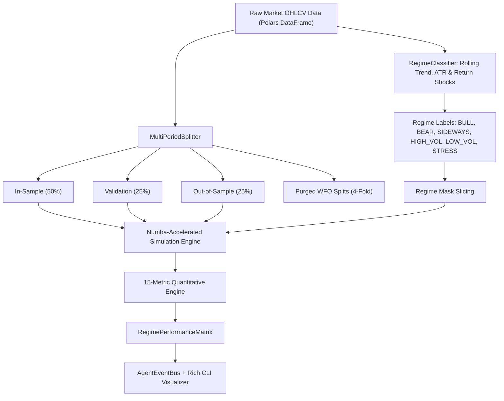

# Part 4: Regime-Aware Backtesting Engine — Subsystem Design

**Document ID:** `DESIGN-2026-10-24-REGIME-AWARE-BACKTEST`  
**Standard:** Institutional Quantitative Operating Framework (Part 4)  
**Status:** Approved  
**Date:** 2026-10-24  

---

## 1. Overview & Objectives

Part 4 mandates that strategy backtesting must never be conducted as a single monolithic full-period evaluation. Financial markets continuously transition across structural market regimes, and a strategy that performs well in an upward-trending bull market can suffer catastrophic drawdowns during volatility expansions or sideways consolidation.

The **Regime-Aware Backtesting Engine** (`core/regime_backtester.py`) delivers:
1. **Multi-Period Partitioning:**
   - In-Sample (IS): 50% training/discovery split.
   - Validation Tuning (VAL): 25% parameter sensitivity and slippage calibration split.
   - Out-of-Sample (OOS): 25% blind forward testing split.
   - Purged Walk-Forward Optimization (WFO): Rolling $k$-fold cross-validation with purge buffers calculating Walk-Forward Efficiency ($WFE = \text{OOS Sharpe} / \text{IS Sharpe} \ge 0.50$).
   - Market Stress Windows: Identification and isolated evaluation of high-volatility, crash, and liquidity-shock segments.
2. **Canonical 6-Regime Classifier:**
   - `BULL`: Positive trend slope ($> +0.05\%$) with normal/low volatility.
   - `BEAR`: Negative trend slope ($< -0.05\%$) with elevated volatility.
   - `SIDEWAYS`: Flat trend slope ($|\text{slope}| \le 0.05\%$) with normal/low volatility.
   - `HIGH_VOL`: Top-quartile volatility ($\ge 75\text{th percentile}$).
   - `LOW_VOL`: Bottom-quartile volatility ($\le 25\text{th percentile}$).
   - `STRESS`: Drawdown from rolling peak $\ge 3\%$ or severe negative price shock ($> 3\sigma$).
3. **15-Metric Full Evaluation Matrix:**
   Evaluates each candidate strategy both globally and conditioned across each regime:
   1. Return %
   2. Annualized Volatility
   3. Sharpe Ratio
   4. Sortino Ratio
   5. Calmar Ratio
   6. Max Drawdown %
   7. Profit Factor
   8. Win Rate %
   9. Average Win / Average Loss Ratio
   10. Mathematical Expectancy
   11. Turnover Rate
   12. Market Exposure %
   13. Average Trade Duration (Bars)
   14. Slippage-Adjusted Return %
   15. P&L Distribution Profile (Mean, Std, Skewness, Kurtosis, Value at Risk $\text{VaR}_{95\%}$, Conditional Value at Risk $\text{CVaR}_{95\%}$)
4. **Execution Authority Hard-Gate:**
   `execution_authority = False` hardcoded across all reports and emissions.

---

## 2. Architecture & Data Flow



---

## 3. Interfaces & Data Structures

```python
@dataclass
class PnLDistribution:
    mean_return: float
    std_return: float
    skewness: float
    kurtosis: float
    var_95: float
    cvar_95: float

@dataclass
class StrategyRegimeMetrics:
    total_return_pct: float
    annualized_volatility: float
    sharpe: float
    sortino: float
    calmar: float
    max_drawdown_pct: float
    profit_factor: float
    win_rate_pct: float
    win_loss_ratio: float
    expectancy: float
    turnover: float
    exposure_pct: float
    avg_trade_duration_bars: float
    slippage_adjusted_return_pct: float
    pnl_distribution: PnLDistribution

@dataclass
class RegimeBacktestReport:
    strategy_id: str
    symbol: str
    timeframe: str
    total_bars: int
    overall_metrics: StrategyRegimeMetrics
    is_metrics: StrategyRegimeMetrics
    val_metrics: StrategyRegimeMetrics
    oos_metrics: StrategyRegimeMetrics
    regime_breakdown: Dict[str, StrategyRegimeMetrics]
    walk_forward_efficiency: float
    wfe_passed: bool
    stress_survival_passed: bool
    execution_authority: bool = False
```

---

## 4. Verification Plan

- Unit tests for `RegimeClassifier`: ensure proper labeling of synthetic trend, mean-reversion, and shock slices.
- Unit tests for 15-metric engine: verify mathematical correctness of skew, kurtosis, VaR, CVaR, win/loss ratio, and expectancy.
- End-to-end integration test: run complete regime backtest across sample strategies on 1,000 bars.
- CLI verification: `rtk python mt5_trader.py quant regime-backtest --symbol EURUSD --timeframe H1 --bars 300`.
