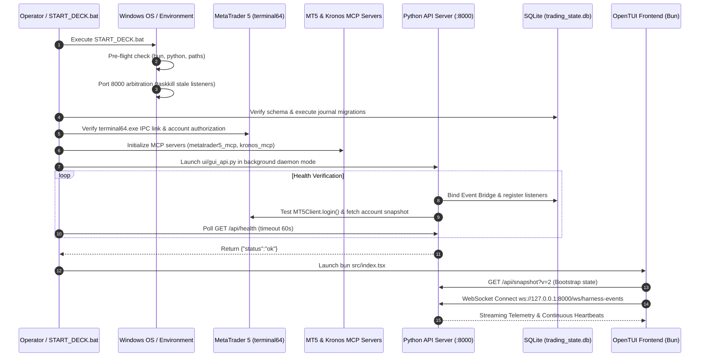

# Initialization & Startup: Optimal End-to-End Workflow Specification

> **Document ID:** `SYS-INIT-002`  
> **Status:** APPROVED / ARCHITECTURAL SPECIFICATION  
> **Scope:** Cold-start orchestration, daemon management, broker binding, IPC channels, and OpenTUI frontend attachment.

---

## 1. System Cold-Start Architecture

The system startup follows a deterministic 5-stage boot sequence designed to prevent race conditions, port contention, and unauthenticated broker queries.

---

## 2. Stage Breakdown & Detailed Requirements

### Stage 1: Pre-Flight & Environment Validation
- **Runtime Resolution**:
  - Resolve `bun.exe` at `%USERPROFILE%\.bun\bin\bun.exe` or system `PATH`.
  - Resolve `python.exe` (minimum 3.10+, verified on Python 3.13).
  - Verify directory paths containing spaces (e.g. `llm trader - Checkpoint dicisipline soilder - used in antigravity`) are safely quoted with double-quotes (`"%PROJECT_ROOT%"`) to prevent Windows `cmd.exe` volume label parsing errors.
- **Dependency & Node Modules Verification**:
  - Check for `%PROJECT_ROOT%tui_opentui\node_modules`. If missing, execute `bun install` before attempting UI launch.

### Stage 2: Port Arbitration & Process Cleanup
- **Port 8000 Ownership**:
  - Stale Python or Uvicorn instances holding `127.0.0.1:8000` are detected via `netstat -aon | findstr :8000 | findstr LISTENING`.
  - Any orphan PID is cleanly terminated with `taskkill /PID <PID> /F` prior to launching the new server.
  - The API launcher invokes `kill_port(8000)` internally in `start_api_server()` as a secondary defensive guarantee.

### Stage 3: Database & Immutability Ledger Verification
- **SQLite Engine Initialization**:
  - Connect to `%PROJECT_ROOT%trading_state.db`.
  - Validate core operational tables:
    - `operational_events`: Immutable audit trail with SHA-256 payload hashes and `operational_events_immutable_update` triggers.
    - `agent_runs`: Heartbeat, status (`RUNNING`, `COMPLETED`, `STALE_RECOVERED`), and agent payloads.
    - `harness_events`: Correlation IDs, session IDs, and event envelopes (`DATA_SOURCE_REFRESH`, `DELIBERATION_STEP`).
    - `trades`: Execution history, tickets, pips, R-multiples, and commission records.
- **Fail-Closed Migration**:
  - If schema version is outdated, execute `journal_migration.py` before starting broker bridge or trading loops.

### Stage 4: Broker & Model Bridge Binding
- **MetaTrader 5 Native Bridge**:
  - Initialize MT5 IPC via `MetaTrader5` package.
  - Verify account login against configuration (`Config.from_sources()`):
    - Account: `5055089321` (Demo).
    - Server: `MetaQuotes-Demo`.
    - Auto-trading permission: **Must be ENABLED** (`trade_allowed == True`).
  - If terminal is offline, start `terminal64.exe` or raise `MT5UnavailableWarning` while setting `is_connected: false`.
- **Kronos Foundation Model MCP**:
  - Verify MCP bridge running on `python -m kronos_mcp.main` for multi-timeframe deep forecasting.

### Stage 5: OpenTUI Connection & Real-Time Streaming
- **Initial State Hydration**:
  - OpenTUI boots `src/index.tsx` using Bun.
  - `src/transport/live.ts` triggers `GET /api/snapshot?v=2` to fetch the complete initial state (Account, PnL, Positions, Autonomy tier, Strategy registry, Deliberation nodes, and Data source statuses).
- **WebSocket Event Bus**:
  - Connects to `ws://127.0.0.1:8000/ws/harness-events`.
  - The API server binds `event_bridge.subscribe(_on_engine_event)` to broadcast real-time engine telemetry directly into the OpenTUI state store without polling delay.

---

## 3. Resilience & Failure Recovery Runbook

| Failure Mode | Detection Signature | Automated Recovery Action |
| :--- | :--- | :--- |
| **Port 8000 Bind Collision** | `[Errno 10048] error while attempting to bind on address ('127.0.0.1', 8000)` | Launcher script queries PID from `netstat` and executes force termination before re-attempting bind. |
| **MT5 IPC Disconnected** | `terminal64.exe` closed or `login() returned False` | System fails closed into `HOLD` mode; logs `MT5 unavailable; AUTO scanner returning no opportunities`. Prevents unauthenticated trading. |
| **Heavy Import Startup Delay** | API takes > 20s to respond to `/api/health` | Retry loop extends to 30 attempts with 2s backoff (60s total ceiling) before signaling failure. |
| **WebSocket Connection Drop** | `live.ts` socket error or close code | Exponential backoff reconnect (`backoff = Math.min(30000, backoff * 1.5)`) while preserving existing store state. |
