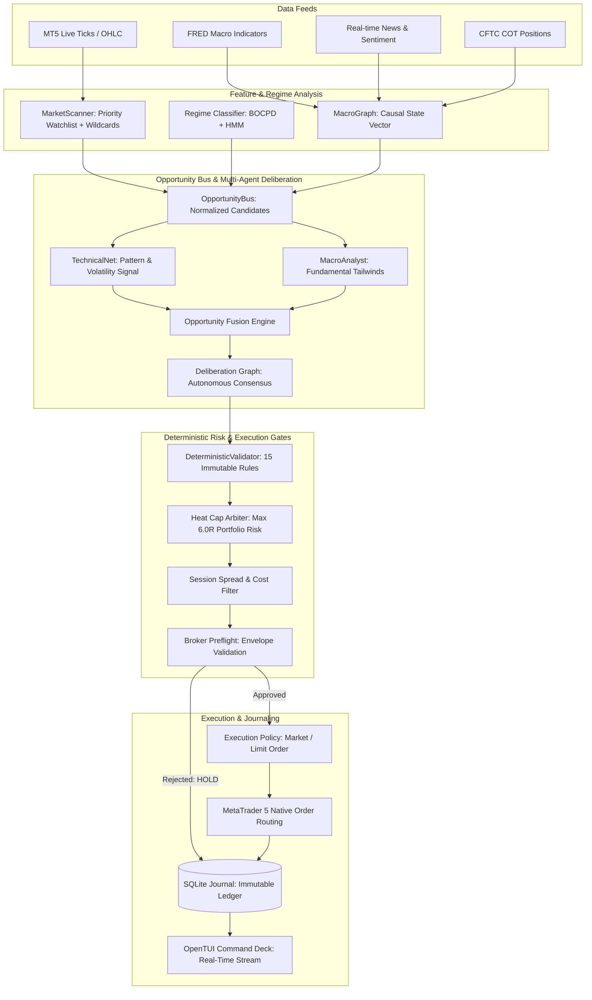

# Steady-State Trading Analysis & Autonomous Execution Workflow

> **Document ID:** `SYS-WORKFLOW-003`  
> **Status:** APPROVED / OPERATIONAL SPECIFICATION  
> **Scope:** Real-time data pipeline, dual-velocity execution engine, multi-agent deliberation graph, deterministic risk gates, and order lifecycle management.

---

## 1. End-to-End Workflow Architecture

The continuous autonomous trading operation runs on a **Dual-Velocity Orchestration Model**:
1. **Fast Lane (1 Hz - 10 Hz)**: Real-time price quotes, dynamic spread monitoring, trailing stop updates, position heat calculation, and emergency stop-loss enforcement.
2. **Slow Lane (15s - 60s Pulse)**: Multi-timeframe bar completion (M15, H1, H4), macro vector compilation, Bayesian Online Changepoint Detection (BOCPD), news sentiment parsing, and opportunity fusion.

---

## 2. Component Specifications & Guardrails

### A. Market Scanner & Watchlist Construction
- **Primary Watchlist (Always Evaluated)**: `XAUUSD`, `EURUSD`, `GBPJPY`.
- **Deterministic Wildcard Pool**:
  - Majors: `GBPUSD`, `USDJPY`, `AUDUSD`, `USDCAD`, `USDCHF`.
  - Crosses: `EURGBP`, `EURJPY`, `AUDJPY`.
  - Indices: `US500`, `DE40`, `USTEC`.
  - Crypto: `BTCUSD`, `ETHUSD`.
- **Selection Policy**: Primary watchlist + first 3 deterministic wildcards. Order is preserved across cycles to guarantee reproducibility.
- **Fail-Closed Guard**: If the broker client is unauthenticated, the scanner returns `[]` (`_fallback_scan()`) rather than fabricating synthetic or delayed quotes.

### B. Mathematical Feature Snapshot & Regime Classification
For every candidate symbol, the engine extracts:
1. **Trend & Momentum**: Exponential Moving Average slope (EMA-50), Moving Average Convergence Divergence (MACD line/signal/histogram), Average Directional Index (ADX-14).
2. **Volatility & Envelopes**: 14-period Average True Range (ATR-14), Bollinger Bands ($\mu \pm 2\sigma$), Realized Volatility over 20 bars.
3. **Microstructure & Orderflow**: Volume-Weighted Average Price (VWAP-20), tick volume ratios, 20-bar Support/Resistance levels, Liquidity Sweep High/Low detection with confirmation candles.
4. **Regime Identification**:
   - `LOW_VOL_TREND`: Strong directional trend with low noise.
   - `LOW_VOL_RANGE`: Mean-reverting consolidation inside Bollinger Bands.
   - `HIGH_VOL_TREND`: Violent momentum expansion (requires wider ATR stops).
   - `HIGH_VOL_CRISIS`: Extreme tail volatility (vetoed for new directional positions).

### C. Deterministic Risk Arbitration (Zero-Bypass Architecture)
Before any trade proposal receives execution authority, it must pass 15 deterministic checks:
1. **Heat Cap Rule**: Portfolio aggregate risk across all open positions must never exceed **$6.0R$** (e.g. $6 \times 1\% = 6\%$ total equity).
2. **Single Trade Risk**: Position size must not risk more than **$1.0\%$** of account equity.
3. **Consecutive Loss Breaker**: If consecutive losses reach 3, single-trade risk is reduced by 50% ($0.5\%$). If 5 losses, trading is halted.
4. **Drawdown Floor**: Peak-to-trough drawdown exceeding 10% triggers automatic risk de-escalation; exceeding 15% triggers immediate emergency halt.
5. **Spread Filter**: Current broker spread must be $\le 3.5 \times$ the 50-period median spread; during rollover sessions, spread multiplier cap is strictly enforced.
6. **Time Stop / Mean Reversion Guard**: Ornstein-Uhlenbeck (OU) process estimates the half-life of mean-reverting positions. If a trade remains stagnant beyond $2.5 \times$ half-life, an exit signal is generated.

### D. Multi-Agent Deliberation & Contract Roles
- **TechnicalNet**: Generates technical trade setups (`trend_pullback_v1`, `breakout_v1`, `mean_reversion_v1`).
- **MacroAnalyst**: Ingests interest rate differentials, yield curve slopes ($10Y - 2Y$), and news shocks.
- **RiskController**: Evaluates portfolio correlation, margin usage, and currency cluster concentration.
- **Supervisor**: Monitors agent health, detects stale heartbeats (> 120s), and orchestrates dead-man switch fail-safes.
- **LearningAgent**: Continuously fits Reinforcement Learning policy weights and updates episodic trading memory.

---

## 3. Order Routing & Lifecycle Management

1. **Proposal Formulation**: A candidate trade is compiled into a `TradeProposal` dataclass containing symbol, direction, entry price, stop-loss, take-profit, setup ID, and risk amount.
2. **Pre-flight Validation**: Envelope parameters are checked against broker symbol specifications (minimum volume, lot step, stops level).
3. **Execution Routing**:
   - In `PAPER` mode: Simulates immediate fill at current bid/ask plus realistic slippage model ($0.5 - 1.5$ pips) and records transaction in `trades` table.
   - In `MICRO` / `LIVE` mode: Sends authenticated order payload via MT5 IPC API with unique Magic Number (`460002`) and comment tag.
4. **Position Monitoring**: Active positions are tracked every second. Trailing stops and target exits are managed autonomously with zero manual intervention required.
