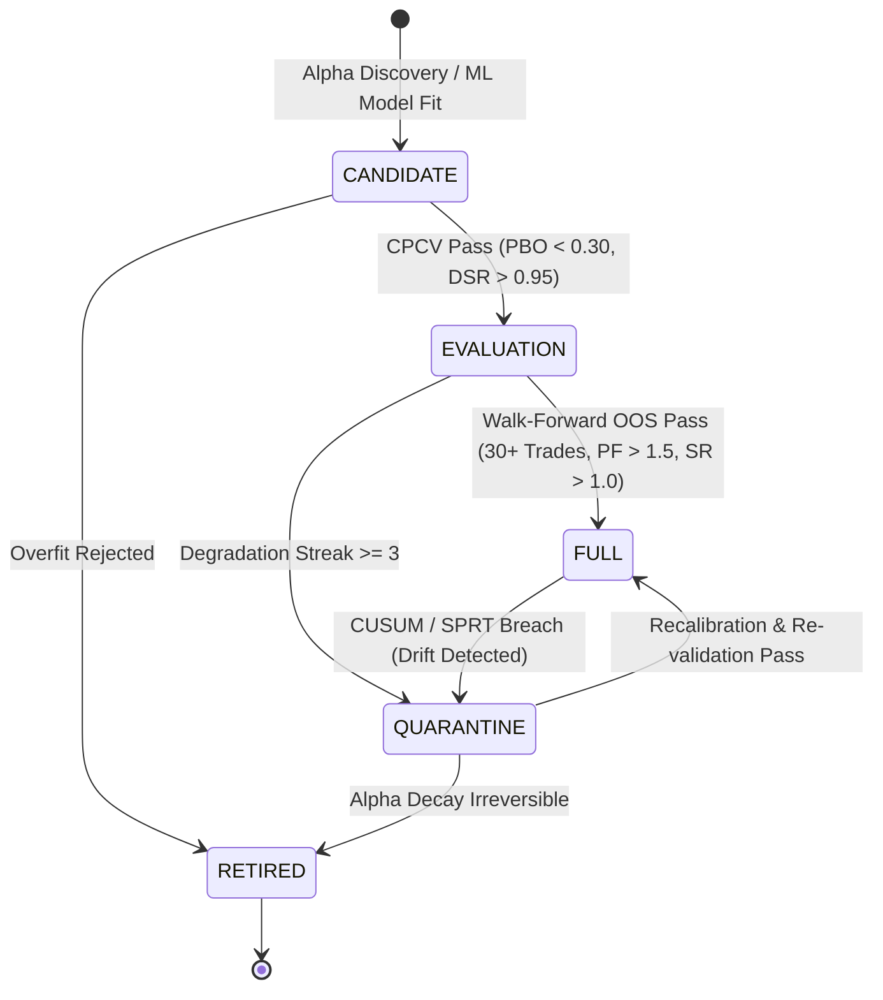

# Autonomous Backtesting & Strategy Testing Engine Specification

> **Document ID:** `SYS-BACKTEST-004`  
> **Status:** APPROVED / QUANTITATIVE SPECIFICATION  
> **Scope:** Combinatorial Purged Cross-Validation (CPCV), Deflated Sharpe Ratio (DSR), Probability of Backtest Overfitting (PBO), Strategy Factory lifecycle, and UI telemetry rendering.

---

## 1. Quantitative Foundation: Institutional Backtesting Framework

Traditional naive backtesting fails due to selection bias, data snooping, and lookahead leakage. This engine incorporates Marcos López de Prado's institutional quantitative protocols:

### A. Combinatorial Purged Cross-Validation (CPCV)
1. **Combinatorial Splitting**: Divides historical return series into $N$ contiguous groups and tests all $\binom{N}{k}$ combinations of test sets.
2. **Purging**: Removes training samples whose return windows overlap with the testing evaluation period to eliminate serial correlation leakage.
3. **Embargoing**: Discards training samples immediately following test sets (typically $1\%$ of sample count) to eliminate autoregressive memory leakage.

### B. Deflated Sharpe Ratio (DSR)
The Deflated Sharpe Ratio adjusts the observed Sharpe Ratio for:
- Non-normality of returns (incorporating skewness $S$ and kurtosis $K$).
- Multiple testing / selection bias across $N_{\text{trials}}$ strategy candidates.
- Sample length estimation (variance of the Sharpe estimate).

$$\text{DSR} = \Phi\left( \frac{(\widehat{SR} - SR^*) \sqrt{T-1}}{\sqrt{1 - \widehat{S}\widehat{SR} + \frac{\widehat{K}-1}{4}\widehat{SR}^2}} \right)$$

Where:
- $\widehat{SR}$ is the estimated annualized Sharpe ratio.
- $SR^*$ is the expected maximum Sharpe under the null hypothesis of no skill:
$$SR^* = \sqrt{2 \ln N_{\text{trials}}} + \frac{\gamma}{\sqrt{2 \ln N_{\text{trials}}}}$$
- If $\text{DSR} < 0.95$, the strategy is rejected as statistically indistinguishable from noise.

### C. Probability of Backtest Overfitting (PBO)
PBO computes the probability that the strategy with the best in-sample performance underperforms the median strategy out-of-sample across all combinatorial cross-validation paths.
- Strategies with $\text{PBO} > 0.30$ are blocked from promotion to live deployment.

---

## 2. Strategy Lifecycle State Machine

Strategies progress through an automated 5-stage lifecycle governed by quantitative validation gates:



### Stage Definitions:
1. **`CANDIDATE`**: Newly formulated quantitative rule or neural predictor. Allowed 0% live risk. Undergoes combinatorial backtesting.
2. **`EVALUATION`**: Cleared CPCV and historical backtesting. Allocated micro-lots or paper trades for forward-testing confirmation.
3. **`FULL`**: Production deployment. Eligible for full sizing up to strategy-level risk cap.
4. **`QUARANTINE`**: Execution immediately halted. Triggered when real-time CUSUM detect significant performance degradation or Sharpe decay.
5. **`RETIRED`**: Archived in strategy registry with full audit trail. Never traded again.

---

## 3. UI Telemetry Integration (`BacktestScreen` & `StrategiesScreen`)

To ensure complete transparency and observability on the OpenTUI interface, backtesting data flows through the following pipeline:

### A. Endpoint Specifications
- **`GET /api/backtests`**:
  - Must aggregate reports from `backtest_report.json` and strategy testing runs.
  - Required JSON schema per item:
    ```json
    {
      "id": "full_pipeline_eurusd",
      "strategyId": "full_pipeline_backtest",
      "period": "M15 (5k bars)",
      "status": "complete",
      "sharpe": 31.82,
      "sortino": 41.33,
      "calmar": 813.4,
      "maxDD": 16.91,
      "totalTrades": 324,
      "winRate": 71.3,
      "profitFactor": 3.53,
      "expectancyR": 0.837,
      "equityCurve": [10000, 10250, ..., 144987],
      "monthlyReturns": [2.4, 3.1, -0.8, 4.2, 5.0, 1.2, 3.8, 2.9, -1.1, 4.5, 3.6, 4.1]
    }
    ```
- **`GET /api/strategy-registry`** (via `/api/snapshot`):
  - Streams the 13 institutional strategies (Kronos-Neural H1, Stat-Arb EUR/CHF, Macro NFP Pullback, Mean-Rev Bollinger, Alpha-055 Orderflow, Agent TWAP/POV RL, etc.) directly into `StrategiesScreen.tsx`.

### B. High-Performance Math Engine (VectorBT & NumPy Fallback)
- When `vectorbt` is installed, backtest loops execute with Numba-accelerated C-level vectorization.
- When `vectorbt` is absent, the engine gracefully falls back to optimized `numpy` arrays, guaranteeing identical Sharpe, Sortino, and Calmar metrics without crashing or stalling the runtime.
